# Einleitung und Grundlagen


::: notes
Mikrocomputertechnik 1 findet an der DHBW, Duale Hochschule Baden-Württemberg, im Studiengang Elektro- und Informationstechnik statt. Diese erste Einheit beginnt ohne Vorwissen aus anderen Vorlesungen dieses Moduls. Benötigt werden die vier Grundrechenarten und die Bereitschaft, einfache Tabellen schrittweise auszuwerten. Zahlendarstellung, Logikgatter, Register und Speicher werden hier eingeführt. Eine Programmiersprache oder ein Simulatorlauf ist dafür noch keine Voraussetzung.

Die Leitfrage lautet: Wie werden Zahlen durch Bits dargestellt, verarbeitet und für den nächsten Schritt gespeichert? Wir verfolgen kleine, vollständig benannte Beispiele. Die Folien zeigen die Struktur und die wichtigsten Ergebnisse; die Notizen erklären Herleitung, Begriffe und typische Verwechslungen als begleitender Lerntext. Spätere Einheiten benutzen diese Bausteine für Maschinenbefehle und Programme. Die heutigen Zeichnungen sind Lehrmodelle, keine behauptete Messung eines realen Chips.
:::

## Was Sie nach dieser Einheit können sollen

- Eine Zahl als Binär- und Hexadezimalmuster darstellen
- Dasselbe Muster vorzeichenlos und als Zweierkomplement lesen
- Bytes eines Datenworts auf Adressen verteilen
- Eine Auswahl und eine Addition mit Logik erklären
- Eine Registerübernahme mit Flanke und Schreibfreigabe vorhersagen

::: notes
Die Ziele folgen dem Datenfluss: Erst steht fest, was ein Muster bedeutet. Dann wählen und verknüpfen Schaltungen die Daten. Zuletzt übernimmt ein Speicherbaustein das Ergebnis. Vorhersagen heißt, aus gegebenen Eingängen und einem Anfangszustand ein begründetes Ergebnis zu bestimmen.

Binär verwendet die Basis zwei, hexadezimal die Basis sechzehn. Das Zweierkomplement ist die hier eingeführte Darstellung vorzeichenbehafteter Ganzzahlen. Eine Adresse benennt eine Speicherstelle und ist von deren Inhalt zu unterscheiden. Eine Flanke ist ein Übergang des Taktsignals, die Schreibfreigabe erlaubt die Übernahme. Jede dieser Größen wird vor ihrer ersten Rechenaufgabe erklärt. In der Übung finden Sie passende Papieraufgaben und in der Musterlösung die Rechenwege. Das Quiz prüft anschließend Entscheidungen und typische Verwechslungen.
:::

## Einordnung in das Modul

| Einheiten | Schwerpunkt |
|---|---|
| 1 | Darstellung, Logik, Register und Speicher |
| 2–4 | Maschinenbefehle, Speicherzugriff, Funktionen |
| 5–7 | Datenpfad, Steuerwerk und Pipeline |
| 8–9 | Ein-/Ausgabe und Verbindung zu C |

Geplant sind neun Einheiten zu jeweils vier Unterrichtseinheiten.

::: notes
Mikrocomputertechnik 1 verbindet Digitaltechnik mit der softwareseitig sichtbaren Maschine. Die neun Einheiten des Kursplans haben jeweils vier Unterrichtseinheiten, zusammen 36. Diese Tabelle ordnet die Themen; sie ist keine Festlegung der konkreten Klausuraufgaben oder Hilfsmittel.

Ein Datenpfad verbindet Bausteine, die Werte lesen, auswählen, berechnen und speichern. Das Steuerwerk bestimmt ihre Aktionen. Eine Pipeline lässt mehrere Befehle zeitlich überlappen und wird erst später benötigt. Ein-/Ausgabe verbindet Programme mit Geräten. C ist die höhere Programmiersprache, deren Verbindung zur Maschine die letzte Einheit betrachtet. Heute bauen wir die Voraussetzungen für diese Themen auf. Wer einen Registerzustand und einen Rechenweg erklären kann, kann in Einheit 2 nachvollziehen, was ein Maschinenbefehl verändert.
:::

## Literatur und Werkzeuge

Sarah L. Harris, David Money Harris:

*Digital Design and Computer Architecture — RISC-V Edition*

- Vertiefung: Patterson / Hennessy, *Computer Organization and Design*
- Venus: Maschinenbefehle und Registerwerte
- Ripes: visueller Datenpfad und Prozessormodelle
- Werkzeugkette: Quelltext übersetzen und Programme verbinden

::: notes
Die zentrale Literatur von Sarah L. Harris und David Money Harris erklärt den Aufbau von der Digitaltechnik zur Rechnerarchitektur. David A. Patterson und John L. Hennessy ergänzen die Verbindung zwischen Software und Hardware. Die Notizen dieser Einheit enthalten die nötigen Begriffe und Rechnungen; konkrete Buchseiten werden nicht vorausgesetzt.

Venus und Ripes sind Simulatoren: Sie führen ein Modell aus. Venus dient später zum Übersetzen und schrittweisen Prüfen von Assemblertext. Assemblertext ist die symbolische Schreibweise von Maschinenbefehlen; das Werkzeug Assembler codiert sie. Ripes zeigt zusätzlich Verbindungen und Zustandsänderungen eines gewählten Prozessormodells. Eine Werkzeugkette verbindet beispielsweise Compiler, Assembler und Linker. Der Compiler übersetzt eine höhere Sprache, der Linker verbindet Programmteile. Ein Simulatorschritt ist keine gemessene Chipzeit. Heute sind die Papiermodelle ausreichend; ein vorbereiteter Ripes-Versuch ist eine optionale Ergänzung.
:::

## Unser Modell ausdrücklich festlegen

- RISC-V-Basis RV32I: 32-Bit-Ganzzahlregister
- Ein Byte: acht Bit; ein RISC-V-Word: 32 Bit
- Kursumgebung: byteadressierter Speicher, Little Endian
- Registermodell: Übernahme an der steigenden Flanke
- Beispiele mit vier oder acht Bit sind verkleinerte Rechenmodelle

::: notes
RISC-V ist die hier verwendete Befehlssatzarchitektur. RV32I bezeichnet ihre 32-Bit-Ganzzahlbasis. Ein Architekturregister ist ein von einem Programm benennbarer kleiner Speicherplatz. Die Bedeutung des Registers und seine konkrete Innenschaltung sind unterschiedliche Fragen.

Ein Bit ist eine Binary Digit, also eine binäre Ziffer mit den Werten null oder eins. Acht Bit bilden ein Byte, 32 Bit hier ein RISC-V-Word. Byteadressierung bedeutet, dass eine Adresse ein Byte bezeichnet. Little Endian ist die gewählte Zuordnung der Bytes eines Mehrbytewerts zu Adressen; wir leiten sie später her. Die steigende Taktflanke ist die Übernahmebedingung unseres Registermodells, keine Vorschrift des RISC-V-Befehlssatzes. Kleine vier- und achtbittige Beispiele machen Rechnungen sichtbar. Ihre Grenzen dürfen nicht mit der 32-Bit-Breite der Kursmaschine verwechselt werden.
:::

# 1. Modelle und Schnittstellen


::: notes
Ein Computer besteht aus sehr vielen zusammenwirkenden Bauteilen. Für den Einstieg wählen wir Modelle, deren Eingänge, Ausgänge und Voraussetzungen vollständig beschrieben werden können. Eine Schnittstelle legt fest, welche Größen ein Baustein erhält und welche Wirkung er zusichert.

Wir beginnen mit einer vertrauten Addition. Ihr mathematisches Ergebnis kann beschrieben werden, ohne die Transistoren zu kennen. Danach fragen wir, welche Teile der Umsetzung für Zahlendarstellung, Rechenweg oder Speicherung wichtig werden. Abstraktion heißt deshalb nicht, beliebige Eigenschaften zu vergessen. Sie heißt, die für die aktuelle Frage nötigen Eigenschaften ausdrücklich zu behalten. Diese Unterscheidung begleitet die späteren Hardware- und Softwaremodelle.
:::

## Eine Rechnung als Schnittstelle

$$A=5,\qquad B=3,\qquad Y=A+B=8$$

| Sicht | Was wird beschrieben? |
|---|---|
| Verhalten | Ergebnis für benannte Eingaben |
| Umsetzung | Bausteine, die das Ergebnis erzeugen |
| Speicherung | Wann und wo das Ergebnis erhalten bleibt |

::: notes
A und B sind die Eingabewerte, Y ist das berechnete Ergebnis. Die mathematische Addition von fünf und drei liefert acht. Diese Aussage beschreibt das Verhalten, noch nicht eine konkrete Schaltung. Eine Umsetzung könnte einen Addierer aus Logikgattern verwenden. Ein Logikgatter ist ein Baustein, der aus logischen Eingangswerten einen logischen Ausgangswert berechnet.

Die Speicherung ist eine weitere Aufgabe. Ein Rechenbaustein allein bewahrt acht nicht automatisch auf, wenn seine Eingänge sich ändern. Ein Register kann einen Wert bis zur nächsten erlaubten Übernahme halten. Auch ein korrektes Verhalten gilt unter Voraussetzungen, beispielsweise einer ausreichenden Bitbreite und einer zulässigen Zeit bis zum gültigen Ausgang. Die Aufteilung verhindert, dass wir eine mathematische Gleichung mit einer zeitlosen Hardwarewirkung oder einer Speicheroperation verwechseln.
:::

## Abstraktion: Der Vertrag bleibt sichtbar

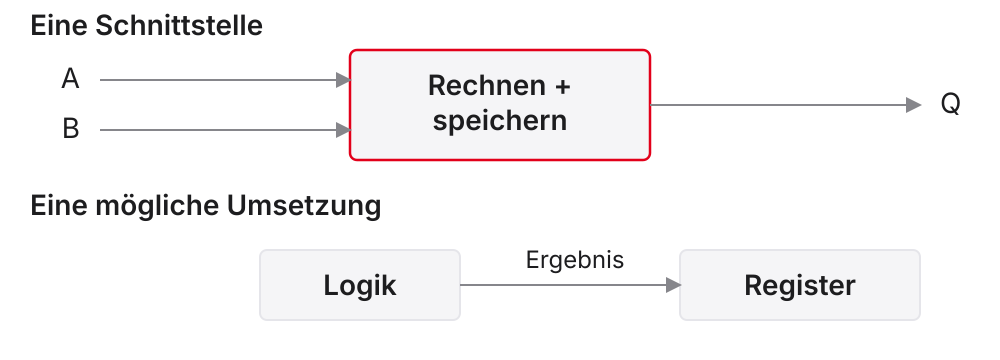{width=90% fig-alt="Eine Addiererschnittstelle zeigt Operanden und Ergebnis, eine Detailansicht zeigt Logik und Register"}

Details ausblenden, Voraussetzungen und Wirkung erhalten.

::: notes
Abstraktion bedeutet, eine Aufgabe über eine begrenzte Schnittstelle zu beschreiben. In der oberen Zeichnung erhält der Baustein A und B und stellt das gespeicherte Ergebnis Q bereit. Der Vertrag umfasst Verarbeitung und eine erlaubte Übernahme. Die untere Ansicht ergänzt Logik und einen gespeicherten Zustand. Die grauen Pfeile zeigen den Datenfluss, die rote Kontur markiert den Baustein, dessen Verhalten betrachtet wird. Beide Ansichten beschreiben dieselbe Aufgabe auf unterschiedlichen Detailstufen; die unteren Kästen sind keine zusätzlichen Zeitschritte der oberen Rechnung.

Ein Addierer kann als Black Box, also als Baustein mit bekanntem äußeren Verhalten, benutzt werden. Zur Schnittstelle gehört trotzdem, welche Wortbreite verarbeitet wird und wann das Ergebnis gültig ist. Bei einer späteren Registerübernahme wird gerade diese Zeit wichtig. Die Abstraktion spart die Erklärung jeder einzelnen Transistorverbindung, ohne Breite, Bedeutung oder Übernahmebedingungen aus dem Vertrag zu entfernen.
:::

## Befehlssatz und Umsetzung unterscheiden

- ISA: Wirkung, die ein Maschinenbefehl zusichert
- Mikroarchitektur: konkrete Umsetzung dieser Wirkung
- Derselbe Befehlssatz kann verschiedene Datenpfade haben
- Positive Registerflanke: Eigenschaft unseres Lehrmodells

::: notes
ISA bedeutet Instruction Set Architecture, auf Deutsch Befehlssatzarchitektur. Sie beschreibt das für ein Programm sichtbare Verhalten, zum Beispiel welche Register eine Addition liest und wohin das Ergebnis geschrieben wird. Die Mikroarchitektur ist eine konkrete Hardwareumsetzung dieser Schnittstelle, etwa mit einem bestimmten Addierer und einem bestimmten Ablauf über Takte.

Zwei Prozessoren können deshalb denselben Befehlssatz ausführen und unterschiedliche Laufzeiten oder Schaltungen besitzen. Unser Modell mit Übernahme an der positiven, also steigenden, Flanke erklärt eine mögliche Umsetzung. Daraus folgt keine allgemeine Flankenvorschrift der ISA. Zunächst benötigen wir noch keine Befehlscodierung. Wir halten nur fest, welche Ebene eine Aussage betrifft. Um die genannten Registerwerte überhaupt zu verstehen, müssen wir als Nächstes ihre Darstellung durch Bits erklären.
:::

# 2. Bits und Zahlendarstellung


::: notes
Eine Zahl wie fünf steht nicht als Dezimalzeichen in einem Register. Sie wird durch ein Bitmuster repräsentiert. Die Zuordnung zwischen Muster und Zahl folgt einer vereinbarten Regel und einer festgelegten Breite.

Dieser Abschnitt führt Bits, Bytegruppen, Stellenwerte und die kompakte Hexadezimalschreibweise ein. Wir verwenden zunächst vorzeichenlose Zahlen, deren Bits nur positive Gewichte haben. Danach bleibt dasselbe Muster bestehen, bekommt aber für negative Zahlen eine andere Interpretation. Die Trennung von Muster, Schreibweise und Bedeutung ist besonders wichtig: Ein Wechsel von Binär zu Hex verändert keine Bits, ein Wechsel der Interpretation kann dagegen einen anderen Zahlenwert ergeben.
:::

## Vom physikalischen Signal zum logischen Bit

- Das digitale Modell verwendet die Werte 0 und 1
- Ein Bauteil ordnet zulässige Pegelbereiche diesen Werten zu
- Ein hoher Pegel ist ein Bereich, keine universelle Spannung
- Rechnen mit Bits abstrahiert die physikalische Umsetzung

::: notes
Bit bedeutet Binary Digit, eine binäre Ziffer. Im digitalen Modell sind null und eins eindeutig. Ein realer Draht trägt dagegen einen physikalischen Zustand, beispielsweise eine Spannung. Eine konkrete Bauteilschnittstelle legt fest, welche Bereiche als niedriger oder hoher Pegel gelten und welche Bereiche nicht als gültiger Eingang zugesichert sind.

Deshalb ist eine bestimmte Spannung wie 3,3 Volt keine universelle logische Eins für alle Systeme. Wir rechnen hier mit den logischen Werten und setzen passende, stabile Eingänge voraus. Diese Abstraktion beschreibt die Funktion einer Schaltung, ohne einen ungenannten Spannungsstandard zu behaupten. Wenn später Zeitbedingungen betrachtet werden, kommt wieder eine Eigenschaft der realen Umsetzung hinzu. Zunächst gruppieren wir die Bits und geben ihren Positionen mathematische Gewichte.
:::

## Bit, Nibble, Byte und Word

| Gruppe | Breite | Hexziffern |
|---|---:|---:|
| Bit | 1 | – |
| Nibble | 4 Bit | 1 |
| Byte | 8 Bit | 2 |
| RISC-V-Word | 32 Bit | 8 |

Ein Register unserer RV32I-Kursmaschine hält ein Word.

::: notes
Ein Bit, Binary Digit, hat zwei mögliche Werte. Ein Nibble ist eine Gruppe von vier Bit und ein Byte eine Gruppe von acht Bit. Die Bezeichnung Word ist architekturabhängig; im RISC-V-Befehlssatz bezeichnet sie 32 Bit. Vier Byte bilden daher ein RISC-V-Word. Hexziffern sind die Ziffern der Basis sechzehn; ihre Zuordnung zu Vierergruppen folgt auf den nächsten Folien.

RV32I ist die 32-Bit-Ganzzahlbasis unserer Kursmaschine. Ihre allgemeinen Register sind 32 Bit breit. Das ist eine Festlegung der betrachteten Architektur und keine allgemeine Definition jedes Registers. Auch bei einem RISC-V-Modell mit 64-Bit-Registern bleibt ein Word 32 Bit; 64 Bit heißen dort Doubleword. Eine Breite bezeichnet die Zahl der Bits und liefert für sich allein keine Aussage über die Anzahl der Ausführungstakte.
:::

## Binär: Jede Position hat ein Gewicht

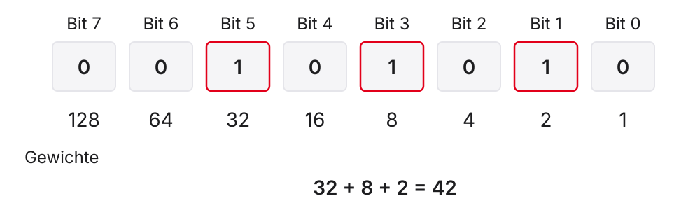{width=94% fig-alt="Acht Bit von 00101010 mit ihren Stellengewichten ergeben 42"}

$$N=\sum_{i=0}^{n-1} b_i\,2^i$$

::: notes
N ist der vorzeichenlose Zahlenwert, n die Anzahl der Bits und b_i der Wert null oder eins an Position i. Das Summenzeichen addiert die Beiträge aller Positionen von null bis n minus eins. Eine Zweierpotenz entsteht durch wiederholtes Verdoppeln; die Potenz zwei hoch null ist eins. Rechts beginnt Position null mit Gewicht eins. Jede Position links davon verdoppelt das Gewicht. Für acht Bit sind das von rechts eins, zwei, vier, acht, sechzehn, 32, 64 und 128.

Die Zeichnung zeigt 00101010. Rot markierte Zellen sind gesetzte Bits; die grauen Zellen enthalten null. Die gesetzten Positionen haben die Gewichte 32, acht und zwei. Ihre Summe ist 42. Die Beschriftung wird von der höchsten Position links zur niedrigsten rechts gelesen. Führende Nullen erhalten die ausdrücklich gewählte Breite, tragen aber zum vorzeichenlosen Wert nichts bei. Bei n Bits sind damit die Werte von null bis $2^n-1$ möglich. Für acht Bit reicht dieser Bereich von null bis 255.
:::

## Hexadezimal verkürzt die Schreibweise

$$16=2^4$$

| Hexziffer | Binärgruppe | Dezimalwert |
|---|---|---:|
| 0 | `0000` | 0 |
| 5 | `0101` | 5 |
| A | `1010` | 10 |
| F | `1111` | 15 |

Eine Hexziffer beschreibt genau vier Bit.

::: notes
Hexadezimal verwendet die Basis sechzehn. Die Ziffern null bis neun haben ihre üblichen Werte, A bis F stehen für zehn bis fünfzehn. Weil sechzehn gleich zwei hoch vier ist, passt genau eine Hexziffer zu einer Vier-Bit-Gruppe, einem Nibble. Die Tabelle zeigt vier Beispiele dieser eindeutigen Zuordnung.

Beim Umrechnen bleibt das Bitmuster unverändert. Aus 0010 1010 werden die Ziffern zwei und A, also 0x2A. Das Präfix 0x kennzeichnet hier die Hexadezimalschreibweise. Als Stellenwertrechnung ist das zweimal sechzehn plus zehn, also 42. Ein Byte besitzt zwei Nibbles und deshalb zwei Hexziffern. Ein 32-Bit-Wort besitzt acht Hexziffern. Hex ist eine lesbare Darstellung derselben Daten, keine zusätzliche Rechenart der Hardware.
:::

## Umrechnen: Gruppen in derselben Reihenfolge

$$42_{10}=0010\,1010_2=\mathtt{0x2A}$$

```text
1101  1010  0011  1111
 D     A     3     F
```

Aufgabe: Welcher Hexwert entsteht, und wie viele Bit sind gezeigt?

::: notes
Die Indizes zehn und zwei kennzeichnen Dezimal- und Binärdarstellung. Die obere Gleichung stellt denselben Wert 42 mit acht Bit dar. Bei der zweiten Folge werden die Bits von rechts in Vierergruppen geteilt. Jede Gruppe erhält ihre Hexziffer, und die Reihenfolge der Gruppen bleibt erhalten.

1101 hat den Wert dreizehn und wird D. 1010 ist zehn und wird A. 0011 ist drei, 1111 ist fünfzehn. Das Ergebnis lautet 0xDA3F und enthält vier Gruppen zu je vier Bit, also sechzehn Bit. Es ist nicht 0xF3AD; eine Umrechnung dreht die Gruppen nicht um. Erst eine ausdrücklich vereinbarte Byteordnung betrifft die Verteilung in einem Speicher. Eine zu kurze vorzeichenlose Darstellung darf links mit Nullen ergänzt werden. Das ist von der späteren Vorzeichenerweiterung zu unterscheiden.
:::

## Ein Muster, mehrere Bedeutungen

Das 8-Bit-Muster `0100 0001`:

| Interpretation | Bedeutung |
|---|---|
| Vorzeichenlose Zahl | 65 |
| ASCII-Zeichencodierung | Zeichen A |
| Maschinenbefehl | Nur mit passendem Format und gültiger Codierung |

Der Kontext legt die Interpretation fest.

::: notes
Ein Bitmuster enthält für sich genommen keine Information darüber, ob es als Zahl, Zeichen oder Teil eines Befehls verwendet wird. Vorzeichenlos hat 01000001 den Wert 64 plus eins, also 65. ASCII bedeutet American Standard Code for Information Interchange und ist eine Zeichencodierung; darin bezeichnet dieses Muster den Buchstaben A.

Ein Maschinenbefehl benötigt zusätzlich eine passende Länge und ein gültiges Format der Befehlssatzarchitektur. Das Vorliegen von Bits allein macht das Muster nicht automatisch zu einem zulässigen Befehl. Auch Hexadezimal ist keine weitere Bedeutung, sondern nur eine andere Schreibweise: 01000001 lässt sich als 0x41 schreiben. Diese Unterscheidung hilft später beim Lesen von Registern und Speichertabellen. Wir ändern nun die Zahleninterpretation, damit dieselbe endliche Breite auch negative Werte ausdrücken kann.
:::

# 3. Negative Zahlen und feste Breite


::: notes
Bisher haben alle Bits positive Stellengewichte. Für negative Ganzzahlen wird eine andere Codierung benötigt. Signed bedeutet vorzeichenbehaftet, unsigned vorzeichenlos. Beide Begriffe beschreiben eine Interpretation, keine unterschiedlichen Arten elektrischer Bits.

Wir legen vor jeder Aufgabe die Bitbreite fest. Ohne diese Angabe ist weder der Wertebereich noch die Bildung einer negativen Darstellung eindeutig. Die vorzeichenlose Acht-Bit-Zahl 251 und die vorzeichenbehaftete Zahl minus fünf werden beispielsweise durch dasselbe Muster repräsentiert. Die folgenden Beispiele erklären, warum das Zweierkomplement zur Addition mit endlicher Wortbreite passt und welche Grenzen diese Darstellung besitzt.
:::

## Eine Alternative: Vorzeichen und Betrag

4-Bit-Sign-Magnitude: erstes Bit Vorzeichen, drei Bits Betrag.

| Muster | Wert |
|---|---:|
| `0101` | $+5$ |
| `1101` | $-5$ |
| `0000` | $0$ |
| `1000` | $0$ |

Zwei Muster können denselben Zahlenwert darstellen.

::: notes
Sign-Magnitude heißt Vorzeichen und Betrag. Bei der hier angenommenen Vier-Bit-Codierung enthält das linke Bit das Vorzeichen: null für einen nichtnegativen, eins für einen negativen Wert. Die übrigen drei Bit bilden den Betrag. 0101 bezeichnet daher plus fünf, 1101 minus fünf. Diese Codierung ist eine Vergleichsidee und nicht die Ganzzahldarstellung unserer Kursmaschine.

Für den Betrag null gibt es zwei Muster, 0000 und 1000. Ein Vergleich der Bits unterscheidet sie, ein Vergleich ihrer numerischen Bedeutung ergibt Gleichheit. Drei Betragsbits erlauben die Werte null bis sieben; der gesamte Zahlenbereich reicht von minus sieben bis plus sieben. Diese Darstellung macht die Vorzeichenidee anschaulich, verlangt bei Addition aber eine Unterscheidung zwischen Vorzeichen und Betrag. Das Zweierkomplement verwendet stattdessen eine andere Gewichtung der Bits.
:::

## Zweierkomplement: Das höchste Bit zählt negativ

$$N=-b_{n-1}\,2^{n-1}+\sum_{i=0}^{n-2} b_i\,2^i$$

Für acht Bit:

$$1111\,1011_2=-128+64+32+16+8+2+1=-5$$

Vorzeichenlos bedeutet dasselbe Muster 251.

::: notes
N ist der vorzeichenbehaftete Zahlenwert, n die Bitbreite und b_i das Bit an Position i. Das höchste Bit an Position n minus eins erhält ein negatives Gewicht. Das Summenzeichen fasst die unteren n minus eins Beiträge zusammen. Die übrigen Bits behalten ihre positiven Zweierpotenzen. Bei acht Bit ist das höchste Gewicht minus 128.

Für 11111011 sind die Gewichte minus 128, 64, 32, sechzehn, acht, zwei und eins gesetzt. Sie ergeben minus fünf. Ohne negative Gewichtung wäre das Muster vorzeichenlos 251. Das höchste Bit ist hier also nicht nur ein separat abtrennbares Vorzeichen, sondern Teil der Wertberechnung. Bei n Bits reicht der Zweierkomplementbereich von $-2^{n-1}$ bis $2^{n-1}-1$. Für acht Bit sind das minus 128 bis plus 127. Nur das Nullmuster repräsentiert null. Diese Gewichtung passt zur modularen Addition, die wir beim Addierer wieder aufgreifen.
:::

## Aus plus fünf wird minus fünf

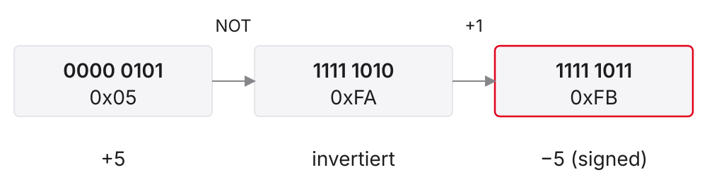{width=94% fig-alt="00000101 wird durch Invertieren zu 11111010 und durch Addition eins zu 11111011"}

Breite festlegen → alle Bits invertieren → eins addieren.

::: notes
Die Abbildung zeigt eine Rechnung mit genau acht Bit. Zuerst steht plus fünf als 00000101 beziehungsweise 0x05. NOT bedeutet Negation; Invertieren ersetzt jede null durch eins und jede eins durch null. Daraus entsteht 11111010 beziehungsweise 0xFA. Nach Addition eins lautet das Muster 11111011 beziehungsweise 0xFB und stellt als Acht-Bit-Zweierkomplement minus fünf dar.

Die Pfeile zeigen die Rechenschritte von links nach rechts; der rote Rahmen markiert das endgültige negative Muster. Wird beim Addieren ein Bit oberhalb der gewählten Breite erzeugt, bleibt für die modulare Rechnung nur der untere Acht-Bit-Teil. Derselbe Ablauf aus Invertieren und Addition eins negiert auch ein bereits negatives Muster: 0xFB wird über 0x04 wieder zu 0x05. Die Zahl kann nur dann als mathematisches Gegenstück interpretiert werden, wenn dieses im gewählten vorzeichenbehafteten Bereich darstellbar ist.
:::

## Die Grenze: Der kleinste Wert hat kein positives Gegenstück

Acht-Bit-Zweierkomplement:

$$-128\leq N\leq127$$

```text
1000 0000  (-128)
0111 1111  (invertiert)
1000 0000  (plus eins)
```

Modulare Negation liefert wieder dasselbe Muster.

::: notes
Die Breite von acht Bit liefert 256 Muster, aber der vorzeichenbehaftete Bereich ist nicht symmetrisch um null. Es gibt minus 128, jedoch kein plus 128. Wird 10000000 invertiert, entsteht 01111111; nach Addition eins steht erneut 10000000. Als Bitoperation ist der Ablauf definiert, als Darstellung des positiven mathematischen Gegenstücks ist das Ergebnis ungeeignet.

Zweimalige modulare Negation stellt für jedes Muster das ursprüngliche Muster wieder her, auch für diesen kleinsten Wert. Hier bleibt es sogar nach einem einzelnen Schritt unverändert. Die Grenze ist die fehlende Darstellbarkeit von plus 128, keine Ausnahme von der Rückkehr nach zweimaliger Bitoperation. Allgemein sollte vor einer Rechnung geprüft werden, ob das gewünschte mathematische Ergebnis in die gewählte Breite passt. Das betrifft auch Additionen am Rand des Wertebereichs.
:::

## Übertrag und vorzeichenbehafteter Überlauf

Acht Bit bleiben gespeichert.

| Rechnung | Ergebnisbits | Übertrag | Signed-Überlauf |
|---|---|---:|---|
| `0x7F + 1` | `0x80` | 0 | Ja: $127+1$ |
| `0xFF + 1` | `0x00` | 1 | Nein: $-1+1$ |

Übertrag und Signed-Überlauf sind verschiedene Aussagen.

::: notes
Ein Übertrag, englisch Carry, ist das zusätzliche Bit oberhalb der gespeicherten Breite. Signed-Überlauf bedeutet dagegen, dass das mathematische Ergebnis nicht in den vorzeichenbehafteten Bereich passt. Signed heißt vorzeichenbehaftet. Für acht Bit reicht dieser Bereich von minus 128 bis plus 127.

0x7F plus eins ergibt 0x80 ohne zusätzlichen Übertrag. Vorzeichenbehaftet wäre das mathematische Ergebnis 128, das nicht darstellbar ist; die Bits werden als minus 128 gelesen. 0xFF plus eins erzeugt dagegen einen Übertrag und unten acht Nullen. Vorzeichenbehaftet ist dies minus eins plus eins gleich null, also ohne Signed-Überlauf. Der 32-Bit-Ganzzahlbefehl unseres RISC-V-Modells liefert entsprechend die unteren 32 Bits und löst dadurch keinen automatischen Ausnahmefall wegen Überlauf aus. C ist eine höhere Programmiersprache. Dort ist für vorzeichenbehafteten Überlauf keine definierte Wirkung der Sprachrechnung zugesichert; die Bitregel des Maschinenmodells ersetzt diese Sprachregeln nicht. Heute ist die wichtige Entscheidung, Carry und Darstellbarkeit getrennt zu prüfen.
:::

## Breiter speichern: Vorzeichen oder Nullen erweitern

| 8-Bit-Muster | Erweiterung auf 32 Bit | Erhaltener Wert |
|---|---|---:|
| `0xFB` | `0xFFFFFFFB` | $-5$, Zweierkomplement |
| `0xFB` | `0x000000FB` | $251$, vorzeichenlos |

Die Interpretation bestimmt die passende Erweiterung.

::: notes
Vorzeichenerweiterung, englisch Sign Extension, kopiert das höchste Bit in die neu hinzugefügten Stellen. Für das Acht-Bit-Zweierkomplement 0xFB ist dieses Bit eins. Die oberen 24 Bit werden daher eins, das 32-Bit-Muster lautet 0xFFFFFFFB und repräsentiert weiterhin minus fünf.

Nullerweiterung, englisch Zero Extension, füllt die neuen Stellen dagegen mit Nullen. Das Ergebnis 0x000000FB hat den vorzeichenlosen Wert 251. Beide Rechnungen vergrößern die Breite, erhalten aber unterschiedliche Interpretationen des Ausgangsmusters. Bei einem nichtnegativen Muster wie 0x05 stimmen die beiden Erweiterungen überein, weil das höchste Ausgangsbit null ist. Die oberen Stellen dürfen deshalb nicht beliebig gefüllt werden. Führende Nullen zur lesbaren Gruppierung einer vorzeichenlosen Zahl sind eine andere Entscheidung als das Erhalten einer negativen Zweierkomplementzahl.
:::

## Kurzaufgabe: 85 und minus 85

1. Stellen Sie 85 mit acht Bit und zwei Hexziffern dar.
2. Bilden Sie das Acht-Bit-Zweierkomplement von $-85$.
3. Welchen vorzeichenlosen Wert hat dessen Muster?

Prüfen Sie zuerst, ob beide vorzeichenbehafteten Werte darstellbar sind.

::: notes
Die Aufgabe verbindet Stellenwertrechnung, Hexgruppierung und Interpretation. Der Acht-Bit-Zweierkomplementbereich reicht von minus 128 bis plus 127, daher passen plus 85 und minus 85 hinein. 85 zerfällt in 64 plus sechzehn plus vier plus eins. Die acht Bits sind 01010101, gruppiert 0101 0101 und hexadezimal 0x55.

Für minus 85 werden alle acht Bits invertiert: 10101010 beziehungsweise 0xAA. Nach Addition eins entsteht 10101011 beziehungsweise 0xAB. Vorzeichenbehaftet hat dieses Muster den Wert minus 128 plus 32 plus acht plus zwei plus eins, also minus 85. Vorzeichenlos werden dieselben Bits als 128 plus 32 plus acht plus zwei plus eins gleich 171 gelesen. Die Kontrolle lautet 256 minus 85 gleich 171. Eine korrekte Antwort nennt daher Muster, Breite und Interpretation zusammen.
:::

# 4. Bytes und Adressen


::: notes
In einem Register betrachten wir bisher ein ganzes Wort. Im byteadressierten Speicher werden seine Bytes auf mehrere aufeinanderfolgende Stellen verteilt. Eine Adresse benennt dabei eine Stelle; sie ist weder deren Inhalt noch eine Registernummer.

Wir führen zuerst das Adressmodell ein und ordnen anschließend die Bytes eines konkreten Worts zu. Die Byteordnung legt fest, welches Byte an der kleinsten Adresse liegt. Eine andere Frage ist die Ausrichtung der Startadresse zur Zugriffsbreite. Beide Begriffe werden getrennt erklärt, damit ein korrekt geordnetes Wort nicht automatisch als passend ausgerichtet verstanden wird.
:::

## Adresse und Inhalt sind verschiedene Größen

| Adresse | Beispielinhalt eines Bytes |
|---|---|
| `0x1000` | `0x78` |
| `0x1001` | `0x56` |
| `0x1002` | `0x34` |
| `0x1003` | `0x12` |

Eine Adresse weiter → ein Byte weiter.

::: notes
Eine Adresse ist die Nummer einer Speicherstelle. Byteadressierung bedeutet, dass zwei aufeinanderfolgende Adressen zwei benachbarte Bytes auswählen. Ein Byte besteht aus acht Bit und wird mit zwei Hexziffern dargestellt. Die Tabelle ist ein angenommenes Speicherbild, keine Beobachtung eines Simulatorlaufs.

An der Adresse 0x1000 steht hier der Inhalt 0x78. Die Adresse ist also nicht selbst das gespeicherte Byte. Die folgenden Stellen haben die Adressen 0x1001 bis 0x1003. Die Inhalte sind vier Teile eines 32-Bit-Werts, deren Ordnung gleich erläutert wird. Eine Registernummer wie x5 gehört dagegen zu einer anderen Schnittstelle und bezeichnet nicht die Speicheradresse fünf. Auch eine Adressierbarkeit in einzelnen Bytes bedeutet nicht, dass ein realer Speichertransfer immer genau ein Byte groß sein muss.
:::

## Adressraum ist keine Aussage über eingebauten Speicher

$$2^{32}\text{ Byte}=4\text{ GiB}=4\,294\,967\,296\text{ Byte}$$

| Einheit | Anzahl Byte |
|---|---:|
| kB | $10^3$ |
| KiB | $2^{10}$ |
| GB | $10^9$ |
| GiB | $2^{30}$ |

Ein Adresswert muss nicht zu eingebautem oder zugreifbarem RAM gehören.

::: notes
Im betrachteten 32-Bit-Byteadressmodell gibt es zwei hoch 32 mögliche Adresswerte, von null bis zwei hoch 32 minus eins. Jeder bezeichnet ein Byte; der gesamte Adressraum umfasst daher vier GiB. GiB bedeutet Gibibyte und ist zwei hoch 30 Byte. GB bedeutet Gigabyte und verwendet die Dezimalbasis zehn hoch neun. kB steht für Kilobyte mit 1000 Byte, KiB für Kibibyte mit 1024 Byte.

RAM heißt Random Access Memory und bezeichnet hier den Arbeitsspeicher. Die Zahl möglicher Adressen sagt nicht, wie viel RAM eingebaut ist. Bereiche können fehlen, anderen Funktionen zugeordnet oder für einen bestimmten Zugriff unzugänglich sein. Auch Bit und Byte dürfen nicht vertauscht werden: Ein großes B bezeichnet Byte, ein kleines b üblicherweise Bit. Die genannte Adressraumgröße ist eine Rechnung des Modells und keine Produktangabe.
:::

## Byteordnung eines 32-Bit-Werts

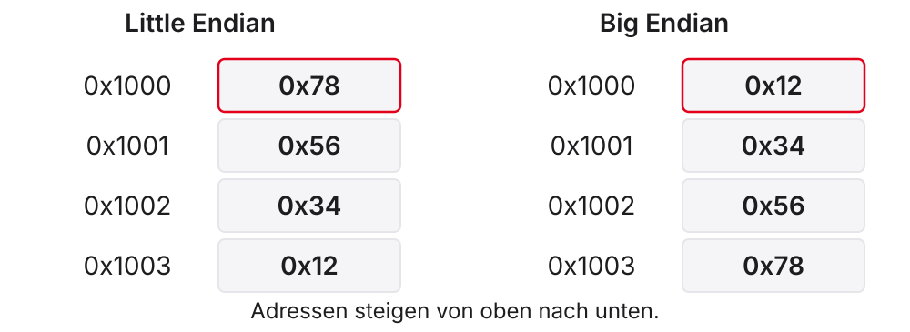{width=92% fig-alt="0x12345678 liegt ab 0x1000 als 78 56 34 12 in Little Endian oder 12 34 56 78 in Big Endian"}

Little Endian: niederwertigstes Byte an der kleinsten Adresse.

::: notes
Endianness heißt Byteordnung und betrifft Mehrbytewerte. Der Wert 0x12345678 besteht aus den Bytes 12, 34, 56 und 78. Das Byte 12 hat den höchsten Stellenwert, 78 den niedrigsten. In der linken Tabelle liegt bei Little Endian 78 an der kleinsten Adresse 0x1000, danach folgen 56, 34 und 12. Rechts zeigt Big Endian die umgekehrte Zuordnung der Bytes zu denselben aufsteigenden Adressen.

Die rote Kontur hebt jeweils das Byte an der Startadresse hervor. Die Tabellen werden von oben nach unten mit zunehmenden Adressen gelesen. Die Ordnung verändert weder die Bits innerhalb eines Bytes noch den Zahlenwert, der nach passender Rekonstruktion entsteht. Little Endian ist die Festlegung unserer Kursumgebung und keine Aussage, dass jede mögliche RISC-V-Umgebung dieselbe Ordnung haben muss. Eine Startadresse beschreibt den Anfang des Objekts; sie liegt bei Little Endian auf dessen niederwertigstem Byte.
:::

## Alignment: Eine andere Frage an die Adresse

Ein Word belegt vier Byte.

- `0x1000` ist durch vier teilbar: natürlich ausgerichtet
- `0x1001` ist nicht durch vier teilbar: nicht natürlich ausgerichtet
- Byteordnung: Welches Byte liegt wo?
- Ausrichtung: Passt die Startadresse zur Breite?

::: notes
Alignment bedeutet Speicherausrichtung. Eine natürliche Ausrichtung zur Breite vier Byte liegt vor, wenn die Startadresse durch vier teilbar ist. Für 0x1000 ist das erfüllt; für 0x1001 nicht. Die Prüfung betrachtet die Adresse, nicht die Reihenfolge der gespeicherten Bytes.

Ein Wert kann in Little Endian korrekt auf vier Bytes verteilt sein und dennoch an einer nicht natürlich ausgerichteten Adresse beginnen. Ob und wie ein solcher Zugriff unterstützt wird, gehört zum konkreten Ausführungsmodell und wird bei Speicherbefehlen in Einheit 3 behandelt. Hier behaupten wir weder einen allgemeinen Fehler noch eine allgemeine problemlose Ausführung. Die grundlegende Rechenprüfung reicht: Bei einer Vier-Byte-Breite muss der Rest der Startadresse bei Division durch vier null sein. Diese Trennung verhindert, dass Endianness, Größe und Ausrichtung zu einem einzigen unscharfen Begriff werden.
:::

# 5. Kombinatorische Logik


::: notes
Die Zahlendarstellung beschreibt die Bedeutung der Daten. Kombinatorische Logik berechnet nun aus den aktuellen Eingangswerten neue Ausgangswerte. Dafür wird kein Zustand bewusst gespeichert. Nach der Laufzeit und Stabilisierung der Schaltung gilt eine feste Zuordnung.

Wir führen die Grundfunktionen mit Tabellen ein und bauen daraus eine Auswahl zwischen zwei Datenquellen. Eine Wahrheitstabelle ist eine vollständige Auflistung der Eingabekombinationen und ihrer Ausgaben. Eine logische Gleichung beschreibt dieselbe Zuordnung kompakt. Schaltbild, Tabelle und Gleichung werden deshalb am gleichen Beispiel verglichen. Die Auswahl wird später im Datenpfad gebraucht, wenn eine Operation unterschiedliche Quellen verwenden kann.
:::

## Kombinatorisch bedeutet ohne gespeicherten Zustand

- Stabile Ausgänge hängen von den aktuellen Eingängen ab
- Eingangsänderungen wirken nach endlicher Laufzeit
- Gatter, Multiplexer und Addierer sind Beispiele
- Ein Takt ist für ihre reine Funktion nicht erforderlich

Laufzeit ist etwas anderes als Gedächtnis.

::: notes
Eine kombinatorische Funktion liefert für dieselben stabilen Eingänge immer dieselben Ausgänge. Ein Gatter speichert dabei keinen bewusst nutzbaren vorherigen Zustand. Ein Multiplexer wählt eine Quelle, ein Addierer berechnet eine Summe; beide gehören zu dieser Klasse.

Die Aussage setzt voraus, dass nach einer Eingangsänderung die Laufzeit abgewartet wird. Physikalisch ist ein Ausgang nicht im selben Zeitpunkt neu gültig. Unterschiedliche Pfadlaufzeiten können außerdem kurze Zwischenwerte erzeugen, sogenannte Glitches. Das macht eine Schaltung noch nicht zu einem Speicher. Ein Takt ist nicht nötig, damit ein UND-Gatter seine Funktion auswertet. Später kann ein Register das gültige kombinatorische Ergebnis an einer Flanke übernehmen. Für die Analyse werden deshalb Verarbeitung, Laufzeit und Speicherung als verschiedene Aufgaben betrachtet.
:::

## Grundgatter als logische Bausteine

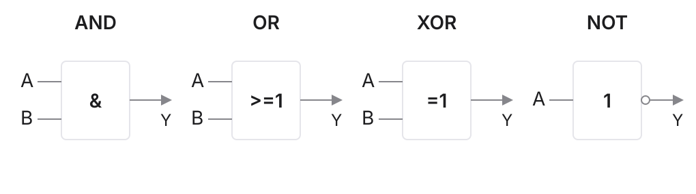{width=94% fig-alt="Rechteckige IEC-Symbole für UND, ODER, exklusives ODER und Negation"}

$$A\land B,\qquad A\lor B,\qquad A\oplus B,\qquad \overline{A}$$

::: notes
A und B sind logische Eingänge mit den Werten null oder eins. AND bedeutet UND: Das Ergebnis ist nur bei zwei Einsen eins. OR bedeutet ODER: Mindestens eine Eins genügt. XOR bedeutet Exclusive OR, exklusives ODER: Bei zwei Eingängen ist das Ergebnis genau dann eins, wenn die Eingänge verschieden sind. NOT bedeutet Negation und vertauscht null und eins.

IEC heißt International Electrotechnical Commission. Die Zeichnung verwendet rechteckige Gatterdarstellungen entsprechend der IEC-Konvention: das UND-Symbol, mindestens eins beim ODER und genau eins beim Zweieingangs-XOR. Der Kreis am Ausgang des mit eins beschrifteten Negationsbausteins kennzeichnet die Invertierung. Graue Leitungen zeigen die Anschlüsse, keine zusätzlichen Rechenschritte. In den Gleichungen stehen das Dach für UND, das umgekehrte Dach für ODER, der Kreisplusoperator für XOR und der Überstrich für Negation. Die nächste Tabelle macht die Funktionen überprüfbar.
:::

## Wahrheitstabelle der Zweieingangsfunktionen

| $A$ | $B$ | $A\land B$ | $A\lor B$ | $A\oplus B$ |
|---:|---:|---:|---:|---:|
| 0 | 0 | 0 | 0 | 0 |
| 0 | 1 | 0 | 1 | 1 |
| 1 | 0 | 0 | 1 | 1 |
| 1 | 1 | 1 | 1 | 0 |

$$\overline{0}=1,\qquad\overline{1}=0$$

::: notes
Zwei binäre Eingänge haben vier Kombinationen, weil jeder unabhängig null oder eins sein kann. Die Tabelle enthält damit alle Fälle. A und B benennen die beiden Eingänge. UND liefert nur in der letzten Zeile eins, ODER in allen Zeilen außer der ersten, exklusives ODER in den beiden Zeilen mit verschiedenen Eingängen.

Die Negation benötigt nur einen Eingang; die untere Gleichung nennt ihre beiden Fälle. Besonders leicht werden ODER und exklusives ODER bei zwei Einsen verwechselt. Für ODER genügt mindestens eine Eins und das Ergebnis ist eins. Für das hier gezeigte Zweieingangs-XOR müssen die Werte verschieden sein und das Ergebnis ist null. Die Regeln können später auf jedes Bit eines Wortes getrennt angewendet werden. Zuerst verwenden wir sie, um eine von zwei Eingaben auszuwählen.
:::

## Multiplexer: Eine von zwei Quellen auswählen

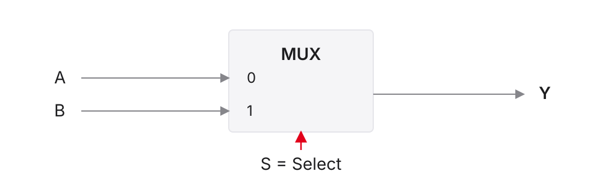{width=84% fig-alt="2-zu-1-Multiplexer mit zwei Dateneingängen, einem Select-Eingang und einem Ausgang"}

$$S=0:\ Y=A,\qquad S=1:\ Y=B$$

::: notes
MUX ist die Abkürzung für Multiplexer, einen Auswahlbaustein. Der gezeigte 2-zu-1-Multiplexer besitzt zwei Dateneingänge A und B, einen Ausgang Y und den Steuereingang S. S heißt Select, Auswahl. Unsere Konvention lautet: Bei S gleich null wird A gewählt, bei S gleich eins B.

Die zwei Pfeile links transportieren Daten, der rote Anschluss unten transportiert die Entscheidung. S ist keine dritte Datenquelle und kein Taktsignal. Der graue Ausgangspfeil trägt den ausgewählten Wert nach rechts. Für A gleich eins und B gleich null liefert S gleich null den Wert eins; S gleich eins liefert null. Beide Eingangswerte dürfen zugleich anliegen. Der Baustein speichert nichts. Wenn sich der gewählte Eingang ändert, folgt Y nach der Laufzeit. Diese Auswahl wird nun als Gleichung und als Gatternetz beschrieben.
:::

## Die Auswahl als Gleichung

$$Y=(\overline{S}\land A)\lor(S\land B)$$

| $S$ | Relevanter Eingang | Ergebnis |
|---:|---|---|
| 0 | $A$ | $Y=A$ |
| 1 | $B$ | $Y=B$ |

Der ungewählte Eingang beeinflusst den stabilen Ausgang nicht.

::: notes
Y ist der Ausgang, A und B sind Daten und S ist der logische Auswahleingang des Multiplexers, kurz MUX. Der Überstrich negiert S, das Dach bedeutet UND und das umgekehrte Dach ODER. Die beiden Terme geben jeweils eine Datenquelle frei.

Bei S gleich null ist der erste Term eins UND A und damit A. Der zweite Term null UND B ist null. Das ODER liefert A. Bei S gleich eins wird der erste Term null, der zweite B; das Ergebnis ist B. Zum Beispiel sind A und B beide eins: Unabhängig von S wird eins ausgegeben. Die Tabelle fasst mehrere vollständige Eingangskombinationen zusammen, weil der ungewählte Wert irrelevant ist. In einer verkürzten Wahrheitstabelle darf er mit X, einem Don't-Care-Platzhalter für beide Möglichkeiten, bezeichnet werden. X beschreibt hier zusammengefasste Fälle und keinen elektrisch unbekannten Pegel.
:::

## Der Multiplexer aus Grundgattern

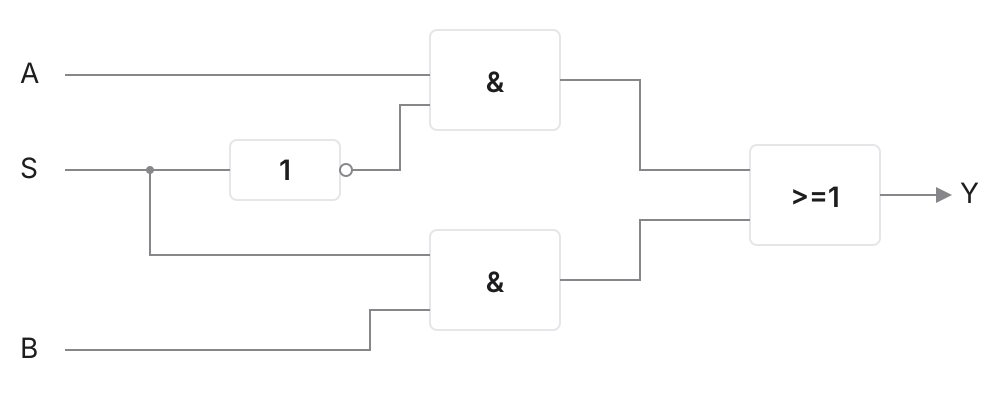{width=94% fig-alt="Negation von S, zwei UND-Gatter und ein ODER-Gatter realisieren den Multiplexer"}

$$Y=(\overline{S}\land A)\lor(S\land B)$$

::: notes
MUX bedeutet Multiplexer. Das Bild setzt dessen Gleichung aus Grundfunktionen um. A geht zum oberen UND-Gatter, B zum unteren. Der Steuereingang S wird für den oberen Pfad negiert und für den unteren direkt verwendet. Das ODER-Gatter führt die beiden Teilergebnisse zu Y zusammen. Der Ausgangskreis am Negationsbaustein ist Teil des Symbols, die ausgefüllten Punkte an Leitungen kennzeichnen Verzweigungen.

Die Leserichtung folgt den Daten von links nach rechts. Bei S gleich null und A gleich eins, B gleich null liefert der obere Pfad eins, der untere null und Y eins. Bei S gleich eins liefert Y null. Die Anschlüsse zeigen keine Speicherung und keinen Takteingang. Die Gleichung beschreibt den stabilen Zustand nach der Laufzeit. Beim Umschalten können verschieden schnelle Pfade kurzzeitig andere Werte erzeugen. Die gezeigte logische Funktion verspricht deshalb allein keine Glitchfreiheit.
:::

## Vom einzelnen Bit zum ganzen Wort

- Ein Bus bündelt mehrere Datenleitungen
- 32-Bit-Auswahl: 32 Ein-Bit-Multiplexer parallel
- Alle erhalten denselben Auswahlwert $S$
- Ein gemeinsamer Auswahlwert ist keine Taktflanke

Beispiel: $A=5$, $B=10$. Auswahl 0 liefert 5, Auswahl 1 liefert 10.

::: notes
Ein Bus ist hier ein Bündel von Datenleitungen, keine Aussage über einen Netzwerkbus. Ein 32-Bit-Bus enthält 32 einzelne Bitpositionen. Der Multiplexer, kurz MUX, lässt sich für jede Position einmal verwenden. Alle Ein-Bit-Multiplexer erhalten denselben Auswahlwert S, sodass das ganze Wort A oder das ganze Wort B gewählt wird.

In unserem Beispiel liegt A als 0x00000005 und B als 0x0000000A vor. S gleich null liefert das erste Wort, also fünf, S gleich eins das zweite, also zehn. Die 32 Bits werden nicht nacheinander in 32 Takten ausgewählt. Die Funktion ist parallel und kombinatorisch, also ohne gespeicherten Zustand. Kleine Laufzeitunterschiede zwischen einzelnen Leitungen bleiben in realer Hardware möglich. Das Prinzip erklärt, wie ein Datenpfad komplette Registerwerte umleiten kann, bevor ein Rechenwerk sie verarbeitet.
:::

# 6. Addition und Rechenwerk


::: notes
Eine Auswahl erzeugt noch keine neue Summe. Der Addierer verbindet die Bits zweier Operanden nach den Regeln der Stellenrechnung. Ein Operand ist ein Wert, auf den eine Operation angewendet wird.

Wir entwickeln die Addition vom einzelnen Bit zum mehrbittigen Wort. Dabei wird der Übertrag zur nächsthöheren Stelle ausdrücklich mitgeführt. Danach nutzen wir das Zweierkomplement, um mit demselben Addierprinzip eine Subtraktion zu bilden. Ein Rechenwerk verbindet solche arithmetischen und logischen Funktionen mit einer Auswahl des Ergebnisses. Damit entsteht die zentrale kombinatorische Verarbeitung zwischen den gespeicherten Registerwerten.
:::

## Halbaddierer: Zwei Bits und zwei Ergebnisse

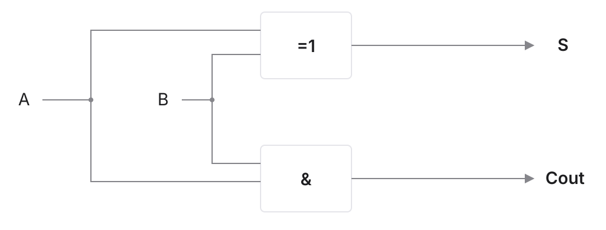{width=90% fig-alt="XOR liefert das Summenbit, UND liefert den Übertrag des Halbaddierers"}

$$S=A\oplus B,\qquad C_{\mathrm{out}}=A\land B$$

::: notes
Ein Halbaddierer, englisch Half Adder, addiert zwei einzelne Bits A und B. S ist das Summenbit der betrachteten Stelle, C_out der ausgehende Übertrag, englisch Carry Out. Exklusives ODER, XOR oder Exclusive OR, bildet das Summenbit; UND, englisch AND, bildet den Übertrag.

Bei A gleich B gleich eins ist die mathematische Summe zwei. In Binärdarstellung sind das die Bits zehn: S wird null, C_out eins. Bei nur einer Eins ist S eins und der Übertrag null. Die Zeichnung führt dieselben Eingänge zu beiden rechteckigen Gattern; die Verzweigungspunkte sind gemeinsame Leitungen. Summe und Übertrag gehen rechts zu verschiedenen Ausgängen. Der Halbaddierer hat keinen Eingang für einen Übertrag aus einer niedrigeren Stelle. Das ist die fehlende Eigenschaft, die ein Volladdierer ergänzt, nicht etwa eine halbierte Wortbreite.
:::

## Volladdierer: Den eingehenden Übertrag mitrechnen

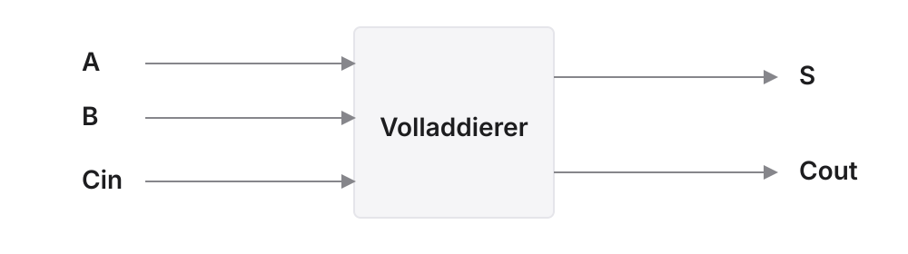{width=80% fig-alt="Volladdierer mit A, B, eingehendem Carry und getrennten Ausgängen für Summe und Carry"}

$$S=A\oplus B\oplus C_{\mathrm{in}}$$
$$C_{\mathrm{out}}=(A\land B)\lor\bigl(C_{\mathrm{in}}\land(A\oplus B)\bigr)$$

::: notes
Der Volladdierer, englisch Full Adder, hat die Eingänge A, B und C_in. C_in bedeutet Carry In, eingehender Übertrag. S ist das Summenbit und C_out, Carry Out, der ausgehende Übertrag. Die Box der Abbildung stellt einen Funktionsbaustein dar; ihre Innenschaltung wird durch die Gleichungen beschrieben.

XOR bedeutet Exclusive OR, exklusives ODER. Für drei verknüpfte Bits ergibt die Kette das Paritätsbit: eins bei einer oder drei Einsen. Der Übertrag entsteht, wenn A und B beide eins sind oder wenn der eingehende Übertrag auf genau eine Eins von A und B trifft. UND und ODER werden durch Dach und umgekehrtes Dach geschrieben. Eine mögliche Umsetzung verwendet zwei Halbaddierer und ein ODER für ihre Überträge. Für drei Einsen ist die mathematische Summe drei, also S gleich eins und C_out gleich eins. Die nächste Tabelle prüft alle acht Eingabefälle.
:::

## Die acht Fälle des Volladdierers

| $A$ | $B$ | $C_{\mathrm{in}}$ | $S$ | $C_{\mathrm{out}}$ |
|---:|---:|---:|---:|---:|
| 0 | 0 | 0 | 0 | 0 |
| 0 | 0 | 1 | 1 | 0 |
| 0 | 1 | 0 | 1 | 0 |
| 0 | 1 | 1 | 0 | 1 |
| 1 | 0 | 0 | 1 | 0 |
| 1 | 0 | 1 | 0 | 1 |
| 1 | 1 | 0 | 0 | 1 |
| 1 | 1 | 1 | 1 | 1 |

::: notes
A und B sind die Operandenbits. C_in, Carry In, ist der eingehende Übertrag. S ist das Summenbit, C_out, Carry Out, der Übertrag zur nächsten Stelle. Die acht Zeilen entstehen aus drei unabhängigen binären Eingängen.

Jede Zeile erfüllt $A+B+C_{\mathrm{in}}=S+2C_{\mathrm{out}}$. Die rechte Seite liest die zwei Ergebnisbits als mathematische Zahl. Keine Eins ergibt null und null. Eine Eins ergibt S gleich eins ohne Übertrag. Zwei Einsen ergeben S gleich null mit Übertrag eins. Drei Einsen ergeben beide Ausgänge eins. Deshalb ist der Volladdierer nicht mit dem Zweieingangs-XOR allein beschrieben. Ein Halbaddierer würde C_in nicht berücksichtigen. Diese vollständige Tabelle liefert auch die Prüfvorschrift für eine Kette: Jede Stelle bekommt genau den Übertrag ihrer niedrigeren Nachbarstelle.
:::

## Mehrere Stellen: Die Überträge verbinden

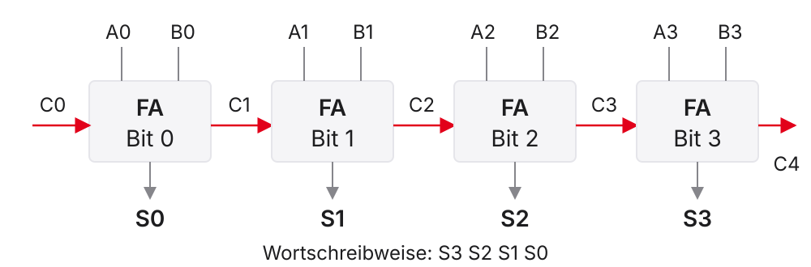{width=94% fig-alt="Vier Volladdierer von Bit 0 bis Bit 3 mit weitergereichten Überträgen und einzelnen Summenbits"}

$$C_{i+1}\text{ wird zum eingehenden Übertrag der Stelle }i+1.$$

::: notes
Ein Ripple-Carry-Adder ist ein Addierer, bei dem der Übertrag von Stelle zu Stelle weitergegeben wird. In der Abbildung liegen vier Volladdierer von links nach rechts für Bit null bis Bit drei. Die Position null ist die niederwertigste Stelle, auch wenn sie hier aus Gründen der Flussrichtung links gezeichnet ist. Beim Schreiben des Zahlenworts steht dagegen S3 links und S0 rechts.

C0 ist der Startübertrag. C1 bis C4 verbinden die Stellen; C4 liegt oberhalb der gespeicherten Vier-Bit-Summe. FA steht für Full Adder, Volladdierer. Die roten Verbindungen heben diese Abhängigkeit hervor, die grauen Eingänge tragen jeweils A_i und B_i. Für normale Addition setzen wir C0 auf null. Jede Box liefert ein eigenes Summenbit nach unten. Eine 32-Bit-Lehrimplementierung setzt das gleiche Prinzip mit 32 Stellen fort. Die Weitergabe benötigt Laufzeit und kann den längsten Datenpfad bestimmen.
:::

## Papierrechnung: Sechs plus fünf

```text
   0110  (6)
 + 0101  (5)
 --------
   1011  (11, vorzeichenlos)
```

| Stelle von rechts | 0 | 1 | 2 | 3 |
|---|---:|---:|---:|---:|
| Eingehender Übertrag | 0 | 0 | 0 | 1 |
| Summenbit | 1 | 1 | 0 | 1 |

::: notes
Wir rechnen hier ausdrücklich vorzeichenlos mit vier gespeicherten Bits. Von rechts beginnt Stelle null. Dort ist null plus eins plus Startübertrag null gleich eins; S0 wird eins und der nächste Übertrag null. Stelle eins berechnet eins plus null plus null, ebenfalls eins ohne Übertrag.

Stelle zwei berechnet eins plus eins plus null gleich zwei. Ihr Summenbit ist null, der ausgehende Übertrag eins. Stelle drei erhält diesen Übertrag und berechnet null plus null plus eins gleich eins. Das Endwort in der üblichen Reihenfolge S3 bis S0 ist 1011, also vorzeichenlos elf. Der letzte Übertrag oberhalb des Worts ist null. Als Vier-Bit-Zweierkomplement würde 1011 dagegen minus fünf bedeuten, weil plus elf außerhalb des Bereichs minus acht bis plus sieben liegt. Eine Antwort muss deshalb angeben, welche Lesart gefragt ist.
:::

## Subtraktion mit demselben Addierprinzip

Für $n$ gespeicherte Bits:

$$A-B\equiv A+\overline{B}+1\pmod{2^n}$$

```text
  0111  (7)
+ 1100  (invertierte Bits von 3)
+    1  (Startübertrag)
-------
 10100  → untere vier Bit: 0100 (4)
```

::: notes
A und B sind die Operanden, n ist die gespeicherte Breite. Der Überstrich über B bezeichnet die Invertierung aller n Bits. Das Kongruenzzeichen mit Modulo zwei hoch n bedeutet, dass die unteren n Ergebnisbits übereinstimmen. So lässt sich die Subtraktion durch Addition des Zweierkomplements von B ausdrücken.

Im Vier-Bit-Beispiel ist sieben 0111 und drei 0011. Die invertierten Bits von drei sind 1100. Mit dem zusätzlichen Startübertrag eins berechnet die Kette insgesamt zwanzig, binär 10100. Die unteren vier Bits 0100 sind vier. Nur C0, der Carry In oder eingehende Übertrag der niedrigsten Stelle, wird auf eins gesetzt. Höhere Stellen erhalten den weitergereichten Übertrag; sie dürfen nicht jeweils noch eine zusätzliche Eins bekommen. Der äußere Übertrag ist nicht automatisch ein vorzeichenbehafteter Überlauf. Die Gleichung beschreibt ein Rechenprinzip, keine von RISC-V vorgeschriebene Innenschaltung.
:::

## Die ALU verbindet mehrere Funktionen

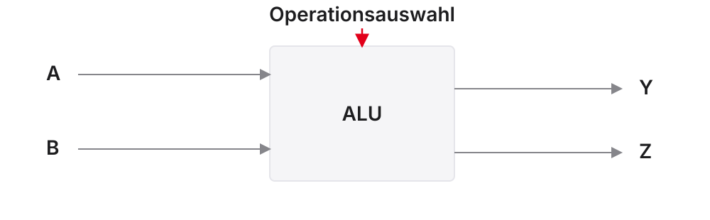{width=90% fig-alt="Arithmetisch-logische Einheit mit zwei Operanden, Operationsauswahl, Ergebnis und Nullerkennung"}

| Interner Beispielcode | Gewählte Funktion |
|---|---|
| 00 | Bitweises UND |
| 01 | Bitweises ODER |
| 10 | Addierpfad |
| 11 | Reserve |

::: notes
ALU bedeutet Arithmetic Logic Unit, arithmetisch-logische Einheit. Sie erhält die Operanden A und B und liefert ein Ergebnis Y. Die Steuereingabe wählt die gewünschte Funktion. Logische Operationen werden bei einem Wort auf jede Bitposition angewendet. Der Addierpfad verbindet die Stellen dagegen über Überträge.

Die grauen Datenpfeile gehen links hinein und rechts hinaus; der rote Steuerpfeil wählt eine Operation. Der zusätzliche Ausgang Z zeigt die Nullerkennung. Die vier zweibittigen Codes der Tabelle sind nur eine interne Beispielcodierung dieser Einheit, keine Maschinenbefehlscodes von RISC-V. Subtraktion kann den Addierpfad mit invertierten B-Bits und Startübertrag eins benutzen, wie zuvor hergeleitet. A gleich fünf und B gleich drei liefern bei Addition acht, bei Subtraktion zwei, bei bitweisem UND eins und bei ODER sieben. Verschiedene Funktionen bedeuten nicht automatisch verschiedene Zielregister. Ein nachgeschalteter Speicher muss das gewählte Ergebnis übernehmen.
:::

## Nullerkennung ist ein Signal des Rechenmodells

$$Z=\overline{Y_{31}\lor Y_{30}\lor\cdots\lor Y_0}$$

- Ergebnis vollständig null → $Z=1$
- Mindestens ein Ergebnisbit eins → $Z=0$
- Im RV32I-Ganzzahlmodell ist dies kein gespeichertes Statusflag

::: notes
Z steht für Zero, Nullerkennung. Y_i ist das Ergebnisbit an Position i. Die ODER-Verknüpfung aller 32 Bits ist eins, wenn mindestens ein Ergebnisbit eins ist. Die Negation über den ganzen Term macht Z genau dann eins, wenn das Wort vollständig null ist.

Für die Differenz fünf minus fünf ist das Ergebnis null und Z eins. Fünf minus drei ergibt zwei, also mindestens eine Eins und Z null. Die ALU, Arithmetic Logic Unit oder arithmetisch-logische Einheit, kann diesen kombinatorischen Draht für eine weitere Entscheidung bereitstellen. Er ist nach der Laufzeit gültig und speichert den alten Wert nicht. RV32I, die 32-Bit-Ganzzahlbasis unserer Kursmaschine, verlangt für solche Operationen kein gespeichertes Condition-Code-Register, also kein Register für Vergleichsflags. Eine interne Nullerkennung und ein für Programme sichtbarer Status sind unterschiedliche Schnittstellen.
:::

## Vertiefung: Überträge schneller berechnen

$$G_i=A_i\land B_i,\qquad P_i=A_i\oplus B_i$$
$$C_{i+1}=G_i\lor(P_i\land C_i)$$

- Generate: Übertrag selbst erzeugen
- Propagate: eingehenden Übertrag weiterreichen
- Andere Übertragsnetze verändern die Umsetzung, nicht die Addition

::: notes
Diese Vertiefung ist für die Papieraufgaben nicht erforderlich. G_i heißt Generate und ist eins, wenn A_i und B_i beide eins sind. Dann entsteht unabhängig vom eingehenden Übertrag C_i ein neuer Übertrag. P_i heißt Propagate und wird hier als exklusives ODER definiert. Bei genau einem gesetzten Operandenbit entscheidet C_i darüber, ob ein Übertrag weitergegeben wird.

Die Gleichung fasst die Volladdiererregel zusammen. Carry Lookahead heißt, Überträge mit einem zusätzlichen logischen Netz aus solchen Größen zu berechnen, statt sie nur durch jede Nachbarzelle zu führen. Lookahead ist keine Schätzung; die Ergebnisse sind logisch exakt. Die konkrete Tiefe und Laufzeit hängen von Aufbau und Bauteilen ab. Ohne eine konkrete Umsetzung geben wir keine gemessene Beschleunigung an. Die Grundaddition bleibt dieselbe Funktion, die wir mit einer Carrykette bereits vollständig nachvollziehen können.
:::

# 7. Zeit und gespeicherter Zustand


::: notes
Ein gültiges Rechenergebnis wird nicht automatisch zum gespeicherten Ergebnis. Wenn die Eingaben eines Addierers wechseln, folgt dessen Ausgang nach der Laufzeit. Ein Register soll dagegen einen übernommenen Wert behalten.

Wir unterscheiden deshalb die Arbeit der kombinatorischen Logik und die Aktualisierung eines Zustands. Für unser Modell erfolgt diese Aktualisierung an einer bestimmten Taktflanke und nur mit Schreibfreigabe. Ein Anfangswert wird in jeder Trace-Aufgabe angegeben, weil der Einschaltzustand nicht allgemein null ist. Zeitbedingungen erläutern anschließend, wann eine solche Übernahme verlässlich ist.
:::

## Kombinatorisch und sequenziell vergleichen

| Frage | Kombinatorisch | Sequenziell |
|---|---|---|
| Gespeicherter Zustand? | Nein | Ja |
| Ausgang abhängig von | Aktuellen Eingängen | Eingängen und Zustand |
| Beispiel | Multiplexer | Register |
| Takt zwingend? | Nein | Nicht allgemein |

Unser Registermodell ist flankengesteuert.

::: notes
Sequenziell bedeutet, dass ein gespeicherter Zustand die Wirkung mitbestimmt. Bei denselben aktuellen Eingängen können verschiedene Anfangszustände zu verschiedenen Ausgängen führen. Ein Register, das fünf gespeichert hat, zeigt fünf auch dann, wenn am Dateneingang schon sieben liegt und noch keine Übernahme erlaubt wurde.

Ein Multiplexer, kurz MUX, hat dagegen nach Stabilisierung für dieselben Eingänge und denselben Auswahlwert denselben Ausgang. Auch er benötigt Laufzeit, aber keinen gespeicherten früheren Wert. Sequenzielle Logik ist nicht allgemein mit einem Takt gleichzusetzen. Ein Latch ist beispielsweise ein pegelgesteuerter Speicher: Während seines Freigabepegels ist es durchlässig und sonst hält es. Unser D-Flip-Flop ist ein anderer, flankengesteuerter Baustein. Diese Unterscheidung ersetzt die falsche Verallgemeinerung, jeder Speicher würde nur an einer steigenden Flanke arbeiten.
:::

## D-Flip-Flop: Ein Bit an einer Flanke übernehmen

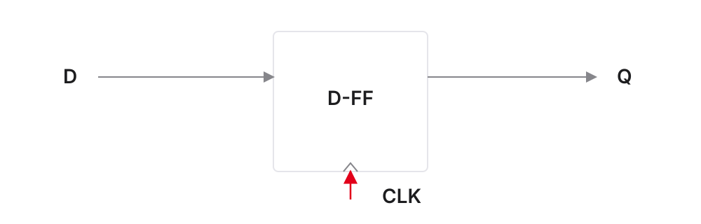{width=76% fig-alt="D-Flip-Flop mit Dateneingang D, flankengesteuertem Takt CLK und gespeichertem Ausgang Q"}

- $D$: neuer Datenwert
- $Q$: gespeicherter Wert
- Unser Modell: Übernahme bei der steigenden Flanke

::: notes
D-FF bedeutet D-Flip-Flop, ein flankengesteuerter Ein-Bit-Speicher. D, Data, ist der neue Datenwert und Q der gespeicherte Ausgang. CLK, Clock, bezeichnet das Taktsignal. Das Dreieck am Takteingang kennzeichnet die Flankensteuerung; unser Symbol hat keinen Inversionskreis an diesem Anschluss und verwendet die steigende Flanke. Die rote Markierung hebt diesen Übernahmeanschluss hervor, die grauen Pfeile zeigen Daten hinein und hinaus.

Ohne aktive Flanke bleibt Q erhalten, auch wenn D sich ändert. Bei einer aktiven Flanke wird ein stabiler D-Wert übernommen und nach der Clock-to-Q-Verzögerung am Ausgang sichtbar. Diese Verzögerung ist die Zeit vom Taktanschluss zum gültigen Q. Die positive Flanke ist eine Annahme dieses Bausteinmodells, keine Vorschrift der Instruction Set Architecture, ISA oder Befehlssatzarchitektur. Der Anfangswert muss angegeben oder durch eine zusätzliche Initialisierung hergestellt werden.
:::

## Takt: Periode und Übernahmeereignis

$$f=\frac{1}{T}$$

Angenommene Periode $T=10\,\mathrm{ns}$:

$$f=100\,\mathrm{MHz}$$

- Steigende Flanke: Übergang von 0 nach 1
- Hoher Pegel allein löst keine neue Übernahme aus
- Ein Takt ist keine allgemeine Zahl von Maschinenbefehlen

::: notes
T bezeichnet die Periodendauer, f die Frequenz. ns bedeutet Nanosekunde, ein Milliardstel einer Sekunde. MHz bedeutet Megahertz, eine Million Perioden pro Sekunde. Im ausdrücklich angenommenen Zahlenbeispiel sind zehn Nanosekunden gleich zehn hoch minus acht Sekunden. Ihr Kehrwert ist zehn hoch acht Hertz, also 100 Megahertz. Das ist eine Umrechnung und keine Messung.

CLK bedeutet Clock, Taktsignal. Eine steigende Flanke ist sein Übergang von niedrigem zu hohem logischem Pegel. Beim gezeigten D-Flip-Flop bestimmt diese Flanke das Übernahmeereignis. Ein dauernd hoher Pegel erzeugt keine fortlaufenden neuen Übernahmen. Die kombinatorischen Bausteine arbeiten zwischen den Flanken weiter. Wie viele Takte ein Maschinenbefehl benötigt, hängt von einer konkreten Mikroarchitektur ab; aus der Periodendauer allein lässt sich das nicht ablesen.
:::

## Setup und Hold: Daten um die Flanke stabil halten

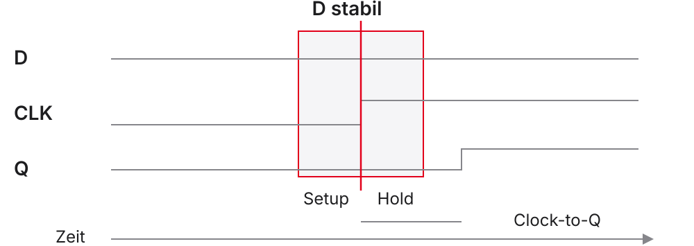{width=92% fig-alt="Schematisches Stabilitätsfenster des Dateneingangs vor und nach einer aktiven Taktflanke"}

Setup vor der Flanke, Hold danach; Ausgang gültig nach Clock-to-Q.

::: notes
Setup bezeichnet die erforderliche Stabilitätszeit des Dateneingangs vor der aktiven Flanke. Hold ist die erforderliche Stabilitätszeit danach. Die Zeichnung wird von links nach rechts auf der Zeitachse gelesen. Der rote Bereich markiert das gesamte Fenster, in dem D, der Datenwert, stabil sein muss. CLK ist Clock, das Taktsignal; Q ist der gespeicherte Ausgang. Die Clock-to-Q-Verzögerung ist separat rechts der Flanke markiert und beschreibt, wann die neue Ausgabe sichtbar wird.

Zur Illustration sind D gleich eins und Q zunächst null angenommen. Die Breiten sind schematisch und keine Zahlen aus einem Bauteildatenblatt. Wird ein Stabilitätsfenster verletzt, kann die gewünschte Übernahme ausbleiben oder ein vorübergehend nicht eindeutig aufgelöster Zustand, Metastabilität, auftreten. Das Ergebnis ist dann nicht durch unser ideales Trace-Modell zugesichert. Langsameres Takten schafft mehr Zeit für lange Rechenpfade, beseitigt aber nicht automatisch jedes Hold-Problem an einem zu kurzen Pfad. Unsere Aufgaben setzen die erfüllten Zeitbedingungen ausdrücklich voraus.
:::

## Ein Register hält ein ganzes Wort

- Ein D-Flip-Flop speichert ein Bit
- 32 parallele Speicherbits bilden unser 32-Bit-Register
- Gemeinsames Taktsignal, eigener Datenwert je Bit
- Ausgangswort bleibt bis zur nächsten erlaubten Übernahme erhalten

Die Architektur legt die Breite fest, die Umsetzung kann variieren.

::: notes
Ein D-Flip-Flop ist der zuvor erklärte flankengesteuerte Ein-Bit-Speicher. Ein Register mit 32 solchen Zustandsbits kann ein ganzes Word, also 32 Bit oder vier Byte, halten. Die Dateneingänge tragen die Positionen null bis 31. Eine gemeinsame aktive Flanke löst ihre Übernahme aus, wenn die Voraussetzungen erfüllt sind.

Die idealisierte Gleichzeitigkeit bedeutet nicht, dass alle realen Ausgänge im exakt selben Moment umschalten. Taktversatz und unterschiedliche Verzögerungen sind Eigenschaften einer Umsetzung. Für die logische Vorhersage betrachten wir das neue Wort nach der Stabilisierung. RV32I bezeichnet die 32-Bit-Ganzzahlbasis und ihre 32-Bit-Registerwerte. Eine Bank aus Flip-Flops ist eine anschauliche Lehrimplementierung dieser gespeicherten Werte, keine zwingende Innenschaltung jedes RISC-V-Prozessors. Damit ein Register nicht an jeder Flanke einen anderen Wert übernehmen muss, ergänzen wir eine Schreibfreigabe.
:::

## Schreibfreigabe: Übernehmen oder halten

An der aktiven Flanke:

$$Q^+=\begin{cases}D,&WE=1\\Q,&WE=0\end{cases}$$

- $WE$: Write Enable, Schreibfreigabe
- Ohne aktive Flanke bleibt $Q$ erhalten
- Der Takt läuft auch bei $WE=0$ weiter

::: notes
Q ist der bisher gespeicherte Wert, D der Dateneingang und Q hoch plus der Zustand nach der erlaubten Aktualisierung. WE bedeutet Write Enable, Schreibfreigabe. Die Fallunterscheidung gilt nur an der aktiven Flanke: Bei WE gleich eins wird D übernommen, bei WE gleich null bleibt der alte Q-Wert.

Für Q gleich drei und D gleich fünf liefert eine aktive Flanke mit Freigabe den neuen Wert fünf. Bei fehlender Freigabe bleibt drei. Ohne aktive Flanke wird in unserem Modell auch mit Freigabe keine neue Zahl gespeichert. WE hält daher nicht das Taktsignal selbst an. Eine einfache Umsetzung wählt vor dem Dateneingang zwischen neuem D und dem zurückgeführten alten Q. Daten und Freigabe müssen die Setup- und Hold-Zeiten, also die Stabilität vor und nach der Flanke, erfüllen. Die Ausgangsänderung ist erst nach der Clock-to-Q-Verzögerung gültig.
:::

## Schreibfreigabe mit einer Datenrückführung

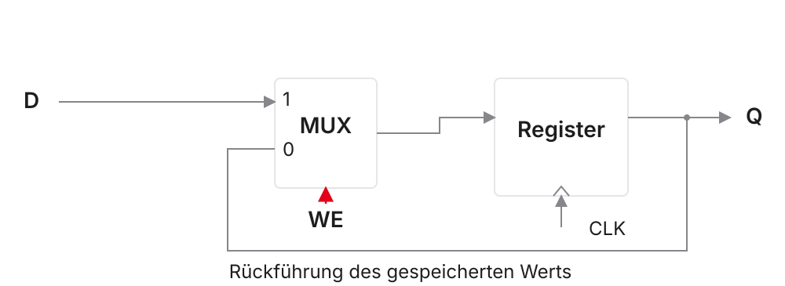{width=92% fig-alt="Multiplexer wählt neues D oder rückgeführtes Q vor einem flankengesteuerten Register"}

$WE=0$ wählt den alten Wert; $WE=1$ wählt neue Daten.

::: notes
Die Abbildung zeigt eine mögliche Umsetzung der Schreibfreigabe. Der Multiplexer, kurz MUX, erhält das äußere Datenwort D und den bisherigen Registerausgang Q. WE, Write Enable oder Schreibfreigabe, ist sein Auswahlwert. Bei null wird Q an den inneren Registereingang zurückgeführt, bei eins das neue D.

Die rechteckige Speicherbox übernimmt ihren Eingang an der steigenden Flanke von CLK, Clock oder Taktsignal. Der rote Auswahlanschluss ist kein getakteter Datenpfad; der Takt geht getrennt zum Speicher. Graue Leitungen transportieren Werte und die untere Rückleitung verbindet Q mit dem Haltepfad. Eine Übernahme bei WE gleich null schreibt damit denselben logischen Wert wieder, sodass der sichtbare Zustand unverändert bleibt. Das ist ein vollständig benannter Grund, weshalb Halten ohne beliebiges Abschalten des Taktpins möglich ist. Andere Registerumsetzungen können dieselbe Schnittstelle erfüllen.
:::

## Zeitverlauf: Ein Wort gezielt übernehmen

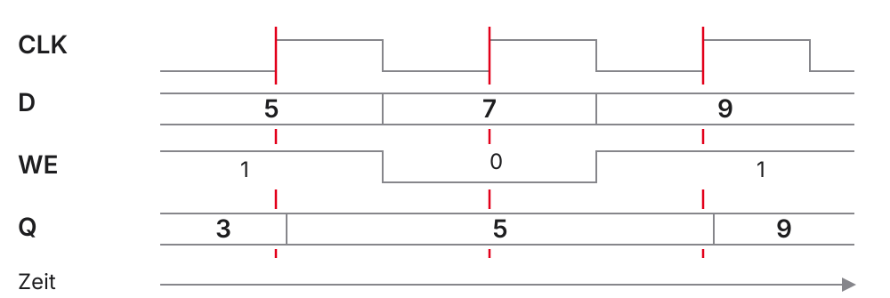{width=94% fig-alt="D, WE und Q über drei steigende Flanken zeigen Übernahme von 5, Halten und Übernahme von 9"}

Anfangszustand $Q=3$; alle Zeitbedingungen erfüllt.

::: notes
Der Zeitverlauf zeigt CLK, Clock oder Taktsignal, D als Datenwort, WE als Write Enable beziehungsweise Schreibfreigabe und Q als gespeichertes Ausgangswort. Die horizontale Richtung ist Zeit, die Zeichnung ist schematisch ohne gemessene Zeiteinheit. Vertikale rote Markierungen bezeichnen die drei steigenden Flanken. Die Wortspuren D und Q zeigen Zahlenwerte, keine einzelnen binären Spannungspegel.

Anfangs gilt Q gleich drei. Vor der ersten Flanke liegen D gleich fünf und WE gleich eins stabil an. Danach wird Q nach der dargestellten kleinen Verzögerung fünf. Für die zweite Flanke ist D sieben, aber WE null; Q bleibt fünf. Vor der dritten Flanke sind D neun und WE eins, danach wird Q neun. Der Takt wechselt auch während der Haltephase. Datenänderungen zwischen Flanken lösen keine zusätzliche Übernahme aus. Setup, Hold und die Clock-to-Q-Verzögerung sind als erfüllt beziehungsweise schematisch dargestellt angenommen.
:::

## Kurzaufgabe: Hoher Takt oder neue Flanke?

Anfang $Q=0$, Zeitbedingungen erfüllt:

1. Steigende Flanke mit $D=1$, $WE=0$
2. Bei hohem Takt wird $WE=1$, noch keine neue Flanke
3. Nächste steigende Flanke mit $D=1$, $WE=1$

Welchen Wert hat $Q$ nach jedem Schritt?

::: notes
Q ist der gespeicherte Ausgang, D das Datenbit und WE, Write Enable, die Schreibfreigabe. Die Schritte liegen so weit auseinander, dass alle Stabilitätsbedingungen eingehalten werden. Die Frage prüft, ob die Freigabe allein oder erst die Kombination mit der aktiven Flanke eine Übernahme auslöst.

Nach Schritt eins bleibt Q null, weil an der Flanke WE null ist. In Schritt zwei wird zwar freigegeben, aber ein hoher Taktpegel ist keine neue steigende Flanke. Q bleibt deshalb weiterhin null. Erst Schritt drei übernimmt den stabilen Wert D gleich eins, sichtbar nach der Clock-to-Q-Verzögerung. Die Folge der gültigen Werte ist also null, null, eins. Ein pegelgesteuertes Latch hätte eine andere Schnittstelle; daraus darf nicht dieselbe Vorhersage für jeden beliebigen Speicherbaustein abgeleitet werden.
:::

# 8. Registerbank und adressierter Speicher


::: notes
Ein einzelnes Register kann einen Wert erhalten. Ein Prozessor benötigt mehrere solcher Werte als mögliche Operanden und Ziele. Eine Registerbank macht sie über Registernummern auswählbar.

Daneben gibt es einen adressierbaren Speicher für Programme und größere Datenmengen. Eine Registernummer, ein Datenwort und eine Speicheradresse sind dabei verschiedene Größen. Wir verbinden zum Abschluss Registerbank und Rechenwerk an einem vollständig angegebenen Additionsfall. Danach ordnen wir Programm- und Datenzugriffe ein. Diese Schnittstellen reichen, um in Einheit 2 erste Maschinenbefehle zu lesen, ohne schon deren Bitcodierung oder eine Pipeline kennen zu müssen.
:::

## Registerbank: Nummern wählen gespeicherte Werte

- Register File bedeutet Registerbank
- RV32I: 32 Architekturregister `x0` bis `x31`
- Jedes hält einen 32-Bit-Wert
- Fünf Auswahlbits reichen: $2^5=32$
- `x5` ist eine Registernummer, keine Speicheradresse

::: notes
Register File ist die englische Bezeichnung für Registerbank und meint keine Datei des Betriebssystems. RV32I ist die 32-Bit-Ganzzahlbasis unserer RISC-V-Kursmaschine. Die Architektur benennt die 32 allgemeinen Register x0 bis x31. Jedes enthält einen Wert von 32 Bit.

Eine fünf Bit breite Auswahl kann 32 Nummern unterscheiden. Steht in x5 der Wert sieben, ist fünf die Registernummer und sieben der Inhalt. Die Anzahl der Architekturregister sagt noch nicht, wie viele physische Speicherplätze eine konkrete Mikroarchitektur intern verwendet. Auch ein Program Counter, PC oder Befehlsadressregister, gehört zu einem eigenen Zustand und ist kein zusätzliches allgemeines Register namens x32. Wir benutzen zunächst nur die x-Namen. Weitere Namenskonventionen für Funktionen werden später eingeführt und sind keine Voraussetzung für das heutige Registerbeispiel.
:::

## Lesen, rechnen und ein Ziel schreiben

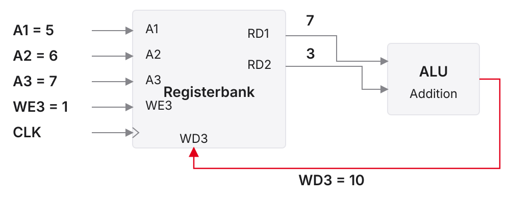{width=94% fig-alt="Zwei Registerauswahlen liefern Operanden zur ALU, deren Ergebnis mit Zielnummer und Schreibfreigabe zurückgeführt wird"}

Lehrzustand: `x5=7`, `x6=3`, `x7=0`.

::: notes
Die Registerbank des Lehrmodells hat zwei Leseports und einen Schreibport. A1 und A2 sind die Auswahl der Quellnummern, RD1 und RD2 bedeuten Read Data, die gelesenen Daten. A3 wählt die Zielnummer, WD3 bedeutet Write Data, Schreibdaten, und WE3 bedeutet Write Enable, Schreibfreigabe. CLK ist Clock, das Taktsignal. Die ALU, Arithmetic Logic Unit oder arithmetisch-logische Einheit, erhält die beiden Operanden.

Mit A1 gleich fünf und A2 gleich sechs werden nach der Leselaufzeit die gespeicherten Werte sieben und drei geliefert. Die auf Addition eingestellte ALU berechnet zehn. A3 gleich sieben und WE3 gleich eins erlauben die Übernahme von WD3 gleich zehn in x7 an der aktiven Flanke. Die grauen Pfeile zeigen die Datenwege, der rote Rückweg das neue Ergebnis. Registernummern sind fünf Bit breit, Daten 32 Bit. Diese Portstruktur und das kombinatorische Lesen sind Lehrmodellannahmen, keine allgemeine Vorgabe jeder physischen Registerbank. Eine Instruktion darf dasselbe Register als Quelle und Ziel wählen: Sie liest den alten Wert und schreibt den neuen erst an der aktiven Flanke. Davon zu unterscheiden ist die spätere Pipeline-Frage, wann ein anderer Befehl einen gerade geschriebenen Wert lesen kann.
:::

## Die Nullregel von `x0`

- Lesen von `x0` liefert stets null
- Schreiben als Ziel verändert diesen Wert nicht
- Beispiel mit `x5=42`:

```asm
add x6, x5, x0
```

Danach: `x6=42`, `x5=42`, `x0=0`.

::: notes
x0 ist das Nullregister des betrachteten RISC-V-Befehlssatzes. Jeder Lesezugriff liefert null, und ein Schreibziel x0 verändert diesen Wert nicht. Diese beobachtbare Regel legt nicht zwingend fest, wie die Hardware null intern bereitstellt.

add bezeichnet den Ganzzahladditionsbefehl. In der gezeigten Assemblersyntax steht zuerst das Ziel x6, danach die Quellen x5 und x0. Für den angenommenen Inhalt 42 in x5 ist die Rechnung 42 plus null gleich 42. Das Ziel x6 erhält das Ergebnis, die Quellen werden dadurch nicht verändert. Der Ausschnitt ist ein einzelner Befehl mit angegebenem Anfangszustand, kein vollständiges Programm mit Start und Ende. Die systematische Syntax folgt in Einheit 2. Hier genügt die Nullregel, um zu erkennen, warum eine Addition auch eine Kopie herstellen kann.
:::

## Ein Additionsschritt verändert den gespeicherten Zustand

Lehrbefehl: `add x7, x5, x6`

| Register | Vorher | Nach gültiger Übernahme |
|---|---:|---:|
| `x5` | 7 | 7 |
| `x6` | 3 | 3 |
| `x7` | 0 | 10 |

Lesen → kombinatorisch addieren → Zielregister übernehmen.

::: notes
add ist die Ganzzahladdition, x7 das Ziel und x5 sowie x6 die Quellen. Die Tabelle nennt den Anfangszustand vollständig. Zuerst liefert die Registerbank sieben und drei. Die ALU, Arithmetic Logic Unit oder arithmetisch-logische Einheit, bildet nach ihrer Laufzeit zehn. Im gewählten Registermodell wird dieses Ergebnis bei freigegebenem Ziel an der aktiven Flanke gespeichert.

Die beiden Quellregister behalten ihre Inhalte. Nur x7 wechselt von null nach zehn. Ein vorheriger Wert in x7 wäre ebenfalls überschrieben worden, weil das Ziel nicht zur gezeigten Summe beiträgt. Die Beschreibung trennt kombinatorisches Ergebnis und gültigen gespeicherten Folgezustand. Sie ist keine allgemeine Aussage über die Taktzahl eines realen Prozessors. Das Ergebnis wird in ein Register geschrieben, nicht in den adressierten Datenspeicher. Der nächste Abschnitt erklärt die zusätzlichen Wege zum Holen von Befehlen und zum Übertragen größerer Datenmengen.
:::

## Programme und Daten benötigen Speicherzugriffe

- Ein Programm besteht aus codierten Maschinenbefehlen
- Instruction Fetch: den nächsten Befehl holen
- Load: Daten aus Speicher in ein Register lesen
- Store: Daten aus einem Register in Speicher schreiben
- Eine Registeraddition benötigt keinen Daten-Store

::: notes
Instruction Fetch heißt Befehlsholen: Eine Befehlsadresse wählt den nächsten Maschinenbefehl aus einem adressierbaren Speicher. Ein Load ist das Lesen eines Datenwerts in ein Register, ein Store das Schreiben eines Registerwerts in den Datenspeicher. Die genaue Befehlssyntax kommt später.

Der allgemeine Registersatz hält vor allem die Operanden und Zwischenergebnisse, nicht das gesamte Programm. Programmbefehle können in unterschiedlichen Speichertechnologien liegen, beispielsweise Arbeitsspeicher oder nichtflüchtigem Flash. Ein Cache ist ein schneller Zwischenspeicher und eine weitere mögliche Umsetzung des Zugriffs. Der vorausgehende add-Fall holt einen Befehl und schreibt sein Rechenergebnis in x7. Er führt deswegen noch keinen Store aus. Um gleichzeitiges Befehlsholen und einen Datenzugriff zu ermöglichen, müssen die Zugriffspfade und verfügbaren Ressourcen betrachtet werden.
:::

## Adressräume und Zugriffspfade unterscheiden

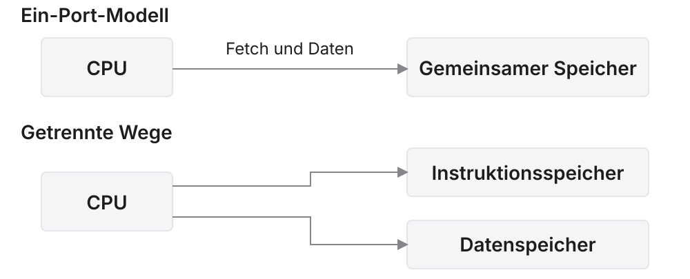{width=94% fig-alt="Gemeinsamer Speicher mit einem Zugriffspfad gegenüber getrennten Instruktions- und Datenwegen"}

Gemeinsamer Adressraum allein erzwingt keinen gemeinsamen Port.

::: notes
CPU bedeutet Central Processing Unit, Prozessor. Die obere Zeichnung ist ein ausdrücklich gewähltes Modell mit gemeinsamem Speicher und einem einzigen Zugriffspfad für Befehle und Daten. Instruction Fetch, Befehlsholen, und ein Datenzugriff können dort dieselbe Ressource benötigen. Die untere Zeichnung bietet getrennte Wege zu Instruktions- und Datenspeicher. Die Pfeile bezeichnen Zugriffe; sie sind keine Aussage über eine gemessene Dauer.

Eine Von-Neumann-Organisation verwendet hier einen gemeinsamen Adressraum für Code und Daten. Ein gemeinsamer Port ist eine zusätzliche Umsetzungsentscheidung. Reine Harvard-Organisation trennt Instruktions- und Datenadressräume. Modifizierte Harvard-Organisation kann getrennte Zugriffspfade bei gemeinsamem Speicher verwenden. Zwei sichtbare Wege beweisen daher für sich allein noch keine Trennung der Adressräume. Auch RISC-V legt nicht durch seinen Namen eine einzige dieser Mikroarchitekturen fest. Für spätere Ripes-Modelle wird die gewählte Struktur ausdrücklich benannt.
:::

## Ausblick auf die ersten Maschinenbefehle

Manuelles Lehrprogramm in `beispiele/vl1_registeraddition.s`:

```asm
addi x5, x0, 7
addi x6, x0, 3
add  x7, x5, x6
```

Transfer im Übungsblatt: neue Registerspur mit 21 und 3; auch `x0` als Ziel.

::: notes
Das Assemblerfragment zeigt die drei relevanten Anweisungen einer vollständigen Lehrdatei. addi heißt Add Immediate, Addition mit einer direkt angegebenen Konstante. Da x0 null liefert, erzeugen die ersten beiden Befehle die Registerwerte sieben und drei. add addiert die Registerquellen und schreibt zehn nach x7. Das Ziel steht jeweils zuerst. Diese Wirkungen reichen zum optionalen Versuch; Befehlscodierungen werden erst in Einheit 2 behandelt.

Die Datei enthält zusätzlich den Textbereich, den Programmeinstieg main und eine Dauerschleife mit j, einem unbedingten Jump oder Sprung. Sie beendet sich nicht durch einen unbenannten Systemdienst. Nach den drei Rechenschritten kann der Zustand angehalten und geprüft werden. Ripes ist der visuelle Simulator; seine installierte Version und das gewählte Modell werden im Protokoll notiert. Die Folie nennt Sollwerte eines manuellen Programms, keine bereits beobachteten Simulatorergebnisse. Das Übungsblatt verwendet bewusst eine andere Folge; das Programm für den optionalen Ripes-Versuch ist dort vollständig abgedruckt. x9 startet mit 21, x10 mit drei. Die erste Addition schreibt 24 nach x11, der Schreibversuch nach x0 verwirft die Summe 45. Danach wird x9 aus seinem alten Wert zu 24, und die letzte Addition schreibt 48 nach x10. Übertragen Sie dafür die Regel über alte Quellen und freigegebenes Ziel.
:::

## Das Fundament für Einheit 2

1. Breite, Bitmuster und Zahlenwert unterscheiden
2. Byteordnung und Adressausrichtung getrennt prüfen
3. Mit Tabelle, Gleichung und Schaltbild dasselbe Verhalten erklären
4. Rechenergebnis und Registerübernahme auseinanderhalten
5. Registernummer und gespeicherten Inhalt benennen

::: notes
Ein Beispiel verbindet die wichtigsten Entscheidungen: 0xFB besteht bei acht Bit aus 11111011. Vorzeichenlos ist das 251, als Zweierkomplement minus fünf. Eine Verbreiterung erhält die gewählte Interpretation nur mit den passenden neuen Bits. Vier Bytes eines Worts werden gemäß der benannten Byteordnung auf Adressen verteilt; deren Ausrichtung bleibt eine eigene Frage.

Ein Multiplexer, kurz MUX, wählt eine Quelle ohne Speicherung. Ein Volladdierer verarbeitet auch den eingehenden Übertrag. Ein Register übernimmt ein gültiges Ergebnis nur zur erlaubten Flanke mit Schreibfreigabe und hält es danach. Der Registername bezeichnet eine Auswahl, nicht den Wert selbst. Diese Grundlagen ermöglichen in Einheit 2 den Schritt zur Instruction Set Architecture, ISA oder Befehlssatzarchitektur, und zur symbolischen Befehlsbeschreibung. Die Papieraufgaben und das Quiz helfen, die Entscheidungen bereits ohne Programmierwerkzeug zu begründen.
:::
