## Vom Baustein zum Programm

- Vorwissen: 32-Bit-Wort, Zweierkomplement, Register, ALU
- Heute: Befehle lesen, Zustände verfolgen, Wörter codieren
- Arbeitsweise: vorhersagen → ausführen → vergleichen

::: notes
Die ALU, Arithmetic Logic Unit, ist die arithmetisch-logische Einheit aus Vorlesung 1. Sie kann Werte addieren und bitweise verknüpfen. Bisher haben wir betrachtet, welche Hardware dafür nötig ist. Nun interessiert uns, wie ein Programm auswählt, welche Register gelesen werden, welche Operation stattfindet und wohin das Ergebnis geschrieben wird. Eine Instruktion ist ein einzelner Maschinenbefehl mit genau solchen Festlegungen.

Ein Wort enthält in unserem Modell 32 Bit. Als Hexdarstellung braucht es acht Ziffern, weil jede Hexziffer vier Bit beschreibt. Dasselbe Muster kann als vorzeichenlose Zahl oder als Zweierkomplement gelesen werden. Diese Grundlagen genügen für alle Pflichtaufgaben. Der Simulator dient dem Vergleich mit Ihrer Rechnung. Wenn die Beobachtung abweicht, suchen Sie den ersten falschen Schritt, statt nur das Endergebnis zu ändern.
:::

## Was Sie anschließend können

- Registerbefehle mit konkreten Anfangswerten erklären
- Immediate-Grenzen und Shiftweiten prüfen
- Ein R- und ein I-Format von Hand codieren und decodieren
- Ein vollständiges Venus-Programm schrittweise prüfen

::: notes
Registerbefehle lesen bedeutet mehr als ein englisches Befehlswort zu übersetzen: Sie müssen Quelle, Ziel, Anfangswerte und Ergebnis auseinanderhalten. Ein Immediate ist eine unmittelbar im Befehl codierte Konstante. R-Format bezeichnet hier das Registerformat mit zwei Registerquellen. I-Format ist das Immediate-Format, das bei den behandelten Rechenbefehlen eine Quelle und eine Konstante enthält. Codieren bedeutet, diese Angaben in ein binäres Wort umzusetzen. Decodieren ist der umgekehrte Weg.

Venus ist das verwendete Assemblerwerkzeug und der Simulator für die Befehlswirkung. Die Papieraufgaben prüfen dieselben Fähigkeiten ohne Werkzeug. Speicherbefehle und Entscheidungen kommen erst in Einheit 3, Aufrufkonventionen ausführlich in Einheit 4. Deshalb bleiben die Programme heute geradlinig: Jede Recheninstruktion folgt auf die vorige, bis der Dienst der Umgebung das Programm beendet.
:::

# 1. Das vereinbarte Maschinenmodell


::: notes
Bevor wir Befehle rechnen, legen wir fest, welches Modell gilt. Eine Befehlssatzarchitektur beschreibt den von Software sichtbaren Zustand und die Wirkung jeder Instruktion. Eine Mikroarchitektur ist die konkrete Hardware, die diese Regeln umsetzt. Verschiedene Prozessoren können dieselben Befehle korrekt ausführen und dafür unterschiedlich viele Takte benötigen.

Unsere Betrachtung benötigt deshalb noch keine Pipeline, also keine überlappte Bearbeitung mehrerer Befehle. Wir beobachten einen Zustand vor und nach einer Instruktion. Aus der ersten Vorlesung kennen Sie Register als speichernde Bausteine. Nun behandeln wir sie als nummerierte, für Programme sichtbare Speicherstellen. Zunächst klären wir die Regeln dieses Zustands, danach lernen wir die Namen und Schreibweise der Operationen kennen.
:::

## ISA und Mikroarchitektur

- ISA: sichtbare Register und definierte Befehlswirkung
- Mikroarchitektur: Datenpfad, Steuerwerk, konkrete Ausführung
- Ein Simulator-Step ist keine Messung eines Hardwaretakts.

::: notes
ISA bedeutet Instruction Set Architecture, auf Deutsch Befehlssatzarchitektur. Sie legt beispielsweise fest, dass eine Addition zwei Registerwerte verarbeitet und das 32-Bit-Ergebnis in ein Zielregister schreibt. Die Mikroarchitektur bestimmt dagegen, welche Addierer, Registerzugänge und zeitlichen Abläufe diese Wirkung erzeugen. Der Datenpfad transportiert und verarbeitet Werte, das Steuerwerk wählt die benötigten Aktionen.

Ein Step, ein Ausführungsschritt im Simulator, zeigt einen Übergang zwischen Maschinenzuständen. Daraus folgt weder, dass ein realer Prozessor genau einen Takt benötigt, noch dass verschiedene Befehle gleich lange dauern. Diese Trennung verhindert eine häufige Verwechslung: Die feste Länge eines Befehlsworts sagt nichts über seine Laufzeit aus. Wir lernen zunächst die vereinbarte Wirkung. Erst in späteren Einheiten verbinden wir diese Regeln mit konkreten Datenpfaden und Pipeline-Modellen.
:::

## RISC-V: regelmäßig und erweiterbar

- RISC: einfache, gut kombinierbare Befehlsformen
- RISC-V ist eine offene ISA; ein konkreter Kern kann proprietär sein.
- RV32I: 32-Bit-Integerbasis
- Erweiterung M: Multiplikation/Division; C: komprimierte Befehle

::: notes
RISC steht für Reduced Instruction Set Computer. Gemeint ist eine Entwurfsrichtung mit regelmäßigen Befehlen und einer Trennung von Rechnen und Speicherzugriffen. Der Name ist kein Versprechen, dass jeder Befehl in einem Takt fertig wird. RISC-V ist eine offen spezifizierte ISA, Instruction Set Architecture beziehungsweise Befehlssatzarchitektur. Offenheit der Spezifikation bedeutet nicht, dass jede Implementierung ihren Hardwarequelltext veröffentlicht.

RV32I bezeichnet die RISC-V-Integerbasis mit einer Registerbreite von 32 Bit. Integer heißt ganzzahlig. M ist eine Erweiterung für Multiplikation und Division. Solche Befehle gehören nicht zur hier verwendeten Basis, obwohl ein realer Kern sie zusätzlich unterstützen kann. C steht für komprimierte, unter anderem 16 Bit lange Befehle. Wir lassen C weg, sodass die nativen Befehle dieser Einheit vier Byte belegen. Weitere Erweiterungen sind für die heutigen Aufgaben nicht erforderlich.
:::

## Unser RV32I-Ausschnitt

- 32 Architekturregister: `x0` bis `x31`, jeweils 32 Bit
- `x0` liefert immer null und verwirft Schreibversuche.
- Byteadressierung; native Instruktionen hier 4 Byte lang
- Rechnen in Registern, Speicherzugriffe durch eigene Befehle

::: notes
RV32I ist die RISC-V-Basis für 32-Bit-Ganzzahlen. Die 32 Architekturregister x0 bis x31 gehören zum vereinbarten Softwarezustand. Ihre Nummern sagen nichts darüber aus, wie viele zusätzliche physische Register ein konkreter Prozessor intern besitzt. x0 ist das besondere Nullregister: Es liest sich als null, auch wenn eine Instruktion versucht, ein anderes Ergebnis hineinzuschreiben.

Byteadressierung bedeutet, dass benachbarte Adressen einzelne Byte bezeichnen. Vier Byte entsprechen hier einem 32-Bit-Instruktionswort. Die Rechenbefehle arbeiten mit Registerwerten oder mit einer im Befehl enthaltenen Konstante. Loads laden Daten aus dem Speicher, Stores schreiben Daten zurück; beide folgen in Einheit 3. Dass die arithmetisch-logische Einheit auch eine Adresse berechnen kann, macht eine Addition noch nicht zu einem Speicherzugriff. Heute bleiben alle Eingabewerte zunächst in Registern.
:::

# 2. Register und Befehlszeilen


::: notes
Ein Programm sieht Register als benannte Speicherstellen. Eine Befehlszeile benennt jedoch nicht nur diese Stellen, sondern weist ihnen Rollen zu: Ein Register kann Quelle einer Operation sein, ein anderes das Ziel. Die Rollen ändern sich von Instruktion zu Instruktion. Deshalb darf man die Nummer eines Registers nicht mit seinem aktuellen Inhalt verwechseln.

Wir beginnen mit der aus Einheit 1 bekannten Addition. Danach führen wir alternative Registernamen ein, die Programme lesbarer machen. Diese Namen sind Vereinbarungen der Software und erzeugen keine zusätzlichen Register. Schließlich verfolgen wir, wie eine Folge von Befehlen sowohl Registerinhalte als auch die Adresse der betrachteten Instruktion verändert. Damit steht das Grundgerüst für alle späteren Rechnungen.
:::

## Ziel links, Quellen rechts

```asm
add x5, x6, x7
```

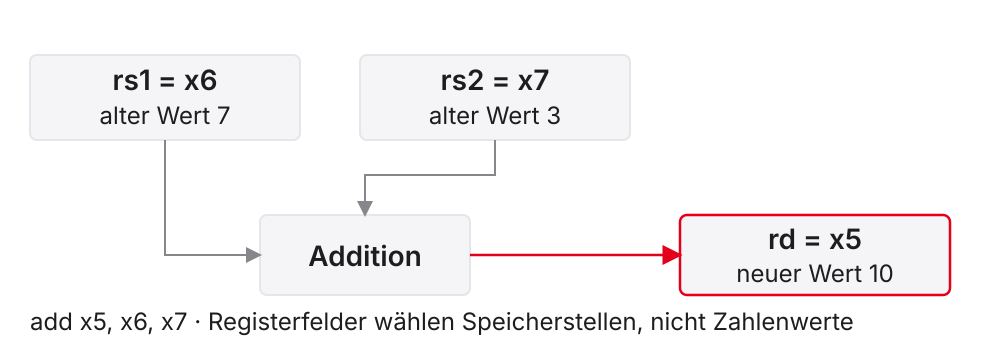{width=90%}

::: notes
add bedeutet Addition. In dieser Assemblerzeile ist x5 das Ziel, x6 die erste und x7 die zweite Quelle. Die Feldnamen rd, register destination, sowie rs1 und rs2, register source 1 und 2, bezeichnen diese Rollen. Sie sind keine weiteren Register. Für das didaktische Beispiel enthalten x6 und x7 vor der Instruktion die Werte 7 und 3. Nachher enthält x5 den Wert 10, während die Quellen unverändert bleiben.

Die Abbildung liest sich von den beiden oberen Quellregistern über die Addition zum unteren Ziel. Pfeile tragen 32-Bit-Werte. Der rote Pfeil und Rahmen markieren den neuen Zielwert, keine zweite Operation. Die Nummer 6 wählt das Register x6, dessen Inhalt hier 7 ist. Diese Unterscheidung wird bei der Codierung entscheidend. Die Regel „Ziel zuerst“ gilt für die hier behandelten Rechenbefehle; sie darf später nicht ungeprüft auf jeden Befehl übertragen werden.
:::

## Ein Register, zwei Namen

```asm
add x5, x6, x7
add t0, t1, t2       # dieselbe Registerauswahl
```

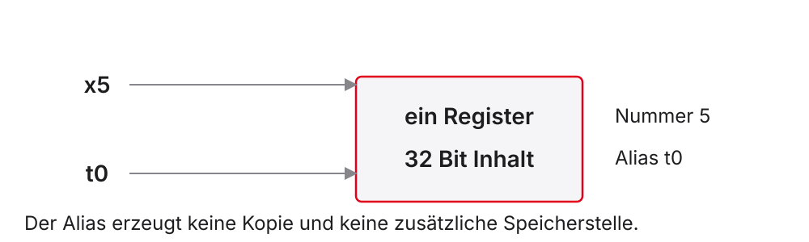{width=85%}

::: notes
Ein Alias ist ein zusätzlicher Name für dieselbe Sache. t0 ist der Alias von x5, t1 der von x6 und t2 der von x7. Das t steht für temporary, also temporäres Register. Beide gezeigten add-Zeilen wählen dieselben Quellen und dasselbe Ziel. Sie sind alternative Schreibweisen einer Addition, keine auszuführende Zweierfolge. Das Kommentarzeichen # leitet Text ein, den das Assemblerwerkzeug nicht als Befehl übersetzt.

Die Zeichnung zeigt zwei Namen links, deren Pfeile auf eine einzige 32-Bit-Speicherstelle führen. Der rote Rahmen betont deren Identität. Ein Schreiben nach t0 verändert deshalb zugleich den unter x5 angezeigten Wert. Es wird keine Kopie angelegt. x5 ist ein Architekturregistername, kein Beleg für eine bestimmte physische Schaltung. Die Aliasnamen helfen, die vereinbarte Verwendung eines Registers im Programm zu erkennen.
:::

## Registerrollen: die nötige Orientierung

| Namen | Nummern | Softwarevereinbarung |
|---|---|---|
| `zero` | `x0` | immer null |
| `t0`–`t6` | `x5`–`x7`, `x28`–`x31` | temporäre Werte |
| `s0`–`s11` | `x8`–`x9`, `x18`–`x27` | bei Funktionsrückkehr erhalten |
| `a0`–`a7` | `x10`–`x17` | Argumente, `a0` auch skalares Ergebnis |

Die ABI ist eine Softwarevereinbarung; Aufrufe folgen in Einheit 4.

::: notes
ABI steht für Application Binary Interface, die binäre Schnittstellenvereinbarung zwischen getrennt übersetzten Programmteilen. Sie legt unter anderem fest, welche Register Argumente transportieren und wer einen Wert über einen Funktionsaufruf hinweg erhält. zero ist x0. t bedeutet temporary, s saved und a argument. Die Tabelle ordnet diesen Aliasgruppen ihre Architekturregisternummern zu. Für die geradlinigen Laborrechnungen verwenden wir vor allem t0 bis t6.

Bei einer normalen Funktion darf der Aufrufer nicht erwarten, dass temporäre t- oder Argumentregister ihren alten Inhalt behalten. Verändert eine aufgerufene Funktion ein s-Register, muss sie bei Rückkehr dessen Eintrittswert wiederherstellen. Bloßes Lesen verlangt keine Sicherung. Die Hardware erledigt dies nicht automatisch. Der vollständige Aufrufmechanismus folgt später. Für skalare Ergebnisse dient üblicherweise a0. Venus verwendet bei seinen Umgebungsdiensten eine eigene Vereinbarung; diese behandeln wir ausdrücklich getrennt.
:::

## Eine Zustandsänderung von Hand

Anfang: `t0 = 7`, `t1 = 3`.

```asm
add t0, t0, t1
sub t1, t0, t1
add x0, t0, t1
```

Welche Werte stehen nach jeder Zeile in `t0`, `t1` und `x0`?

::: notes
add ist Addition, sub Subtraktion. Die temporären Register t0 und t1 heißen auch x5 und x6. x0 ist das Nullregister. Die Anfangswerte 7 und 3 sind ausdrücklich gewählte Lehrwerte. Auch wenn Quelle und Ziel identisch sind, liest eine Instruktion ihre Quellen aus dem Zustand vor dieser Instruktion. Die erste Zeile bildet daher 7 plus 3 und schreibt 10 nach t0.

Die zweite Zeile sieht bereits dieses neue t0. Sie berechnet 10 minus 3 und schreibt 7 nach t1. Die Zustände lauten somit nach Zeile eins: t0 gleich 10, t1 gleich 3, x0 gleich 0; nach Zeile zwei: 10, 7, 0. Die letzte Addition berechnet 17, aber das Ziel x0 verwirft dieses Ergebnis. Es bleiben 10, 7, 0. Diese Befehlssemantik ist von der Frage getrennt, in welchem Hardwaretakt ein konkreter Prozessor Registerzugriffe organisiert.
:::

## Der PC ist eine Adresse

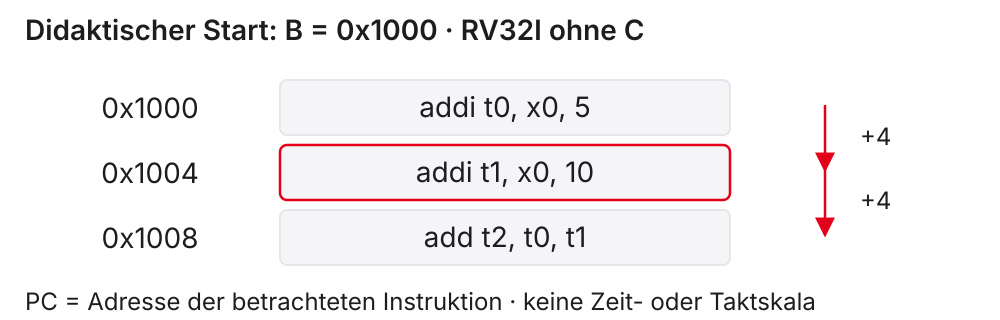{width=90%}

- Bei geradliniger Ausführung: $\mathrm{PC}_{\text{nach}}=\mathrm{PC}_{\text{vor}}+4$
- Labels und Kommentare belegen keine Instruktionsplätze.

::: notes
PC steht für Program Counter, den Programmzähler. Im betrachteten Befehlsmodell bezeichnet er die Adresse der aktuellen Instruktion; er gehört nicht zu x0 bis x31. Die Zeichnung verwendet den didaktisch angenommenen Start B gleich 0x1000, keine behauptete Startadresse von Venus. RV32I ist die 32-Bit-Integerbasis von RISC-V. Ohne die komprimierte Erweiterung C sind die gezeigten nativen Befehle vier Byte lang.

Von oben nach unten folgen deshalb die Adressen 0x1000, 0x1004 und 0x1008. Die roten Pfeile bedeuten eine Adresszunahme um vier Byte, keine Taktdauer. Der rote Rahmen markiert den Eintrag an Adresse 0x1004. PC vor und PC nach in der Formel sind die Adressen vor beziehungsweise nach einer normal fortlaufenden Instruktion. Nach der dritten Zeile ergibt sich 0x100C. Sprünge und Umgebungsaufrufe benötigen eigene Regeln. Ein Label benennt eine Adresse und ein Kommentar erklärt Text; beide erzeugen keine Instruktion. Eine Pseudozeile kann dagegen mehrere Plätze belegen.
:::

# 3. Mit Registerwerten rechnen


::: notes
Die Registerauswahl ist nun klar. Im nächsten Schritt unterscheiden wir die Operationen, die auf den ausgewählten Werten stattfinden. Addition und Subtraktion behandeln die 32 Bit als Zahlenmuster. Bitweise Befehle verknüpfen dagegen jede Bitstelle unabhängig. Schiebeoperationen versetzen die Stellen und legen fest, welche neuen Bits am Rand eingefügt werden.

Wir verwenden konkrete Anfangswerte, sodass jede Wirkung vollständig nachgerechnet werden kann. Besonders wichtig sind Fälle, in denen die mathematische Zahl außerhalb des darstellbaren Bereichs liegt oder ein negatives Zweierkomplement rechts geschoben wird. Eine Operation kann für vorzeichenlose und vorzeichenbehaftete Interpretationen desselben Musters unterschiedlich bewertet werden. Das gespeicherte Bitmuster ist trotzdem eindeutig. Diese Regeln bilden die Grundlage für die anschließenden Konstantenbefehle.
:::

## Addition: die unteren 32 Bit bleiben

$$R_{\text{neu}}=(A+B)\bmod 2^{32}$$

| Quellen | Ergebniswort | Interpretation |
|---|---|---|
| `5` und `10` | `0x0000000F` | 15 |
| `0xFFFFFFFF` und `1` | `0x00000000` | Umlauf |
| `0x7FFFFFFF` und `1` | `0x80000000` | signed: $-2^{31}$ |

`add` löst bei signed Überlauf keinen Überlauf-Trap aus.

::: notes
A und B sind die vor der Addition gelesenen 32-Bit-Quellwerte, R neu ist das neue Zielwort. Modulo 2 hoch 32 bedeutet, dass nur die unteren 32 Ergebnisbits erhalten bleiben. add arbeitet so unabhängig davon, ob Sie die Quellen als vorzeichenlos oder als signed, also vorzeichenbehaftet, interpretieren. Die erste Rechnung ergibt 15, hexadezimal 0x0000000F.

0xFFFFFFFF ist vorzeichenlos 2 hoch 32 minus 1. Mit eins ergibt sich mathematisch 2 hoch 32, im Ziel aber null. Als Zweierkomplement ist dieselbe Quelle minus eins, sodass minus eins plus eins ebenfalls null ergibt. Beim dritten Beispiel wird die größte positive signed Zahl zu 0x80000000, der kleinsten negativen Zahl. Das ist signed Überlauf. Ein Trap wäre eine außerordentliche Übergabe an die Umgebung; add löst wegen dieses Überlaufs keinen solchen aus. Es gibt dafür auch kein architektonisches Überlaufflag, also kein zusätzliches Statusbit.
:::

## Subtraktion: Reihenfolge beachten

```asm
# Lehrannahme: t0 = 7, t1 = 3
sub t2, t0, t1      # 7 - 3
sub t3, t1, t0      # 3 - 7
```

$$R_{\text{neu}}=(A-B)\bmod 2^{32}$$

`t2 = 0x00000004`, `t3 = 0xFFFFFFFC`.

::: notes
sub steht für subtract, also subtrahieren. t0 bis t3 sind temporäre Register; t0 und t1 enthalten hier ausdrücklich die Lehrwerte 7 und 3. Die erste Quelle ist der Minuend A, die zweite der Subtrahend B. t2 erhält daher vier. Beim Vertauschen der Quellen erhält t3 das 32-Bit-Muster für minus vier, 0xFFFFFFFC. Die Eingaben bleiben in beiden Zeilen unverändert.

Die Moduloformel beschreibt wiederum das Weglassen von Bits außerhalb der 32-Bit-Breite. Aus Vorlesung 1 kennen Sie die Subtraktion als Addition des Zweierkomplements. Hier müssen Sie keinen Addierer zeichnen, sondern die definierte Wirkung auf Register verfolgen. Eine häufige Verwechslung ist, die zweite Quelle vom Ziel statt von der ersten Quelle abzuziehen. Das Ziel benennt ausschließlich den Ort des neuen Werts; sein alter Inhalt wird nur verwendet, wenn es ausdrücklich auch als Quelle vorkommt.
:::

## Eine Gleichung braucht Zwischenergebnisse

$$Y=(A+B)-(C+D),\quad A=5,\ B=10,\ C=3,\ D=2$$

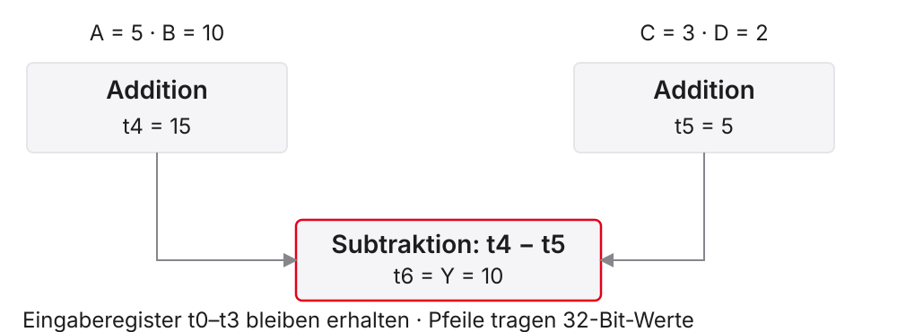{width=90%}

::: notes
A, B, C und D sind die didaktischen Eingabezahlen 5, 10, 3 und 2. Y ist das gesuchte Ergebnis. Wir legen die Eingaben in die temporären Register t0 bis t3 und behalten sie unverändert. Die erste Addition schreibt A plus B gleich 15 nach t4. Die zweite schreibt C plus D gleich 5 nach t5. Anschließend berechnet sub t6, t4, t5 die Differenz 15 minus 5 gleich 10.

Die Abbildung führt die beiden oberen Summen entlang grauer Pfeile zur unteren Subtraktion. Die Pfeile transportieren 32-Bit-Werte. Der rote Rahmen markiert das endgültige Ergebnis in t6. Die vertikale Anordnung beschreibt Abhängigkeiten und keine Taktachse. Würden Sie die erste Summe überschreiben, bevor die Subtraktion sie liest, wäre die Rechnung verloren. Das bewusste Zuweisen von Eingaben, Zwischenergebnissen und Zielregistern wird im Labor auf eine andere Gleichung übertragen.
:::

## Bitweise Logik arbeitet stellenweise

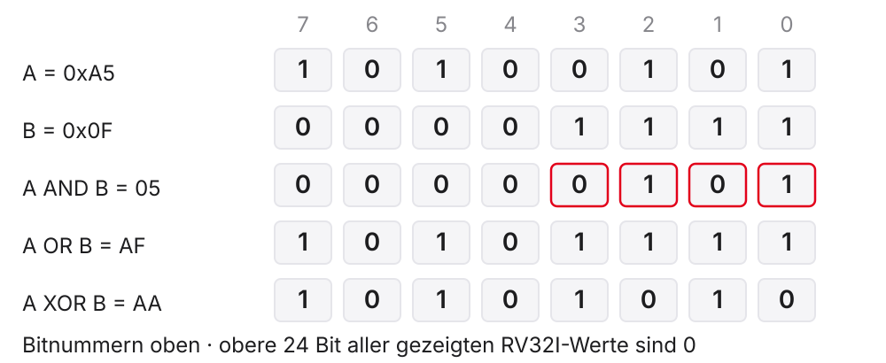{width=90%}

::: notes
AND ist die Und-Verknüpfung, OR die Oder-Verknüpfung und XOR das exklusive Oder. Die Befehle and, or und xor wenden diese Verknüpfung auf jede der 32 Bitstellen an. Die Zeichnung zeigt der Übersicht wegen nur die unteren acht Stellen; die oberen 24 Bit beider Quellen sind null. A ist 0xA5, binär 10100101, B ist 0x0F, binär 00001111. Bitnummer 7 steht links, Bitnummer 0 rechts.

Von oben nach unten sehen Sie die Quellen und die drei Ergebnisse. AND erhält nur Stellen, an denen beide Quellen eins sind: 0x05. OR erhält Stellen mit mindestens einer eins: 0xAF. XOR erhält Stellen mit verschiedenen Quellbits: 0xAA. Der rote Rahmen betont, dass die Maske 0x0F bei AND die unteren vier Stellen durchlässt. Die vollständigen Worte gehören zur RV32I-Basis von RISC-V mit 32-Bit-Integerregistern. Es wird nicht die Wahrheit des gesamten Zahlenwerts getestet. Beispielsweise ist das Ergebnis von XOR zweier verschiedener Zahlen nicht zwingend die Zahl eins.
:::

## Maskieren, setzen, invertieren

Lehrannahme: `t0 = 0x000000A5`, `t1 = 0x0000000F`.

```asm
and t2, t0, t1      # 0x00000005
or  t3, t0, t1      # 0x000000AF
xor t4, t0, t1      # 0x000000AA
xor t5, t0, t0      # 0x00000000
```

Eine Maske wählt einzelne Bitstellen aus.

::: notes
Eine Maske ist ein Bitmuster, dessen Stellen festlegen, welche Bits untersucht oder verändert werden. Die temporären Register t0 und t1 enthalten die angegebenen Lehrwerte; t2 bis t5 sind getrennte Ziele. and führt bitweises AND, also Und, aus und erhält die unteren vier Bits von t0. or verwendet OR, also Oder, und setzt diese vier Stellen unabhängig vom alten Wert. xor führt XOR, das exklusive Oder, aus und kippt genau die Stellen, an denen t1 eins enthält.

Die Ergebnisse sind 0x05, 0xAF und 0xAA, jeweils mit führenden Nullen auf 32 Bit. In der letzten Zeile sind beide Quellen identisch. Jede Stelle wird mit sich selbst exklusiv verodert und ergibt null, daher wird das gesamte Zielwort null. Das setzt nur t5 zurück und verändert t0 nicht. Zum Invertieren aller Stellen bräuchten wir als zweite Quelle ein Wort aus 32 Einsen. Eine passende Immediate-Variante folgt später.
:::

## Links schieben: Randbits gehen verloren

`sll rd, rs1, rs2`: links schieben, rechts Nullen einfügen.

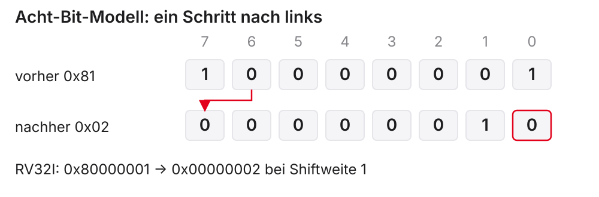{width=90%}

::: notes
sll bedeutet Shift Left Logical, logisches Schieben nach links. rd ist das Zielregister, rs1 die Wertquelle und rs2 das Register mit der Verschiebungsweite. Die Zeichnung verwendet oben ein begrenztes Acht-Bit-Modell: 0x81 wird um eine Stelle zu 0x02, weil die obere eins herausfällt. Der rote Pfeil zeigt beispielhaft den Weg von Bit 6 nach Bit 7; der rote Rahmen rechts markiert die eingefügte null. Bitnummern laufen von 7 links bis 0 rechts.

Im vollständigen RV32I-Modell, der 32-Bit-Integerbasis von RISC-V, geht stattdessen Bit 31 verloren. Der passende Grenzfall ist 0x80000001, das bei Weite eins zu 0x00000002 wird. Die acht Bit in der Zeichnung sind daher keine Behauptung, dass der 32-Bit-Wert 0x81 zu 0x02 würde: Dieser würde zu 0x102. Ohne Verlust relevanter Stellen entspricht ein Links-Shift der Multiplikation mit einer Zweierpotenz, etwa fünf um drei Stellen zu vierzig.
:::

## Rechts schieben: null oder Vorzeichen?

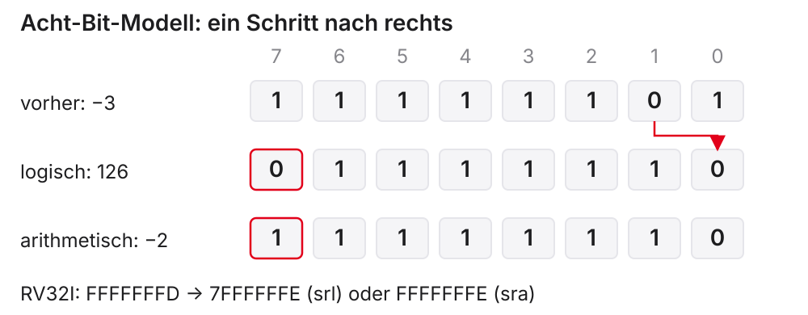{width=90%}

`srl` füllt mit null; `sra` kopiert das höchste Quellbit.

::: notes
srl steht für Shift Right Logical, logisches Rechtsschieben. sra bedeutet Shift Right Arithmetic, arithmetisches Rechtsschieben. Beide verlieren rechts die herausgeschobenen Stellen. Links fügt srl Nullen ein, während sra das höchste Quellbit wiederholt. Die Zeichnung veranschaulicht einen Schritt mit dem Acht-Bit-Zweierkomplement 11111101 für minus drei. Der rote Pfeil zeigt eine erhaltene Stelle auf ihrem Weg nach rechts. Die roten Rahmen links markieren die unterschiedlichen Füllbits.

Im Acht-Bit-Modell ergibt logisch 01111110, vorzeichenlos 126. Arithmetisch entsteht 11111110, signed minus zwei. RV32I, die RISC-V-Basis mit 32-Bit-Integerregistern, verwendet für minus drei 0xFFFFFFFD. Die Ergebnisse sind dort 0x7FFFFFFE beziehungsweise 0xFFFFFFFE. Arithmetisches Schieben einer negativen Zahl entspricht einer Division durch eine Zweierpotenz mit Abrundung nach unten: minus drei durch zwei wird minus zwei. Es ist daher nicht allgemein gleich einer Division mit Abschneiden zur null.
:::

## Registershift: nur fünf Bits zählen

$$k=\operatorname{unsigned}(R[rs2])\bmod 32$$

| Inhalt von `rs2` | effektive Weite $k$ | `sll` für Quelle 5 |
|---:|---:|---:|
| 1 | 1 | 10 |
| 31 | 31 | `0x80000000` |
| 32 | 0 | 5 |
| 33 | 1 | 10 |

::: notes
rs2 ist das zweite Quellregister, R von rs2 bezeichnet seinen aktuellen 32-Bit-Inhalt. unsigned bedeutet vorzeichenlose Interpretation. k ist die tatsächlich verwendete Shiftweite. Ein Registershift in der 32-Bit-Basis verwendet nur die unteren fünf Bits dieses Inhalts, also den Rest bei Division durch 32. Fünf Bit reichen für die Werte null bis 31. sll ist Shift Left Logical, logisches Linksschieben.

Bei der Quelle fünf ergibt Weite eins zehn. Bei Weite 31 bleibt nur die ursprüngliche Bitstelle null, die nach Bit 31 wandert: 0x80000000. Registerinhalt 32 hat die unteren fünf Bits null und verschiebt daher gar nicht. Inhalt 33 verschiebt um eins. Diese Begrenzung ist eine definierte Befehlswirkung und kein Assemblerfehler. Sie gilt genauso für logisches und arithmetisches Rechtsschieben mit Registerweite. Eine direkt im Befehl angegebene Shiftweite wird anders geprüft; der Unterschied folgt bei den Immediate-Befehlen.
:::

## Kopieren und negieren mit x0

Lehrannahme: `t0 = 5`.

```asm
add t1, t0, x0     # kopieren: t1 = 5
sub t2, x0, t0     # negieren: t2 = -5
```

- `x0` liefert die benötigte null.
- Sonderfall: `0x80000000` bleibt beim Negieren dasselbe Muster.

::: notes
Die temporären Register t0, t1 und t2 sind getrennte Speicherstellen. x0 ist das Nullregister. add addiert den Quellwert fünf mit null, wodurch eine Kopie nach t1 entsteht. sub subtrahiert fünf von null und schreibt das Zweierkomplement von minus fünf nach t2, hexadezimal 0xFFFFFFFB. Die Quelle t0 bleibt erhalten. Für beide Wirkungen genügen vorhandene Rechenbefehle.

Negieren bedeutet hier, das additive Gegenstück modulo 2 hoch 32 zu bilden. Beim kleinsten signed Wert, 0x80000000 beziehungsweise minus 2 hoch 31, ist die positive Gegenzahl nicht als signed 32-Bit-Zahl darstellbar. Das Zielwort bleibt daher 0x80000000. Es wird keine besondere Ausnahme ausgelöst. Später begegnet Ihnen mv, move, als Assemblerhilfe zum Kopieren. Dass eine Schreibweise bequem ist, bedeutet nicht, dass die Hardware dafür einen eigenen nativen Befehl benötigt.
:::

# 4. Konstanten direkt im Befehl


::: notes
Ein Registerbefehl benötigt zwei bereits vorhandene Werte. Für kleine feste Zahlen wäre es umständlich, stets ein weiteres Register vorzubereiten. Ein Immediate löst dieses Problem: Die Konstante wird Bestandteil der Instruktion und steht bei deren Ausführung unmittelbar zur Verfügung. Der bisherige Quellregisterwert und die Konstante sind dann die beiden Operanden.

Allerdings muss diese Zahl neben den übrigen Angaben in ein 32-Bit-Befehlswort passen. Ihr Feld ist deshalb begrenzt. Wir wenden die Vorzeichenerweiterung aus Einheit 1 nun auf zwölf statt auf acht Bit an. Danach betrachten wir bitweise und Schiebevarianten sowie Assemblerhilfen für größere Konstanten. Die Grenze des nativen Befehls ist dabei von der Bequemlichkeit einer Quelltextschreibweise zu unterscheiden.
:::

## addi: eine Quelle und eine Zahl

```asm
addi t0, x0, 5     # t0 = 5
addi t1, t0, 10    # t1 = 15
addi t1, t1, -4    # t1 = 11
```

$$R[rd]_{\text{neu}}=(R[rs1]+\operatorname{sext}_{12\to32}(imm))\bmod 2^{32}$$

::: notes
addi steht für Add Immediate, Addition mit einer unmittelbar codierten Konstante. rd ist das Zielregister, rs1 die Registerquelle und imm das zwölf Bit breite Immediate-Feld. R bezeichnet einen Registerinhalt. Die Schreibweise sext für sign extension bedeutet Vorzeichenerweiterung von zwölf auf 32 Bit. Anschließend gelten dieselben Modulo-Regeln wie für add: Nur die unteren 32 Ergebnisbits werden gespeichert.

Im Code sind t0 und t1 temporäre Register. x0 liefert null, sodass die erste Zeile fünf nach t0 schreibt. Die zweite liest diese fünf und addiert zehn, also erhält t1 den Wert 15. Die dritte liest den alten t1-Wert 15 und addiert minus vier, wodurch elf entsteht. Das letzte Argument bezeichnet eine Zahl, kein weiteres Register. Die Konstante liegt im Instruktionswort; es wird kein separates Datenwort aus dem Speicher geladen. Wie große und negative Zahlen codiert werden, hängt vom begrenzten Immediate-Feld ab.
:::

## Zwölf Bit: ein vorzeichenbehafteter Bereich

$$-2^{11}\le imm\le 2^{11}-1 \quad\Rightarrow\quad -2048\ldots2047$$

| Zwölf-Bit-Muster | signed Wert |
|---|---:|
| `0x7FF` = `0111 1111 1111` | 2047 |
| `0x800` = `1000 0000 0000` | −2048 |
| `0xFFF` = `1111 1111 1111` | −1 |

`addi t0, x0, 2048` ist keine gültige native Instruktion.

::: notes
imm bezeichnet das Immediate, also die direkt im Befehl gespeicherte Konstante. Zwölf Bit ergeben 4096 mögliche Muster. Als Zweierkomplement reicht der Bereich von minus 2048 bis plus 2047. signed bedeutet vorzeichenbehaftet. Das höchste Feldbit, Bit 11, bestimmt das Vorzeichen. 0x7FF hat dort null und ist 2047. 0x800 hat dort eins und stellt minus 2048 dar. Bei 0xFFF sind alle zwölf Stellen eins, daher bedeutet es minus eins.

addi, Add Immediate, nimmt eine Zahl aus diesem signed Bereich. Die positive Zahl 2048 ist deshalb unzulässig. Man kann nicht einfach ihr Muster 0x800 als positiven Wert in das Feld schreiben: Die Maschine würde es als minus 2048 verwenden. t0 ist das temporäre Ziel, x0 die Nullquelle. Für größere Konstanten verwenden wir später die Assemblerhilfe li. Eine genaue Fehlermeldung ist werkzeugabhängig, die Feldgrenze dagegen eine Eigenschaft des Befehls.
:::

## Vorzeichen auf 32 Bit erweitern

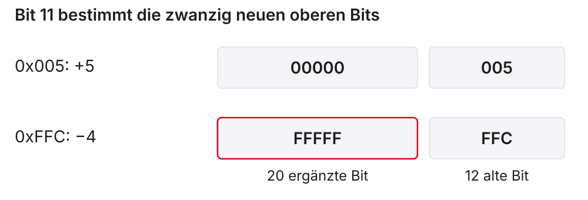{width=90%}

`addi t0, t1, -4` addiert `0xFFFFFFFC`, nicht `0x00000FFC`.

::: notes
Die Vorzeichenerweiterung kopiert Bit 11 des zwölf Bit breiten Immediate-Felds in die zwanzig neu ergänzten oberen Stellen. Der Zahlenwert bleibt dadurch im Zweierkomplement erhalten. Die Abbildung zeigt links den zwölf Bit breiten Ausgangswert und rechts zwei nebeneinanderliegende Teile des 32-Bit-Ergebnisses. Es handelt sich um Hexdarstellungen: fünf Ziffern für die ergänzten zwanzig Bit, drei für die unveränderten zwölf Bit.

Plus fünf, 0x005, wird zu 0x00000005. Minus vier, 0xFFC, wird zu 0xFFFFFFFC. Der rote Rahmen hebt die zwanzig eingefügten Einsen im negativen Fall hervor. In addi t0, t1, minus vier liest die Addition mit Immediate den alten Wert des temporären Registers t1 und addiert genau dieses erweiterte Wort. Bei t1 gleich 15 entsteht elf. Eine Nullerweiterung würde stattdessen 4092 addieren und wäre hier falsch. Diese Regel gilt auch für die folgenden logischen Immediate-Befehle.
:::

## Auch logische Immediates sind signed

Lehrannahme: `t0 = 0x000000A5`.

```asm
andi t1, t0, 0x0F    # t1 = 0x00000005
ori  t2, t1, 0x80    # t2 = 0x00000085
xori t3, t0, -1      # t3 = 0xFFFFFF5A
```

Die Maske `-1` wird auf 32 Einsen erweitert.

::: notes
andi, ori und xori bedeuten AND Immediate, OR Immediate und XOR Immediate. Sie verknüpfen bitweise mit einer direkten Konstante: Und, Oder beziehungsweise exklusives Oder. t0 bis t3 sind temporäre Register. Der Immediate wird in allen drei Fällen von zwölf auf 32 Bit vorzeichenerweitert. Eine logische Operation macht ihn nicht automatisch vorzeichenlos.

Die erste Zeile lässt aus 0xA5 die unteren vier Bits durch und liefert 0x05. Die zweite setzt Bit 7 dieses Zwischenergebnisses und schreibt 0x85 nach t2. Die dritte verwendet wieder die ursprüngliche Quelle t0, nicht t2. Minus eins ist zwölf Bit 0xFFF und wird zu 0xFFFFFFFF. XOR mit dieser Maske invertiert jede der 32 Stellen, sodass 0xFFFFFF5A entsteht. Wer nur die unteren zwölf Bit durchlassen möchte, benötigt dagegen die positive Maske 4095. Diese passt nicht in das signed Immediate-Feld; man lädt sie in ein Register und verwendet den Registerbefehl and.
:::

## Shift-Immediate: eine besondere Aufteilung

| Registerweite | direkte Weite | Füllung |
|---|---|---|
| `sll` | `slli` | links schieben, rechts null |
| `srl` | `srli` | rechts schieben, links null |
| `sra` | `srai` | rechts schieben, links Vorzeichen |

- `shamt`: direkt codierte Weite, in RV32I nur 0 bis 31
- `slli t0, t1, 32` ist unzulässig; Registerweite 32 ergibt Weite 0.

::: notes
Die Abkürzungen sll, srl und sra bedeuten Shift Left Logical, Shift Right Logical und Shift Right Arithmetic: logisch links, logisch rechts und arithmetisch rechts schieben. Das zusätzliche i kennzeichnet die Immediate-Variante. shamt steht für shift amount, die direkt codierte Verschiebungsanzahl. In RV32I, der 32-Bit-Integerbasis von RISC-V, benötigt diese Anzahl fünf Bit und reicht von null bis 31.

Bei diesen Befehlen ist das obere zwölf Bit breite Feld keine frei wählbare signed Zahl. Es enthält sowohl die fünf Weitenbits als auch Funktionsinformation für die Schiebeart. Deshalb darf die normale addi-Regel nicht auf das gesamte Feld übertragen werden. Ein Assembleroperand 32 ist bei slli nicht als gültige Weite codierbar. Beim Registerbefehl sll zählt dagegen nur der untere Fünf-Bit-Teil des Registerinhalts 32 und ergibt null. Mit t1 gleich minus drei schreibt srai t0, t1, 1 das Wort 0xFFFFFFFE, also minus zwei.
:::

## Subtrahieren mit addi: die Grenze prüfen

```asm
addi t0, t0, -7      # eine gültige Subtraktion von 7
```

$$X-K=X+(-K)$$

- RV32I benötigt dafür keinen nativen `subi`-Befehl.
- Gegenbeispiel: Subtraktion von $-2048$ benötigt $+2048$.

::: notes
addi ist Add Immediate, Addition einer direkten Konstante. Für den temporären Registerwert X in t0 gilt die algebraische Umformung X minus K gleich X plus minus K. K ist die abzuziehende Konstante. Für K gleich sieben passt minus sieben in das signed Zwölf-Bit-Feld. Der gezeigte Befehl vermindert daher beispielsweise 20 auf 13.

RV32I ist die RISC-V-Basis mit 32-Bit-Integerregistern. Sie hat keinen nativen subi-Befehl für eine separate Subtraktion mit Immediate. Daraus folgt aber nicht, dass jede konstante Subtraktion mit einem einzelnen addi möglich ist. Bei K gleich minus 2048 wäre der Additionsoperand plus 2048, und dieser liegt knapp außerhalb des zulässigen Bereichs. Man kann stattdessen die Konstante minus 2048 in ein weiteres Register laden und mit sub abziehen. Die Umformung ist mathematisch korrekt; die begrenzte Codierung entscheidet zusätzlich, ob eine einzelne Instruktion genügt.
:::

## Pseudoinstruktionen: Hilfe des Assemblers

| Quelltext | Bedeutung | gültige native Entwicklung |
|---|---|---|
| `li t0, 42` | Konstante laden | `addi t0, x0, 42` |
| `mv t1, t0` | kopieren | `addi t1, t0, 0` |

- `li` kann bei großen Werten mehrere Instruktionen erzeugen.
- Der Prozessor führt die erzeugten nativen Befehle aus.

::: notes
Eine Pseudoinstruktion ist eine bequeme Assemblertextschreibweise, die das Assemblerwerkzeug in native Maschinenbefehle entwickelt. li bedeutet Load Immediate, Laden einer Konstante; mv steht für move, Kopieren. Die temporären Register t0 und t1 sind die angegebenen Ziele beziehungsweise Quellen, x0 liefert null. li t0, 42 lässt sich als addi t0, x0, 42 umsetzen, denn 42 liegt im signed Zwölf-Bit-Bereich. mv t1, t0 lässt sich als Addition der direkten null schreiben.

Der Prozessor braucht für diese beiden Pseudonamen keine zusätzlichen Operationscodes. Er sieht nur die ausgegebenen nativen Instruktionswörter. Bei einer größeren li-Konstante können mehrere Wörter nötig sein. Deshalb zählen Kommentare, Labels, native Befehle und Pseudozeilen unterschiedlich. Die Tabelle zeigt gültige Entwicklungen, keinen behaupteten Ausgabeausschnitt eines gestarteten Assemblers. Im Simulator prüfen Sie später die tatsächlich erzeugte Folge, statt die Zahl der Quelltextzeilen als Zahl der Befehle anzunehmen.
:::

## Warum li 2048 mehr als einen Schritt braucht

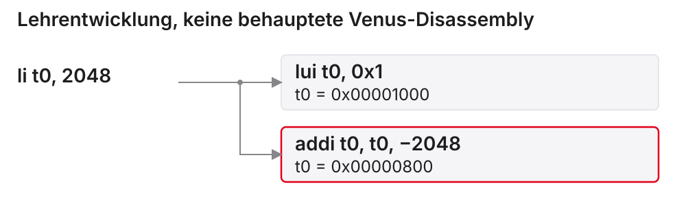{width=90%}

::: notes
li, Load Immediate, ist die Assemblerhilfe zum Laden einer Konstante. t0 ist das temporäre Zielregister. Der Wert 2048 ist positiv und passt nicht in ein normales addi-Immediate. Die Abbildung zeigt eine gültige Lehrentwicklung, keine behauptete Venus-Disassembly. Disassembly bedeutet eine menschenlesbare Darstellung vorhandener Maschinenwörter.

lui heißt Load Upper Immediate. Dieser native Befehl setzt einen oberen Anteil in die Bits 31 bis 12 und lässt die unteren zwölf Bit null. lui t0, 0x1 ergibt deshalb 0x00001000, also 4096. addi, Add Immediate, addiert anschließend minus 2048 und liefert 0x00000800, also 2048. Die grauen Pfeile verbinden die Pseudozeile mit den zwei nativen Befehlen; der rote Rahmen markiert den erst nach dem zweiten Befehl fertigen Wert. Das vollständige obere Format wird später vertieft. Hier genügt die erklärte Wirkung dieses Beispiels: Nach dem ersten nativen Schritt ist die Konstante noch nicht fertig geladen.
:::

## Zwischenhalt: Ergebnis und Zulässigkeit

Lehrannahme: `t0 = 0xFFFFFFFD` ($-3$).

1. `srai t1, t0, 1`: Ergebnis?
2. `xori t2, t0, -1`: Ergebnis?
3. `addi t3, x0, 2048`: gültig?
4. `sll t4, t0, t5` mit `t5 = 32`: Ergebnis?

::: notes
t0 bis t5 sind temporäre Register. Der vorgegebene Quellwert ist das 32-Bit-Zweierkomplement von minus drei. srai steht für Shift Right Arithmetic Immediate, arithmetisches Rechtsschieben mit direkter Weite. Es füllt links mit dem gesetzten Vorzeichenbit und ergibt 0xFFFFFFFE, also minus zwei. xori, XOR Immediate, führt exklusives Oder mit der vorzeichenerweiterten direkten minus eins aus. Es kippt alle Stellen von 0xFFFFFFFD und ergibt 0x00000002.

addi, Add Immediate, kann plus 2048 nicht als signed Zwölf-Bit-Konstante codieren; die dritte Zeile ist deshalb unzulässig. sll ist Shift Left Logical mit einer Registerweite. t5 gleich 32 hat in den unteren fünf Bits null, daher bleibt das Zielwort t4 gleich 0xFFFFFFFD. Prüfen Sie zuerst die Zulässigkeit einer Instruktion und erst dann ihre Wirkung. Ein ungültiger Assembleroperand hat kein normales Ergebnis, das man durch Abschneiden einfach erraten dürfte.
:::

# 5. Vom Befehl zum 32-Bit-Wort


::: notes
Die Wirkung der Befehle ist bekannt. Nun können wir erklären, wie diese Wirkung im Instruktionswort beschrieben wird. Das Wort muss die Operation und die benötigten Register oder Konstanten enthalten. Die festgelegten Bitpositionen ermöglichen es der Hardware, diese Informationen zu erkennen, ohne den ursprünglichen Assemblertext zu sehen.

Codierung verbindet damit die Softwarebeschreibung mit dem späteren Steuerwerk. Sie beantwortet noch nicht, wie ein bestimmter Prozessor seine Steuerleitungen zeitlich erzeugt. Wir beginnen mit dem Registerformat, arbeiten eine vollständige Addition durch und lesen ein anderes Wort rückwärts. Anschließend übertragen wir den Weg auf addi. Für alle Papieraufgaben stehen die benötigten Feldpositionen und Operationswerte zur Verfügung; es geht um ihren begründeten Einsatz, nicht um das Auswendiglernen einer langen Codetabelle.
:::

## Text, Werkzeug und Maschinenwort

- Assemblertext: `add t0, t1, t2`
- Assemblerwerkzeug: löst Namen auf und codiert Felder
- Maschinenwort: `0x007302B3`
- Prozessor: decodiert dieses Wort und führt die Wirkung aus

::: notes
Assemblertext ist die symbolische Schreibweise für Maschinenbefehle. Das Assemblerwerkzeug ist das Programm, das diesen Text übersetzt. Maschinencode besteht aus den binären Instruktionswörtern. Diese drei Bedeutungen sollte man auseinanderhalten, obwohl das Wort Assembler im Alltag sowohl Sprache als auch Werkzeug bezeichnen kann.

add ist die Addition. Die Aliasnamen t0, t1 und t2 bezeichnen x5, x6 und x7. Die Zeile wählt das Ziel x5 und die Quellen x6 und x7. Ihr numerisches Instruktionswort ist 0x007302B3. Es hängt von diesen Registernummern und der Operation ab, nicht von den aktuellen Werten in den Registern. Ob x6 gerade sieben oder hundert enthält, verändert die Codierung nicht. Der Prozessor sieht auch keine Kommas und Kommentare; diese sind Aufgaben des Textparsers im Übersetzungswerkzeug. Ein Parser zerlegt den Text in seine Bestandteile. Erst das fertige Wort ist die Eingabe des Befehlsdecoders.
:::

## R-Format: sechs feste Felder

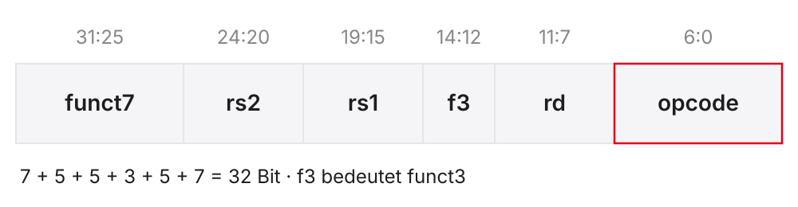{width=95%}

`rd`, `rs1`, `rs2`: je 5 Bit für eine Registernummer von 0 bis 31.

::: notes
R-Format ist das Registerformat. rd, register destination, bezeichnet das Ziel. rs1 und rs2, register source 1 und 2, sind die beiden Quellen. Jedes Registerfeld hat fünf Bit, weil 2 hoch 5 gleich 32 mögliche Nummern ergibt. opcode ist der Operationscode für eine Befehlsfamilie. funct3 und funct7, in der Zeichnung teilweise f3, sind drei beziehungsweise sieben Bit Funktionsinformation zur genaueren Auswahl der Operation.

Die Abbildung liest sich von Bit 31 links bis Bit 0 rechts. Die Boxbreiten sind proportional zur Bitzahl. Von links folgen funct7, rs2, rs1, funct3, rd und opcode. Ihre Breiten sieben, fünf, fünf, drei, fünf und sieben addieren sich zu 32. Der rote Rahmen rechts hebt den Familiencode hervor. Die Registerfelder enthalten Nummern, keine Quellwerte. Aus dem Wort weiß ein Decoder daher, woher die Operanden kommen sollen; die tatsächlichen Inhalte liest der Datenpfad aus den gewählten Registern.
:::

## Opcode allein reicht nicht

| Befehl | opcode | funct3 | funct7 |
|---|---|---|---|
| `add` | `0110011` | `000` | `0000000` |
| `sub` | `0110011` | `000` | `0100000` |
| `and` | `0110011` | `111` | `0000000` |
| `or` | `0110011` | `110` | `0000000` |
| `xor` | `0110011` | `100` | `0000000` |

Erst die Kombination bezeichnet die Operation eindeutig.

::: notes
opcode ist der sieben Bit breite Operationscode der Befehlsfamilie. funct3 und funct7 heißen hier Funktionsfelder und verfeinern die Auswahl mit drei und sieben Bit. 0110011 kennzeichnet die betrachtete Registerarithmetik und Registerlogik. Es ist nicht schon der Code für eine Addition. add addiert und sub subtrahiert; beide haben denselben opcode und dasselbe funct3. Erst funct7 unterscheidet sie.

and, or und xor bedeuten bitweises AND, OR und XOR: Und, Oder und exklusives Oder. Ihre funct3-Werte unterscheiden sich. Bei add und sub mit sonst identischen Feldern ändert sich Instruktionsbit 30, das zu funct7 gehört. Ein beliebiges Wort mit gesetztem Bit 30 ist deshalb aber nicht automatisch sub; die anderen Felder müssen ebenfalls passen. Die Tabelle zeigt gültige Kombinationen dieses Ausschnitts. Sie behauptet keine zeitliche Reihenfolge des Decoders: Ein Hardwareentwurf kann mehrere Felder gleichzeitig auswerten.
:::

## Codieren: erst die Felder bestimmen

Beispiel: `add x9, x20, x21`.

| Feld | Wert | Binärfeld |
|---|---:|---|
| `rd` | 9 | `01001` |
| `rs1` | 20 | `10100` |
| `rs2` | 21 | `10101` |
| `funct3` | 0 | `000` |
| `funct7` | 0 | `0000000` |
| `opcode` | `0x33` | `0110011` |

::: notes
add ist die Addition; der Auftrag benennt Ziel x9 sowie Quellen x20 und x21. Die aktuellen Registerinhalte werden für die Codierung nicht benötigt. rd, register destination, enthält die Zielnummer neun. rs1 und rs2, register source 1 und 2, enthalten 20 und 21. Neun zerlegt sich in acht plus eins und wird als Fünf-Bit-Feld 01001 geschrieben. Zwanzig ist 16 plus vier, also 10100. Einundzwanzig ergänzt eine eins und wird 10101.

funct3 und funct7 sind die drei und sieben Bit breiten Funktionsfelder. Für add sind beide null. opcode ist der sieben Bit breite Operationscode der Familie, 0110011 beziehungsweise hexadezimal 0x33. Wichtig ist die feste Breite: Führende Nullen dürfen beim Aneinanderfügen nicht verschwinden. Außerdem listet diese Tabelle die Register zunächst zum Verständnis in Syntaxreihenfolge. Im fertigen Wort steht rd nicht links, sondern an den Bits 11 bis 7.
:::

## Codieren: verbinden und in Hex lesen

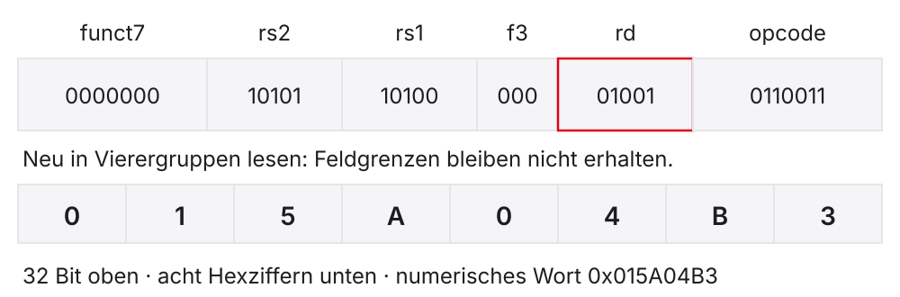{width=95%}

`add x9, x20, x21` → `0x015A04B3`.

::: notes
add addiert die Werte der Architekturregister x20 und x21 und schreibt nach x9. Für die Codierung wählen rd, register destination, sowie rs1 und rs2, register source 1 und 2, die Nummern neun, 20 und 21. funct7 und funct3, in der Abbildung f3, sind die Funktionsfelder. opcode ist der Familiencode. Die obere Reihe ordnet ihre bereits bestimmten Werte von Bit 31 links bis Bit 0 rechts an: 0000000, 10101, 10100, 000, 01001, 0110011.

Die untere Reihe gruppiert dieselben 32 Bits neu in acht Vierergruppen: 0000 0001 0101 1010 0000 0100 1011 0011. Daraus entstehen die Hexziffern 0, 1, 5, A, 0, 4, B, 3. Der rote Rahmen markiert das Zielfeld oben; dessen Grenzen stimmen nicht mit den Hexzifferngrenzen überein. Das Ergebnis 0x015A04B3 ist ein numerisches Wort. Die Reihenfolge seiner Byte im Speicher ist eine zusätzliche Frage, die wir gleich getrennt behandeln.
:::

## Decodieren: den Weg umkehren

Wort: `0x007302B3`.

```text
0000000 00111 00110 000 00101 0110011
funct7  rs2   rs1   f3  rd    opcode
```

1. Familie und Operation aus `opcode`, `funct3`, `funct7` bestimmen.
2. Registerfelder als Nummern lesen.
3. Ergebnis: `add x5, x6, x7` = `add t0, t1, t2`.

::: notes
Decodieren bedeutet, ein vorhandenes Instruktionswort in seine festgelegten Felder zu zerlegen. Wir schreiben 0x007302B3 zunächst als 32 Bit und schneiden an den Feldgrenzen. opcode ist der Familiencode 0110011. funct3, hier f3, ist 000 und funct7 ist 0000000. Die Kombination kennzeichnet add, die Addition. rs2, register source 2, enthält 00111 und damit Nummer sieben. rs1, register source 1, enthält 00110 und damit sechs. rd, register destination, enthält 00101 und damit fünf.

Die Assembler-Syntax setzt das Ziel wieder an die erste Stelle: add x5, x6, x7. Mit den temporären Aliasnamen ergibt sich add t0, t1, t2. Die Reihenfolge der Felder im Wort darf also nicht einfach als Reihenfolge der Argumente abgeschrieben werden. Das decodierte Wort gibt die Registerauswahl an, aber ohne einen Anfangszustand keinen Zahlenwert des Ergebnisses. Codierung und Zustandsrechnung sind verschiedene Aufgaben, die sich nun zusammenführen lassen.
:::

## Wortdarstellung und Bytefolge

Instruktionswort: `0x015A04B3`.

| Adresse, Lehrannahme | Byte in Little Endian |
|---|---|
| `0x1000` | `0xB3` |
| `0x1001` | `0x04` |
| `0x1002` | `0x5A` |
| `0x1003` | `0x01` |

Die Hexschreibweise des numerischen Worts wird nicht umgedreht.

::: notes
Little Endian bedeutet, dass das niederwertigste Byte eines mehrbyteigen Worts an der kleinsten Adresse liegt. Diese Reihenfolge ist die Festlegung unserer Kursumgebung. Ein Byte umfasst acht Bit, in Hexdarstellung zwei Ziffern. Wir nehmen als reine Lehradresse 0x1000 an. Das niederwertige Byte des Wortes 0x015A04B3 ist 0xB3, danach folgen 0x04, 0x5A und 0x01.

Die Tabelle ordnet diese Byte den vier aufeinanderfolgenden Adressen zu. Die Schreibweise 0x015A04B3 bleibt die numerische Darstellung des gesamten 32-Bit-Worts, mit der höchstwertigen Ziffer links. Wer die Speicherfolge B3 04 5A 01 als neues numerisches Wort 0xB3045A01 decodiert, untersucht ein anderes Bitmuster. Aus Einheit 1 kennen Sie dieselbe Unterscheidung bei Datenwörtern. Hier gilt sie ebenso für die betrachteten 32-Bit-Instruktionen. Feldgrenzen beziehen sich auf das zusammengesetzte Wort, nicht auf die Reihenfolge, in der Byte in einer Speicheransicht aufgelistet werden.
:::

## I-Format: Immediate statt zweiter Quelle

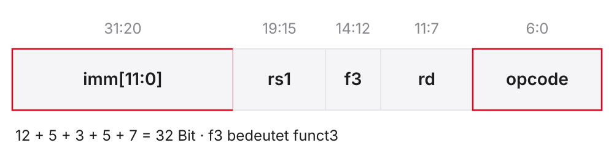{width=95%}

Für `addi`: `opcode = 0010011`, `funct3 = 000`.

::: notes
I-Format bezeichnet das Immediate-Format. imm von 11 bis 0 ist das zwölf Bit breite Feld der direkten Konstante. rs1, register source 1, ist die Registerquelle und rd, register destination, das Ziel. funct3, im Bild f3, ist das drei Bit breite Funktionsfeld. opcode ist der sieben Bit breite Familiencode. Die Darstellung läuft von Bit 31 links bis Bit 0 rechts, mit proportionalen Feldbreiten.

Der rote Rahmen links betont den Immediate-Bereich, der im Registerformat noch funct7 und rs2 enthielt. Hier dürfen diese alten Feldnamen nicht weiterverwendet werden. Zwölf plus fünf plus drei plus fünf plus sieben ergibt 32 Bit. Bei addi, Add Immediate beziehungsweise Addition einer direkten Konstante, lautet opcode 0010011, hexadezimal 0x13, und funct3 ist 000. Andere Befehle können dieselbe Formatfamilie anders nutzen. Die Folie beschreibt den Rechenfall addi; insbesondere ist das zwölf Bit breite Feld bei Shift-Immediate-Befehlen zusätzlich in Weite und Funktionsinformation aufgeteilt.
:::

## Ein negatives addi vollständig codieren

`addi t0, t1, -4` = `addi x5, x6, -4`.

```text
imm[11:0]   rs1   f3  rd    opcode
111111111100 00110 000 00101 0010011

1111 1111 1100 0011 0000 0010 1001 0011
   F    F    C    3    0    2    9    3
```

Maschinenwort: `0xFFC30293`.

::: notes
addi steht für Add Immediate, Addition einer direkt codierten Konstante. t0 und t1 sind die temporären Aliase für x5 und x6. rd, register destination, wird daher 00101; rs1, register source 1, wird 00110. funct3, hier f3, ist das Funktionsfeld 000. opcode ist der Familiencode 0010011. imm von 11 bis 0 bezeichnet die zwölf Bit des Immediate.

Minus vier wird in zwölf Bit als 2 hoch 12 minus vier gleich 4092 dargestellt: 0xFFC, binär 111111111100. Wir verbinden dieses Feld mit den vier übrigen Feldern und gruppieren erst danach in Vierergruppen. Daraus ergibt sich 0xFFC30293. Eine Rückprüfung liest oben wieder 0xFFC aus und interpretiert es signed: 4092 minus 4096 gleich minus vier. Mit einem alten x6-Wert 15 würde die Instruktion elf nach x5 schreiben. Diese Ergebnisrechnung folgt aus dem Anfangszustand; im Maschinenwort selbst steht nur die Konstante minus vier und die Registernummer sechs.
:::

# 6. Vorhersagen und mit Venus vergleichen


::: notes
Das Papiermodell verbindet nun Syntax, Befehlswort und Zustandsänderung. Der Simulator macht diese drei Ebenen nebeneinander beobachtbar. Bevor Sie auf eine Schaltfläche klicken, halten Sie fest, welche native Instruktion ausgeführt werden soll und welche Register danach andere Inhalte haben müssten. So wird die Bedienung zu einer Prüfung Ihrer Erklärung.

Venus ist der webbasierte Assembler und RISC-V-Simulator für diese Übung. Die genaue Oberfläche kann sich zwischen Distributionen unterscheiden. Entscheidend sind erfolgreicher Übersetzungslauf, Registeranzeige, Instruktionsansicht und ein nachvollziehbarer Neustart. Für eine Konsolenausgabe benötigen wir außerdem einen Dienst der simulierten Umgebung. Dessen Registervereinbarung erklären wir, bevor Sie das vollständige Programm schreiben; sie darf nicht mit der Vereinbarung normaler Funktionsrückgaben verwechselt werden.
:::

## Der erste verlässliche Vergleich

- Kurs-Venus: [thaumicmekanism.github.io/venus](https://thaumicmekanism.github.io/venus/)
- Text eingeben und erfolgreich assemblieren
- Tatsächlich erzeugte native Instruktionen ansehen
- Anfangswerte notieren, Step ausführen, Zustände vergleichen
- Nach Änderungen neu assemblieren und zurücksetzen

::: notes
Venus ist ein Assemblerwerkzeug und Simulator für die RISC-V-Befehlswirkung. Die verlinkte Kursdistribution ist die Arbeitsumgebung; Hinweise zu den Diensten finden Sie in der zugehörigen Dokumentation. Assemblieren übersetzt den Assemblertext zu Maschinenwörtern. Die Instruktionsansicht zeigt, welche nativen Befehle tatsächlich entstehen. Gerade bei li, Load Immediate, sollten Sie die Expansion einer großen Konstante ansehen.

Ein Step ist der einzelne Ausführungsschritt der Bedienoberfläche. Ordnen Sie ihn der nativen Instruktion und dem Zustand davor zu. Ein Reset, also Zurücksetzen, stellt den Anfangszustand wieder her. Nach einer Textänderung müssen Sie erneut assemblieren und den Lauf neu beginnen, damit Sie nicht einen alten Zustand beobachten. Exakte Schaltflächennamen sind keine Voraussetzung des Blatts. Der Simulator zeigt Befehlswirkungen, keine Hardwarelaufzeit. Die Programme sind vollständig notiert; ihre konkreten Venus-Anzeigen sollen Sie im Labor selbst protokollieren, statt eine vorgespielte Messung zu übernehmen.
:::

## Direktive, Label, Kommentar oder Befehl?

```asm
.text
.globl main
main:
    addi t0, x0, 5    # Eingabe
    addi t1, x0, 10
    add  t2, t0, t1
```

Codeausschnitt: Der Umgebungsabschluss fehlt hier noch.

::: notes
Dieser Assemblerausschnitt initialisiert die temporären Register t0 und t1 mit fünf und zehn; t2 erhält durch add den Wert 15. addi heißt Add Immediate und add ist die Registeraddition. x0 liefert null. .text ist eine Direktive des Assemblerwerkzeugs für den Codeabschnitt. .globl main macht das Symbol main global sichtbar. main ist ein Label, das eine Adresse benennt. Ein Label legt allein noch nicht universell den Startmechanismus jedes Werkzeugs fest; hier steht main am Beginn unseres Programms.

Das Zeichen # beginnt einen Kommentar. Direktiven, das Label und der Kommentar erzeugen keine zusätzlichen Recheninstruktionen. Im Ausschnitt stehen genau drei native Befehle. Nach diesen Zeilen ist aber noch kein kontrollierter Abschluss beschrieben; deshalb wird der Code ausdrücklich als Ausschnitt bezeichnet. Im vollständigen Laborprogramm folgt ein Dienstaufruf zum Beenden. Für die Adressrechnung betrachten Sie die assemblierte Instruktionsliste, nicht die sichtbare Zahl der Textzeilen.
:::

## ecall: die Venus-Dienste haben eigene Rollen

| Zweck | `a0` | `a1` |
|---|---:|---|
| ganze Zahl ausgeben | Dienst 1 | Druckwert |
| Programm beenden | Dienst 10 | hier unbenutzt |

- `ecall` fordert einen Dienst der Umgebung an.
- Normale Funktion: `a0` kann Ergebnis sein.
- Venus-Dienst: `a0` ist hier die Dienstnummer.

::: notes
ecall heißt Environment Call, Aufruf der Ausführungsumgebung. Der Befehl selbst legt nicht allgemein fest, wie eine Konsole bedient wird. Die Kursdistribution von Venus definiert dafür Dienste. a0 und a1 sind die Argumentregister mit den Architekturregisternummern x10 und x11. Für Dienst eins, Print Integer beziehungsweise Ganzzahlausgabe, enthält a0 die Dienstnummer und a1 den signed 32-Bit-Druckwert. Dienst zehn beendet den Lauf.

Diese Zuordnung gilt für die verwendete Venus-Umgebung. Sie darf nicht ohne Prüfung auf ein Betriebssystem oder auf einen anderen Simulator übertragen werden. Ebenso ist sie von der normalen Funktionsvereinbarung zu unterscheiden, bei der a0 ein skalares Ergebnis zurückgeben kann. Wenn Ihre Rechnung in t6 liegt, müssen Sie den Wert deshalb nach a1 kopieren; a0 wird zum Auswählen des Diensts überschrieben. Die Tabelle zeigt konkrete Vorbedingungen vor dem jeweiligen ecall. Sie verspricht keine allgemeine Erhaltung aller übrigen Register nach beliebigen Umgebungsdiensten.
:::

## Ein vollständiges Druckprogramm

```asm
.text
.globl main
main:
    addi t0, x0, 42
    addi a1, t0, 0
    addi a0, x0, 1
    ecall
    addi a0, x0, 10
    ecall
```

Erwartung: Konsolenzahl `42`, anschließend Ende.

::: notes
Dieses vollständige Assemblerprogramm gilt für die Kurs-Venus-Dienste. .text wählt den Codeabschnitt, .globl veröffentlicht das Label main am Beginn. addi, Add Immediate, initialisiert das temporäre Register t0 mit 42 aus der Nullquelle x0. Die zweite Instruktion kopiert 42 durch Addition von null nach a1, dem Argumentregister x11. a0, Argumentregister x10, erhält die Dienstnummer eins. ecall, Environment Call, fordert damit die Ganzzahlausgabe an.

Nach der Ausgabe benötigt das Programm keinen erhalten gebliebenen temporären Rechenwert mehr. Es setzt a0 ausdrücklich neu auf zehn und beendet den Lauf mit einem weiteren ecall. Die erwartete Konsolenzahl ist 42; ein bestimmtes Zeilenumbruchverhalten wird nicht vorausgesetzt. Die numerische Vorhersage folgt aus dem Dienstvertrag und der Rechnung, nicht aus einem hier behaupteten Venus-Lauf. Der kontrollierte Abschluss verhindert, dass man nach dem letzten Rechenbefehl ohne erklärte Umgebung weiterläuft. Dieses Muster bildet den Rahmen für Ihre eigene Gleichung.
:::

## Laborauftrag: Messkorrektur berechnen

$$Y=(A-B)+4C$$

- `t0`–`t2`: $A=12$, $B=19$, $C=5$
- `t3`: Differenz; `t4`: vierfaches C; `t5`: Ergebnis
- Vor der Ausgabe: Werte am Label `Ergebnis_pruefen` prüfen
- Venus: Ergebnis nach `a1`, Dienst 1, danach Dienst 10

Im Übungsblatt: Programm verfolgen, codieren, Fehler finden, in Venus prüfen.

::: notes
Das Übungsblatt überträgt den Registerplan aus der vorgeführten Summendifferenz auf eine neue Messkorrektur. A, B und C sind die Eingaben, Y das Ergebnis. Die temporären Register t0 bis t2 enthalten zwölf, 19 und fünf. sub t3, t0, t1 bildet minus sieben. slli t4, t2, 2 schiebt den kleinen Wert fünf um zwei Stellen nach links und bildet 20. add t5, t3, t4 ergibt 13. Die Eingaben bleiben dabei erhalten. Der Shift benötigt keine Multiplikationserweiterung. Dasselbe Programm zieht sich durch den Papierteil: Sie verfolgen es Zeile für Zeile, ergänzen Statusmasken und eine Mittelwertbildung durch Schieben, prüfen Konstantengrenzen, codieren seine Befehle und suchen Fehler ausgehend von falschen Ausgaben wie 27 oder 33 statt 13.

Ergebnis_pruefen markiert die Stelle vor der Ausgabevorbereitung. Dort prüfen Sie zuerst t3, t4 und t5. Danach kopiert das Programm das Ergebnis nach a1; a0 wählt Venus-Dienst eins, anschließend Dienst zehn zum Beenden. a0 ist damit später eine Dienstkennung. Das Blatt druckt den Programmrahmen ab; die drei Rechenbefehle und die Ausgabe ergänzen Sie selbst. Als Varianten ergeben drei Nullen null, die Eingaben minus acht, sieben, zwei ergeben minus sieben und neun, minus vier, minus zwei ergeben fünf. Für einen neuen Sensor mit dem Rohwert 3012 und dem Nullpunkt 3000 ergibt sich 32; dort erzeugt li jeweils mehr als einen nativen Befehl. Jede Variante beginnt nach neuem Assemblieren und Zurücksetzen. Die Werte sind Vorhersagen, keine behaupteten Simulatorläufe.
:::

## Fehlersuche: zuerst die Abweichung finden

| Beobachtung | zuerst prüfen |
|---|---|
| Übersetzung scheitert | `t0` mit Ziffer 0, Operandentyp, Immediate-Grenze |
| falsches Registerergebnis | alte Quellen, Reihenfolge bei `sub` |
| Ausgabe statt Ergebniszahl | Dienst in `a0`, Wert in `a1` |
| unerwartete zusätzliche Schritte | `li`-Expansion und native Liste |

Erwarteten und beobachteten Zustand desselben Schritts vergleichen.

::: notes
Eine Übersetzungsdiagnose betrifft den Assemblertext. t0 ist ein temporärer Alias mit der Ziffer null; to mit dem Buchstaben o ist keiner. Ebenso kann ein Operandentyp falsch sein, etwa ein Register an einer Stelle für eine direkte Konstante. Bevor Sie ein Rechenergebnis untersuchen, muss der Text erfolgreich in gültige Instruktionen übersetzt worden sein.

Bei einer falschen Rechnung schreiben Sie für jeden Schritt die alten Quellwerte auf. sub ist die Subtraktion der zweiten von der ersten Quelle. Für die Venus-Ausgabe gilt a0 als Dienstnummer und a1 als Druckwert; beide sind Argumentregister. li, Load Immediate, ist eine Pseudoinstruktion und kann mehr als einen nativen Befehl erzeugen. Vergleichen Sie deshalb denselben Eintrag in der nativen Liste und denselben Zustand vor oder nach ihm. Nach einer Änderung beginnen Sie erneut mit Assemblieren und Zurücksetzen. So lässt sich ein Syntaxproblem von einer falschen Vorhersage oder einem falsch vorbereiteten Umgebungsdienst unterscheiden.
:::

## Selbstkontrolle vor dem Quiz

1. Warum ändert ein neuer Inhalt von `x20` nicht das Wort `0x015A04B3`?
2. Warum invertiert `xori` mit `-1` alle 32 Bits?
3. Warum ist `a0 = 10` am Programmende kein Rechenergebnis?
4. Wie viele Byte belegen zwei native Instruktionen ohne C?

::: notes
Die erste Frage trennt Registernummer und Registerinhalt. 0x015A04B3 codiert add x9, x20, x21, also Addition und Registerauswahl. Ein geänderter Inhalt von x20 verändert später die Rechnung, aber nicht die Befehlsbits. Die zweite Frage betrifft xori, XOR Immediate, exklusives Oder mit einer direkten Konstante. Minus eins wird von zwölf auf 32 Einsen vorzeichenerweitert. XOR mit einer eins kippt jede Bitstelle, daher werden alle 32 Stellen invertiert.

a0 ist das Argumentregister x10. Im Venus-Abschluss bezeichnet sein Wert zehn den Umgebungsdienst zum Beenden, nicht Y aus der Gleichung. Schließlich belegen zwei native Befehle acht Byte, weil hier die komprimierte Erweiterung C ausgeschlossen ist und jede Instruktion vier Byte hat. Die Antwort kann nicht anhand von zwei beliebigen Pseudozeilen gegeben werden. Alle vier Fragen prüfen Abgrenzungen, die auch in den Papieraufgaben und im Quiz verwendet werden.
:::

## Weiterlernen und gezielt nachschlagen

- Einheit 3: Speicherzugriffe und Bedingungen
- Einheit 4: Funktionen und vollständige Aufrufkonvention
- Harris/Harris: *Digital Design and Computer Architecture — RISC-V Edition*
- Patterson/Hennessy: *Computer Organization and Design — RISC-V Edition*
- [Venus-Dienste: Dokumentation](https://github.com/61c-teach/venus/wiki/Environmental-Calls)

::: notes
Die heutige Einheit reicht aus, um Registerrechnungen zu verstehen und auf Papier sowie im Simulator zu prüfen. Die nächste Einheit ergänzt Daten aus dem Speicher und bedingte Kontrollflüsse. Danach erklären Funktionen, wie Argumente, Ergebnisse und erhaltene Werte über Aufrufe hinweg organisiert werden. Auf diese Themen müssen Sie für die heutigen Pflichtaufgaben nicht vorgreifen.

Harris und Harris behandeln die Verbindung von Digitaltechnik und Rechneraufbau anhand von RISC-V. Patterson und Hennessy vertiefen die Schnittstelle zwischen Hardware und Software. RISC bedeutet Reduced Instruction Set Computer, die regelmäßige Befehlssatzentwurfsrichtung im Namen RISC-V. Zum Nachschlagen eines Befehls unterscheiden Sie dessen Architekturwirkung von der konkreten Simulatorbedienung. Die verlinkte Venus-Dokumentation beschreibt die Umgebungsdienste, etwa Dienstnummer und Druckargument. Stimmen Notizen und eigene Beobachtung scheinbar nicht überein, prüfen Sie daher zunächst, ob dieselbe Umgebung und dieselben Anfangswerte gemeint sind.
:::
