## Zwei neue Möglichkeiten

- Bisher: Register rechnen mit vorhandenen Werten.
- Heute: Daten aus dem Speicher lesen und zurückschreiben.
- Heute: entscheiden, überspringen und wiederholen.
- Leitbeispiel: fünf Zahlen im Array $A=[10,20,30,40,50]$.

::: notes
In Vorlesung 2 hatte jedes Rechenbeispiel seine Eingaben bereits in Registern oder als direkte Konstanten. Ein größeres Programm verarbeitet aber Daten, die dauerhaft im Speicher liegen. Ein Array ist eine Folge gleich großer Elemente. A bezeichnet hier die fünf ausdrücklich gewählten Lehrzahlen 10, 20, 30, 40 und 50. Jedes Element belegt ein 32-Bit-Wort, also vier Byte. Die Nummer des ersten Elements ist null.

Zunächst lesen wir einzelne Elemente und verändern einen Wert. Danach lassen wir eine Bedingung festlegen, welche Instruktionen ausgeführt werden. Schließlich verbindet eine Schleife beide Werkzeuge und berechnet die Summe 150. Diese Reihenfolge hält jeweils nur ein neues Problem offen: erst die Datenadresse, dann die Auswahl des nächsten Befehls, dann die Wiederholung. Sie benötigen dafür keine Syntax einer höheren Programmiersprache. Die zusätzlichen Speicher- und Sprungbefehle werden aus ihrer konkreten Wirkung auf den Maschinenzustand erklärt.
:::

## Lernziele und bekannte Grundlagen

- Adresse, Byteoffset und Inhalt auseinanderhalten
- `lw`/`sw` und Teilzugriffe mit konkreten Werten verfolgen
- Bedingte und unbedingte Sprünge erklären
- Eine Array-Schleife einschließlich leerem Fall prüfen
- Befehlsfelder nutzen; keinen Hardwaretakt aus Step ableiten

::: notes
Ein Offset ist ein Abstand relativ zu einer Basisadresse. Die Speicherbefehle lw, Load Word, und sw, Store Word, lesen beziehungsweise schreiben ein vier Byte breites Wort. Teilzugriffe betreffen nur ein oder zwei Byte. Aus der ersten Einheit kennen Sie schon den Unterschied zwischen einem Bitmuster und seiner signed oder unsigned Interpretation, also mit oder ohne Vorzeichen. Das benötigen wir sowohl beim Laden als auch beim Vergleichen.

Die Registerarithmetik und die Vorzeichenerweiterung aus Einheit 2 bleiben gültig. Neu ist, dass eine Instruktion den Speicher oder die Auswahl der nächsten Adresse verändert. Ein Step im Simulator zeigt einen solchen Ausführungsschritt und keine gemessene Taktzeit. Die Papieraufgaben überprüfen dieselben Regeln ohne Werkzeug. Am Ende können Sie eine Schleife so erläutern, dass auch für null Elemente feststeht, ob ein Zugriff stattfindet. Das ist eine wichtigere Kontrolle als nur die Summe für fünf Eingaben zu kennen.
:::

# 1. Adressen bilden, Wörter übertragen


::: notes
Wir erweitern den sichtbaren Maschinenzustand um Daten im Speicher. Ein Register enthält weiterhin ein 32-Bit-Muster. Ob dieses Muster als Zahl oder als Adresse dient, legt die Verwendung im Befehl fest. Der Arbeitsspeicher bietet viele adressierte Byte, während Register die gerade benötigten Werte bereithalten. Eine große Datenfolge muss deshalb nicht vollständig gleichzeitig in Registern liegen.

Für die folgenden Beispiele wird eine gültige, beschreibbare Speicherregion angenommen. Wir legen keine allgemeine Speicherkarte eines realen Rechners fest. Die Adresse 0x1000 ist ein Lehrwert und nicht die zugesicherte Basis eines Venus-Programms. Diese Trennung erlaubt es, alle Rechenschritte von Hand nachzuvollziehen und im Labor dieselbe Erklärung mit der tatsächlich angezeigten Labeladresse anzuwenden.
:::

## Ein Array belegt lückenlos Byte

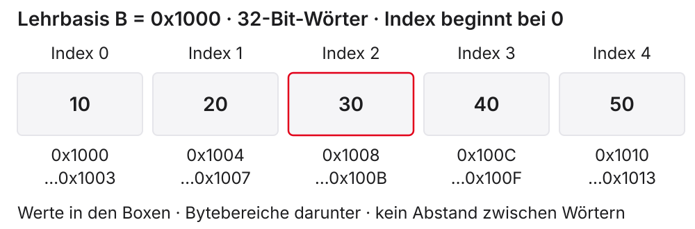{width=95%}

$$\operatorname{Adresse}(A[i])=B+4i,\qquad 0\le i<5$$

::: notes
A ist unser Array aus fünf 32-Bit-Wörtern. i ist der nullbasierte Elementindex und B die Basisadresse, hier als Lehrwert 0x1000 gewählt. Die Formel berechnet die Startadresse eines Elements in Byte: Ein Wort umfasst vier Byte, deshalb ist der Abstand viermal der Index. Index zwei liegt bei 0x1008 und enthält die Zahl 30.

Die Abbildung liest sich von links nach rechts entlang steigender Adressen. Oben stehen die Indizes, in den Boxen die Zahlenwerte und darunter die jeweils belegten Bytebereiche. Der rote Rahmen hebt Element zwei hervor. Zwischen 0x1003 und 0x1004 liegt kein leeres Fach; die Adresse steigt genau um eins. Aufeinanderfolgende Elementstarts liegen dagegen vier Byte auseinander. Index eins ist daher nicht Byteadresse B plus eins. Die angegebene Grenze kleiner fünf ist die gültige Indexmenge dieses Arrays. Die Adressformel prüft diese Grenze nicht von selbst; ein Programm muss zulässige Indizes gewährleisten.
:::

## Ein Pointer enthält eine Adresse

Lehrannahme: `s1 = 0x1000`; dort liegt $A[0]=10$.

| Ausdruck im Maschinenmodell | Bedeutung |
|---|---|
| Inhalt von `s1` | Adresse `0x1000` |
| vier Byte ab dieser Adresse | Wort `0x0000000A` |
| `addi t0, s1, 0` | Adresse nach `t0` kopieren |
| `lw t0, 0(s1)` | gespeicherte Zahl nach `t0` laden |

::: notes
Pointer bedeutet Zeiger: ein Wert, der als Adresse verwendet wird. s1 ist ein Registeralias und hält hier die Lehradresse 0x1000. A von null bezeichnet das erste Arrayelement, dessen Wert zehn ist. Die temporäre Zielstelle t0 kann sowohl eine kopierte Adresse als auch geladene Daten enthalten. Das Register besitzt dafür keinen getrennten Hardwaretyp.

addi, Add Immediate, addiert die direkte null zu s1 und kopiert damit 0x1000. lw, Load Word, benutzt denselben Quellinhalt dagegen als Basis für einen Speicherzugriff und lädt 0x0000000A. Die Tabelle stellt zwei unabhängige Alternativen dar, keinen versteckten automatischen Ladevorgang. Dass eine Zahl als Pointer eingesetzt wird, macht die Adresse noch nicht gültig. Ebenso erzeugt das Laden der Zahl 0x1000 in ein Register dort keine Datenregion. Für vollständige Programme deklarieren wir die Daten ausdrücklich und lassen das Assemblerwerkzeug ihre Adresse bestimmen.
:::

## Daten deklarieren und ihre Adresse laden

```asm
.data
myArray: .word 10, 20, 30, 40, 50
.text
.globl main
main:
    la s1, myArray
    lw t0, 0(s1)
```

Codeausschnitt; der kontrollierte Abschluss folgt im Laborrahmen.

::: notes
.data ist eine Direktive des Assemblerwerkzeugs für den Datenabschnitt. .word legt die angegebenen 32-Bit-Werte hintereinander ab; das sind Startdaten und keine während des Laufs ausgeführten Store-Befehle. Das Datenlabel myArray benennt ihre Basis. .text wählt den Codeabschnitt, .globl macht das Symbol main sichtbar, und main ist hier das Startlabel. Diese Direktiven sind keine nativen Instruktionen.

la bedeutet Load Address, Laden einer Adresse. Es ist eine Pseudoinstruktion: Das Werkzeug erzeugt eine passende native Folge, die die tatsächliche Adresse von myArray nach s1 schreibt. lw, Load Word, liest anschließend das erste Wort zehn nach t0. s1 und t0 sind Registeraliase. Die Adresse hängt von der Umgebung und der Datenanordnung ab; sie wird nicht als 0x1000 vorausgesetzt. Der Ausschnitt hat noch keinen Exit-Dienst. Ein vollständiges Programm benötigt den später gezeigten Abschluss. Im Labor kontrollieren Sie die Adresse aus la und danach den Inhalt am ersten Load getrennt.
:::

## Basis plus signed Byteoffset

$$EA=(R[rs1]+\operatorname{sext}_{12\to32}(imm))\bmod 2^{32}$$

- $EA$: effektive Adresse des Zugriffs
- `offset(rs1)`: direkte Zahl und Basisregister
- Offsetbereich: $-2048$ bis $2047$ Byte
- Auch `lbu` verwendet einen signed Adressoffset.

::: notes
EA steht für Effective Address, die effektive Adresse. R von rs1 ist der alte Inhalt des Basisregisters; rs1 bedeutet register source 1, erste Registerquelle. imm ist das zwölf Bit breite Immediate-Feld. sext steht für sign extension, Vorzeichenerweiterung von zwölf auf 32 Bit. Die Addition liefert ein 32-Bit-Adressmuster, deshalb beschreibt die Formel das Ergebnis modulo 2 hoch 32. Für unsere Beispiele werden gültige Adressen ohne Umlauf angenommen.

Der Offset zählt Byte und liegt signed, also vorzeichenbehaftet, zwischen minus 2048 und 2047. Bei Basis 0x1000 und Offset acht ergibt sich 0x1008. Die Schreibweise 8(s1) bedeutet diese Rechnung und ist kein Funktionsaufruf. lbu heißt Load Byte Unsigned und erweitert die geladenen Daten mit Nullen; sein Adressoffset wird trotzdem vorzeichenerweitert. Dateninterpretation und Adressrechnung sind getrennte Entscheidungen. Die berechnete Adresse wird nicht automatisch in das Basisregister zurückgeschrieben, sondern für den konkreten Zugriff verwendet.
:::

## lw: Adresse hin, Daten zurück

`lw t0, 8(s1)`

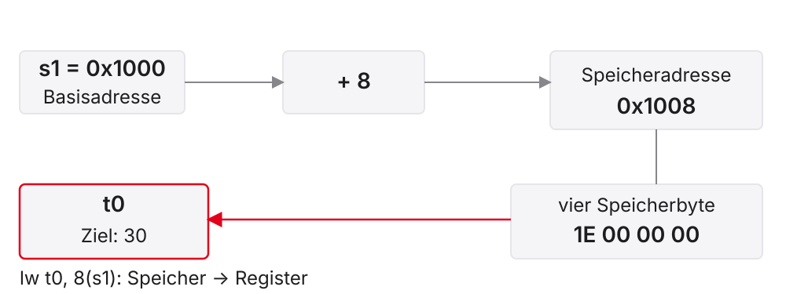{width=90%}

::: notes
lw bedeutet Load Word, Laden eines 32-Bit-Worts. In lw t0, 8(s1) ist t0 das temporäre Zielregister und s1 die Basisquelle. Die Zeichnung nimmt s1 gleich 0x1000 und das Array mit 30 an Index zwei an. Oben entsteht aus Basis plus acht die Adresse 0x1008. Die graue Verbindung wählt die vier Speicherbytes an dieser Adresse aus. Unter Little Endian, der niederwertige Byteanteil an der kleineren Adresse, lauten sie 1E 00 00 00.

Der rote Datenpfeil unten führt vom Speicher zurück zum Zielregister. Danach ist t0 gleich 0x0000001E, also 30. s1 bleibt 0x1000 und die Speicherbytes bleiben unverändert. Ein vorhandener alter t0-Wert wird vollständig überschrieben. Die Zeichnung ist eine Darstellung der Befehlswirkung und keine Behauptung über konkrete Leitungen oder Taktphasen eines Prozessors. Entscheidend sind die zwei verschiedenen Informationen: Die grauen Wege liefern die Adresse, der rote Weg liefert den Inhalt. Ein Load schreibt nicht die berechnete Adresse nach t0.
:::

## sw: Registerdaten werden Speicherinhalt

`sw t0, 12(s1)`

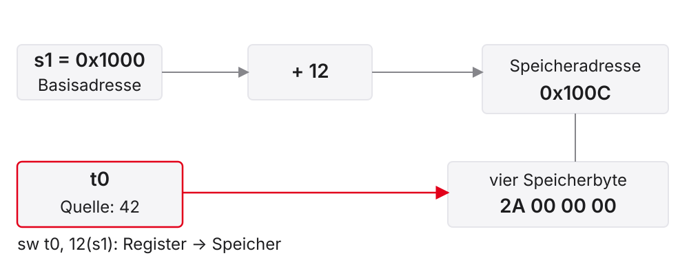{width=90%}

::: notes
sw bedeutet Store Word, Speichern eines 32-Bit-Worts. Anders als bei den Rechenbefehlen ist das erste Argument t0 hier eine Quelle, kein Ziel. s1 liefert die Basis. Mit den Lehrwerten s1 gleich 0x1000 und t0 gleich 42 wird die effektive Adresse 0x100C gebildet. Die oberen grauen Pfeile zeigen diese Adressrechnung. Der rote Datenpfeil läuft unten von t0 zum Speicher.

42 ist hexadezimal 0x0000002A. Little Endian legt deshalb an den Adressen 0x100C bis 0x100F die Byte 2A, 00, 00, 00 ab. Die dort zuvor stehenden vier Byte werden überschrieben; Nachbarbytes bleiben gleich. Beide Quellregister behalten ihren Inhalt. Ein Store besitzt kein allgemeines Zielregister rd, register destination. Die Syntax „erstes Argument ist das Ziel“ aus den bisherigen Rechenbefehlen darf daher nicht verallgemeinert werden. Das Bild stellt die definierte Wirkung dar, ohne einen bestimmten Hardware-Datenpfad oder eine Laufzeit festzulegen.
:::

## Lesen, rechnen, zurückschreiben

Anfang: $A=[10,20,30,40,50]$, `s1` enthält die Basis.

```asm
lw   s0, 8(s1)
addi t0, x0, 12
add  t1, s0, t0
sw   t1, 12(s1)
```

Danach: $A=[10,20,30,42,50]$.

::: notes
Das Array A enthält die fünf Lehrwerte, s1 seine gültige, natürlich ausgerichtete Basisadresse. s0, t0 und t1 sind Registeraliase. lw, Load Word, liest mit Byteoffset acht das Element an Index zwei: s0 wird 30. addi, Add Immediate, schreibt aus der Nullquelle x0 und der direkten zwölf den Wert zwölf nach t0. add bildet 30 plus zwölf und schreibt 42 nach t1. sw, Store Word, speichert dieses Wort am Byteoffset zwölf, also an Index drei.

Die übrigen Elemente und die Basis s1 bleiben unverändert. Der Ablauf braucht einen Load für die Eingabe und einen Store für die dauerhafte Änderung. Die arithmetisch-logische Einheit allein schreibt das Array nicht zurück. Die Zeilen sind ein Rechenausschnitt; Dateninitialisierung, Start und Abschluss stehen in beispiele/vl3_wordzugriff.s. Die dort benutzten s-Register gehören hier zum Hauptprogramm und modellieren keinen Funktionsaufruf. Ein Simulatorvergleich prüft Registerwerte und Speicherzustand an ihrem jeweiligen Schritt, nicht erst nach dem Exit-Dienst.
:::

## Ein variabler Index ist kein lw-Immediate

`s1`: Basis $B$, `t0`: gültiger Index $i=3$.

```asm
slli t1, t0, 2
add  t2, s1, t1
lw   t3, 0(t2)
```

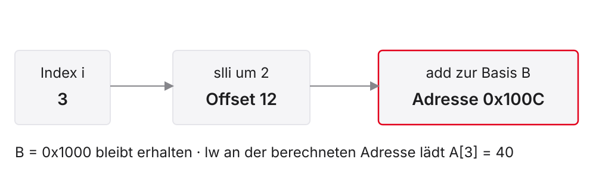{width=90%}

::: notes
Ein Load-Offset ist eine direkt codierte Konstante. Die Schreibweise eines Laufzeitregisters an dieser Stelle würde den Registerinhalt nicht automatisch zum Offset machen. s1 hält die Basis B, die temporäre Stelle t0 den hier gültigen Index i gleich drei. slli ist Shift Left Logical Immediate, logisches Linksschieben mit direkter Weite. Weite zwei multipliziert diesen kleinen Index mit vier: t1 wird zwölf. add schreibt B plus zwölf nach t2. lw, Load Word, lädt von dieser Adresse das vierte Element nach t3, hier 40.

Die Abbildung folgt genau diesen Rechenschritten von links nach rechts. Der rote Rahmen markiert die fertige Adresse 0x100C für die Lehrbasis 0x1000. Sie ist noch nicht der geladene Wert. Die Basis s1 bleibt erhalten. Gültiger Index und ausreichender Adressbereich sind Voraussetzungen; ein Shift ersetzt keine Arraygrenzenprüfung. Bei einer Schleife können wir stattdessen einen laufenden Pointer verschieben. Beide Methoden sind korrekt, dürfen aber nicht unbedacht gleichzeitig dieselbe Bewegung addieren.
:::

## Negative Offsets beziehen sich auf die aktuelle Basis

Lehrannahme: `s1 = 0x100C` zeigt bereits auf $A[3]$.

```asm
lw t0, -4(s1)       # Adresse 0x1008: A[2] = 30
lw t1,  0(s1)       # Adresse 0x100C: A[3] = 40
lw t2,  4(s1)       # Adresse 0x1010: A[4] = 50
```

`s1` bleibt bei allen drei Loads `0x100C`.

::: notes
s1 ist hier nicht mehr die ursprüngliche Arraybasis, sondern ein Pointer auf das vierte Element A von drei. Die ursprüngliche Basis des Arrays ist weiterhin 0x1000. Ein Offset wird stets zum aktuellen Registerinhalt addiert. lw bedeutet Load Word und liest vier Byte ab dieser effektiven Adresse. Die temporären Ziele t0, t1 und t2 erhalten daher 30, 40 und 50.

Minus vier ist als signed Zwölf-Bit-Immediate zulässig und zeigt ein Wort zurück. Offset null lädt den Inhalt an der aktuellen Basis, nicht die Zahl null. Plus vier zeigt ein Wort vorwärts. Kein Load verändert s1. Würden Sie zuvor addi s1, s1, 4 ausführen, wäre s1 dagegen dauerhaft 0x1010; dieselben Offsets hätten andere Ziele. Die gültige Speicherregion und ein passender Elementbereich sind auch bei negativen Offsets nötig. Ein negativer Abstand ist weder automatisch ungültig noch eine Erlaubnis, vor den Anfang eines Arrays zu greifen.
:::

## Ausrichtung prüft die effektive Adresse

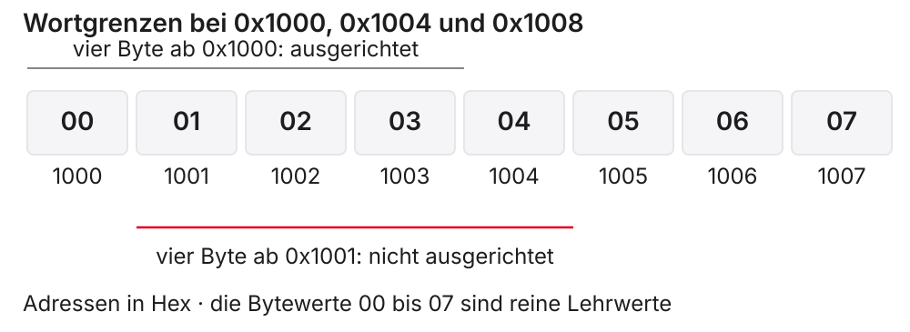{width=90%}

- Wortzugriff: $EA\bmod4=0$; Halbwort: $EA\bmod2=0$
- Ein gerader Offset genügt bei unpassender Basis nicht.
- Kursaufgaben verwenden natürlich ausgerichtete Zugriffe.

::: notes
EA bedeutet Effective Address, effektive Adresse aus Basis plus Byteoffset. Alignment heißt Ausrichtung. Ein vier Byte breites Wort ist natürlich ausgerichtet, wenn seine Startadresse durch vier teilbar ist; ein zwei Byte breites Halbwort entsprechend durch zwei. Modulo bezeichnet in diesen Formeln den Divisionsrest. Bytezugriffe brauchen keine weitere Teilbarkeit.

Die Zeichnung zeigt Byteadressen 0x1000 bis 0x1007 und ausdrücklich gewählte Bytewerte 00 bis 07. Der graue Balken umfasst das Wort ab 0x1000, der rote das verschobene Stück ab 0x1001. Beide Zugriffe hätten vier Byte Breite, doch nur der erste startet an einer Wortgrenze. Basis 0x1001 plus Offset drei ergibt wiederum 0x1004 und ist ausgerichtet. Ob eine konkrete RISC-V-Umgebung einen unausgerichteten Zugriff unterstützt oder mit einer Ausnahme abbricht, hängt von deren Festlegung ab. Ein garantierter Absturz ist keine allgemeine Folgerung. Unsere Aufgaben vermeiden solche Zugriffe und prüfen zusätzlich, dass alle betroffenen Byte gültig sind.
:::

# 2. Kleine Speicherstücke, volle Register


::: notes
Ein Register bleibt immer 32 Bit breit, auch wenn wir nur ein Speicherbyte benötigen. Der Load muss deshalb festlegen, wie aus acht oder sechzehn Datenbits ein vollständig definiertes 32-Bit-Wort entsteht. Aus Einheit 1 kennen Sie bereits zwei Möglichkeiten: Vorzeichenerweiterung und Nullerweiterung. Nun übernimmt der Befehl diese Entscheidung.

Beim Store ist die Richtung umgekehrt. Er wählt die unteren Bits des Registers aus und überschreibt nur die passende Anzahl Speicherbytes. Die übrigen Stellen der Quelle und des Speichers werden nicht verändert. Wir führen die Unterscheidung mit einem gesetzten höchsten Datenbit vor, weil bei kleinen positiven Werten beide Load-Arten dasselbe Ergebnis liefern und der Unterschied sonst unsichtbar bliebe.
:::

## lb und lbu: dasselbe Byte, anderes Ergebniswort

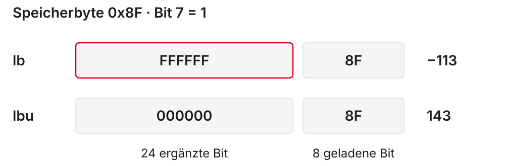{width=90%}

::: notes
lb heißt Load Byte und lbu Load Byte Unsigned. Beide lesen genau ein Byte. lb kopiert das höchste Datenbit, Bit sieben, in die oberen 24 Registerstellen; lbu füllt sie mit Nullen. Das Bild verwendet das Speicherbyte 0x8F, binär 10001111. Die acht unteren Bits bleiben in beiden Reihen rechts erhalten. Links stehen die 24 ergänzten Bits als sechs Hexziffern. Der rote Rahmen betont die eingefügten Einsen beim signed Load.

Nach lb ist das vollständige Wort 0xFFFFFF8F. Als Zweierkomplement entspricht es 143 minus 256 gleich minus 113. Nach lbu steht 0x0000008F, also 143. Es gibt nach keinem dieser Befehle undefinierte obere Bits oder ein erforderliches leeres Zielregister. Ein beliebiger alter Inhalt wird vollständig ersetzt. Die Wahl hängt davon ab, ob das gespeicherte Byte eine signed Zahl oder ein vorzeichenloses Bitmuster darstellen soll. An Adresse und Zugriffsbreite ändert der Zusatz unsigned nichts; der Adressoffset bleibt signed.
:::

## An den Grenzen wird die Erweiterung sichtbar

| Speicherbyte | `lb`: Wort / signed Wert | `lbu`: Wort / Wert |
|---|---|---|
| `0x7F` | `0x0000007F` / 127 | `0x0000007F` / 127 |
| `0x80` | `0xFFFFFF80` / −128 | `0x00000080` / 128 |
| `0xFF` | `0xFFFFFFFF` / −1 | `0x000000FF` / 255 |

Die Interpretation entsteht beim Laden; das Byte bleibt unverändert.

::: notes
lb, Load Byte, erweitert mit dem Vorzeichen. lbu, Load Byte Unsigned, erweitert mit Nullen. Die Tabelle wählt die Grenze zwischen 0x7F und 0x80 sowie das Muster 0xFF. signed bedeutet Zweierkomplementinterpretation. Bei 0x7F ist Bit sieben null; beide Befehle ergeben 127. Bei 0x80 ist es eins: lb bewahrt den Acht-Bit-Zahlenwert minus 128 durch 24 zusätzliche Einsen, lbu erzeugt die positive Zahl 128.

Ein Byte aus acht Einsen bedeutet signed minus eins oder unsigned 255. Der Speicher trägt keine zusätzliche Vorzeichenmarkierung. Erst die Load-Art und die spätere Verwendung bestimmen die Interpretation des gelesenen Musters. Derselbe Bereich darf daher mit verschiedenen Load-Arten untersucht werden, ohne dass sich seine Byte ändern. Ein vorhandenes Zielwort 0x12345678 liefert keine oberen Bits zum Ergebnis: Das neue Registerwort ist vollständig definiert. Diese Beispiele erlauben im Labor eine klare Kontrolle, ob Vorzeichen- oder Nullerweiterung gewählt wurde.
:::

## Halbwörter: zwei Byte und Bit 15

- `lh`: Load Halfword, mit Vorzeichenerweiterung
- `lhu`: Load Halfword Unsigned, mit Nullen
- Little Endian: Bytefolge `00 80` ergibt Halbwort `0x8000`.

| Befehl | Registerwort | Zahlenwert |
|---|---|---:|
| `lh t0, 0(s1)` | `0xFFFF8000` | −32768 |
| `lhu t1, 0(s1)` | `0x00008000` | 32768 |

::: notes
Ein Halfword, Halbwort, enthält sechzehn Bit und belegt zwei Byte. lh, Load Halfword, kopiert Datenbit 15 in die oberen sechzehn Registerstellen. lhu, Load Halfword Unsigned, ergänzt dort Nullen. s1 ist die Basisadresse, t0 und t1 sind temporäre Ziele. Wir nehmen eine gültige, durch zwei teilbare Basis an und an ihr die Bytefolge 00, 80.

Little Endian legt das niederwertige Byte zuerst ab, sodass das zusammengesetzte Halbwort 0x8000 lautet. Bit 15 ist eins. lh ergibt damit 0xFFFF8000, signed minus 32768; lhu ergibt 0x00008000, also 32768. Die Registerquelle s1 wird in keinem Fall verändert. Im Unterschied zum Byte-Load muss die effektive Adresse natürlich gerade sein. Ein gerader Offset allein genügt nicht, wenn s1 ungerade ist. Die beiden Erweiterungsarten folgen derselben Regel wie bei acht Bit, lediglich das maßgebliche Datenbit und die Zahl der ergänzten Stellen ändern sich.
:::

## sb und sh überschreiben nur einen Teil

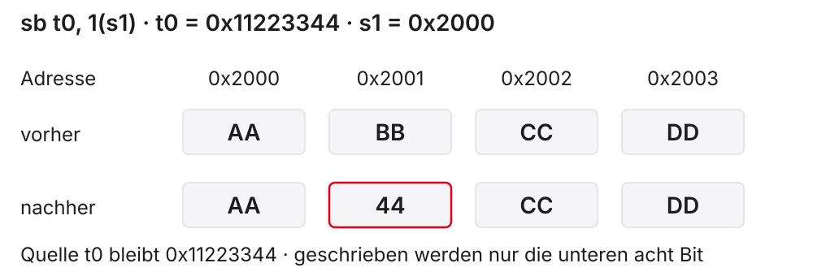{width=90%}

`sh` schreibt entsprechend die unteren 16 Bit in zwei Byte.

::: notes
sb ist Store Byte, Speichern eines Bytes, sh Store Halfword, Speichern eines Halbworts. Im Bild enthält t0 das Quellwort 0x11223344 und s1 die Lehrbasis 0x2000. sb t0, 1(s1) wählt Adresse 0x2001 und schreibt ausschließlich die unteren acht Registerbits, also 0x44. Die Spalten zeigen steigende Byteadressen, die Reihen den Speicher vor und nach dem Zugriff. Der rote Rahmen markiert die einzige geänderte Stelle. AA, CC und DD bleiben erhalten; t0 und s1 ebenfalls.

Ein sh mit natürlich ausgerichtetem Ziel würde die unteren sechzehn Bits 0x3344 schreiben, unter Little Endian als 44, 33. Es wird nichts vorzeichen- oder nullerweitert, weil die Datenbreite verkleinert wird. Ein Registerwert minus eins und ein Registerwert 255 schreiben per sb dasselbe Byte FF. Deshalb benötigt die Integerbasis keinen eigenen sbu-Befehl für einen unsigned Store dieser Breite. Erst ein späteres lb oder lbu macht daraus verschiedene volle Registerwerte.
:::

## Die Zugriffsbreite ist Teil des Befehls

| Breite | Load signed | Load unsigned | Store | natürliche Ausrichtung |
|---|---|---|---|---|
| 1 Byte | `lb` | `lbu` | `sb` | jede Byteadresse |
| 2 Byte | `lh` | `lhu` | `sh` | Adresse durch 2 teilbar |
| 4 Byte | `lw` | gleiches Wort | `sw` | Adresse durch 4 teilbar |

Alle Speicherbefehle hier: Basis plus signed Zwölf-Bit-Byteoffset.

::: notes
Load bedeutet Lesen vom Speicher in ein Register, Store Schreiben aus einem Register in den Speicher. Die Namen enthalten Byte, Halfword oder Word, also acht, sechzehn oder 32 Bit: lb/lbu und sb, lh/lhu und sh sowie lw und sw. Das u bedeutet unsigned, vorzeichenlos, und kennzeichnet hier Nullerweiterung der kleineren Load-Daten. signed Loads bewahren den Zweierkomplementwert durch Kopieren des höchsten Datenbits.

Beim 32-Bit-Load sind Daten- und Registerbreite gleich. Eine Erweiterung entfällt, daher gibt es in dieser 32-Bit-Basis keinen benötigten zusätzlichen lwu-Befehl. Stores schreiben nur die ausgewählte Zahl unterer Bits. Die Adresse entsteht bei allen Tabellenzeilen aus Basis plus signed Zwölf-Bit-Byteoffset; unsigned geladene Daten machen den Offset nicht unsigned. Natürliche Ausrichtung betrifft diese effektive Adresse. Die Tabelle beschreibt keine Laufzeit und keine Garantie für unausgerichtete Zugriffe einer konkreten Umgebung. Breite, Erweiterung und Adresse werden nun als Angaben im Befehlswort wiedererkannt.
:::

# 3. Speicherbefehle im Maschinenwort


::: notes
Das Register- und Immediate-Format aus Einheit 2 erklärt schon einen großen Teil der Speicherbefehle. Ein Load braucht ein Basisregister, einen direkten Offset und ein Zielregister. Diese Angaben passen in das bekannte Immediate-Format. Die Operation unterscheidet sich aber von einer Addition: Das berechnete Adresswort wird zum Lesen benutzt, nicht als Rechenergebnis ins Ziel geschrieben.

Ein Store braucht dagegen zwei Quellen, nämlich Basis und Datenwert, und zusätzlich einen Offset. Ein Registerziel fehlt. Das Store-Format verteilt deshalb die zwölf Offsetbits auf zwei freie Bereiche. Wir verfolgen diese Verteilung vollständig, einschließlich eines negativen Beispiels und der Rückrechnung. Die nötigen Operationswerte werden angegeben. Sie müssen die Feldpositionen begründet anwenden, nicht eine neue Liste von Zahlen auswendig kennen.
:::

## lw verwendet das I-Format

`lw t0, 8(s1)`: `t0=x5`, `s1=x9`.

| Feld | Bits | Wert |
|---|---|---|
| `imm[11:0]` | 31:20 | `000000001000` |
| `rs1` | 19:15 | `01001` |
| `funct3` | 14:12 | `010` |
| `rd` | 11:7 | `00101` |
| `opcode` | 6:0 | `0000011` |

Maschinenwort: `0x0084A283`.

::: notes
I-Format ist das Immediate-Format. imm von elf bis null enthält die zwölf Bit des direkten Byteoffsets. rs1, register source 1, wählt die Basisquelle; rd, register destination, das Ziel für die gelesenen Daten. funct3 ist das drei Bit breite Funktionsfeld und opcode der sieben Bit breite Familiencode. lw heißt Load Word. Seine Kombination lautet opcode 0000011 und funct3 010.

t0 bezeichnet x5, s1 x9. Deshalb codieren wir rd als 00101 und rs1 als 01001. Der Offset acht ist 000000001000. Das Zusammensetzen in der angegebenen Wortreihenfolge liefert 000000001000 01001 010 00101 0000011, neu gruppiert das Wort 0x0084A283. Es enthält die Registernummer neun, aber weder den aktuellen Basiswert noch das später gelesene Speicherwort. Dieselben Feldpositionen wie bei addi bedeuten also keine identische Befehlswirkung. funct3 unterscheidet in der Load-Familie sowohl Breite als auch Erweiterung; es ist nicht bloß eine allgemeine Byteanzahl.
:::

## S-Format: zwei Quellen, kein rd

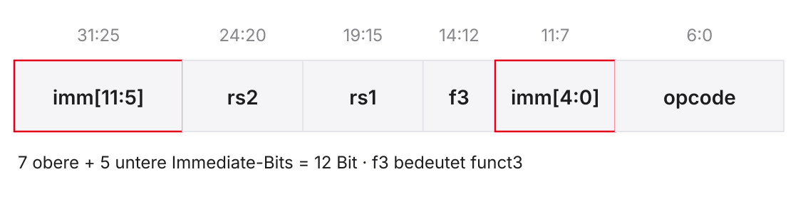{width=95%}

`sw rs2, offset(rs1)`: Datenquelle `rs2`, Basis `rs1`.

::: notes
S-Format bezeichnet das Store-Format. sw bedeutet Store Word. rs1, register source 1, ist die Basisquelle, rs2, register source 2, die Datenquelle. Ein rd-Feld, register destination, gibt es hier nicht, denn der neue Wert wird in den Speicher geschrieben. opcode ist der Familiencode und funct3, im Bild f3, das Funktionsfeld für den Store-Typ.

Die Zeichnung läuft von Instruktionsbit 31 links bis Bit null rechts; die Breiten entsprechen den Bitzahlen. Die roten Rahmen markieren imm von elf bis fünf links und imm von vier bis null weiter rechts. Zusammen tragen diese beiden Felder zwölf Offsetbits. Die Stelle an den Bits elf bis sieben, die im Registerformat rd hieß, enthält im Store-Format den unteren Offsetteil. Die Registerquellen bleiben an den bekannten Positionen 19 bis 15 und 24 bis 20. Diese regelmäßige Lage vereinfacht die Auswahl der Register, ohne dass wir eine bestimmte Zahl eingesparter Transistoren oder Takte behaupten.
:::

## sw mit negativem Offset codieren

`sw t0, -4(s1)`: `rs2=x5`, `rs1=x9`.

```text
imm[11:5] rs2   rs1   f3  imm[4:0] opcode
1111111   00101 01001 010 11100    0100011
```

Offset $-4$: `0xFFC` → oben `1111111`, unten `11100`.

Maschinenwort: `0xFE54AE23`.

::: notes
sw ist Store Word. t0 ist die Datenquelle x5, s1 die Basisquelle x9. rs2 und rs1 bedeuten register source 2 und 1. imm bezeichnet die Offsetbits, funct3 beziehungsweise f3 das Funktionsfeld, opcode den Familiencode. Für sw lauten opcode 0100011 und funct3 010. Die Datenquelle fünf wird 00101, die Basisquelle neun 01001.

Minus vier wird als zwölf Bit Zweierkomplement gebildet: 2 hoch zwölf minus vier gleich 4092, also 0xFFC und binär 111111111100. Die oberen sieben dieser Bits sind 1111111, die unteren fünf 11100. Erst jetzt setzen wir sie an ihre getrennten Positionen im Instruktionswort. In Wortreihenfolge entstehen 1111111 00101 01001 010 11100 0100011. Vierergruppierung liefert 1111 1110 0101 0100 1010 1110 0010 0011, also 0xFE54AE23. Der gespeicherte Datenwert ist nicht Teil dieser Codierung. Die Zeile schreibt vier Byte ab der aktuellen Basis minus vier, vorausgesetzt diese Adresse ist gültig und ausgerichtet.
:::

## Das S-Immediate wieder zusammensetzen

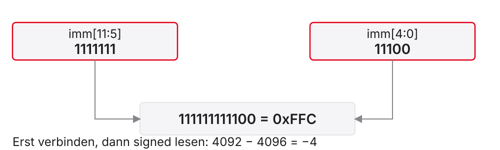{width=90%}

Erst zwölf Bit rekonstruieren, danach auf 32 Bit vorzeichenerweitern.

::: notes
imm heißt Immediate, das im Befehl enthaltene Offsetfeld. Die Abbildung zeigt oben seine beiden Teile imm von elf bis fünf und imm von vier bis null. Die grauen Pfeile stehen für ihr Zusammenfügen, nicht für einen Speicherzugriff. Der rote Rahmen hebt beide Eingangsfelder hervor. Sie ergeben unten die zwölf Bit 111111111100 beziehungsweise 0xFFC.

signed bedeutet Zweierkomplementinterpretation. Der uninterpretierte Feldwert ist 4092; weil Bit elf gesetzt ist, wird 4096 abgezogen. Das Resultat ist minus vier. Bei der anschließenden Vorzeichenerweiterung wird Bit elf in die zwanzig neuen Stellen kopiert und es entsteht 0xFFFFFFFC. Falsch wäre, die beiden Teile einzeln als vorzeichenbehaftete Zahlen zu lesen oder den unteren Teil als Registernummer zu behandeln. Die Rekonstruktion verwendet ausschließlich Instruktionsbits. Erst danach wird das erweiterte Offsetwort zum Basisregisterinhalt addiert. Damit bleibt derselbe Adressweg wie beim zusammenhängenden Immediate eines Loads erhalten.
:::

## Rückrechnung eines Stores

Wort `0x0054A623`:

```text
0000000 00101 01001 010 01100 0100011
oberes  rs2   rs1   f3  unten opcode
```

- `opcode=0100011`, `funct3=010` → `sw`
- `rs2=5`, `rs1=9`; Offset `000000001100` → 12
- Ergebnis: `sw t0, 12(s1)`; Bits 11:7 sind kein `rd`.

::: notes
Decodieren bedeutet, das Maschinenwort in seine Felder zu zerlegen. opcode ist der sieben Bit breite Store-Familiencode 0100011. funct3, hier f3, ist 010 und wählt sw, Store Word. rs2, register source 2, enthält 00101 und wählt x5, Alias t0. rs1, register source 1, enthält 01001 und wählt x9, Alias s1. Die verbleibenden Immediate-Teile sind oben 0000000 und unten 01100.

Wir verbinden beide Teile zu 000000001100. Bit elf ist null, der signed Byteoffset daher plus zwölf. Der Assemblertext lautet sw t0, 12(s1). Mit s1 gleich 0x1000 und t0 gleich 42 würde diese Instruktion vier Byte ab 0x100C schreiben. Diese Werte sind eine zusätzliche Lehrbelegung, keine Information im Wort. Ein allgemeines Zielregister rd, register destination, ist hier nicht vorhanden. Wer die Bits elf bis sieben trotzdem als Zielnummer zwölf interpretiert, verwechselt das Format. Das bisherige Registerformat liefert nützliche Positionen, ersetzt aber die Auswahl des richtigen Formats nicht.
:::

# 4. Die nächste Instruktion auswählen


::: notes
Ein Speicherbefehl verändert Daten, aber bei normaler Ausführung geht das Programm danach zur nächsten Instruktion weiter. Eine Entscheidung benötigt nun eine andere Möglichkeit: abhängig von zwei Registerwerten entweder fortsetzen oder zu einer benannten Stelle springen. Diese Auswahl betrifft den Programmzähler und nicht die Anordnung der Daten im Array.

Wir führen zunächst einen einzelnen bedingten Sprung ein. Danach prüfen wir verschiedene Vergleichsarten und den Bezugspunkt der Zieladresse. Ein zusätzlicher unbedingter Sprung ermöglicht, genau einen von zwei Rechenblöcken auszuführen. Dafür genügen die bisher bekannten Registeroperationen und neue Labels im Code. Rückkehradressen und vollständige Funktionsaufrufe sind ein Thema der nächsten Einheit; hier bleiben alle Wege innerhalb desselben Programms.
:::

## Branch: zwei mögliche Folgeadressen

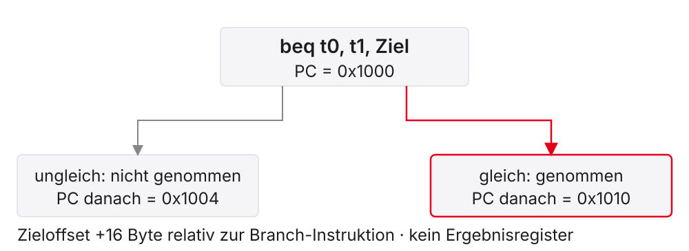{width=90%}

::: notes
Ein Branch ist ein bedingter Sprung. beq heißt Branch if Equal und vergleicht die beiden Registerinhalte auf gleiche Bitmuster. t0 und t1 sind temporäre Quellen. PC bedeutet Program Counter, Programmzähler; er enthält im betrachteten Modell die Adresse der aktuellen Instruktion. Die Zeichnung setzt den Branch an die Lehradresse 0x1000 und das Label Ziel an 0x1010.

Der graue linke Weg bedeutet ungleiche Quellen: Der Branch wird nicht genommen und der PC nachher ist 0x1004. Der rote rechte Weg bedeutet Gleichheit: Die Instruktion wählt 0x1010. Der Zielabstand beträgt plus sechzehn Byte, bezogen auf die Branch-Adresse selbst. Die Folgeadresse plus vier wird nicht zusätzlich zum Zieloffset addiert. Ein Branch erzeugt kein allgemeines Ergebnisregister und verändert seine beiden Quellen nicht. Die Abbildung ist eine Auswahl zwischen Befehlsadressen, keine Darstellung von gleichzeitig ausgeführten Rechenzweigen. Die nächsten Beispiele machen deutlich, welche Zeilen dadurch übersprungen werden.
:::

## Labels benennen Adressen

```asm
    addi t0, x0, 5      # Lehradresse 0x1000
Weiter:
    addi t1, x0, 6      # Lehradresse 0x1004
```

- `Weiter` benennt die Adresse der folgenden Instruktion.
- Das Label selbst erzeugt kein Instruktionswort.
- Adressabstände zählen native Befehle, nicht Quelltextzeilen.

::: notes
Ein Label ist eine symbolische Adressmarke im Assemblertext. Weiter mit Doppelpunkt benennt die Stelle der folgenden Instruktion. addi heißt Add Immediate und schreibt aus der Nullquelle x0 die direkten Werte fünf und sechs in die temporären Register t0 und t1. Für die beiden nativen Befehle wird der Start 0x1000 ausdrücklich als Lehradresse angenommen. Da jeder vier Byte belegt, steht Weiter bei 0x1004.

Der Doppelpunkt und die Kommentartexte erzeugen keinen weiteren Befehlsplatz. Ein Label vor Daten würde entsprechend eine Datenadresse benennen. Das Assemblerwerkzeug berechnet die tatsächliche Lage und benutzt bei Sprüngen die Distanz zur Zielmarke. Der sichtbare Abstand im Text ist keine verlässliche Bytezahl: Leerzeilen und Kommentare belegen nichts, und Pseudoinstruktionen können mehrere native Befehle erzeugen. Änderungen zwischen Branch und Ziel können daher den codierten Abstand verändern, obwohl der Labelname gleich bleibt. Für Rechnungen von Hand verwenden wir ausschließlich ausdrücklich native oder fest entwickelte Zeilen.
:::

## beq und bne lesen zwei Register

Anfang: `t2=0`.

```asm
    beq t0, t1, Weiter
    addi t2, t2, 1
Weiter:
    addi t3, x0, 9
```

- `t0=t1`: `t2` bleibt 0.
- `t0` ungleich `t1`: `t2` wird 1.
- `bne` springt bei Ungleichheit; `t3` wird in beiden Fällen 9.

::: notes
beq ist Branch if Equal, Sprung bei gleichen Registerbitmustern. bne bedeutet Branch if Not Equal und ist das Gegenstück für Ungleichheit. Beide haben zwei Registerquellen und ein Ziel-Label. Die temporäre Stelle t2 wird ausdrücklich mit Anfangswert null angenommen. addi, Add Immediate, erhöht sie nur, wenn die Ausführung durch die zweite Zeile läuft. x0 ist die Nullquelle für die letzte Initialisierung.

Sind t0 und t1 beide fünf, springt beq direkt zu Weiter und lässt t2 null. Sind sie fünf und sechs, wird nicht gesprungen; t2 erhält eins. t3 wird auf beiden Wegen neun. Ein Ersetzen von beq durch bne vertauscht, bei welchen Daten die Erhöhung übersprungen wird. Der Vergleich schreibt weder eine allgemeine Wahrheitszahl noch ein architektonisches Vergleichsflag, also ein Statusbit, das ein weiterer Befehl erst lesen müsste. Wie eine konkrete Schaltung Gleichheit erkennt, wird hier nicht vorgegeben. Die bekannte Regel über alte Quellwerte bleibt gültig.
:::

## Signed Relationen: blt und bge

| Befehl | Bedeutung für Zweierkomplementwerte $A,B$ |
|---|---|
| `blt rs1, rs2, Ziel` | springen, wenn $A<B$ |
| `bge rs1, rs2, Ziel` | springen, wenn $A\ge B$ |

| Quellen | `blt` genommen? | `bge` genommen? |
|---|---|---|
| $-5$, $2$ | ja | nein |
| $2$, $2$ | nein | ja |
| $3$, $2$ | nein | ja |

::: notes
blt steht für Branch if Less Than, Sprung wenn die erste Quelle kleiner ist. bge bedeutet Branch if Greater or Equal, Sprung bei größer oder gleich. rs1 und rs2 heißen register source 1 und 2, die beiden Quellregister. A und B bezeichnen ihre alten Inhalte, hier als signed Zweierkomplementzahlen interpretiert. Ziel ist die symbolische Sprungmarke.

Die drei Beispiele decken kleiner, gleich und größer ab. Minus fünf ist kleiner als zwei, daher wird nur blt genommen. Bei Gleichheit wird bge genommen, denn sein Vergleich schließt Gleichheit ein. Beide Befehle lassen die Registerwerte unverändert und entscheiden lediglich über die nächste Befehlsadresse. Für jede feste Quellbelegung ergänzen sich die beiden Bedingungen: Genau eine ist wahr. Die Wahl der Interpretation gehört zum Befehl; ein Register ist nicht von sich aus ein signed Register. Für denselben Bitinhalt kann ein vorzeichenloser Vergleich eine andere Reihenfolge ergeben, was insbesondere bei großen Rohwerten oder Adressen wichtig ist.
:::

## Unsigned vergleicht dieselben Bits anders

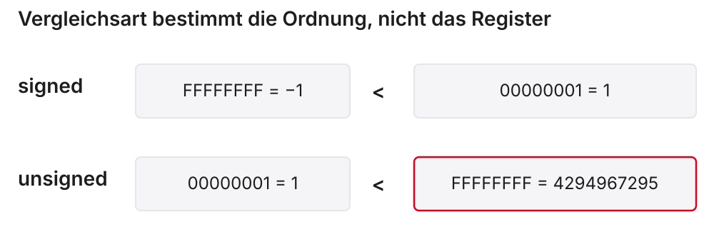{width=90%}

- `bltu`: vorzeichenlos kleiner
- `bgeu`: vorzeichenlos größer oder gleich
- Adressmuster werden in unseren Assemblerbeispielen vorzeichenlos geordnet.

::: notes
unsigned heißt vorzeichenlos. bltu bedeutet Branch if Less Than Unsigned, bgeu Branch if Greater or Equal Unsigned. Sie entsprechen den signed Relationen blt und bge, interpretieren die Quellen aber als nichtnegative Zahlen zwischen null und 2 hoch 32 minus eins. Die Abbildung verwendet dasselbe Muster FFFFFFFF und das Muster 00000001 in beiden Reihen.

Oben ist die signed Zweierkomplementordnung: FFFFFFFF bedeutet minus eins und liegt vor eins. Unten steht die unsigned Ordnung: FFFFFFFF ist 4294967295 und liegt hinter eins. Die Boxen enthalten Werte, das Kleinerzeichen benennt deren Ordnung; der rote Rahmen hebt den großen vorzeichenlosen Wert hervor. Für einen Vergleich von t0 gleich 0xFFFFFFFF und t1 gleich eins würde blt springen, bltu nicht. Die Bits ändern sich dabei nicht. Eine hohe Adresse mit gesetztem Bit 31 ist als Adressmuster nicht deshalb eine negative Speicherposition. Für die Adresszahlen unserer Beispiele ist die vorzeichenlose Ordnung passend, ohne dass damit ein konkretes gültiges Speichergebiet zugesichert wird.
:::

## Kleiner oder gleich: Quellen vertauschen

$$A\le B\quad\Longleftrightarrow\quad B\ge A$$

```asm
bge t1, t0, Ziel      # t0 <= t1, signed
```

- Für vorzeichenlose Werte: `bgeu t1, t0, Ziel`
- `ble` kann eine Pseudoschreibweise dafür sein.
- Relation und Reihenfolge gemeinsam prüfen.

::: notes
A und B sind die zu vergleichenden Werte. Die Relation A kleiner oder gleich B ist gleichbedeutend mit B größer oder gleich A. Deshalb benötigt die 32-Bit-Integerbasis keinen separaten nativen ble-Befehl. bge, Branch if Greater or Equal, erreicht die gewünschte signed Bedingung mit vertauschten Quellen: Im Code steht t1 vor t0. t0 und t1 sind temporäre Register, Ziel das Label.

Für t0 gleich zwei und t1 gleich drei gilt drei größer oder gleich zwei, der Sprung wird genommen. Bei beiden gleich zwei ebenso. Bei t0 gleich vier und t1 gleich drei nicht. signed bedeutet Zweierkomplementinterpretation. unsigned, vorzeichenlose Interpretation, benutzt dieselbe Umformung mit bgeu, Branch if Greater or Equal Unsigned. ble, Branch if Less or Equal, ist gegebenenfalls eine Pseudoinstruktion des Assemblerwerkzeugs. Die native Entwicklung ist hier bereits angegeben und genügt unabhängig von dieser Komfortschreibweise. Das Vertauschen erhält die gewünschte Relation, nicht jede beliebige Bedingung ohne Prüfung.
:::

## Der Sprungoffset zählt ab der Branch-Adresse

$$PC_{\text{nach}}=\begin{cases}
PC_{\text{vor}}+\Delta,&\text{Bedingung erfüllt}\\
PC_{\text{vor}}+4,&\text{sonst}
\end{cases}$$

| Branch-Adresse | Ziel | signed Byteoffset $\Delta$ |
|---|---|---:|
| `0x1000` | `0x1010` | +16 |
| `0x1018` | `0x1000` | −24 |

Das B-Immediate liefert diesen Byteoffset; kein zweites Verdoppeln.

::: notes
PC steht für Program Counter, Programmzähler. PC vor ist die Adresse der Branch-Instruktion und PC nach die ausgewählte nächste Adresse. Delta bezeichnet den vorzeichenbehafteten Zielabstand in Byte. Bei erfüllter Bedingung wird Delta zum alten PC addiert; sonst folgt die nächste native Instruktion im Abstand vier. Der relative Offset wird also nicht ab PC plus vier gerechnet.

0x1010 minus 0x1000 ergibt hexadezimal 0x10, also 16 Byte. Rückwärts ergibt 0x1000 minus 0x1018 den Abstand minus 24. Das B-Format ist das Format bedingter Sprünge. Sein rekonstruierter Immediate enthält bereits das implizite Bit null mit Wert null und beschreibt die Bytezahl. Man darf es danach nicht nochmals um eine Stelle schieben. Es ist ein anderes Immediate-Format als das normale zwölf Bit breite Load-Offsetfeld. Die vollständige Bitverteilung ist für die Pflichtaufgaben nicht nötig. Beide Lehrziele liegen hier an Vier-Byte-Grenzen, passend zu den unkomprimierten Instruktionen der Kursbasis.
:::

## j springt ohne Datenbedingung

```asm
    j Ende
    addi t0, x0, 2      # auf diesem Weg übersprungen
Ende:
    addi t1, x0, 9
```

Gültige native Entwicklung: `jal x0, Ende`.

`j` beendet das Programm nicht und löscht keine Register.

::: notes
j bedeutet Jump, unbedingter Sprung. Der Befehl wählt Ende ohne Vergleich von Datenregistern. Ende ist ein Label. Im Ausschnitt wird die Initialisierung von t0 übersprungen, die von t1 mit neun jedoch ausgeführt. addi ist Add Immediate, Addition einer direkten Konstante; x0 liefert null. Der alte t0-Inhalt bleibt auf diesem Weg bestehen. Ein anderer Einstieg könnte die übersprungene Zeile erreichen, daher ist sie nicht allgemein unerreichbarer Code.

j ist eine Pseudoinstruktion. Für die hier nahen Ziele ist jal x0, Ende ihre gültige native Entwicklung. jal heißt Jump and Link und würde normalerweise die Folgeadresse, alter Programmzähler plus vier, in sein Zielregister schreiben. Das Ziel x0 verwirft diesen Linkwert, sodass nur die Umleitung bleibt. Der Zielabstand wird relativ zur Sprunginstruktion codiert. „Unbedingt“ bezeichnet die fehlende Datenbedingung und ist keine Aussage über absolute Adressierung. Wie ein Linkwert später eine Rückkehr ermöglicht, behandeln wir erst bei Funktionen.
:::

## Genau einer von zwei Blöcken

Auftrag: bei `s0=s1` Ergebnis 1, sonst Ergebnis 2 in `t0`.

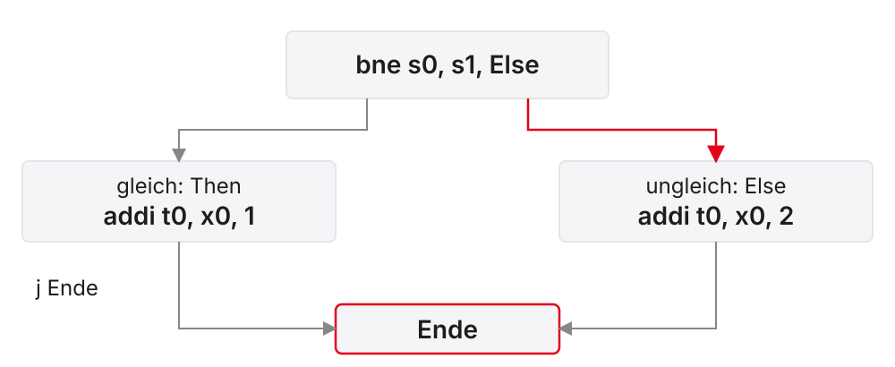{width=90%}

::: notes
s0 und s1 sind die Eingaberegister, t0 das temporäre Ergebnisregister. Then ist der Block für die erfüllte ursprüngliche Gleichheitsbedingung, Else der andere Block. bne bedeutet Branch if Not Equal und springt gerade bei Ungleichheit zum Else-Label. Die ursprüngliche Entscheidung und die Sprungbedingung sind daher entgegengesetzt. Bei Gleichheit läuft das Programm ohne Sprung in den Then-Block.

Die Zeichnung zeigt diesen Gleichheitsweg links in Grau, den genommenen Ungleichheitsbranch rechts in Rot. addi, Add Immediate, schreibt aus der Nullquelle x0 eins beziehungsweise zwei nach t0. Am Ende des linken Blocks führt j Ende, der unbedingte Jump, an Else vorbei. Beide Wege treffen erst an Ende wieder zusammen; der rote Rahmen dort markiert das gemeinsame Weiterlaufen, keinen Exit-Dienst. Ohne den linken Jump würde die Ausführung nach der eins auch den Else-Block durchlaufen und zwei schreiben. Eine andere Anordnung der Blöcke wäre möglich, benötigt dann aber passende Bedingungen und Sprungziele.
:::

## Die Entscheidung als vollständiger Ausschnitt

```asm
    bne  s0, s1, ElseBlock
    addi t0, x0, 1
    j    EndIf
ElseBlock:
    addi t0, x0, 2
EndIf:
    addi t1, x0, 9
```

Beide Wege: `t1=9`. Ergebnis `t0` wird genau einmal gesetzt.

::: notes
Der Code enthält die gesamte Entscheidung, aber noch nicht die Initialisierung des Hauptprogramms und dessen Abschluss. s0 und s1 sind bekannte Eingaben. bne, Branch if Not Equal, springt bei unterschiedlichen Mustern zu ElseBlock. addi, Add Immediate, schreibt aus x0 null plus eins oder zwei nach t0. j ist Jump und überspringt ElseBlock nach dem ersten Rechenblock. EndIf ist die gemeinsame Fortsetzungsmarke; t1 erhält dort neun.

Mit s0 und s1 beide sieben ist der Branch nicht genommen. Die ausgeführten Zeilen sind bne, die Initialisierung eins, j und die Initialisierung neun. t0 endet als eins. Mit sieben und acht springt bne direkt zum zweiten Block; ausgeführt werden bne, die Initialisierung zwei und die Initialisierung neun. t0 endet als zwei. In beiden Fällen bleiben die Quellen erhalten. Labels werden beim Tracen nicht als Instruktionen mitgezählt. Die unterschiedliche Zahl ausgeführter nativer Instruktionen ist noch keine Laufzeitmessung eines Prozessors.
:::

## Selbstprüfung: Was fehlt in diesem Pfad?

```asm
    bne  s0, s1, ElseBlock
    addi t0, x0, 1
ElseBlock:
    addi t0, x0, 2
EndIf:
    addi t1, x0, 9
```

Was steht für gleiche und ungleiche Eingaben am Ende in `t0`?

::: notes
bne heißt Branch if Not Equal, bedingter Sprung bei ungleichen Registermustern. s0 und s1 sind die Eingaben, t0 das gewünschte Ergebnis und t1 die gemeinsame Folgerechnung. addi, Add Immediate, verwendet x0 als Nullquelle. Die Labels ElseBlock und EndIf markieren Positionen und begrenzen keine Ausführung von sich aus.

Bei ungleichen Eingaben springt bne nach ElseBlock, sodass t0 direkt zwei wird. Bei gleichen Eingaben wird nicht gesprungen: t0 wird zunächst eins, danach läuft die Ausführung aber ebenfalls in ElseBlock und überschreibt es mit zwei. Am Ende ist t0 daher in beiden Fällen zwei und t1 neun. Es fehlt j EndIf nach der Initialisierung eins, der unbedingte Jump über den zweiten Block. Die Aufgabe illustriert, warum ein korrekt geschriebenes Label noch keinen Blockabschluss erzeugt. Der Rechenweg ist vollständig bestimmt; der Fehler liegt im Kontrollfluss, nicht in einer zufälligen Registerinitialisierung.
:::

# 5. Wiederholen, bis die Arbeit erledigt ist


::: notes
Eine Schleife verwendet dieselben Sprungwerkzeuge wie eine Entscheidung. Neu ist, dass ein Weg zu einem früheren Test zurückführt und dabei einen Fortschrittswert verändert. Damit daraus eine endende Rechnung wird, brauchen wir einen Anfangszustand, eine passende Abbruchbedingung und ein Update, das die Grenze tatsächlich erreicht.

Für die Speicheraufgabe legen wir den Test vor den Zugriff. So bleibt der Fall ohne Elemente korrekt: Das Programm kann sofort beenden, ohne überhaupt zu laden. Zuerst üben wir diese Form mit einem kleinen Zähler. Danach erhält der Schleifenrumpf eine Speicheroperation, und wir verfolgen zusätzlich Pointer und Summe. Die Verbindung wird nicht durch einen neuen Spezialbefehl hergestellt, sondern durch die bereits verstandenen Instruktionen.
:::

## Eine kopfgesteuerte Schleife

```text
i = 0
solange i < N:
    eine Arbeit ausführen
    i = i + 1
danach fortsetzen
```

- Test vor dem Rumpf
- Initialisierung vor dem Rücksprungziel
- Für $N=0$: kein Durchlauf

::: notes
Der Text ist ein ausdrücklich sprachunabhängiger Algorithmus, kein ausführbarer Assemblercode. i zählt die bereits erledigten Arbeiten, N ist deren nichtnegative Anzahl. Der Rumpf bezeichnet die innerhalb einer Wiederholung auszuführenden Aktionen. Kopfgesteuert heißt, dass der Test vor diesem Rumpf steht. Für N gleich drei läuft die Arbeit bei i gleich null, eins und zwei; nachher ist i gleich drei.

Bei N gleich null ist schon der erste Test i kleiner N falsch. Es findet keine Arbeit statt. Ein Rücksprung führt zum Test, nicht zurück zur Initialisierung, denn sonst würde i jedes Mal null werden. Das Update erhöht i nach jeder Arbeit um eins. Diese Platzierung liefert eine überprüfbare Beziehung zwischen Rumpfdurchläufen und Endzähler. In Assembler springen wir bei der entgegengesetzten Bedingung i größer oder gleich N zum Ende; solange diese falsch bleibt, läuft die Ausführung in den Rumpf.
:::

## Ein kleiner Schleifen-Trace

```asm
    addi t0, x0, 0       # i
    addi t1, x0, 3       # N
    addi s0, x0, 0       # Summe
Loop:
    bge  t0, t1, Done
    add  s0, s0, t0
    addi t0, t0, 1
    j    Loop
Done:
```

Welcher Wert entsteht in `s0`, und wie oft wird getestet?

::: notes
addi ist Add Immediate, add Registeraddition, bge Branch if Greater or Equal und j Jump. x0 liefert null. t0 hält den Zähler i, t1 die Grenze N gleich drei und s0 die Summe. Alle benötigten Anfangswerte sind explizit gesetzt. Loop bezeichnet den Test, Done die Stelle nach der Schleife. Das Fragment lässt die spätere Verwendung des Ergebnisses und den Programmabschluss offen.

Am ersten Test ist i null, daher wird nicht zu Done gesprungen. Der Rumpf addiert null und erhöht i auf eins. Am zweiten Test entsteht im Rumpf die Summe eins und i wird zwei. Beim dritten entsteht drei und i wird drei. Der vierte Test nimmt den Branch, ohne den Rumpf erneut auszuführen. Somit ist s0 gleich null plus eins plus zwei, also drei; es gibt drei Rumpfdurchläufe, drei Rücksprünge und vier Tests. Diese Zählung betrifft ausgeführte Instruktionen, keine gemessenen Takte. Das zusätzliche letzte Testen ist für eine korrekte Trace-Tabelle wichtig.
:::

## Ein Test nach dem Rumpf hat andere Randfälle

```asm
    addi t0, x0, 0
    addi t1, x0, 3
Loop:
    addi t0, t0, 1
    bne  t0, t1, Loop
```

- Für Grenze 3 funktioniert dieses Zählerbeispiel.
- Für Grenze 0 wird der Rumpf trotzdem zuerst ausgeführt.
- Ein korrektes Beispiel ist kein allgemeines Schleifenmuster.

::: notes
addi bedeutet Add Immediate und erhöht hier das temporäre Zählerregister t0. t1 enthält die Grenze drei, x0 die Nullquelle. bne, Branch if Not Equal, springt zurück, solange der erhöhte Zähler ungleich der Grenze ist. Bei den gezeigten Werten erreicht t0 nacheinander eins, zwei und drei; dann wird der Branch nicht genommen. Der Test liegt am Fuß der Schleife, also nach dem Rumpf.

Für eine gewünschte Anzahl null wäre bereits die erste Erhöhung eine unerwünschte Arbeit. Würde der Rumpf vorher einen Arraywert laden, wäre dieses Laden ebenfalls schon geschehen. Außerdem ist eine reine Ungleichheitsprüfung nur passend, wenn das Update die Grenze tatsächlich trifft. Erhöhen um zwei bei einer ungeraden Grenze ist ein Gegenbeispiel. Die Moduloarithmetik großer Zähler macht daraus kein geeignetes Pflichtmuster. Unsere Array-Schleife verwendet deshalb einen Test vor dem Load und einen ausdrücklich kontrollierten Schritt. Diese Wahl begründet die korrekte leere Eingabe, statt nur den üblichen Fall vorzuführen.
:::

## Registerplan für die Array-Summe

| Bedeutung | Register | Anfang |
|---|---|---|
| erledigte Elemente $i$ | `t0` | 0 |
| Anzahl $N$ | `t1` | 5 |
| laufender Pointer | `s1` | Basis $B$ |
| Summe | `s0` | 0 |
| aktuell geladener Wert | `t2` | erst nach `lw` benötigt |

Voraussetzung: $0\le N\le5$, gültige natürlich ausgerichtete Daten.

::: notes
Das Array A enthält die fünf Lehrzahlen. N ist die Zahl seiner zu verarbeitenden Elemente, hier fünf; i zählt, wie viele bereits zur Summe beigetragen haben. t0, t1 und t2 sind temporäre Registeraliase. s0 und s1 sind ebenfalls Aliasnamen, hier für das Hauptprogramm ohne Funktionsaufruf verwendet. Der Pointer ist eine Adresse und beginnt an der Basis B. s0 erhält ausdrücklich den Anfangswert null.

Der Inhalt von t2 muss nicht vorab null sein, denn jeder Rumpfdurchlauf überschreibt ihn durch lw, Load Word, bevor er gelesen wird. Die Grenze null bis fünf stellt sicher, dass nur Elemente der deklarierten Datenfolge verarbeitet werden. Diese Prüfung wird als Vorbedingung genannt; das spätere bge allein weiß nicht, wie viele Speicherwörter tatsächlich angelegt wurden. Für die kleinen nichtnegativen Zähler genügt signed Vergleich. Durch den Registerplan bleiben Anzahl, Byteadresse und Zahlenwert getrennt. Das Update des Pointers wird vier Byte betragen, das des Zählers nur eins.
:::

## Test, Rumpf, Update, Rücksprung

```asm
Loop:
    bge  t0, t1, Done
    lw   t2, 0(s1)
    add  s0, s0, t2
    addi s1, s1, 4
    addi t0, t0, 1
    j    Loop
Done:
```

Initialisierung gemäß Registerplan erfolgt vor `Loop`.

::: notes
bge ist Branch if Greater or Equal und beendet die Schleife, wenn der Zähler t0 mindestens die Grenze t1 erreicht. lw, Load Word, lädt über den laufenden Pointer s1 in t2. add summiert diesen Wert zum alten s0. addi, Add Immediate, verschiebt danach s1 um vier Byte und erhöht t0 um ein Element. j, Jump, führt zum Testlabel Loop zurück. Done bezeichnet die Fortsetzung nach der Schleife.

Mit der Basis B und dem ersten Wert zehn wird im ersten Rumpf t2 zehn, s0 zehn, s1 B plus vier und t0 eins. Der Offset des Loads bleibt null, weil schon der Pointer zum nächsten Element wandert. Die Initialisierung wird nicht beim Rücksprung wiederholt. Falls der Zeiger stehen bliebe, würde dasselbe Wort mehrfach gelesen; falls er um eins stiege, passten die Wortadressen nicht. Die Summe folgt der 32-Bit-Moduloarithmetik aus Einheit 2. Alle Lehrsummen bleiben im darstellbaren signed Bereich, doch das vollständige Programm garantiert nicht allgemein überlauffreie Mathematik für beliebige Eingaben.
:::

## Der Test schützt den Zugriff

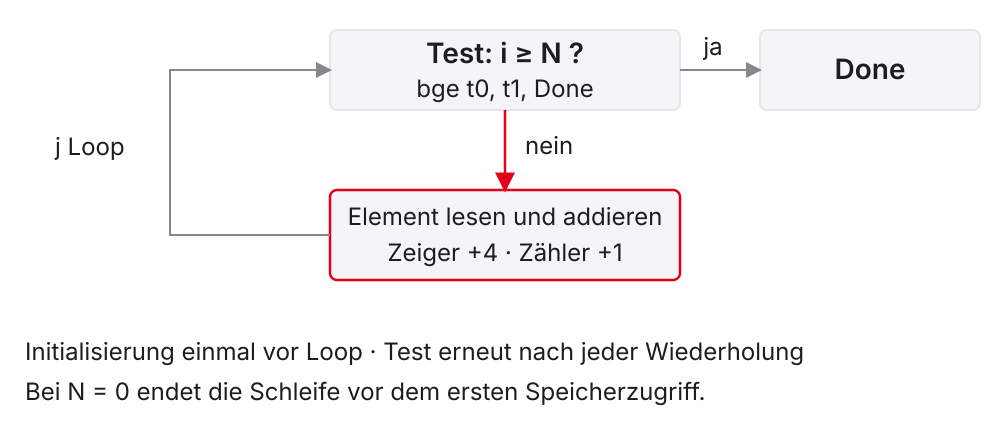{width=85%}

::: notes
i ist die Zahl bereits verarbeiteter Elemente, N ihre erlaubte Anzahl. t0 und t1 enthalten diese Werte. bge, Branch if Greater or Equal, springt zum Label Done, wenn i größer oder gleich N ist. Loop ist die Marke des Tests. j bedeutet Jump und führt nach dem Rumpf bedingungslos dorthin zurück. Ein Pointer ist der laufende Adresswert für den nächsten Load.

Die Zeichnung beginnt oben beim Test. Rechts geht der graue Ja-Weg direkt zum Ende, nach unten der rote Nein-Weg zum Lesen und Addieren. Der Rahmen des Rumpfs markiert die Arbeit einschließlich Zeiger- und Zählerupdate. Links führt der Rückweg zum Test zurück, ohne die Initialisierung erneut auszuführen. Für N gleich null wählt schon der erste Test den Endweg. Für N gleich fünf läuft der Rumpf genau fünfmal, der Test dagegen sechsmal. Die Grafik beschreibt den Kontrollfluss und keine Zeitachse. Der Schutz gilt nur mit korrekter Grenze und passender Datenregion; ein falsches N kann trotz dieser Form zu einem Zugriff außerhalb des Arrays führen.
:::

## Was am Schleifenkopf immer gelten soll

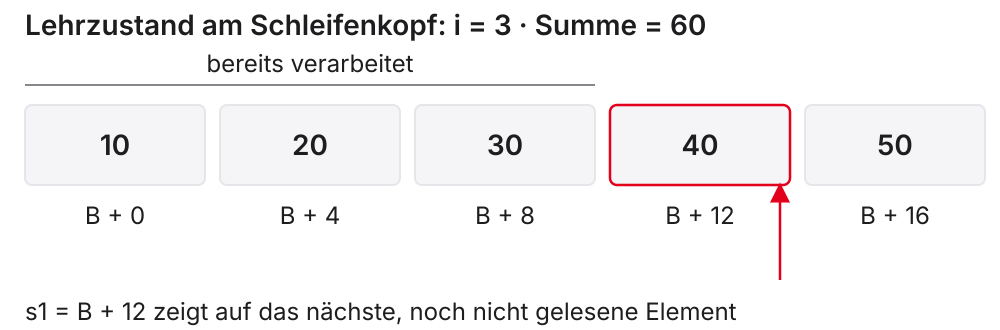{width=95%}

- `t0`: bereits verarbeitete Elemente
- `s1`: Basis plus viermal `t0`
- `s0`: Summe dieser bereits verarbeiteten Elemente

::: notes
Eine Schleifeninvariante ist eine Beziehung, die am gleichen Kontrollpunkt vor jedem Test gilt. Hier enthält t0 den Zähler i, s1 den Pointer B plus viermal i und s0 die Summe der ersten i Arraywerte, bei allgemeinen Mustern modulo 2 hoch 32. B ist die ursprüngliche Basis, die der Rechnung zugrunde liegt. Für i gleich null ist die leere Summe null. t2 ist nur ein Zwischenregister und muss an diesem Punkt nicht der nächste Wert sein.

Die Zeichnung nimmt i gleich drei an. Die graue Markierung oben umfasst die bereits verarbeiteten Werte zehn, 20 und 30, deren Summe 60 ist. Der rote Rahmen und Pfeil zeigen den nächsten Wert 40 bei B plus zwölf. Er wurde noch nicht zum aktuellen s0 addiert. Ein weiterer korrekter Rumpfdurchlauf lädt 40, macht die Summe 100 und erhöht Pointer und Zähler passend. So begründen Anfang und Update die Beziehung. Am Ende ist i gleich N und die Beziehung liefert genau die gewünschte Summe.
:::

## Die komplette Zustandsfolge

Zustand am Testlabel `Loop`, vor `bge`:

| `t0`: $i$ | `s1` | `s0` | nächste Aktion |
|---:|---|---:|---|
| 0 | $B$ | 0 | 10 laden |
| 1 | $B+4$ | 10 | 20 laden |
| 2 | $B+8$ | 30 | 30 laden |
| 3 | $B+12$ | 60 | 40 laden |
| 4 | $B+16$ | 100 | 50 laden |
| 5 | $B+20$ | 150 | nach `Done` springen |

::: notes
Die Tabelle verwendet das Array zehn, 20, 30, 40, 50 und die Grenze N gleich fünf. i ist der Zähler im temporären Register t0, B die ursprüngliche Datenbasis, s1 der laufende Pointer und s0 die Summe. Loop ist der Testpunkt, bge bedeutet Branch if Greater or Equal und Done die Fortsetzung nach der Schleife. Jede Zeile beschreibt den Zustand vor dem Branch, nicht unmittelbar nach dem Load.

Die erste Zeile ist die Initialisierung. Von einer Zeile zur nächsten wurde ein Element geladen und addiert, der Pointer um vier Byte sowie der Zähler um eins erhöht. Die Summen ergeben sich als zehn, zehn plus 20 gleich 30, plus 30 gleich 60, plus 40 gleich 100 und plus 50 gleich 150. In der letzten Zeile zeigt s1 hinter die verarbeiteten fünf Wörter. Dieser Adresswert darf im Register stehen; es folgt aber kein Load davon. Das letzte bge wird genommen. Wer nur die Rumpfdurchläufe notiert, übersieht diesen sechsten Test und häufig auch einen Zugriff zu viel.
:::

## N gleich null ist ein eigener Prüfungsfall

Anfang: `t0=0`, `t1=0`, `s0=0`.

```asm
Loop:
    bge t0, t1, Done
    lw  t2, 0(s1)
    # weiterer Rumpf wie zuvor
Done:
```

Ergebnis: Summe 0, unveränderter Pointer, kein Speicherlesen.

::: notes
N bezeichnet die Zahl zu verarbeitender Elemente und ist hier null. t0 ist der bereits bei null beginnende Zähler, t1 die Grenze und s0 die bei null beginnende Summe. bge, Branch if Greater or Equal, vergleicht null mit null und springt unmittelbar zu Done. Deshalb wird lw, Load Word, gar nicht ausgeführt. t2 bleibt mit seinem unbekannten alten Inhalt bestehen, ohne dass dieser für die Summe verwendet wird. s1 wird nicht erhöht.

Dieser lokale Kontrollfluss benötigt für den ausgelassenen Load keinen zugänglichen Datenwert. Das vollständige Beispiel lädt seinen Pointer dennoch regulär vom Arraylabel. Der Kommentarteil bezeichnet hier ausdrücklich den bereits erklärten ausgelassenen Rumpf und keine eigenständige Programmimplementierung. Ein Test unterhalb des Loads könnte den leeren Fall nicht schützen. Ebenso wäre ein Branch mit striktem Größer statt Größer-oder-gleich bei gleichen Startwerten falsch. Die Aufgabe verlangt also nicht, ein vermeintliches erstes Element null zu laden, sondern den Zugriff vollständig zu vermeiden.
:::

## Zwei Adressierungsmethoden nicht doppelt zählen

| Methode | Basis | zusätzliche Adresse |
|---|---|---|
| laufender Pointer | `s1` wächst um 4 | `lw t2, 0(s1)` |
| feste Basis und Index | `s1` bleibt $B$ | `slli`, `add`, dann `lw` |

- Beide Methoden können das nächste Element finden.
- Pointerbewegung plus derselbe Indexoffset würde doppelt vorwärts gehen.
- Erster ungültiger Index bei fünf Wörtern: $i=5$.

::: notes
Ein Pointer ist der Adresswert im Register s1. lw, Load Word, liest ein Wort von der effektiven Adresse. Bei der ersten Methode enthält s1 bereits B plus viermal i, daher ist der Load-Offset null. Bei der zweiten bleibt s1 gleich B. slli, Shift Left Logical Immediate, erzeugt den Offset viermal i und add bildet in einem zusätzlichen Register die Adresse; der Load nutzt diese neue Basis.

Beide Wege sind für gültige Indizes äquivalent. Wenn man aber den Pointer bereits auf B plus viermal i erhöht hat und nochmals viermal i dazuaddiert, würde für i gleich eins B plus acht statt B plus vier verwendet. Das überspringt ein Element. Der erste ungültige Index eines Arrays mit fünf Wörtern ist fünf, weil die gültigen Indizes null bis vier reichen. Ein zu spät platzierter Abbruchtest oder ein Limit sechs kann diese Grenze überschreiten. Die Architektur kennt keine versteckte Länge des Arrays. Die Programmvorbedingung und der richtige Kontrollfluss müssen die gültige Region sicherstellen.
:::

# 6. Papiermodell und Venus zusammenführen


::: notes
Im Labor wird das vollständige Programm aus deklarierter Datenfolge, Initialisierung, Schleife und Umgebungsabschluss zusammengesetzt. Die einzelne Instruktion ist dabei ebenso wichtig wie der Kontrollpunkt: Ein geladener Wert steht erst nach dem Load bereit, eine Summe nach der Addition, und die Beziehung zwischen Pointer und Zähler prüfen Sie vor dem nächsten Test.

Vorhersage und Beobachtung sollten in getrennten Spalten stehen. So bleibt sichtbar, welche Rechnung Sie selbst begründet haben und welche Anzeige das Werkzeug tatsächlich lieferte. Datenadressen lesen Sie aus dem verwendeten Lauf ab; die Lehrbasis 0x1000 wird nicht übertragen. Dieselbe Arbeit prüft beim Store ein anderes Speicherbild und bei der Schleife eine Folge von Zuständen. Der Simulator ergänzt damit das Papiermodell, ohne eine physische Laufzeit zu messen.
:::

## Speicheransicht: erst die Anzeigeeinheit klären

- [Kurs-Venus öffnen](https://thaumicmekanism.github.io/venus/) und neu assemblieren
- Arrayadresse aus `la` beziehungsweise Labelanzeige ablesen
- Prüfen: einzelne Byte oder zusammengesetzte Wörter?
- Register und Speicher vor und nach derselben Instruktion vergleichen
- Nach Änderungen neu starten; keine feste Labeladresse voraussetzen

::: notes
Venus ist der im Kurs verwendete Assembler und Simulator. la heißt Load Address, Pseudoinstruktion zum Laden der Adresse eines Labels. Die konkrete Register- und Speicheransicht kann zwischen Distributionen unterschiedlich aussehen. Eine Liste in Viererschritten kann ganze Wörter anzeigen, obwohl der Speicher weiterhin byteadressiert ist. Ein Hex-Dump, eine Auflistung der Speicherwerte als Hexziffern, kann dagegen einzelne Byte enthalten.

Bei dem Wort 42 sehen Sie als zusammengesetztes Wort 0x0000002A, in Little-Endian-Bytefolge 2A 00 00 00. Das sind keine unterschiedlichen Inhalte. Bei einem sw prüfen Sie die genau vier geänderten Byte und die unveränderten Quellen. Nach einer Quelltextänderung neu assemblieren und den Zustand zurücksetzen, sonst vergleichen Sie mit einem alten Lauf. Die Adresse lesen Sie aus dem aktuellen Programm. Ein Step belegt die Befehlswirkung im Simulator, keine Latenz eines realen Speicherchips. Die Aufgaben verlangen ein eigenes Protokoll; dargestellte Lehrwerte ersetzen dieses nicht.
:::

## Laborauftrag: Array summieren und Randfälle prüfen

- Daten: `.word 10, 20, 30, 40, 50`
- Vorher: Startzustand und Zustände an `Loop` vorhersagen
- Nachher: am Label `Ergebnis_pruefen` vor dem Druckdienst prüfen
- Varianten: $N=0$, $N=1$, $N=5$ und gemischte Vorzeichen
- Musterlösung: [vl3_array_summe.s](../beispiele/vl3_array_summe.s)

::: notes
.word ist die Direktive für fünf aufeinanderfolgende 32-Bit-Datenwörter. N ist die erlaubte Anzahl zwischen null und fünf. Die Musterlösung benutzt t0 als Zähler, t1 als Grenze, s1 als Pointer, s0 als Summe und t2 als gelesenen Wert. Loop benennt den Test vor jedem Load. Ergebnis_pruefen liegt in der überarbeiteten Quelle direkt vor der Vorbereitung der Ausgabe. Dort wird zunächst die Summe s0 beurteilt, nicht ein späterer Dienstwert in a0.

Für N gleich null erwarten wir null, keinen Load und unveränderten Pointer. Für eins erwarten wir zehn und einen Load. Für fünf erwarten wir 150 und fünf Loads. Ein zusätzlicher Datensatz minus drei, acht, minus zehn, eins mit N gleich vier ergibt minus vier. Nach jeder Änderung müssen Daten und Grenze zusammenpassen sowie neu assembliert und gestartet werden. Die Datei enthält Anfang und Ende; sie dient erst nach eigener Bearbeitung als Vergleich. Notieren Sie bei Abweichungen den ersten falschen Zustand am gleichen Kontrollpunkt, nicht nur eine andere Endsumme.
:::

## Ausgabe: der Rechenwert bleibt vor dem Dienst prüfbar

```asm
Done:
Ergebnis_pruefen:
    mv   a1, s0
    li   a0, 1
    ecall
    li   a0, 10
    ecall
```

Vor `mv`: `s0=150`. Erwartete Druckzahl: `150`, danach Ende.

::: notes
Done ist die Fortsetzung nach der Summenschleife, Ergebnis_pruefen ein zweiter Name für dieselbe Stelle. Labels erzeugen keine zusätzlichen Instruktionen. Die Summe im Registeralias s0 ist für die fünf positiven Lehrwerte 150. mv, move, ist eine Pseudoinstruktion zum Kopieren und schreibt den Wert nach a1, dem Argumentregister x11. li, Load Immediate, setzt a0, Argumentregister x10, auf die Dienstnummer eins.

ecall bedeutet Environment Call, Umgebungsaufruf. In der Kurs-Venus-Distribution druckt Dienst eins die signed Ganzzahl in a1. Danach wird a0 ausdrücklich auf zehn gesetzt und der zweite ecall beendet. Die Konsolenzahl sollte 150 sein; ein bestimmter Zeilenumbruch wird nicht vorausgesetzt. Nach dem ersten Dienst benötigt das Programm keinen erhaltenen temporären Summenwert mehr. Eine allgemeine Erhaltung sämtlicher Register durch beliebige Dienste wird nicht angenommen. Auch wenn s0 hier vor dem Dienst die Summe hält, ist a0 nach der Vorbereitung eine Dienstnummer und keine Ergebnisvariable. Normale Funktionsrückgaben werden davon in Einheit 4 getrennt erklärt.
:::

## Selbstkontrolle vor dem Quiz

1. Warum ist $A[3]$ ein Byteoffset von 12 und kein Offset von 3?
2. Was bleibt bei `sw t0, 12(s1)` unverändert?
3. Warum liefert `lbu` von `0xFF` 255, auch mit Offset −1?
4. Warum gibt es bei fünf Durchläufen sechs Schleifentests?

::: notes
A ist ein Array aus vier Byte breiten Wörtern; der nullbasierte Index drei liegt daher zwölf Byte hinter der Basis. sw, Store Word, schreibt die vier unteren Byte aus der Quelle t0 an Basis s1 plus zwölf. Beide Register und alle Speicherbytes außerhalb des Zielbereichs bleiben unverändert. Ein nachfolgender Load kann den neuen Inhalt sehen, aber der Store selbst lädt nichts zurück.

lbu bedeutet Load Byte Unsigned. Es erweitert das Datenbyte FF mit Nullen zu 0x000000FF, also 255. Der signed Offset minus eins betrifft nur die Adresse; er kann bei gültiger Region ein Byte vor der aktuellen Basis wählen und verändert die Erweiterungsart nicht. Schließlich testet die kopfgesteuerte Schleife vor jedem der fünf Rumpfdurchläufe und ein sechstes Mal mit Zähler fünf. Erst dann wird die Abbruchbedingung größer oder gleich wahr. Diese Antworten verbinden Größe, Datenrichtung, Interpretation und Kontrollpunkt. Sie benötigen dafür keine konkrete Labeladresse oder einen gestarteten Simulator.
:::

## Ausblick und Quellen

- Einheit 4: Funktionen, Rückkehradressen und Aufrufkonvention
- Harris/Harris: *Digital Design and Computer Architecture — RISC-V Edition*
- Patterson/Hennessy: *Computer Organization and Design — RISC-V Edition*
- [Venus-Dienste dokumentiert](https://github.com/61c-teach/venus/wiki/Environmental-Calls)

::: notes
Sie können nun aus Registerbefehlen, Speicherzugriffen und Sprüngen einen vollständigen geradlinigen oder wiederholten Ablauf zusammensetzen. Die nächste Einheit ordnet solche Abläufe als Funktionen: Ein Aufruf muss eine Rückkehradresse bereitstellen, Eingaben übergeben und festlegen, welche Werte erhalten bleiben. Dafür dienen die Registerrollen aus Einheit 2, die bisher noch keine Sicherungsroutine verlangt haben.

Harris und Harris erklären die Verbindung von Digitaltechnik und Rechnerarchitektur anhand von RISC-V. Patterson und Hennessy vertiefen die Schnittstelle zwischen Hardware und Software. RISC steht im Namen für Reduced Instruction Set Computer, eine Entwurfsrichtung mit regelmäßigen Befehlsformen. Beim Nachschlagen eines Beispiels unterscheiden Sie weiterhin Architekturwirkung und konkrete Umgebung. Die verlinkte Venus-Dokumentation beschreibt die Registerzuordnung der Umgebungsdienste. Weder ein bestimmter Speicherstart noch eine bestimmte Step-Schaltfläche ist deshalb eine allgemeine Eigenschaft der Befehlssatzarchitektur. Diese Trennung bleibt für die kommenden Datenpfad- und Pipeline-Modelle wichtig.
:::
