## Aus einem Rechenblock wird eine Funktion

- Bekannt: Werte in Registern, `lw`/`sw`, `j` und Bedingungen
- Neu: hineinrufen und zum jeweiligen Aufrufer zurückkehren
- Neu: Werte über weitere Aufrufe hinweg erhalten
- Leitbeispiel: $\operatorname{Calc}(a,b)=2a+b$

::: notes
lw, Load Word, und sw, Store Word, lesen beziehungsweise schreiben ein 32-Bit-Wort. j, Jump, wählt ohne Datenbedingung eine andere Instruktionsadresse. Diese Werkzeuge kennen Sie aus Vorlesung 3. Eine Funktion ist nun ein benannter Instruktionsbereich mit vereinbarten Eingaben, einem Ergebnis und einem Rückweg. Mehrere Stellen sollen denselben Rechenblock benutzen können, statt ihn mehrfach zu kopieren.

a und b sind zwei Eingabewerte. Calc soll zweimal a plus b liefern. Für fünf und zehn ergibt das 20. Wir verwenden ausschließlich bekannte Ganzzahlarithmetik, keine Multiplikationserweiterung. Zunächst kann ein einfacher Helfer die Summe a plus b bilden. Calc wird diesen Helfer aufrufen und danach den alten Wert von a noch einmal addieren. Dadurch entstehen zwei gleichzeitig benötigte Rückwege und ein Wert, der den inneren Aufruf überdauern muss. Genau diese Anforderungen motivieren Registervertrag und Stack, statt deren Regeln ohne Anwendungsfall auswendig einzuführen.
:::

## Welche Fragen ein Aufruf beantworten muss

1. Wo wird nach dem Unterprogramm weitergearbeitet?
2. Wo liegen Eingaben und das einzelne 32-Bit-Ergebnis?
3. Welche alten Registerwerte bleiben zugesichert?
4. Wo liegen Sicherungen mehrerer aktiver Aufrufe?

Ein Aufruf erzeugt keine eigenen Architekturregister.

::: notes
Aufrufer und aufgerufene Funktion teilen sich dieselben Architekturregister. Ein Label ist eine Adresse, kein neu angelegter Satz lokaler Register. Deshalb reicht es nicht, zu einem Rechenblock zu springen: Die Funktion muss die konkrete Fortsetzungsadresse kennen und dieselben Erwartungen an Daten und Erhaltung erfüllen wie der Aufrufer.

Wir beantworten die vier Fragen in dieser Reihenfolge. Ein Linkregister hält zunächst den Rückweg eines Aufrufs. Argumentregister transportieren Eingaben und Ergebnis. Die Aufrufvereinbarung unterscheidet, welche Register die Funktion verändern darf und welche sie vor der Rückkehr wiederherstellen muss. Der Stack trägt bei Bedarf Sicherungen, deren Lebensdauer zu verschachtelten Aufrufen passt. Nicht jede Funktion benötigt dafür einen Speicherrahmen. Ein einfacher Helfer ohne weitere Aufrufe und ohne zu erhaltende Arbeitsregister kann direkt zurückkehren. Am Ende prüfen Sie nicht nur einen richtigen Ergebniswert, sondern auch den Rückweg, erhaltene Register und den restaurierten Stackzeiger.
:::

# 1. Hinweg und dynamischer Rückweg


::: notes
Ein unbedingter Sprung aus Einheit 3 löst den Hinweg. Für Wiederverwendung fehlt jedoch eine Information: Ein Unterprogramm kann von verschiedenen Stellen gerufen werden, und jede Stelle hat ihre eigene Folgeinstruktion. Ein festes Rücksprunglabel würde allen Aufrufern dieselbe Fortsetzung aufzwingen.

Die Rückkehradresse wird deshalb beim Aufruf aus der aktuellen Instruktionsadresse berechnet und in einem Register abgelegt. Die Rückkehr liest später genau diesen Registerwert. Zunächst betrachten wir einen einzigen aktiven Aufruf, sodass diese Adresse noch nicht überschrieben wird. Danach kommen Argumente und Registerrollen hinzu. Verschachtelte Aufrufe zeigen erst im Anschluss, warum ein einzelnes Register nicht alle gleichzeitig benötigten Rückwege allein aufnehmen kann.
:::

## Zwei Aufrufstellen, zwei Fortsetzungen

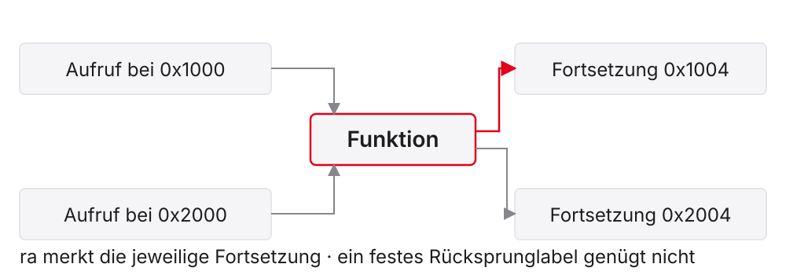{width=90%}

::: notes
ra steht für return address, Rückkehradresse, und ist der Alias des Architekturregisters x1. Die Abbildung zeigt zwei alternative Aufrufstellen als ausdrücklich angenommene Lehradressen 0x1000 und 0x2000. Die mittlere Box ist dieselbe Funktion. Graue Hinpfeile führen hinein, Rückpfeile zu den jeweiligen Fortsetzungen 0x1004 und 0x2004. Rot hebt einen der beiden Rückwege hervor, keine gleichzeitig ausgeführte zweite Operation.

Die vier Byte zwischen Aufruf und Fortsetzung entsprechen der nativen Instruktionslänge unseres Modells. Ein festes j auf das erste Fortsetzungslabel wäre nur für den ersten Aufruf passend. Eine Adresse im Register kann dagegen für jeden Aufruf neu gesetzt werden. Der Funktionscode muss dafür nicht wissen, woher er gerufen wird. Die Zeichnung zeigt noch keine Verschachtelung: Sie begründet unterschiedliche Rückkehradressen für unterschiedliche Aufrufstellen. Ob die Funktion dieselben Registerwerte erhält oder ein Ergebnis produziert, ist ein zusätzlicher Softwarevertrag und folgt nicht aus diesem Rückweg allein.
:::

## jal: zwei Werte aus dem alten PC

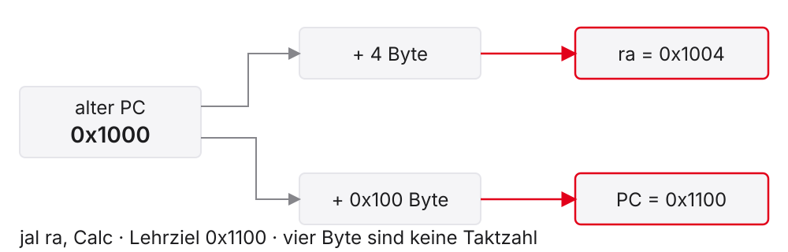{width=90%}

$$R[rd]_{\text{neu}}=PC_{\text{alt}}+4,\qquad PC_{\text{neu}}=PC_{\text{alt}}+\Delta$$

::: notes
jal bedeutet Jump and Link, Springen und eine Fortsetzungsadresse ablegen. PC steht für Program Counter, Programmzähler. rd, register destination, ist das Zielregister des Linkwerts; Delta ist der signed Byteoffset zum Sprungziel. Beide Rechnungen verwenden den alten PC. Für den normalen Aufruf wählen wir rd gleich ra, return address, also x1.

Die Zeichnung nimmt PC alt gleich 0x1000 und das Ziel Calc bei 0x1100 an. Der obere Weg addiert vier Byte und schreibt 0x1004 nach ra. Der untere addiert den Abstand 0x100 und macht den neuen PC zu 0x1100. Die roten Rahmen betonen die zwei neuen Werte. Die Größe der Funktion hat keinen Einfluss auf den Linkwert. Die Formel sagt nichts über Hardwaretakte; vier ist die Befehlslänge, keine Zeit. Ein anderes Zielregister ist architektonisch möglich. Beim bekannten Sprung j wird der Linkwert nach x0 geschrieben und verworfen, sodass ra unverändert bleibt.
:::

## jalr benutzt eine Registeradresse

$$T=(R[rs1]+\operatorname{sext}_{12\to32}(imm))\bmod2^{32}$$

`jalr rd, imm(rs1)`:

- Ziel: $T$ mit gelöschtem Bit 0
- Linkwert: alter PC plus vier Byte nach `rd`
- Rückkehrfall: `jalr x0, 0(ra)`

::: notes
jalr heißt Jump and Link Register. rs1, register source 1, liefert die Basisadresse und imm ein direktes signed Zwölf-Bit-Immediate. R bezeichnet den alten Registerinhalt. sext steht für sign extension, Vorzeichenerweiterung von zwölf auf 32 Bit. T ist die zunächst berechnete 32-Bit-Summe. Im Sprungziel wird anschließend Bit null gelöscht. PC bedeutet Program Counter, Programmzähler; dessen alter Wert plus vier wird als Linkwert nach rd, register destination, geschrieben.

Für die Rückkehr wählen wir x0 als Linkziel und ra, return address, als Basis. Mit ra gleich 0x1004 und Offset null wird der nächste PC 0x1004; x0 verwirft den neu berechneten Linkwert. ra wird dabei nicht beschrieben. Im Unterschied zum PC-relativen jal hängt das Ziel von einem zur Laufzeit gelesenen Register ab. Dadurch kann derselbe Rücksprungcode alle Aufrufstellen bedienen. Die angegebene Rechnung prüft aber weder die Zugänglichkeit der Zieladresse noch automatisch jede nötige Ausrichtung.
:::

## Bit 0 löschen garantiert keine Vier-Byte-Grenze

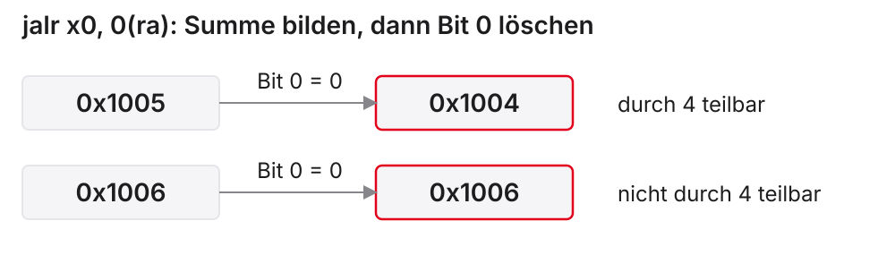{width=90%}

Die Kursbasis ohne C benötigt ausgerichtete Instruktionsziele.

::: notes
jalr ist Jump and Link Register. x0 verwirft den Linkwert, ra, return address, liefert hier die Basis und der direkte Offset ist null. Die Abbildung zeigt zwei ausdrücklich angenommene Adressmuster. Links steht die Summe vor dem Löschen von Bit null, rechts das berechnete Ziel. Die Pfeile zeigen diesen einen Bitwechsel; rote Rahmen markieren die Resultate.

0x1005 endet binär auf 01. Nach Löschen des letzten Bits entsteht 0x1004 mit Endbits 00, eine durch vier teilbare Adresse. 0x1006 endet dagegen auf 10 und bleibt unverändert, also nicht durch vier teilbar. C ist die komprimierte Erweiterung, die wir hier nicht verwenden. Unsere nativen Instruktionen liegen an Vier-Byte-Grenzen. Das Löschen eines Bits ist daher keine allgemeine Reparatur einer falschen Rückkehradresse. Selbst eine passend ausgerichtete Adresse muss auf zugänglichen ausführbaren Code zeigen. Normale von jal erzeugte Folgeadressen sind im betrachteten gültigen Ablauf bereits passend ausgerichtet.
:::

## ret springt; es räumt nicht auf

`ret` ist die Pseudoinstruktion für `jalr x0, 0(ra)`.

- `ra` liefert den aktuellen Rückweg.
- `x0` verwirft den Linkwert.
- Ergebnisregister, Sicherungen und `sp` werden nicht restauriert.
- Ein falsches `ra` bleibt ein falscher Rückweg.

::: notes
ret steht für return, Rückkehr. Es ist eine Assemblerhilfe für jalr, Jump and Link Register, mit Linkziel x0 und Basis ra. ra bedeutet return address, Rückkehradresse. x0 ist das Nullregister. Die Maschine liest die Adresse, die jetzt in ra steht; sie erinnert sich nicht zusätzlich an eine unsichtbare frühere Aufrufgeschichte.

ret erzeugt kein Rechenergebnis und lädt keine Sicherungen aus dem Speicher. sp heißt stack pointer, Stackzeiger; auch dieser Registerwert wird durch ret nicht automatisch geändert. Wenn eine Funktion ihn für einen Speicherrahmen verschoben hat, muss sie ihn vorher selbst wiederherstellen. Dasselbe gilt für veränderte erhaltene Register. Mit ra gleich 0x1004 führt ret zum Folgebefehl dort; mit überschriebenem ra würde es zum anderen aktuellen Wert springen. Diese Trennung ist für die spätere Fehleranalyse wichtig: Rücksprung, Ergebnisbereitstellung und Aufräumen sind verschiedene Aktionen, die im Funktionsende zusammenpassen müssen.
:::

## Ein vollständiges Leaf-Beispiel

```asm
.text
.globl main
main:
    li a0, 15
    jal ra, Verdopple
Ergebnis_pruefen:
    mv a1, a0
    li a0, 1
    ecall
    li a0, 10
    ecall
Verdopple:
    slli a0, a0, 1
    ret
```

::: notes
Leaf bedeutet Blattfunktion: Sie ruft selbst keine weitere Funktion auf. .text wählt den Codeabschnitt, .globl macht main sichtbar; main ist der Kurs-Venus-Einstieg. li, Load Immediate, setzt das Argumentregister a0 auf 15. jal, Jump and Link, legt die Fortsetzung in ra, return address, ab und ruft Verdopple. slli, Shift Left Logical Immediate, schiebt den alten a0-Wert um eine Stelle nach links und liefert 30. ret springt zurück.

Ergebnis_pruefen liegt vor der Ausgabevorbereitung. a0 ist dort das Funktionsresultat. mv, move, kopiert es nach a1. ecall heißt Environment Call: In Kurs-Venus druckt Dienst eins aus a0 die signed Zahl in a1, danach beendet Dienst zehn das Programm. Der Abschluss verhindert das Weiterlaufen in den Funktionscode. Verdopple braucht hier keinen Frame: Es verändert keine erhaltenen Register und überschreibt seinen Rückweg nicht durch einen inneren Aufruf. Für beliebige Eingabemuster ist das Ergebnis zweimal die Quelle modulo 2 hoch 32, keine allgemeine Garantie einer überlauffreien signed Multiplikation.
:::

# 2. Ein gemeinsamer Registervertrag


::: notes
Ein funktionierender Rückweg reicht noch nicht für getrennt geschriebene Funktionen. Der Aufrufer muss wissen, wohin er Eingaben legt, wo er das Ergebnis findet und welche früheren Werte er nach der Rückkehr noch nutzen darf. Eine Konvention beantwortet diese Fragen unabhängig vom jeweiligen Funktionsnamen.

Die aus Einheit 2 bekannten Aliasgruppen werden nun zu konkreten Verantwortlichkeiten. Der Prozessor schützt keine als erhalten bezeichneten Register. Eine Funktion darf sie als Arbeitsregister nutzen, muss ihren Eintrittswert aber vor der Rückkehr wiederherstellen. Bei anderen Registern liegt die Verantwortung für noch benötigte alte Werte auf der Aufruferseite. Wir behandeln zuerst die Übergabe und danach genau diese Erhaltungsfragen; die Speichertechnik folgt anschließend.
:::

## ABI und Aufrufkonvention

- ABI: Application Binary Interface, binäre Schnittstellenvereinbarung
- Aufrufteil: Argumente, Ergebnis, Registererhaltung, Stackausrichtung
- `a0`–`a7`: einfache 32-Bit-Argumente
- `a0`: hier ein einzelnes 32-Bit-Integer-Ergebnis
- Kurskonvention ILP32; Stackzeiger an Aufrufgrenzen durch 16 teilbar

::: notes
ABI bedeutet Application Binary Interface, binäre Schnittstellenvereinbarung. Die Calling Convention, Aufrufkonvention, ist ihr Teil für die Zusammenarbeit von Funktionen. Sie legt Datenorte und Erhaltungspflichten fest, keine neue Hardwareoperation. ILP32 bezeichnet das Datenmodell mit 32 Bit für int, long und Pointer; wir verwenden daraus die normale Integer-Aufrufkonvention. C-Syntax wird dafür nicht benötigt.

a0 bis a7 sind Argumentregister, Architekturregister x10 bis x17. Für die hier gezeigten einfachen 32-Bit-Eingaben übergibt der Aufrufer die Werte darin. Das einzelne 32-Bit-Ergebnis liegt nach der Rückkehr in a0. Andere Typen oder mehr Argumente benötigen zusätzliche Regeln und sind nicht Gegenstand der Pflichtaufgaben. Der Stackzeiger muss an Aufrufgrenzen durch sechzehn teilbar sein. Die Hardware erzwingt diesen Softwarevertrag nicht automatisch. Ein ecall-Dienst der Umgebung ist wiederum ein eigener Vertrag: In Venus bezeichnet a0 dann die Dienstnummer statt eines Funktionsresultats.
:::

## Sum: Argumente werden zum Ergebnis

```asm
    li a0, 5
    li a1, 10
    jal ra, Sum
    # hier: a0 = 15

Sum:
    add a0, a0, a1
    ret
```

Ausschnitt: Der vollständige Hauptprogrammabschluss steht im Beispiel.

::: notes
a0 und a1 sind Argumentregister. li, Load Immediate, lädt die gewählten Eingaben fünf und zehn. jal, Jump and Link, speichert die Fortsetzungsadresse in ra, return address, und ruft Sum. add ist die Registeraddition: Sie liest beide alten Argumente und schreibt 15 nach a0. ret kehrt über die in ra stehende Adresse zurück. a0 ist nun das einzelne skalare Ergebnis und nicht mehr das erste Eingabeargument.

Der gezeigte Ausschnitt beschreibt den Aufruf und die Funktion, lässt aber die Fortsetzungsinstruktionen des Hauptprogramms aus. Ein vollständiges Programm muss nach dem Aufruf weiterrechnen oder kontrolliert enden, statt später einfach in Sum hineinzulaufen. Die Datei mit Calc enthält diesen Rahmen. Sum verändert keine s-Register und ruft niemanden weiter auf, sodass sie in dieser Fassung keinen Stackrahmen benötigt. Dass a1 hier unverändert bleibt, ist keine allgemeine Erhaltungszusage für Argumentregister. Ein anderer korrekter Sum-Code dürfte es als Zwischenregister überschreiben, solange Ergebnis und vertraglich erhaltene Werte stimmen.
:::

## Caller und Callee sind relative Rollen

`main → Calc → Sum`

| Aufruf | Caller: Aufrufer | Callee: Aufgerufener |
|---|---|---|
| `main` ruft `Calc` | `main` | `Calc` |
| `Calc` ruft `Sum` | `Calc` | `Sum` |

`Calc` muss beide Seiten des Vertrags erfüllen.

::: notes
Caller heißt Aufrufer, Callee aufgerufene Funktion. Die Bezeichnungen beziehen sich auf einen bestimmten Aufruf, nicht dauerhaft auf einen Programmnamen. main ruft Calc: Calc ist auf dieser Kante Callee. Calc ruft Sum: Calc ist dort Caller. Sum ist in unserem Beispiel eine Leaf-Funktion, also eine Funktion ohne weiteren inneren Aufruf.

Als Callee muss Calc beispielsweise den Eintrittswert eines von ihr veränderten s0 wiederherstellen. Als Caller muss sie gleichzeitig Werte erhalten, die ihr eigener Weiterlauf nach Sum noch benötigt. Dazu gehört ihre eigene Rückkehradresse nach main, die im Register ra vor dem inneren Aufruf steht. Die beiden Pflichten widersprechen sich nicht, sondern betreffen unterschiedliche Lebensdauern. Die Tabelle zeigt die Rollen im Ablauf ohne eine bestimmte Codeadresse oder Speicherkarte anzunehmen. Der Name main ist hier der Simulator-Einstieg mit anschließendem Exit, keine gewöhnlich zum aufrufenden Laufzeitcode zurückkehrende Funktion.
:::

## Caller-saved heißt nicht automatisch gelöscht

- Nicht als erhalten zugesichert: `t0`–`t6`, `a0`–`a7`, `ra`
- Caller erhält einen alten Wert, wenn er ihn nach dem Aufruf noch braucht.
- Ein unbenutzter alter Wert benötigt keine Sicherung.
- Beobachtetes Unverändertbleiben ist kein allgemeiner Vertrag.

::: notes
Caller-saved bedeutet Sicherungsverantwortung des Aufrufers. t steht für temporary, temporäres Register, a für argument und ra für return address, Rückkehradresse. Ein normaler Aufruf garantiert die alten Inhalte dieser Gruppen nicht. jal, Jump and Link, schreibt ra schon durch den Aufruf selbst neu. Die aufgerufene Funktion darf t- und a-Register verwenden, ohne deren Eintrittswerte zu restaurieren.

Das heißt weder, dass alle Werte auf null gesetzt werden, noch dass jede Funktion tatsächlich alle verändert. Enthält t0 einen Zähler fünf, den der Caller danach braucht, muss er diesen Wert durch eine geeignete Sicherung, Registerwahl oder Neuberechnung erhalten. Ein nach dem Aufruf nicht mehr gelesener Zwischenwert verlangt keinen solchen Aufwand. Das neue Ergebnis in a0 ist eine gewünschte Änderung, die nicht durch blindes Zurückladen des alten Arguments vernichtet werden darf. Ein Testlauf mit zufällig unverändertem t0 beweist nur das Verhalten dieser Implementierung, nicht die allgemeine Sicherheit über künftige Aufrufe hinweg.
:::

## Callee-saved heißt am Ende wiederhergestellt

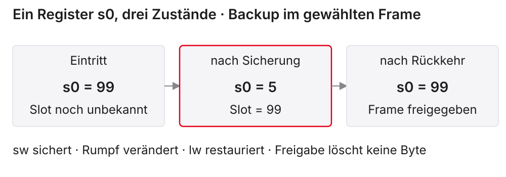{width=95%}

`s0`–`s11`: Eintrittswerte bei korrekter Rückkehr erhalten.

::: notes
Callee-saved heißt Erhaltungsverantwortung der aufgerufenen Funktion. s bedeutet saved, erhaltenes Register. Die Funktion darf ein solches Register verändern, muss aber seinen Eintrittswert bei der Rückkehr wieder bereitstellen. Bloßes Lesen oder Nichtbenutzen verlangt keine Sicherung. Die Zeichnung verwendet das Register s0 mit Eintrittswert 99 und Arbeitswert fünf.

Von links nach rechts sehen Sie Eintritt, gesicherten Arbeitszustand und Rückkehr. Beim Eintritt ist der spätere Sicherungsslot noch unbekannt. sw, Store Word, legt 99 im Frame ab; der Rumpf darf s0 anschließend auf fünf setzen. Vor der Rückkehr lädt lw, Load Word, wieder 99. Der rote Rahmen betont den Arbeitszustand, in dem Register und Kopie verschiedene Werte haben. Ein Frame ist der Speicherrahmen dieses Aufrufs. Seine Freigabe löscht die Byte nicht automatisch. Andere Zustände sind nicht allgemein unverändert: a0 darf das Ergebnis und Speicher darf vereinbarte Änderungen enthalten. Diese Unterscheidung verhindert die falsche Forderung, jeden Registerwert nach jeder Funktion zurückzuladen.
:::

## Sichern benötigt einen Ort und eine Lebensdauer

- Ein Registerbackup kann im passenden Fall genügen.
- Verschachtelte aktive Aufrufe brauchen getrennte Sicherungen.
- Ein fester gemeinsamer Slot kann überschrieben werden.
- Der Stack verwaltet Speicher passend zur Rückkehrreihenfolge.

::: notes
Backup bedeutet Sicherungskopie. Ein Wert kann in einem anderen Register erhalten werden, wenn dessen Verfügbarkeit und Erhaltungspflicht passen. Ein Wechsel von t0 nach s0 beseitigt die Pflicht jedoch nicht: Verändert eine normale Funktion s0, muss sie dessen eigenen Eintrittswert erhalten. Bei vielen gleichzeitig lebenden Werten wird Speicher zur systematischen Lösung.

Ein einziger fest verwendeter Speicherplatz ist für beliebige Verschachtelung ungeeignet. Der äußere Aufruf legt seine Rückkehradresse darin ab; ein innerer schreibt dieselbe Stelle und zerstört die ältere Kopie. Separate Slots mit passenden Lebensdauern vermeiden dies. Beim gewöhnlichen Aufruf endet der innere Aufruf zuerst. Ein Stack, Stapel, organisiert genau diese umgekehrte Reihenfolge und liefert für jeden benötigten Rahmen einen eigenen Bereich. Er ist aber kein automatischer Tresor: Registeraddition reserviert den Bereich, Stores legen Kopien ab und Loads holen sie zurück. Diese schon bekannten Befehle bilden im nächsten Abschnitt den vollständigen Mechanismus.
:::

# 3. Ein Speicherrahmen für aktive Werte


::: notes
Der Stack ist hier ein von der Umgebung bereitgestellter gültiger Speicherbereich. Der Stackzeiger beschreibt die aktuelle Grenze der reservierten Rahmen. Die Konvention lässt ihn beim Reservieren zu kleineren Adressen wandern. Eine aufgerufene Funktion reserviert darunter ihren eigenen Bereich und gibt ihn vor der Rückkehr wieder frei.

Das ist eine Softwareanordnung, keine pauschale Speicherkarte aller RISC-V-Systeme. Wir benötigen weder einen Heap noch ein Betriebssystemmodell, um sie zu erklären. Ausgangspunkt ist ein passend ausgerichteter Anfangszeiger und genug zugänglicher Speicher darunter. Unbekannte Byte werden nicht als null angenommen. Vier getrennte Aktionen sind wichtig: reservieren, Daten schreiben, Daten lesen und freigeben. Ihre Reihenfolge und ihre Adressen müssen zusammenpassen.
:::

## sp und LIFO

- `sp=x2`: stack pointer, Stackzeiger
- LIFO: Last In, First Out — inneren Frame zuerst freigeben
- Eintrittswert $S$: gültig und durch 16 teilbar
- Reservieren: `addi sp, sp, -16`
- Freigeben: `addi sp, sp, 16`

::: notes
sp ist der Alias von x2 und steht für stack pointer, Stackzeiger. LIFO bedeutet Last In, First Out: Der zuletzt hinzugekommene Rahmen wird zuerst freigegeben. Ein Frame ist der Speicherbereich eines aktiven Aufrufs. S bezeichnet seinen Eintritts-Stackzeiger, nicht eine feste Adresse jeder Plattform. Wir setzen S durch 16 teilbar und einen ausreichenden gültigen Speicherbereich darunter voraus.

addi heißt Add Immediate. Minus sechzehn verschiebt sp von S auf S minus sechzehn und reserviert im gewählten absteigenden Modell die Byte von S minus sechzehn bis S minus eins. Plus sechzehn stellt nach der Nutzung S wieder her. Keine dieser Additionen schreibt allein ein Backup in den Speicher. Ebenso löscht die zweite Addition die vorher dort gespeicherten Daten nicht. Andere Funktionen dürfen den freigegebenen Bereich danach für ihre eigenen Rahmen benutzen. Der Aufrufbefehl selbst verschiebt sp nicht; die konkreten Prolog- und Epiloginstruktionen tun es.
:::

## Nutzbedarf und Framegröße unterscheiden

$$F=16\left\lceil\frac{B}{16}\right\rceil$$

| Nutzbedarf $B$ | Frame $F$ | Padding |
|---:|---:|---:|
| 4 Byte | 16 Byte | 12 Byte |
| 8 Byte | 16 Byte | 8 Byte |
| 12 Byte | 16 Byte | 4 Byte |
| 20 Byte | 32 Byte | 12 Byte |

::: notes
B ist der benötigte Speicherumfang in Byte, F die im einfachen Beispiel gewählte Framegröße. Aufrunden auf ein Vielfaches von sechzehn erhält die Stackausrichtung der Kurs-Aufrufkonvention. Die obere Klammerfunktion bedeutet ceiling, Aufrunden zur kleinsten größeren oder gleichen ganzen Zahl. Padding ist der verbleibende reservierte Platz ohne hier benutzte Nutzdaten.

Ein gesichertes 32-Bit-Register benötigt vier Byte. Trotzdem reservieren wir für dieses einzelne Wort sechzehn, nicht vier. Drei Wörter benötigen zwölf Nutzbyte und passen ebenfalls in einen Sechzehn-Byte-Frame. Fünf Wörter benötigen 20 Byte und werden hier auf 32 aufgerundet. Die Tabelle zählt weder Instruktionen noch Takte. Die Formel beschreibt diese kleinen Rahmen ohne weitere Ausrichtungs- oder lokale Zusatzanforderungen. Für Bedarf null darf der Frame null bleiben. Die Größe allein legt die Belegung nicht fest; welche Sicherung bei welchem Offset liegt, wählen wir anschließend konsistent innerhalb des reservierten Bereichs.
:::

## Ein Wort im 16-Byte-Frame

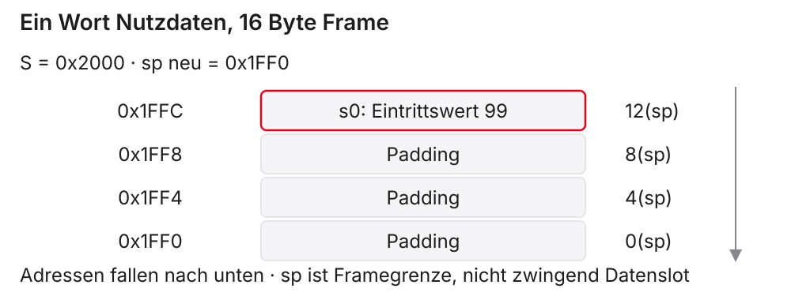{width=90%}

::: notes
sp ist der stack pointer, Stackzeiger, S sein Eintrittswert. Die Zeichnung nimmt als Lehrwert S gleich 0x2000 an. Nach Reservierung von sechzehn Byte steht sp bei 0x1FF0. Die vier Zeilen zeigen Wortstarts von oben 0x1FFC bis unten 0x1FF0, also fallende Adressen. Die rechte Spalte enthält Byteoffsets relativ zum neuen sp. Der rote Rahmen hebt den gewählten Sicherungsslot für s0, ein saved Register, bei zwölf hervor.

s0 enthält am Eintritt 99. sw s0, 12(sp), Store Word, schreibt die Kopie an 0x1FFC bis 0x1FFF. Die unteren zwölf Byte bleiben hier Padding, reservierter unbenutzter Platz, dessen Inhalte unbekannt sind. Die graue Abwärtspfeilrichtung erklärt die Adressordnung, keine Zeitachse. sp ist die untere Framegrenze und muss daher nicht genau auf das gesicherte Wort zeigen. Slot zwölf ist eine Layoutwahl. Andere passende ausgerichtete Slots innerhalb desselben Frames wären ebenfalls zulässig, wenn die Wiederherstellung denselben Slot verwendet.
:::

## Reservieren und Speichern sind zwei Befehle

```asm
addi sp, sp, -16
sw   s0, 12(sp)
```

- Nach `addi`: reserviert, Slotinhalt noch unbekannt
- Nach `sw`: Eintrittswert von `s0` als Kopie vorhanden
- Die Quelle `s0` bleibt beim Store unverändert.

::: notes
addi ist Add Immediate, Addition einer direkten Konstante. sp bedeutet stack pointer, Stackzeiger. Der erste Befehl verschiebt ihn vom gültigen Eintrittswert S auf S minus sechzehn. Er beschreibt keines der reservierten Byte. sw heißt Store Word und schreibt anschließend die 32 Bits des saved Registers s0 in den Slot am Offset zwölf. Die Quelle bleibt unverändert.

Bei S gleich 0x2000 und s0 gleich 99 wird sp zunächst 0x1FF0. Der Slot beginnt danach bei 0x1FFC; sein Wert wird erst durch sw zu 0x00000063. Unter Little Endian liegen dort 63 00 00 00, das niederwertige Byte zuerst. Eine Bezeichnung wie Push, auf den Stapel legen, meint hier diesen zusammengesetzten Ablauf und keinen nativen RV32I-Befehl. RV32I ist die RISC-V-Basis mit 32-Bit-Integerregistern. Eine Sicherung vor dem Reservieren wäre in diesem Modell außerhalb des eigenen Frames. Ebenso wäre Lesen ohne vorherige gültige Sicherung kein Weg, einen erfundenen nullten Anfangswert zu erhalten.
:::

## Laden, dann den Frame freigeben

```asm
lw   s0, 12(sp)
addi sp, sp, 16
ret
```

Der neue Slot gehört nach der Freigabe nicht mehr zum aktiven Frame.

::: notes
lw, Load Word, holt das gesicherte Wort aus dem Speicher zurück in s0, ein saved Register. sp ist der stack pointer und steht noch auf der unteren Framegrenze. addi, Add Immediate, gibt durch plus sechzehn die Reservierung frei. ret ist die Rückkehrhilfe für jalr, Jump and Link Register, über ra, return address. Der Rückweg muss für diesen Funktionsausschnitt weiterhin korrekt in ra stehen.

Mit sp gleich 0x1FF0 liegt Slot zwölf bei 0x1FFC. Der Load stellt den gesicherten Eintrittswert wieder her, anschließend ist sp wieder 0x2000. Würde die Addition zuerst ausgeführt und danach unverändert 12(sp) gelesen, wäre die Adresse 0x200C und damit ein anderer Ort außerhalb dieses Frames. Die Freigabe löscht die alten Byte bei 0x1FFC nicht; sie beendet deren reservierte Lebensdauer. Das hier als Pop bezeichnete Herunternehmen ist deshalb eine Folge aus Laden und Zeigermanagement, kein automatischer Registerrestore durch ret. Die richtige Reihenfolge erklärt sich aus den tatsächlichen Adressen.
:::

## Drei Sicherungen teilen sich einen Frame

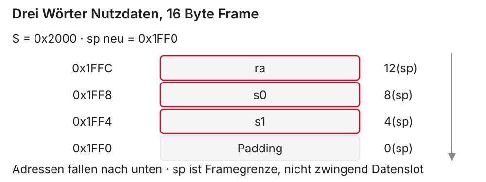{width=90%}

Für 12 Byte Nutzdaten genügt hier ein Frame von 16 Byte.

::: notes
ra heißt return address, Rückkehradresse; s0 und s1 sind saved Register. sp ist der stack pointer und wird in der Zeichnung vom Lehrstart S gleich 0x2000 auf 0x1FF0 verschoben. Die drei roten Slots beginnen bei 0x1FFC, 0x1FF8 und 0x1FF4. Wir wählen die Offsets zwölf für ra, acht für s0 und vier für s1. Das unterste Wort bei Offset null bleibt Padding, unbenutzter reservierter Raum.

Jeder Slot umfasst vier Byte. Drei Wörter ergeben zwölf Byte Nutzbedarf, die Aufrufausrichtung verlangt in diesem einfachen Layout sechzehn Byte Reservierung. Nur einmal sp zu verschieben genügt; danach adressieren drei Stores unterschiedliche Slots. Das ist keine Pflicht, für jedes Register separat einen Sechzehn-Byte-Frame anzulegen. Die graue Pfeilrichtung zeigt fallende Adressen. Im Epilog werden dieselben Register aus denselben Slots gelesen und sp um sechzehn zurückgesetzt. Die Reihenfolge unabhängiger Loads darf wechseln, ihre Zuordnung und der Zeitpunkt vor der Freigabe müssen erhalten bleiben.
:::

## Ein Leaf kann trotzdem einen Frame brauchen

```asm
ArbeiteMitS0:
    addi sp, sp, -16
    sw   s0, 12(sp)
    li   s0, 42
    add  a0, a0, s0
    lw   s0, 12(sp)
    addi sp, sp, 16
    ret
```

::: notes
Leaf heißt eine Funktion ohne weiteren Funktionsaufruf. Hier verwendet sie dennoch das saved Register s0 als Arbeitsregister. Deshalb sichert sw, Store Word, dessen Eintrittswert im von addi, Add Immediate, reservierten Frame. sp ist der stack pointer, und Slot zwölf ist die gewählte Belegung. li, Load Immediate, setzt s0 auf 42. add addiert diese Zahl zum Argumentregister a0, das anschließend das Ergebnis trägt.

lw, Load Word, restauriert s0, die zweite Addition an sp gibt den Frame frei und ret kehrt über das unverändert gebliebene ra, return address, zurück. Für a0 gleich sieben und s0 am Eintritt gleich 99 lautet das Ergebnis 49, während s0 bei der Rückkehr wieder 99 ist. a0 darf sich ändern, s0 muss erhalten werden. Ein ra-Backup ist hier nicht nötig, denn kein innerer Aufruf überschreibt ra. Die Funktion ist damit ein Gegenbeispiel zur falschen Gleichsetzung „Leaf bedeutet immer framefrei“. Sie zeigt zugleich, warum der Epilog ein Eintrittsregister restauriert, ohne das gewünschte Ergebnis zurückzusetzen.
:::

## Freigabefehler lassen sp verschoben

Lehrstart $S=\mathtt{0x2000}$:

| Aktion | `sp` |
|---|---|
| Prolog: −16 | `0x1FF0` |
| korrekter Epilog: +16 | `0x2000` |
| falscher Epilog: nur +8 | `0x1FF8` |

Ein korrektes Ergebnis allein beweist keine korrekte Rückkehr.

::: notes
sp ist der stack pointer, Stackzeiger. S bezeichnet den angenommenen Eintrittswert 0x2000. Der Prolog, die Vorbereitung, reserviert sechzehn Byte durch Subtraktion von sechzehn. Der Epilog, das Aufräumen, muss genau diese Reservierung freigeben. Die Tabelle stellt den richtigen und den falschen Epilog als Alternativen dar, nicht als nacheinander auszuführende zwei Additionen.

Nur plus acht führt von 0x1FF0 auf 0x1FF8, also S minus acht. Acht Byte bleiben als Zeigerabweichung, und die nötige Sechzehn-Byte-Ausrichtung ist ebenfalls verfehlt. Ein vorher geladener Rückweg kann trotzdem noch stimmen und a0 das richtige Resultat enthalten. Spätere Zugriffe des Aufrufers mit sp-relativen Offsets treffen dann andere Adressen. Ein Absturz ist nicht die einzig mögliche Auswirkung; falsche Daten oder eine schleichende Verschiebung genügen als Fehler. Prüfen Sie daher Ergebnis, erhaltene Register, Rückkehradresse und sp getrennt. Die Freigabemenge richtet sich nach dem Frame, nicht bloß nach der Zahl tatsächlich geladenen Wörter.
:::

## Verschachtelte Frames liegen getrennt

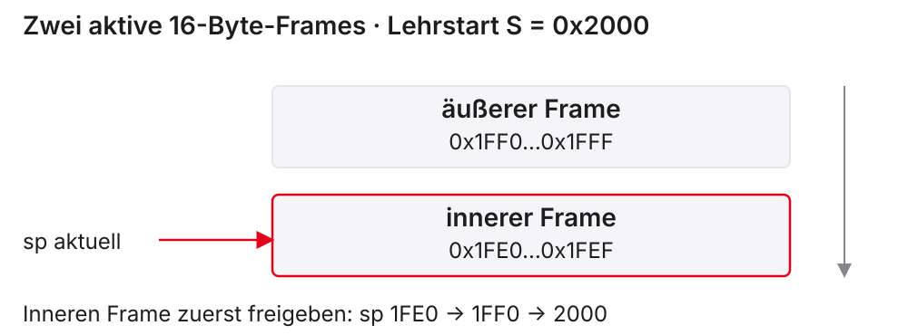{width=90%}

::: notes
Ein Frame ist der reservierte Speicherrahmen eines aktiven Aufrufs. Die Zeichnung nimmt den Lehrstart S gleich 0x2000 und zwei jeweils sechzehn Byte große Rahmen an. Der äußere liegt von 0x1FF0 bis 0x1FFF, der innere von 0x1FE0 bis 0x1FEF. sp, stack pointer, zeigt im dargestellten inneren Zustand auf 0x1FE0. Rot markiert den aktuellen Rahmen, grau den älteren weiterhin lebenden.

Der rechte Pfeil zeigt fallende Adressen. Die Rückkehr des inneren Aufrufs gibt dessen Rahmen zuerst frei und stellt sp auf 0x1FF0. Die spätere äußere Rückkehr stellt 0x2000 her. Diese Last-In-First-Out-Reihenfolge wird als LIFO, Stapelregel, bezeichnet. Gleiche positive Offsets können in beiden Funktionen benutzt werden, denn die jeweiligen sp-Basen unterscheiden sich. Es entsteht keine Slotkollision, solange jede Funktion in ihrem eigenen gültigen Frame bleibt. Genug bereitgestellter Speicher ist eine Voraussetzung; das Wachstum kann eine Stackgrenze überschreiten, ohne dass dafür ein bestimmtes Heapmodell angenommen werden muss.
:::

# 4. Calc ruft selbst einen Helfer auf


::: notes
Calc soll zweimal das erste Argument plus das zweite liefern. Wir teilen die Arbeit in Sum für die Summe beider Argumente und eine anschließende Addition des alten ersten Arguments. Diese Aufteilung ist didaktisch gewählt; sie ist keine Behauptung über die schnellste Implementierung.

Der innere Aufruf erzeugt zwei Erhaltungsprobleme. Der alte Rückweg nach main wird weiterhin gebraucht, während ra den neuen Rückweg aus Sum aufnimmt. Außerdem ist das alte erste Argument nach Sum nicht mehr in a0, weil dort das Ergebnis liegt. Wir lösen den zweiten Bedarf durch s0 als Arbeitsregister und erfüllen dessen Erhaltungspflicht mit einem eigenen Slot. Ein gemeinsamer Sechzehn-Byte-Frame genügt für die beiden Sicherungen.
:::

## Non-Leaf: ra hat nun zwei Lebensdauern

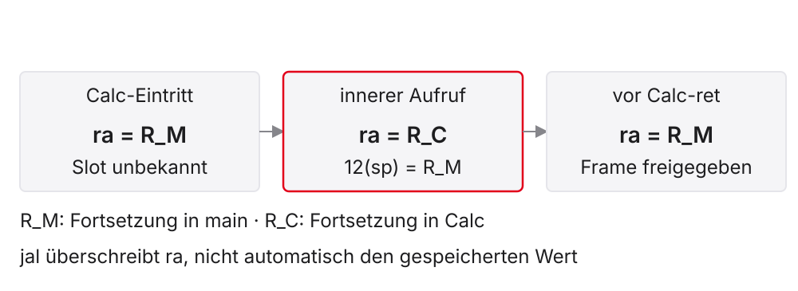{width=95%}

::: notes
Non-Leaf bedeutet eine Funktion, die selbst weitere Funktionen aufruft. ra, return address, enthält am Calc-Eintritt den Rückweg nach main, im Bild R_M. Der innere jal, Jump and Link, schreibt danach den Rückweg aus Sum nach Calc, R_C. Beide Adressen werden zu unterschiedlichen Zeiten gebraucht. Die Abbildung liest sich von links nach rechts und trennt den Registerwert von der Kopie im Frame, dem Speicherrahmen.

Vor dem inneren Aufruf legt sw, Store Word, R_M in den gewählten Slot 12(sp). sp heißt stack pointer. Der rote mittlere Zustand zeigt ra gleich R_C, während der Slot unverändert R_M enthält. Vor Calc-ret wird lw, Load Word, die ältere Adresse wieder nach ra laden und der Frame freigegeben. ra ist caller-saved: Calc ist gegenüber Sum selbst Caller und muss seinen noch benötigten alten Wert erhalten. Das Beispiel verlangt die Sicherung, ohne jeden denkbaren Weiterleitungs- oder Endaufruf auf dieselbe Schablone zu verpflichten.
:::

## Ohne Backup kehrt das zweite ret falsch zurück

```asm
Calc_bad:
    jal ra, Sum_bad
calc_bad_return:
    ret
Sum_bad:
    ret
```

Nach `Sum_bad.ret` zeigt `ra` weiterhin auf `calc_bad_return`.

::: notes
jal heißt Jump and Link, ret ist die Rückkehrhilfe über ra, return address. Calc_bad und Sum_bad sind Labels eines absichtlich fehlerhaften Ausschnitts. Vor Calc_bad sei ra die Fortsetzung des äußeren Aufrufers. Der innere jal überschreibt diesen Wert mit der Adresse calc_bad_return, unmittelbar nach dem inneren Aufruf. Sum_bad enthält nur ret und kehrt damit korrekt zu dieser Stelle zurück.

Calc_bad führt nun seinerseits ret aus. ra wurde jedoch nicht restauriert und zeigt weiterhin genau auf diese ret-Instruktion. Der PC, Program Counter beziehungsweise Programmzähler, bleibt bei wiederholten Schritten dort. Es entsteht ein Selbstloop, nicht zwingend ein Absturz. Die Datei beispiele/mct1_vl4_ra_fehler.s enthält einen vollständigen Einstieg, mit dem dieser isolierte Fehler beobachtet werden kann. Das Fortsetzungslabel in main wird nicht erreicht. Der Ausschnitt verändert keinen Stackzeiger; die Ursache ist ausschließlich der verlorene ältere Rückweg. Andere ra-Fehler können anders aussehen, je nachdem, welcher Code an der falschen Zieladresse liegt.
:::

## Calc reserviert zwei verschiedene Slots

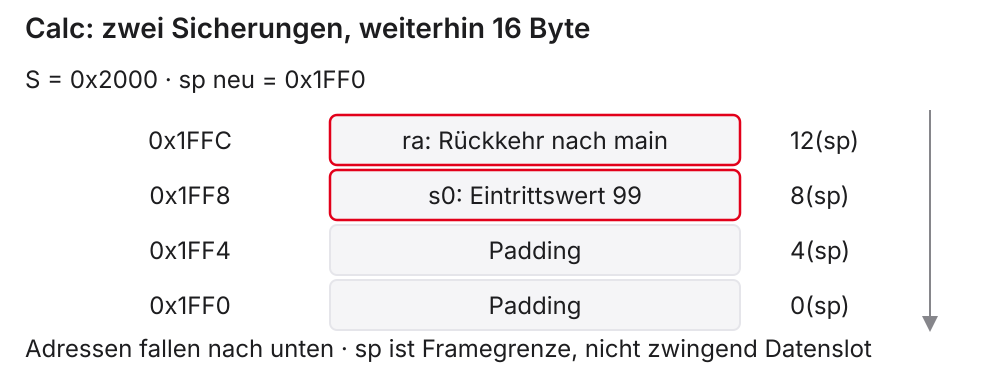{width=90%}

```asm
addi sp, sp, -16
sw   ra, 12(sp)
sw   s0, 8(sp)
```

::: notes
Calc ist im Beispiel ein Non-Leaf, eine Funktion mit innerem Aufruf. sp ist der stack pointer, ra die return address und s0 ein saved Register. addi, Add Immediate, reserviert sechzehn Byte. sw, Store Word, sichert ra am Offset zwölf und den s0-Eintrittswert am Offset acht. Die Zeichnung verwendet den Lehrstart S gleich 0x2000 und markiert diese zwei Slots rot.

Die Rückkehradresse liegt damit an 0x1FFC, der alte s0-Wert 99 an 0x1FF8. Beide benötigen insgesamt acht Nutzbyte; der Frame bleibt trotzdem sechzehn Byte groß, unten acht Byte Padding. Die Sicherungen dürfen nicht denselben Slot belegen. Erst nach dem zweiten Store darf Calc s0 mit dem noch benötigten ersten Argument fünf überschreiben. ra und s0 werden aus verschiedenen Gründen gesichert: ra schützt den eigenen äußeren Rückweg vor dem inneren Aufruf, s0 erfüllt die Erhaltungspflicht gegenüber main. Dass beide im selben Frame liegen, hebt diese Rollen nicht auf.
:::

## Der Rumpf bewahrt a und verwendet Sum

```asm
mv  s0, a0
jal ra, Sum
calc_after_sum:
add a0, a0, s0
```

$$5+10=15,\qquad 15+5=20$$

`a0` wird Ergebnis; das alte Argument bleibt während Sum in `s0`.

::: notes
mv, move, kopiert das erste Argument aus a0 in s0. Die Prologsicherung des alten s0 ist dafür bereits erfolgt. a0 und a1 sind Argumentregister, zunächst fünf und zehn. jal, Jump and Link, ruft Sum und legt die Fortsetzung calc_after_sum in ra, return address. Sum gibt a plus b als einzelnes Ergebnis in a0 zurück, hier 15. s0 ist callee-saved, daher darf eine korrekte Sum-Funktion seinen Wert fünf nicht dauerhaft verändern.

add liest nun a0 gleich 15 und s0 gleich fünf und schreibt 20 nach a0. Das ursprüngliche erste Argument ist nicht mehr in a0; gerade deswegen wurde es vor dem Aufruf erhalten. Eine bloße Kopie nach einem ungesicherten temporären t0 wäre gegenüber einer anderen korrekten Sum-Implementierung nicht zuverlässig. Calc erfüllt anschließend ihre eigene s0-Pflicht, indem sie 99 aus dem Frame restauriert. Das Ergebnis 20 muss nicht in s0 bleiben und wird vom Epilog nicht überschrieben. Alle Rechnungen unterliegen der bekannten 32-Bit-Moduloarithmetik.
:::

## Der Epilog erhält das Ergebnis und stellt den Kontext her

```asm
lw   s0, 8(sp)
lw   ra, 12(sp)
addi sp, sp, 16
ret
```

Danach: `a0=20`, `s0=99`, `sp=S`; Fortsetzung in `main`.

::: notes
lw ist Load Word. Der erste Load restauriert den Eintrittswert 99 des saved Registers s0. Der zweite stellt ra, return address, auf den gesicherten Rückweg nach main. sp ist der stack pointer und wird durch addi, Add Immediate, auf seinen Eintrittswert S zurückgesetzt. Erst danach führt ret, die Rückkehr über jalr, Jump and Link Register, den Sprung aus.

a0 ist das Ergebnisregister und bleibt bei diesen Loads unberührt: Es enthält 20. Der Arbeitswert fünf in s0 wird dagegen absichtlich durch den Eintrittswert ersetzt. Die Loadreihenfolge zwischen s0 und ra könnte wechseln, beide müssen aber mit der richtigen Framebasis und Slotzuordnung stattfinden. Eine Freigabe vor dem unveränderten Load würde falsche Adressen erzeugen. Nur sp zu erhöhen ersetzt den ra-Load nicht. Nur ra zu restaurieren ersetzt wiederum die sp-Freigabe nicht. Der vollständige korrekte Zustand enthält Ergebnis, erhaltene Werte und Rückweg, sodass main mit seinen eigenen Erwartungen weiterlaufen kann.
:::

## Eine vollständige Zustandsfolge von Calc

$R_M$: Fortsetzung in main; $R_C$: Fortsetzung nach Sum.

| Kontrollpunkt | `a0` | `s0` | `ra` | `sp` |
|---|---:|---:|---|---|
| Eintritt | 5 | 99 | $R_M$ | $S$ |
| gesichert, Argument kopiert | 5 | 5 | $R_M$ | $S-16$ |
| Sum zurück | 15 | 5 | $R_C$ | $S-16$ |
| Ergebnis gebildet | 20 | 5 | $R_C$ | $S-16$ |
| Slots geladen | 20 | 99 | $R_M$ | $S-16$ |
| zurück in main | 20 | 99 | $R_M$ | $S$ |

::: notes
a0 ist das Argument- und Ergebnisregister, s0 ein saved Register, ra die return address und sp der stack pointer. S ist der Eintrittswert des Stackzeigers. R_M bezeichnet die konkrete Fortsetzungsadresse in main, R_C die nach dem inneren Sum-Aufruf in Calc. Die Tabelle verwendet keine behaupteten Labeladressen einer Simulatorausführung, sondern verfolgt symbolisch genau diese Rollen.

Die ersten Stores legen R_M und 99 im Frame ab. Danach darf s0 fünf halten. Sum liefert 15 in a0 und ra enthält noch R_C. Die folgende Addition liefert 20. Die zwei Loads ändern s0 und ra zurück, nicht a0. Nach Freigabe und ret hat sp wieder S und der PC steht bei R_M in main. Zwischen den Tabellenzeilen können mehrere native Instruktionen liegen; es sind Kontrollpunkte, keine einzelnen Hardwaretakte. Die Sicherungskopien bleiben bis zum Laden unverändert. Diese Tabelle zeigt das Vorhersageverfahren für das Vorlesungsbeispiel. Im Übungsblatt erstellen Sie entsprechende Kontrollpunkte für die Funktion Restmenge eines Abfüllautomaten.
:::

## Die Rückkehr führt zum unmittelbaren Aufrufer

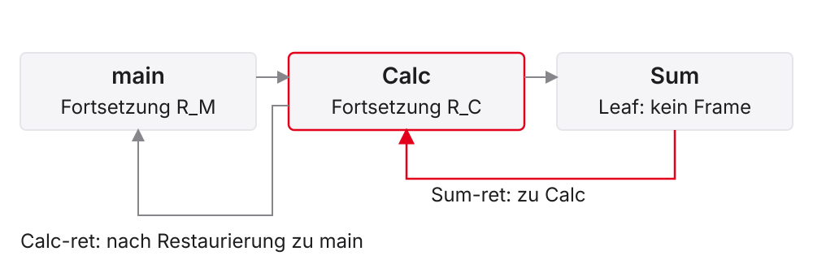{width=90%}

::: notes
Leaf bedeutet ein Unterprogramm ohne weitere Aufrufe, hier Sum. Calc hat einen inneren Aufruf und ist deshalb Non-Leaf. R_M ist die Fortsetzung in main, R_C die Fortsetzung in Calc. Die Abbildung zeigt die Hinwege oben von links nach rechts. Der rote untere Weg führt Sum-ret zurück zu Calc; der graue längere Weg führt erst Calc-ret zu main. Die Boxpositionen sind Funktionsrollen und keine physische Speicheranordnung.

ra, return address, hält während Sum den inneren Rückweg R_C. Calc hat den älteren Wert R_M vorher im Frame gesichert. Nach der Rückkehr aus Sum bildet Calc noch sein Ergebnis und restauriert den eigenen Kontext. Erst dann darf der äußere ret erfolgen. Ein ret führt daher nicht allgemein immer direkt zu main, sondern zur aktuell vereinbarten Fortsetzung des jeweiligen Aufrufs. Die Länge der Funktion und die Reihenfolge der Definitionen im Assemblertext ändern dieses Prinzip nicht. Ein fehlender Restore kann trotz korrektem innerem Rückweg den äußeren zerstören.
:::

## Mehrere Helfer brauchen nicht mehrere Kopien von R_M

- Eingehendes `ra` einmal vor dem ersten inneren Aufruf sichern.
- Weitere innere Aufrufe dürfen das Register erneut überschreiben.
- Der Slot muss die äußere Fortsetzung bis zum Epilog behalten.
- Erneutes `sw ra, 12(sp)` kann die falsche Adresse darüber schreiben.

::: notes
ra ist return address und R_M die beim Eintritt vorhandene Fortsetzung des äußeren Aufrufers. Ein Frame, Speicherrahmen, mit Slot zwölf hält hier die Sicherung. sw, Store Word, schreibt die aktuellen Registerbits. Nach der Rückkehr aus dem ersten Helfer enthält ra aber dessen Fortsetzung innerhalb der aktuellen Funktion. Ein neuer Store auf denselben Slot würde daher R_M durch diese innere Adresse ersetzen.

Die richtige Lebensdauer ist länger als ein einzelner Helferaufruf: Das einmal gesicherte eingehende ra bleibt bis zur eigenen normalen Rückkehr im Slot. Weitere jal, Jump and Link, können die Registerfassung beliebig mit ihren jeweils neuen inneren Fortsetzungen belegen. Erst der Epilog lädt R_M zurück. Natürlich müssen dabei Frame und Slot weiter bestehen und dürfen nicht anderweitig überschrieben werden. Diese Regel beschreibt unser normal zurückkehrendes Beispiel, keine Pflicht einer beliebigen optimierten Endweiterleitung. Sie macht deutlich, warum „vor jedem jal blind ra sichern“ keine allgemein richtige Reparatur ist, obwohl vor dem ersten inneren Aufruf eine Sicherung benötigt wird.
:::

## Auch der Caller kann einen t-Wert im Frame schützen

```asm
    li   t0, 5
    addi sp, sp, -16
    sw   t0, 12(sp)
    li   a0, 15
    jal  ra, VerdoppleMitTemp
    lw   t0, 12(sp)
    addi sp, sp, 16
    add  a0, a0, t0
```

Ergebnis 35 auch dann, wenn der Helfer `t0` überschreibt.

::: notes
Caller ist die Aufruferseite. t0 ist temporary, ein temporäres caller-saved Register. sp ist der stack pointer; addi, Add Immediate, reserviert den Frame. sw, Store Word, erhält den noch benötigten alten Zähler fünf im gewählten Slot zwölf. a0 ist das Argument- und Ergebnisregister. jal, Jump and Link, ruft den Helfer, ra ist die return address. Der Helfer verdoppelt 15 zu 30 und darf t0 verändern.

lw, Load Word, stellt nach der Rückkehr fünf in t0 wieder her. Die Freigabe restauriert sp, und add bildet 30 plus fünf gleich 35 in a0. Das alte a0 wird absichtlich nicht zurückgeladen: Dort steht das gewünschte neue Ergebnis. Der Ausschnitt gehört zum Hauptprogramm mit späterem Exit, nicht zu einer selbst nochmals zum eigenen Caller zurückkehrenden Funktion. Die vollständige Quelle beispiele/mct1_vl4_caller_save.s enthält Vorbereitung und Abschluss sowie einen Helfer, der t0 ausdrücklich auf 999 setzt. So ist die Sicherungswirkung sichtbar und hängt nicht von zufälligem Unverändertbleiben ab.
:::

# 5. Vorhersage und Werkzeugbeobachtung


::: notes
Die vollständigen Vorlesungsprogramme mit korrektem und fehlerhaftem Rückweg liegen im Repository. Das Übungsblatt überträgt das Verfahren auf einen Abfüllautomaten: Restmenge(a,b), also a minus zweimal b, ruft den Helfer Entnahme auf; das vollständige Programm steht im Blatt. Dort wird b in s1 erhalten, ra liegt am Offset null und der alte s1-Wert, die Chargennummer 77, am Offset vier des 16-Byte-Frames. Für 19 und sechs entsteht sieben; s1 muss danach wieder 77 sein. Das Blatt verfolgt diesen Ablauf mit Lehradressen, sucht Fehler ausgehend von beobachteten Symptomen und erweitert die Funktion um eine zweite Entnahme. Vor dem Simulatorlauf wählen Sie die Kontrollpunkte, notieren Erwartungen und unterscheiden Labeladressen aus dem tatsächlichen Listing von angenommenen Lehradressen.

Der Zustand enthält mehr als das Resultat: Stackzeiger, Rückkehradresse, erhaltene Register und gespeicherte Slots müssen ebenfalls stimmen. Der Anfangsstack gehört zur Umgebung und wird vor dem Lauf überprüft. Bei unbekannten Byte gibt es keine erfundene Nullbelegung. Ein funktionales Rechenmodell kann die Instruktionswirkung prüfen, ersetzt aber keine Beobachtung der konkreten Oberfläche oder der Pseudoexpansion. Diese Trennung bleibt auch beim anschließenden Quiz und bei klausurnahen Papieraufgaben bestehen.
:::

## Das vollständige Hauptprogramm mit Calc

```asm
.text
.globl main
main:
    li s0, 99
    li a0, 5
    li a1, 10
    jal ra, Calc
main_after_calc:
    mv s1, a0
    li a0, 10
    ecall
```

Calc und Sum: [mct1_vl4_nested_calls_ok.s](../beispiele/mct1_vl4_nested_calls_ok.s).

::: notes
.text und .globl sind Assemblerdirektiven für Code und sichtbares Startsymbol main. li bedeutet Load Immediate, mv move. a0 und a1 sind die Argumentregister, s0 und s1 saved Register. jal, Jump and Link, ruft über ra, return address, die in der verlinkten vollständigen Quelle definierte Calc-Funktion. Der Anfangswert 99 in s0 dient als überprüfbares Erhaltungssignal.

Direkt am Label main_after_calc erwarten wir a0 gleich 20, s0 gleich 99 und sp gleich seinem Eintrittswert. sp ist der stack pointer. mv kopiert das Ergebnis nach s1, bevor a0 überschrieben wird. ecall, Environment Call, beendet in der Kurs-Venus-Distribution mit Dienst zehn den Lauf. Das gezeigte Hauptprogramm druckt nichts; das Ergebnis wird vor dem Exit beobachtet. Der Exit verhindert das Weiterlaufen in die dahinter definierten Funktionen. main ist hier ein Simulator-Einstieg, kein mit ret zu einem weiteren Caller zurückkehrendes Unterprogramm. Seine Verwendung von s1 verlangt deshalb keinen normalen Rückkehr-Epilog.
:::

## Kontrollpunkte statt zufälliger Steps

- Vor Aufruf: Argumente, Eintritts-`sp` und Erhaltungssignal notieren
- Nach Prolog: zwei Slots relativ zum aktuellen `sp` prüfen
- Nach Sum: `a0`, `s0` und inneres `ra` prüfen
- Nach Calc: Ergebnis, ursprüngliches `s0`, `sp` und Fortsetzung prüfen
- [Kurs-Venus](https://thaumicmekanism.github.io/venus/): tatsächlich erzeugte native Liste ansehen

::: notes
sp heißt stack pointer, ra return address. a0 ist Argument- und Ergebnisregister, s0 ein saved Register. Venus ist der verwendete Assembler und Simulator. Ein Step zeigt die Fortschaltung der konkreten Oberfläche; eine Quelltextzeile kann durch Pseudoinstruktionen wie li, Load Immediate, mehrere native Wörter darstellen. Deshalb ordnen Sie jedes Vorher und Nachher einem echten Kontrollpunkt zu.

Notieren Sie den Anfangsstack S und prüfen Sie seine Sechzehn-Byte-Ausrichtung sowie die verfügbare Region, bevor Framezugriffe interpretiert werden. Adressen der Fortsetzungen R_M und R_C lesen Sie aus dem tatsächlichen Listing, statt sie aus einem Lehrbild zu übernehmen. Am Prolog erwarten Sie die eingehende Adresse und den alten s0-Wert in verschiedenen Slots. Nach Sum sind a0 gleich 15 und s0 gleich fünf, nach Calc a0 gleich 20 und s0 gleich 99. Nach Änderungen neu assemblieren und starten. Die Schritte sind keine Zeitmessung der Hardware; ein eigenes Beobachtungsprotokoll bleibt von der Rechnung getrennt.
:::

## Vier Eingabefälle, derselbe Erhaltungsvertrag

$$\operatorname{Calc}(a,b)=(2a+b)\bmod2^{32}$$

| Argumente $a,b$ | signed Ergebnis | `s0` danach | `sp` danach |
|---|---:|---:|---|
| 5, 10 | 20 | 99 | $S$ |
| 0, 0 | 0 | 99 | $S$ |
| −3, 8 | 2 | 99 | $S$ |
| 7, −10 | 4 | 99 | $S$ |

Resultat und Erhaltung unabhängig prüfen.

::: notes
a und b sind die beiden 32-Bit-Eingabemuster, S der gültige Eintrittsstackzeiger. Calc berechnet erst die Summe und addiert das ursprüngliche a danach nochmals. Die Formel beschreibt das gespeicherte Wort modulo 2 hoch 32; die Tabelle zeigt seine signed Zweierkomplementinterpretation für kleine Lehrwerte. s0 ist das saved Erhaltungssignal mit Eintrittswert 99, sp der stack pointer.

Fünf und zehn ergeben 20. Null und null ergeben null, minus drei und acht ergeben zunächst fünf und danach zwei, sieben und minus zehn zunächst minus drei und danach vier. Die Vorzeichenfälle prüfen, dass die Registeraddition auf denselben Mustern arbeitet und der erhaltene erste Operand nicht verloren geht. Für alle Fälle bleiben s0 und sp bei korrekter Rückkehr wie am Eintritt. Auch ein Resultat null beweist das nicht allein: Ein falscher Slot oder ein zu kleiner Freigabebetrag kann denselben Zahlenwert liefern und trotzdem den Vertrag verletzen. Für große Muster kann signed Überlauf auftreten; die Basis löst dafür keinen Überlauf-Trap aus.
:::

## Fehlersuche: welche Pflicht ist verletzt?

| Beobachtung | gezielt prüfen |
|---|---|
| falscher Rückweg | eingehendes `ra` vor innerem Aufruf erhalten? |
| falscher alter Wert | caller- oder callee-saved, gleiche Slotzuordnung? |
| `sp` verschoben | Framegröße vollständig freigegeben? |
| Summe vor Dienst richtig, Anzeige später anders | `a0` bereits Dienstnummer? |
| unbekannte Slotwerte | tatsächlich vor dem Load gesichert? |

::: notes
ra ist return address, sp stack pointer und a0 das Argument- beziehungsweise Ergebnisregister. Caller-saved bezeichnet die Erhaltungspflicht des Aufrufers für noch benötigte alte Werte, callee-saved die Pflicht des Aufgerufenen für veränderte erhaltene Register. Diese Unterscheidung erklärt verschiedene Fehler, die ein bloßer Vergleich der Endsumme nicht auseinanderhalten kann.

Ein falscher Rückweg kann einen Selbstloop verursachen, auch wenn der innere ret korrekt ist. Eine falsche s0-Wiederherstellung kann einen alten Callerwert verändern, obwohl a0 stimmt. Ein Rest von acht Byte am Stack kann spätere sp-relative Zugriffe verschieben. Unbekannte Slotbyte dürfen vor einem passenden Store nicht als null ausgegeben werden. In Venus wird a0 nach Funktionsrückkehr eventuell als Dienstnummer überschrieben; das ist ein Wechsel des Vertrags, kein neuer Funktionswert. Prüfen Sie die erste abweichende Stelle mit gleicher Vorhersage und gleichem Beobachtungszeitpunkt. Ein funktionierender Einzellauf mit unverändertem t0 ersetzt keine Erhaltungsregel.
:::

## Selbstkontrolle vor dem Quiz

1. Welcher alte Wert wird von `jal ra` verändert, welcher von `j` nicht?
2. Warum ist `ra` caller-saved und wird trotzdem in Calc gesichert?
3. Sind drei Registerslots gleich drei 16-Byte-Frames?
4. Kann `ret` einen um acht Byte falschen `sp` korrigieren?

::: notes
jal ist Jump and Link und schreibt den neuen Linkwert nach ra, return address. j ist die Pseudoinstruktion für jal mit Linkziel x0; das Nullregister verwirft den Wert und ra bleibt unverändert. Calc ist gegenüber dem äußeren Aufrufer Callee, gegenüber Sum Caller. Gerade als Caller benötigt Calc seinen alten äußeren Rückweg nach dem inneren Aufruf noch und erhält ihn vor dessen Überschreiben.

Ein Slot ist hier ein vier Byte breiter Speicherplatz für ein Registerwort. Drei Slots belegen zwölf Nutzbyte und passen in einen gemeinsamen Sechzehn-Byte-Frame; vier Byte bleiben Padding. Frame und Slot sind daher unterschiedliche Größen. ret springt über das aktuelle ra, verändert aber sp, den stack pointer, nicht automatisch. Ein um acht Byte falscher Zeiger bleibt falsch, auch wenn der Rücksprung selbst gelingt. Die Antworten verbinden Befehlswirkung, Rolle, Layout und Lebensdauer. Für ihre Prüfung benötigen Sie weder feste Venus-Adressen noch eine neue Multiplikationserweiterung.
:::

## Optionale Vertiefung: rekursive Summe

$$S(n)=\begin{cases}0,&n=0\\n+S(n-1),&n>0\end{cases}$$

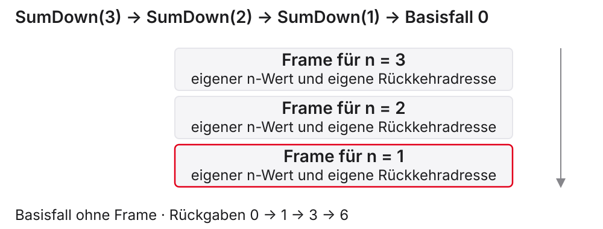{width=90%}

Für $n=3$: Ergebnis 6; hier kein `mul` nötig.

::: notes
Rekursion bedeutet, dass eine Funktion sich selbst aufruft. S von n bezeichnet die Summe der Zahlen eins bis n. Der Basisfall n gleich null liefert null, die anderen Fälle erhalten ihr n und rufen mit n minus eins weiter. Für die optionale Datei werden kleine nichtnegative Eingaben null bis sechs vorausgesetzt. mul, Multiplikation, wird nicht benötigt; jede Stufe addiert nur ihren n-Wert zur erhaltenen kleineren Summe.

Das Bild zeigt aktive Frames für n gleich drei, zwei und eins; der Basisfall null ist Leaf und framefrei. Jeder andere Rahmen hält eine eigene Rückkehradresse und das noch benötigte n. Rot markiert den innersten nichtleeren Frame, der Pfeil die absteigende Adressrichtung. Die Rückgaben laufen als null, eins, drei und sechs zurück. Die tatsächlich benötigte Zusatzreserve beträgt hier sechzehnmal n Byte. Die vollständige Quelle beispiele/mct1_vl4_rekursive_summe.s sichert ra, return address, und das saved Register s0 pro nichtleerer Stufe und restauriert sp, den stack pointer, vor jeder Rückkehr. Dieser Zusatz liegt außerhalb des Pflichtzeitplans.
:::

## Abschluss und Quellen

- Aufruf: Rückweg, Eingaben und Ergebnis müssen zusammenpassen.
- Erhaltung: alte Werte entsprechend ihrer Lebensdauer schützen.
- Stack: reservieren, speichern, laden und exakt freigeben.
- Einheit 5: bekannte Befehlswirkung als Datenpfad umsetzen.
- Harris/Harris und Patterson/Hennessy, jeweils RISC-V Edition

::: notes
Sie können nun einen Unterprogrammablauf sowohl an den Instruktionen als auch an den nötigen Erhaltungspflichten erklären. Ein korrekter Rückweg allein garantiert kein korrektes Ergebnis, und eine richtige Zahl allein garantiert keinen restaurierten Aufruferkontext. Für die betrachteten kleinen Funktionen reichen Registerarithmetik, die Aufrufinstruktionen und die aus Einheit 3 bekannten Speicherbefehle.

RISC steht in RISC-V für Reduced Instruction Set Computer, eine Entwurfsrichtung mit regelmäßigen Befehlsformen. Harris und Harris, Digital Design and Computer Architecture — RISC-V Edition, verbinden Digitaltechnik und Rechneraufbau. Patterson und Hennessy, Computer Organization and Design: The Hardware/Software Interface — RISC-V Edition, vertiefen die Hardware-Software-Schnittstelle. In Einheit 5 bleibt die vereinbarte Wirkung eines Befehls bestehen; neu ist dessen interne Umsetzung im Datenpfad. Dabei muss stets benannt werden, welche Befehle ein vereinfachtes Modell tatsächlich unterstützt. Ein vollständiger Funktionsablauf dieser Einheit folgt nicht automatisch aus dem kleinen späteren Datenpfadausschnitt.
:::
