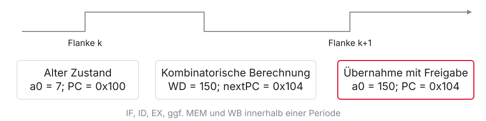
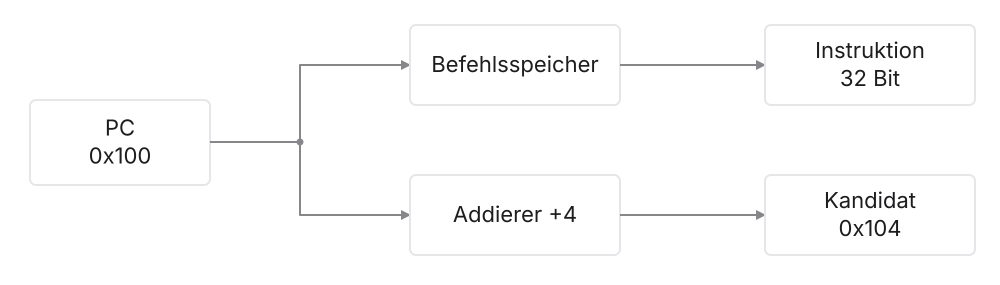
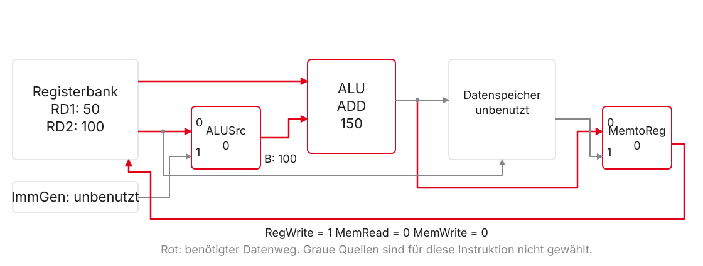
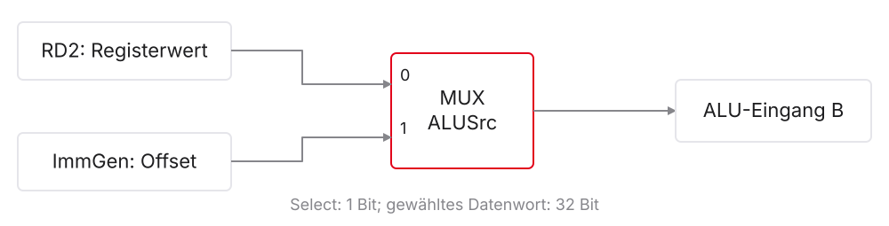
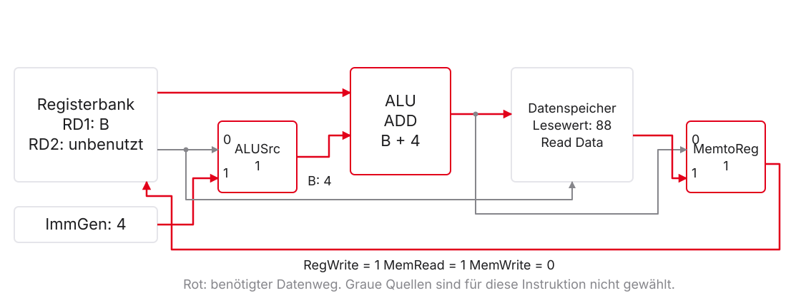
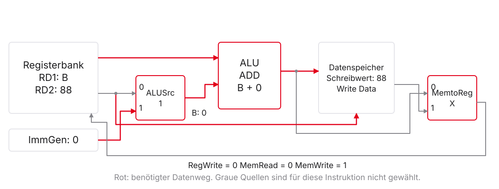
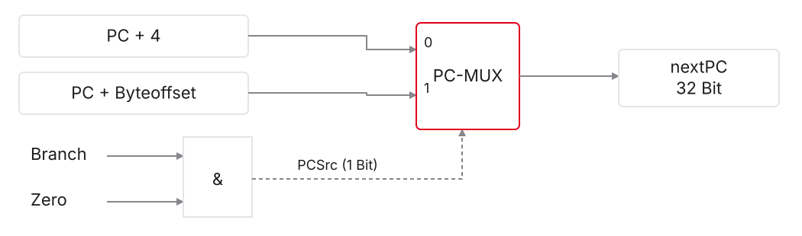
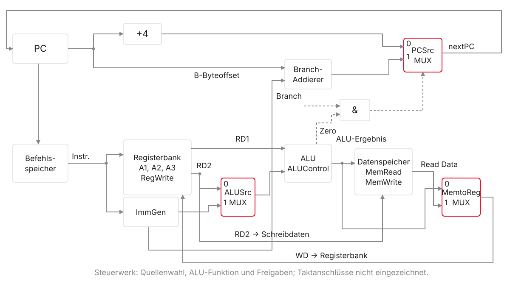

# Der Single-Cycle-Datenpfad

::: notes
In den Einheiten 2–4 haben Sie beschrieben, was RISC-V-Befehle mit Registern, Speicher und dem Program Counter tun. Jetzt erklären wir, wie eine konkrete Schaltung diese Wirkungen erzeugen kann. Die Befehlssatzarchitektur (ISA) legt die sichtbare Wirkung fest; der Datenpfad ist Teil einer Mikroarchitektur, die diesen Vertrag umsetzt.

Unser Single-Cycle-Lehrmodell führt jeden unterstützten Befehl zwischen zwei steigenden Taktflanken aus. Wir bauen es aus den Bausteinen der ersten Einheit auf: Register, Registerbank, ALU, Addierer und Multiplexer. Die folgenden Notizen erläutern die Folien als zusammenhängendes Skript; Rechnungen beziehen sich immer auf das ausdrücklich vereinbarte Lehrmodell.
:::

## Leitfrage und Lernziele

Wie wird aus `add a0, t0, t1` eine Registeränderung?

- Instruktionsfelder und Datenwerte unterscheiden
- Datenwege für `add`, `lw`, `sw` und `beq` verfolgen
- MUX-Auswahl und Schreibfreigabe begründen
- Werte vor und Zustand nach der Taktflanke erklären
- Einen begrenzenden Datenweg erkennen

::: notes
Wenn t0 den Wert 50 und t1 den Wert 100 enthält, soll a0 nach der Ausführung 150 enthalten. Dafür müssen die Register ausgewählt, ihre Werte gelesen, addiert und an die richtige Stelle zurückgeschrieben werden.

Wir gehen in dieser Reihenfolge vor: Zustandsmodell und fünf Tätigkeiten, Registerarithmetik, Speicherzugriffe, bedingter Sprung, Gesamtbild und Timing. Anschließend vergleichen wir die Funktionen mit Ripes. Sie sollen keine vollständige Schaltung auswendig zeichnen, sondern an einer gegebenen Zeichnung die ausgewählten Quellen und erlaubten Zustandsänderungen begründen können.
:::

## Das bringen Sie aus Einheit 1–4 mit

| Bisher bekannt | Heute benötigte Verbindung |
|:---|:---|
| MUX, ALU, Register und Takt | Quellen wählen, rechnen, Zustand speichern |
| `rd`, `rs1`, `rs2` und Befehlsformate | Register über Instruktionsbits auswählen |
| `lw` / `sw`: Basis plus Offset | ALU berechnet die effektive Adresse |
| `beq`: Gleichheit und Sprungziel | Vergleich und nächste PC-Adresse vorbereiten |

::: notes
Einheit 1 liefert die Hardwaregrundlagen: Ein Multiplexer wählt einen Eingang, kombinatorische Logik reagiert mit Verzögerung auf ihre Eingänge, und ein flankengetriggertes Register übernimmt Daten nur an der aktiven Flanke. Einheit 2 erklärt Register und Maschinenwortfelder; Einheit 3 erklärt Speicheradressen und Branches.

Aus Einheit 4 wissen Sie außerdem, dass Registerrollen wie a0 oder t0 ABI-Konventionen sind. Die Hardware adressiert dieselben Register als x10 beziehungsweise x5. Sie müssen für diese Vorlesung weder Pipeline-Hazards noch den inneren Aufbau eines Steuerwerks kennen. Beide Themen folgen erst später.
:::

## Annahmen unseres Lehrmodells

- Unterstützt: `add`, `sub`, `and`, `or`, `lw`, `sw`, `beq`
- 32-Bit-Daten, byteadressierter Speicher, Little Endian
- Keine C-Erweiterung: jede betrachtete Instruktion belegt vier Byte
- Speicherlesen kombinatorisch; Schreiben an der steigenden Flanke
- Ein Befehl je Taktperiode; keine Pipeline, Caches oder Traps

::: notes
Das Modell ist bewusst kein vollständiger RV32I-Prozessor. Beispielsweise kennen Sie bereits addi und jal, sie sind hier aber nicht als unterstützte Befehle vereinbart. Pseudoinstruktionen wie li und la sind ebenfalls keine zusätzlichen Hardwareoperationen. Ripes unterstützt mehr Befehle und kann solche Anweisungen zum Vorbereiten unserer Beispiele verwenden.

Die kombinatorische Speicherleseausgabe und die flankengesteuerten Schreibzugriffe sind Eigenschaften unseres Lehrmodells. Reale Speicher können zusätzliche Takte benötigen. Wir betrachten gültige, für Wortzugriffe durch vier teilbare Adressen. Vier Byte Instruktionsbreite folgt aus unserer Wahl ohne C, nicht aus einer allgemeinen Aussage über alle RISC-V-Varianten. Verbindlich ist der gemeinsame Kursvertrag.
:::

# 1. Ein Befehl zwischen zwei Flanken

::: notes
Zuerst legen wir fest, was gespeichert ist und was nur auf einer Leitung anliegt. Dieser Unterschied erklärt später, warum ein Register zugleich Quell- und Zielregister sein darf und warum ein vorbereiteter Store den Speicher noch nicht verändert hat.

Die fünf Tätigkeiten IF, ID, EX, MEM und WB helfen beim Verfolgen des Datenwegs. Im Single-Cycle-Modell sind sie keine fünf Taktzyklen. Viele Teilrechnungen, etwa die Vorbereitung von PC plus vier, laufen parallel zu anderen Tätigkeiten.
:::

## Fünf Tätigkeiten, eine Taktperiode

| Kürzel | Tätigkeit | Beispiel |
|:---|:---|:---|
| IF | Instruction Fetch: Instruktion holen | PC adressiert Befehlsspeicher |
| ID | Instruction Decode: Felder auswerten | Registerwerte bereitstellen |
| EX | Execute: rechnen oder vergleichen | Summe, Adresse oder Differenz |
| MEM | Memory Access: Datenspeicher nutzen | `lw` liest, `sw` schreibt |
| WB | Write-Back: Registerschreibwert bereitstellen | ALU- oder Speicherwert |

::: notes
Die Namen beschreiben logische Aufgaben. Bei add wird der Datenspeicher nicht benutzt; bei sw und beq wird kein Register zurückgeschrieben. Es existiert kein Zwang, für jeden Befehl jede Tabellenzeile mit einer eigenen Hardwareaktion zu füllen.

Bei lw hängt das gelesene Datenwort von der zuvor berechneten Adresse ab. Diese Abhängigkeit benötigt Laufzeit innerhalb derselben Periode. Gleichzeitig kann ein separater Addierer bereits die nächste sequenzielle Instruktionsadresse vorbereiten. Zwischen diesen Tätigkeiten gibt es keine zusätzlichen Taktflanken oder Pipeline-Register in unserem Modell.
:::

## Daten, Nummern und Steuersignale

- `rs1 = 5`: Registernummer, fünf Bit
- Inhalt von `x5`: Datenwort, 32 Bit
- `ALUSrc = 0`: Quellenauswahl, ein Bit
- `RegWrite = 1`: Schreibfreigabe, ein Bit

Der Datenpfad verarbeitet Werte; das Steuerwerk wählt seine Funktionen.

::: notes
Eine Registernummer sagt, wo gelesen oder geschrieben werden soll. Sie sagt nicht, welcher Wert dort gespeichert ist. So kann rs1 die Nummer 5 enthalten, während x5 den Wert 50 enthält. Zwei unabhängige Leseports liefern zwei 32-Bit-Wörter aus derselben Registerbank.

Auch Steuerbits sind keine Operanden. ALUSrc wählt die Quelle des zweiten ALU-Operanden. RegWrite erlaubt oder unterbindet das spätere Registerschreiben. Ein richtig ausgewählter Schreibwert wird ohne Freigabe nicht übernommen. Das Steuerwerk erzeugt die Signale aus dem aktuellen Maschinenwort; seine systematische Herleitung folgt in Einheit 6.
:::

## Vor der Flanke: vorbereiteter Wert

{.nostretch fig-alt="Ein Single-Cycle-Takt: alter Zustand, kombinatorische Berechnung und Übernahme des neuen Zustands"}

- Vor der Flanke: Ergebnis und nächste PC-Adresse sind vorbereitet
- An der Flanke: PC und freigegebene Schreibziele übernehmen
- Danach: neuer Zustand und nächste Instruktion

::: notes
PC, Registerbank und Datenspeicher enthalten den gespeicherten Zustand. Nach einer Flanke liefern sie den Ausgangszustand für die aktuelle Instruktion. Befehlswort, Registerwerte und Rechenergebnisse stabilisieren sich anschließend mit den jeweiligen Laufzeiten.

Für add a0, t0, t1 kann vor der nächsten Flanke bereits 150 am Schreibdateneingang liegen, während a0 noch seinen alten Wert enthält. Erst mit RegWrite gleich eins und der nächsten Flanke wird 150 übernommen. Gleichzeitig erhält der PC seinen Folgewert. Die Leitungen können danach schon die nächste Instruktion zeigen. Bei realen Registern sind außerdem Setup- und Hold-Zeiten einzuhalten.
:::

## Fetch: ein PC, zwei parallele Wege

{.nostretch fig-alt="Der PC adressiert den Befehlsspeicher und speist parallel den PC-plus-vier-Addierer"}

Bei $PC = \mathtt{0x100}$: Instruktion an `0x100`, Kandidat $PC+4 = \mathtt{0x104}$.

::: notes
Der Program Counter ist ein eigenes Register und gehört nicht zu x0 bis x31. Sein Ausgang adressiert im Lehrmodell den Befehlsspeicher. Dessen Ausgabe ist das 32-Bit-Instruktionswort. Ein separater Addierer berechnet aus demselben alten PC den Wert PC plus vier.

Der neue Wert liegt zunächst nur am PC-Eingang bereit. Bei normalen Rechen- und Speicherbefehlen wird er an der nächsten Flanke übernommen. Für beq ergänzen wir später eine zweite mögliche Quelle. Befehlsspeicher und Datenspeicher sind hier getrennte Zugriffspfade, damit etwa lw in einer Periode Instruktion und Daten lesen kann. Das behauptet weder zwei reale RAM-Chips noch eine bestimmte Speicherbelegung.
:::

# 2. Registerarithmetik: der erste vollständige Pfad

::: notes
Wir verfolgen nun add a0, t0, t1 mit den Ausgangswerten 50 und 100. Der Befehl ist aus Einheit 2 bekannt. Neu sind die Verbindungen zwischen seinen Feldern und den Ports der Registerbank.

Wenn Sie den add-Pfad verstanden haben, können Sie auch sub, and und or verfolgen: Die Registerports und die Rückführung bleiben gleich. Lediglich die gewählte ALU-Operation ändert sich.
:::

## Aus dem Maschinenwort werden Registernummern

```asm
add a0, t0, t1       # Maschinenwort: 0x00628533
```

| Feld | Bits | Wert im Beispiel |
|:---|:---|:---|
| `rs1` | 19:15 | 5 → `t0` |
| `rs2` | 24:20 | 6 → `t1` |
| `rd` | 11:7 | 10 → `a0` |
| `opcode` / `funct3` / `funct7` | 6:0 / 14:12 / 31:25 | `0x33` / `0` / `0` |

::: notes
Für diesen R-Type-Befehl gehen rs1 und rs2 an die Leseadressports, rd an den Schreibadressport. Alle drei Nummern sind fünf Bit breit und wählen eines der 32 Architekturregister aus.

Die Operation folgt nicht allein aus dem Opcode: add und sub haben denselben Opcode und funct3, unterscheiden sich aber durch funct7. Bei sub ist dieses Feld 0x20. Das Steuerwerk und die ALU-Steuerung berücksichtigen die jeweils nötigen Funktionsfelder. Die codierten Registernummern bleiben unabhängig davon, welche Werte gerade in t0 und t1 gespeichert sind.
:::

## Die Ports der Registerbank

| Port | Bedeutung | Breite | Bei unserem `add` |
|:---|:---|:---|:---|
| A1 / A2 | Leseadressen | je 5 Bit | 5 / 6 |
| RD1 / RD2 | gelesene Werte | je 32 Bit | 50 / 100 |
| A3 | Schreibadresse | 5 Bit | 10 |
| WD | vorbereitete Schreibdaten | 32 Bit | 150 |
| RegWrite | Schreiben an der Flanke erlauben | 1 Bit | 1 |

::: notes
A steht hier für Address, RD für Read Data und WD für Write Data. Die Leseausgänge unseres Registerfile-Modells sind kombinatorisch: Sobald Adresse und Registerinhalt festliegen, erscheinen die gelesenen Daten nach der Leseverzögerung. Keine zusätzliche Lesetaktflanke ist erforderlich.

Am Schreibport müssen Zielnummer, Datenwort und Freigabe rechtzeitig vor der aktiven Flanke gültig sein. Ein Schreibversuch auf x0 wird verworfen; x0 liest stets null. A1, A2 und A3 sind unsere Portbezeichner, keine von der ISA vorgeschriebenen Leitungsnamen.
:::

## Der Weg für `add`

{.nostretch fig-alt="R-Type-Datenweg: Registerwerte zur ALU, Ergebnis zurück zur Registerbank"}

- ALU-Quelle B: RD2, also `ALUSrc = 0`
- Rückschreibquelle: ALU, also `MemtoReg = 0`
- `RegWrite = 1`; Datenspeicher bleibt unverändert

::: notes
Der erste ALU-Eingang erhält RD1. Der zweite erhält über den ALUSrc-Multiplexer RD2. Die gewählte Operation ADD liefert aus 50 und 100 den Wert 150. Der MemtoReg-Multiplexer wählt das ALU-Ergebnis als Schreibdaten.

Das Bild zeigt bereits die später benötigten Auswahlstellen, sodass Sie dieselben Bezeichnungen bei lw wiedererkennen. Für add wird kein Datenspeicherwort benötigt oder verändert. Neben dem Registerschreiben wird an der Flanke der PC auf den sequenziellen Folgewert gesetzt. Die Rückführung ist ein gerichteter Datenweg, keine sofortige kombinatorische Speicherung.
:::

## Ein vollständiger `add`-Trace

Vorher: $PC=\mathtt{0x100}$, `t0 = 50`, `t1 = 100`, `a0 = 7`.

| Beobachtung | Wert |
|:---|:---|
| RD1 / RD2 vor der Flanke | `0x00000032` / `0x00000064` |
| ALU-Ergebnis und WD | `0x00000096` = 150 |
| A3 und RegWrite | 10 und 1 |
| `a0` vor der Flanke | 7 |
| `a0` und PC nach der Flanke | 150 und `0x104` |

::: notes
Hex- und Dezimalwerte sind zwei Darstellungen derselben Daten. 0x32 entspricht 50, 0x64 entspricht 100 und 0x96 entspricht 150. Der PC-Wert bezeichnet dagegen die Adresse der Instruktion, nicht die Summe.

Notieren Sie bei jedem Trace erst den Ausgangszustand, dann die vorbereiteten Leitungswerte und zuletzt die übernommenen Änderungen. t0 und t1 bleiben unverändert. Auch ein gültiger WD-Wert ändert a0 vor der Flanke nicht. Bei irrtümlich deaktiviertem RegWrite würde a0 den Wert 7 behalten, obwohl die ALU korrekt 150 berechnet hat.
:::

## Wenn Quelle und Ziel dasselbe Register sind

```asm
add t0, t0, t1       # vorher: t0 = 50, t1 = 100
```

- RD1 liest zunächst den alten Wert 50
- Die ALU bereitet 150 für WD vor
- An der Flanke wird `t0` mit 150 beschrieben
- Erst danach steht der neue Wert am Leseausgang

::: notes
Die Rückführung wird durch den gespeicherten Registerzustand unterbrochen. Deshalb erzeugt add t0, t0, t1 keine endlose kombinatorische Folge von Additionen. Während der Berechnung liefern die Leseports den alten Zustand; die Schreibdaten werden erst an der aktiven Flanke übernommen.

Nach der Flanke ändert sich auch der PC. Die nächste Instruktion darf den neuen Wert 150 lesen. Dieses Beispiel knüpft an die flankengetriggerten Register aus Einheit 1 an und nimmt keine Pipeline-Regeln vorweg. Weder ein Compilertrick noch ein zusätzlicher ALU-Puffer ist nötig.
:::

## Verständnischeck: Was fehlt zum Speichern?

Bei `sub a0, t0, t1` liegen `0xFFFFFFCE` am ALU-Ausgang.

1. Welchen Dezimalwert stellt dieses Wort dar?
2. Welche drei Angaben benötigt der Registerschreibport?
3. Würde `RegWrite = 0` die Subtraktion verhindern?

::: notes
Lösung: Das 32-Bit-Zweierkomplementwort 0xFFFFFFCE stellt minus 50 dar, denn 50 minus 100 ergibt minus 50. Ganzzahlregisterarithmetik arbeitet modulo zwei hoch 32; sie setzt kein architektonisches Überlaufflag.

Zum Schreiben braucht die Registerbank A3 gleich 10, WD gleich 0xFFFFFFCE und RegWrite gleich eins, zusätzlich zur aktiven Taktflanke und gültigem Timing. RegWrite gleich null verhindert nur die Übernahme. Die ALU kann trotzdem ein gültiges Ergebnis ausgeben. Fragen Sie im Unterricht zunächst nach Ergebnisbildung und Zustandsänderung, bevor Sie die Lösung besprechen.
:::

# 3. Load und Store: Adresse ist nicht Inhalt

::: notes
Bei den nächsten Befehlen berechnet die ALU die Adresse eines Speicherworts. Der zu lesende oder zu schreibende Datenwert ist davon getrennt.

Wir verwenden zwei Wörter: 99 an der Basisadresse B und 88 an B plus vier. B ist eine gültige, durch vier teilbare Byteadresse. Zunächst lädt lw das zweite Wort, anschließend überschreibt sw das erste mit dem geladenen Wert. So vergleichen Sie beide Richtungen des Speicherzugriffs.
:::

## Wo liegt der Offset im Maschinenwort?

| Befehl | Format | Offsetbits | Register |
|:---|:---|:---|:---|
| `lw a0, 4(s1)` | I | `instr[31:20]` | `rs1 = 9`, `rd = 10` |
| `sw a0, 0(s1)` | S | `instr[31:25]` und `instr[11:7]` | `rs1 = 9`, `rs2 = 10` |

- Beide Offsets sind zwölf Bit und vorzeichenbehaftet
- `sw` hat kein `rd`-Feld

::: notes
Für lw enthält das I-Format den Offset zusammenhängend in den oberen zwölf Bits. Für sw verteilt das S-Format denselben zwölf Bit breiten Wert auf zwei Felder: Die oberen sieben Bits kommen aus instr[31:25], die unteren fünf aus instr[11:7]. Diese Felder werden in der richtigen Reihenfolge zusammengesetzt.

Die Bits 11:7 sind beim Store kein Zielregister. Sie können an einer fest verdrahteten Registeradressleitung anliegen, dürfen aber kein Schreiben auslösen. Dafür bleibt RegWrite null. rs1 liefert bei beiden Befehlen die Basisadresse; rs2 liefert beim Store den zu speichernden Wert.
:::

## ImmGen: Bits zusammensetzen und erweitern

Der Immediate Generator liefert ein 32-Bit-Datenwort für die ALU.

| Offset | Zwölf codierte Bits | Vorzeichenerweitertes Wort |
|:---|:---|:---|
| $+4$ | `0000 0000 0100` | `0x00000004` |
| $-4$ | `1111 1111 1100` | `0xFFFFFFFC` |

Das Vorzeichenbit wird in die zusätzlichen oberen Stellen kopiert.

::: notes
Die Vorzeichenerweiterung kennen Sie aus Einheit 1 und den I-Type-Befehlen aus Einheit 2. Ein positiver Offset behält oben Nullen, ein negativer bekommt oben Einsen. So kann die 32-Bit-ALU denselben vorzeichenbehafteten Offset zur Basis addieren.

Eine Basisadresse 0x1004 mit minus vier ergibt 0x1000. Die Addition der Bitmuster erfolgt modulo zwei hoch 32. ImmGen lädt dabei kein Speicherwort und verändert kein Register; er bereitet ausschließlich die codierte Konstante auf. Er benötigt je nach Format andere Eingangsbits, nicht pauschal nur die zwölf I-Type-Bits.
:::

## ALUSrc wählt den zweiten ALU-Operanden

{.nostretch fig-alt="ALUSrc-Multiplexer: RD2 an Eingang 0, Immediate an Eingang 1"}

| Befehl | Quelle B | ALUSrc |
|:---|:---|:---:|
| `add`, `sub`, `and`, `or`, `beq` | RD2 | 0 |
| `lw`, `sw` | Immediate | 1 |

::: notes
Die ALU benötigt bei Registerarithmetik und unserem beq-Vergleich zwei Registerwerte. Bei Load und Store muss sie dagegen die Basisadresse aus RD1 mit dem Offset aus ImmGen addieren. Ein Multiplexer verbindet jeweils genau eine dieser Quellen mit dem zweiten ALU-Eingang.

Die Quellen werden weder addiert noch durch direktes Verbinden ihrer Ausgänge zusammengeführt. ALUSrc ist ein Auswahlbit; das ausgewählte Wort ist 32 Bit breit. Beim Store bleibt RD2 gleichzeitig für den Speicher-Schreibdatenweg verfügbar, obwohl es nicht als ALU-Operand gewählt wird.
:::

## `lw`: Adresse und Inhalt

`lw a0, 4(s1)` bei `s1 = B` liest das Wort 88 an $B+4$.

{.nostretch fig-alt="Load-Datenweg: Basis und Offset zur ALU, Speicherwort zurück zur Registerbank"}

::: notes
lw a0, 4(s1) ist als Maschinenwort 0x0044A503 codiert. rs1 wählt x9, also s1; rd wählt x10, also a0. ImmGen liefert vier. ALUSrc gleich eins führt den Offset zur ALU, die ihn mit der Basisadresse B addiert.

Der Datenspeicher erhält B plus vier am Adressport. Mit MemRead gleich eins liefert er nach seiner Leseverzögerung das Wort 88. Dieses Wort, nicht die Adresse, soll am Registerschreibport anliegen. Deshalb benötigt der Rückschreibpfad eine Auswahl zwischen ALU-Ergebnis und Speicherlesedaten.
:::

## MemtoReg wählt den Registerschreibwert

| Instruktion | ALU-Ergebnis | WD-Quelle | MemtoReg |
|:---|:---|:---|:---:|
| `add a0, t0, t1` | 150 | ALU-Ergebnis | 0 |
| `lw a0, 4(s1)` | $B+4$ | Speicherwort 88 | 1 |

Beide schreiben nach `a0`: `RegWrite = 1`.

::: notes
MemtoReg bedeutet Memory to Register und bezeichnet hier die Auswahl vor WD. Eingang null trägt das ALU-Ergebnis, Eingang eins die Speicherlesedaten. Beim Load muss Eingang eins gewählt werden, sonst würde die Adresse in a0 landen.

Die Auswahl ist unabhängig von der Zielnummer A3 und der Freigabe RegWrite. Alle drei Angaben müssen passen. Ein Simulator kann zusätzlich PC plus vier als Rückschreibquelle anbieten, um jal zu unterstützen. Das erweitert unseren Zwei-Wege-MUX; seine Portnummern müssen nicht mit unserer Codierung übereinstimmen.
:::

## Der `lw`-Trace mit konkreten Adressen

Vorher: `s1 = 0x1000`, Wort an `0x1004` ist 88, `a0 = 7`.

| Vor der Flanke | Wert |
|:---|:---|
| ImmGen / ALUSrc | `0x00000004` / 1 |
| ALU-Ergebnis | `0x00001004` |
| Read Data / WD | `0x00000058` |
| MemRead / MemWrite / RegWrite | 1 / 0 / 1 |

Nachher: `a0 = 88`; Speicher unverändert; PC um vier Byte weiter.

::: notes
Die Basis 0x1000 dient nur der Papierrechnung. In Ripes lesen Sie die tatsächliche Adresse des Symbols werte ab; sie hängt von der Umgebung ab. Entscheidend ist die Beziehung zwischen Basis, Zugriffsort und Daten.

0x58 ist die Hexdarstellung von 88. Die Adresse 0x1004 hat eine andere Funktion. Weil lw ausschließlich liest, bleibt MemWrite null und der Speicherinhalt unverändert. An der Flanke wird der ausgewählte Speicherwert in a0 übernommen und der PC fortgeschaltet. Alle Tätigkeiten gehören zu derselben Taktperiode.
:::

## `sw`: zwei getrennte Datenwege

`sw a0, 0(s1)` bei `s1 = B` und `a0 = 88`.

{.nostretch fig-alt="Store-Datenweg: Basis plus Offset an den Adressport, RD2 direkt an die Speicher-Schreibdaten"}

::: notes
Bei sw liefert rs1 die Basisadresse, rs2 den zu speichernden Wert. Die ALU erhält trotzdem das Immediate als zweiten Operanden, denn sie berechnet die Adresse. Der zweite Registerwert nimmt einen separaten Weg zum Write-Data-Port des Datenspeichers.

Vor der Flanke liegen Adresse B und Schreibdaten 88 bereit. Mit MemWrite gleich eins schreibt der Speicher an der Flanke vier Byte. Gleichzeitig geht der PC vier Byte weiter. Kein Architekturregister wird verändert. Unterscheiden Sie den Speicher-Schreibdatenport vom Register-Schreibdatenport WD.
:::

## Der Store verändert vier Byte

An `0x1000` steht zunächst 99. `sw a0, 0(s1)` schreibt 88.

| Byteadresse | Vorher: 99 | Nachher: 88 |
|:---|:---:|:---:|
| `0x1000` | `63` | `58` |
| `0x1001` | `00` | `00` |
| `0x1002` | `00` | `00` |
| `0x1003` | `00` | `00` |

`s1` und `a0` bleiben unverändert; das Wort an `0x1004` ebenfalls.

::: notes
Die Tabelle zeigt Bytewerte in Hexdarstellung. Little Endian legt das niederwertigste Byte eines Worts an die kleinste Adresse. Bei 88 liegt deshalb 0x58 an 0x1000. Die drei weiteren Bytezellen gehören ebenfalls zum geschriebenen Wort, auch wenn ihr sichtbarer Wert null bleibt.

Ein Wortzugriff belegt vier aufeinanderfolgende Byteadressen; der Offset wird trotzdem in Byte gezählt. Die Basis 0x1000 erfüllt unsere Wortausrichtung. Allgemein reicht ein durch vier teilbarer Offset nicht: Entscheidend ist die effektive Adresse aus Basis und Offset.
:::

## Verständnischeck: Welcher Wert wird falsch?

1. Bei `lw` steht `MemtoReg` irrtümlich auf 0.
2. Bei `sw` steht `ALUSrc` irrtümlich auf 0.
3. Bei `sw` steht nur `MemtoReg` anders als erwartet.

Welche Fälle verändern das Ergebnis, und warum?

::: notes
Im ersten Fall schreibt lw bei aktiver Registerfreigabe die ALU-Adresse statt des gelesenen Worts in rd. Im zweiten verwendet die Store-ALU RD2 statt des Offsets. Sie berechnet eine falsche Adresse, sofern die beiden Werte nicht zufällig gleich sind. Die Schreibdaten stammen weiterhin aus RD2.

Im dritten Fall bleibt das Ergebnis unverändert, wenn alle anderen Signale korrekt sind: RegWrite ist bei sw null, daher wird der Register-Rückschreib-MUX nicht übernommen. Das führt zum Begriff Don't Care. Ein Simulator zeigt dafür weiterhin einen konkreten Auswahlwert.
:::

# 4. Branch: vergleichen und das Ziel vorbereiten

::: notes
beq verändert kein Architekturregister und schreibt keine Daten in den Speicher. Es entscheidet über die nächste PC-Adresse: Sind die Registerwerte gleich, und wo liegt das Sprungziel?

Unser Modell nutzt die Haupt-ALU für den Gleichheitstest. Ein separater Addierer bildet gleichzeitig das Ziel aus altem PC und Byteoffset. Beide Rechnungen laufen parallel und werden erst bei der PC-Auswahl zusammengeführt.
:::

## `beq` hat zwei unabhängige Teilaufgaben

```asm
beq t0, t1, ziel
```

- Vergleich: ALU berechnet $\mathrm{RD1}-\mathrm{RD2}$
- Gleichheit: `Zero = 1`, wenn das Ergebnis null ist
- Ziel: Branch-Addierer berechnet $PC_{\mathrm{alt}}+\mathrm{Byteoffset}$
- Auswahl: Ziel bei Gleichheit, sonst $PC_{\mathrm{alt}}+4$

::: notes
Zwei 32-Bit-Wörter sind genau dann gleich, wenn ihre Differenz modulo zwei hoch 32 null ist. Das Zero-Signal der ALU meldet dieses Ergebnis.

Zero ist ein kombinatorisches Ein-Bit-Signal, kein gespeichertes RISC-V-Statusregister. Andere Mikroarchitekturen können einen eigenen Vergleich verwenden. Weil unsere Haupt-ALU bereits subtrahiert, benötigt das Modell einen weiteren Addierer für die gleichzeitige Zielberechnung. Das Ziel bezieht sich auf die Adresse des Branch-Befehls, nicht auf PC plus vier.
:::

## B-Immediate: verteilte Bits, fertiger Byteoffset

| Bit im Byteoffset | Herkunft im Maschinenwort |
|:---|:---|
| 12, das Vorzeichen | `instr[31]` |
| 11 | `instr[7]` |
| 10:5 | `instr[30:25]` |
| 4:1 | `instr[11:8]` |
| 0 | fest 0, nicht gespeichert |

ImmGen setzt die 13-Bit-Zahl zusammen und erweitert sie auf 32 Bit.

::: notes
Das B-Format codiert zwölf variable Bits für einen vorzeichenbehafteten 13-Bit-Byteoffset. Bit null ist immer null und wird nicht gespeichert. Unser ImmGen setzt es bereits beim Zusammensetzen ein. An seinem Ausgang liegt die vollständige Sprungdistanz in Byte.

Danach darf kein zusätzliches Shift-left-one folgen: Es würde den Offset verdoppeln. Andere Zeichnungen können die Null erst in einem nachgelagerten Schiebeschritt ergänzen; dann hat deren ImmGen-Ausgabe eine andere Bedeutung. Ohne C müssen die tatsächlich genommenen Sprungziele unserer Beispiele zusätzlich auf vier Byte ausgerichtet sein.
:::

## Zielrechnung vorwärts und rückwärts

Branch-Adresse: $PC_{\mathrm{alt}}=\mathtt{0x200}$.

| Byteoffset | ImmGen-Ausgang | Sprungziel |
|:---|:---|:---|
| $+12$ | `0x0000000C` | `0x20C` |
| $-8$ | `0xFFFFFFF8` | `0x1F8` |

Der Fall-Through-Kandidat ist in beiden Fällen `0x204`.

::: notes
Für den Vorwärtssprung addiert der Branch-Addierer zwölf zur alten Branch-Adresse. Für den Rückwärtssprung stellt ImmGen minus acht als 32-Bit-Zweierkomplement bereit. Die Addition ergibt die acht Byte kleinere Adresse 0x1F8.

Beide Ziele können unabhängig davon berechnet werden, ob der Branch genommen wird. Ihre Berechnung allein ändert den PC nicht. Bei falscher Bedingung wird 0x204 ausgewählt. Der Assembler bestimmt die Distanz zwischen Branch-Adresse und Label, nicht zwischen Folgeinstruktion und Label.
:::

## Nur Branch und Gleichheit zusammen wählen das Ziel

{.nostretch fig-alt="Branch und Zero führen über ein rechteckiges IEC-UND-Gatter zum PCSrc-Multiplexer"}

$$\mathrm{PCSrc}=\mathrm{Branch}\land\mathrm{Zero}$$

0 wählt $PC+4$; 1 wählt das Branch-Ziel.

::: notes
Branch kommt aus der Instruktionsdecodierung: Bei beq ist es eins, bei einer Registeroperation null. Zero meldet das aktuelle ALU-Ergebnis. Nur die UND-Verknüpfung beider Signale darf den PC-Multiplexer auf das Branch-Ziel stellen.

Das rechteckige Gatter mit dem Symbol & entspricht der europäischen Darstellung aus Einheit 1. Seine Ein- und Ausgänge sind je ein Bit breit. Die MUX-Datenquellen und die PC-Adresse sind 32-Bit-Wörter. Bei PCSrc gleich eins wird das Ziel übernommen, sonst der alte PC plus vier.
:::

## Taken und Fall-Through im selben Beispiel

`beq t0, t1, ziel` bei `PC = 0x200`, Byteoffset $+12$.

| Fall | RD1 / RD2 | Zero | PCSrc | PC nach der Flanke |
|:---|:---|:---:|:---:|:---|
| genommen (taken) | 5 / 5 | 1 | 1 | `0x20C` |
| nicht genommen | 5 / 6 | 0 | 0 | `0x204` |

In beiden Fällen: `RegWrite = 0`, `MemWrite = 0`.

::: notes
Für fünf und fünf ist die ALU-Differenz null. Branch ist bei beq eins, also wird PCSrc eins. Der PC übernimmt 0x20C. Für fünf und sechs ist die Differenz minus eins mit dem Bitmuster 0xFFFFFFFF. Zero bleibt null, und der PC übernimmt 0x204.

Die Registerwerte dienen nur als Vergleichsoperanden. Weder Differenz noch Sprungziel wird in ein Architekturregister geschrieben. Notieren Sie vor einem Simulatorschritt beide Kandidaten und die Entscheidung, anschließend den tatsächlich gespeicherten PC.
:::

## Verständnischeck: Springt `sub` bei Ergebnis null?

```asm
sub a0, t0, t1      # t0 = 5, t1 = 5
```

- ALU-Ergebnis: 0 → `Zero = 1`
- Welche Werte haben `Branch` und `PCSrc`?
- Welche Zustandsänderungen erfolgen an der Flanke?

::: notes
Lösung: Branch ist null, weil die Instruktion sub und kein beq ist. Deshalb bleibt PCSrc insgesamt null, obwohl Zero eins ist. Der PC wird um vier Byte fortgeschaltet. Zugleich schreibt sub bei RegWrite gleich eins null nach a0.

Das Beispiel prüft die Verwechslung von Zero mit der Freigabe Branch. Ein interner Nullausgang der ALU ist kein selbsttätiger Sprungbefehl. Die Steuerung bestimmt, wann dieses Ergebnis zur PC-Entscheidung verwendet wird.
:::

# 5. Gesamtbild und Laufzeit

::: notes
Die Pfade nutzen dieselbe Registerbank, ALU und dieselben Speicherports. Multiplexer wählen für die aktuelle Instruktion die passende Quelle. Freigaben verhindern unerwünschte Schreibzugriffe.

Beginnen Sie beim Lesen des Gesamtbilds mit der Instruktion und verfolgen Sie nur den gerade benötigten Weg. Danach untersuchen wir, wie lange Daten und Steuersignale brauchen, bis die nächste Flanke sicher erfolgen darf.
:::

## Alle Pfade in einer Schaltung

{.nostretch style="max-height: 510px; width: auto;" fig-alt="Single-Cycle-Datenpfad des Kursmodells mit drei Multiplexern und Branch-UND"}

Punkt = Verbindung; Kreuzung ohne Punkt = getrennte Leitungen.

::: notes
Oben liegen PC-Kandidaten und Entscheidung, unten Registerarithmetik, Speicherzugriff und Rückführung. ImmGen speist die ALU-Quellenauswahl und die Branch-Zielberechnung. RD2 hat einen Abzweig zu den Speicher-Schreibdaten; das ALU-Ergebnis einen Abzweig zum Register-Rückschreib-MUX.

PCSrc kommt ausdrücklich aus Branch und Zero, nicht direkt aus dem Opcode. Weitere Steuerleitungen sind zugunsten der Lesbarkeit durch Portbeschriftungen angegeben. Die eigene Kurszeichnung orientiert sich am Single-Cycle-Konzept von Harris & Harris sowie Patterson & Hennessy. Sie übernimmt keine vollständige Lehrbuch- oder Ripes-Abbildung.
:::

## Quellen und Freigaben für Rechnen und Speicher

| Befehl | ALUSrc | MemtoReg | RegWrite | MemRead | MemWrite | ALU |
|:---|:---:|:---:|:---:|:---:|:---:|:---|
| `add` | 0 | 0 | 1 | 0 | 0 | ADD |
| `sub` | 0 | 0 | 1 | 0 | 0 | SUB |
| `and` / `or` | 0 | 0 | 1 | 0 | 0 | AND / OR |
| `lw` | 1 | 1 | 1 | 1 | 0 | ADD |
| `sw` | 1 | X | 0 | 0 | 1 | ADD |

Bei diesen Befehlen: `Branch = 0`, also `PCSrc = 0`.

::: notes
Bei Registerarithmetik kommen beide Operanden aus Registern und das Ergebnis aus der ALU. Bei lw kommt der zweite Operand aus dem Immediate, der Registerschreibwert aus dem Speicher. Bei sw kommt der Offset zur ALU, der gespeicherte Wert direkt aus RD2.

MemRead und MemWrite schließen sich im Lehrmodell gegenseitig aus. Das ist keine allgemeine Aussage über alle Speichertypen. Die ausgeschriebene ALU-Funktion reicht heute; eine konkrete ALUControl-Bitcodierung ist eine interne Entwurfsentscheidung und wird in Einheit 6 besprochen.
:::

## `beq` und Don't Care

| Signal | Wert für `beq` | Begründung |
|:---|:---:|:---|
| ALUSrc | 0 | zwei Registerwerte vergleichen |
| ALU | SUB | Gleichheit über Differenz prüfen |
| RegWrite / MemRead / MemWrite | 0 / 0 / 0 | kein Registerschreiben oder Datenzugriff |
| Branch / PCSrc | 1 / Zero | Ziel nur bei Gleichheit |
| MemtoReg | X | Registerschreiben ist gesperrt |

X bedeutet: Diese Auswahl beeinflusst das Ergebnis nicht.

::: notes
Don't Care bezeichnet die Bedeutung eines Signals für das gewünschte architektonische Ergebnis. Bei gesperrtem Registerschreibport ist die Rückschreib-MUX-Auswahl unerheblich. Dagegen ist ALUSrc bei beq nicht beliebig: Nur die beiden Registerwerte liefern den geforderten Vergleich.

X bedeutet nicht, dass ein unbekannter Wert oder eine dritte MUX-Stellung anliegen muss. In Ripes sehen Sie einen konkreten Bitwert. Ob ein Zustandsspeicher verändert wird, entscheidet seine eigene Freigabe, nicht die Tatsache, dass ein Wert an seinem Eingang anliegt.
:::

## Der kritische Pfad setzt die Taktgrenze

$$T_{\mathrm{clk}}\geq t_{\mathrm{clk\rightarrow Q}}+t_{\mathrm{komb,max}}+t_{\mathrm{setup}}$$

- Von gespeichertem Zustand bis zum nächsten Schreibziel
- Hintereinander liegende Verzögerungen addieren
- Bei parallelen Wegen auf den späteren Eingang warten
- Daten und Steuersignale müssen rechtzeitig gültig sein

::: notes
Clock-to-Q ist die Zeit von der Flanke bis zum gültigen Registerausgang. Die kombinatorische Verzögerung umfasst den längsten für eine Zustandsänderung benötigten Weg. Setup ist die Zeit, während der Eingänge vor der nächsten Flanke stabil sein müssen. Wir vernachlässigen Clock-Skew und Sicherheitsreserve; Hold-Time muss unabhängig davon ebenfalls eingehalten werden.

Ein zu kurzer Takt kann zur Übernahme eines ungültigen Werts führen. Der langsamste Weg kann auch durch Steuerlogik bestimmt sein. Bei beq laufen Zieladdition und Vergleich parallel: Ihre Laufzeiten werden nicht hintereinander addiert. Ripes misst diese Gatterlaufzeiten nicht.
:::

## Rechenbeispiel mit erfundenen Lehrwerten

| Verzögerung | Wert |
|:---|:---|
| Clock-to-Q / Setup | $0{,}2 / 0{,}3\,\mathrm{ns}$ |
| Befehlsspeicher / Registerlesen | $2{,}0 / 1{,}0\,\mathrm{ns}$ |
| ALU / Datenspeicherlesen | $1{,}5 / 1{,}8\,\mathrm{ns}$ |
| Write-Back-MUX | $0{,}5\,\mathrm{ns}$ |

Annahme: Operanden- und Steuerpfade kommen nicht später an.

::: notes
Die Zahlen sind erfundene Laufzeiten eines vereinfachten Entwurfs, keine Ripes-Messwerte oder Datenblattwerte. Für diese Rechnung ist angenommen, dass die ALU-Operandenauswahl und die benötigten Steuerfreigaben vor den zeitbestimmenden Daten bereitliegen.

Wir rechnen den add- und lw-Rückschreibweg vollständig durch. Die übrigen Wege, einschließlich Speicher-Schreiben und PC-Entscheidung, sollen in diesem Beispiel nicht länger sein. Bei anderen Speicher- oder Steuerverzögerungen könnte ein anderer Weg dominieren. Das ist keine universelle Aussage, dass lw immer der langsamste RISC-V-Befehl sei.
:::

## `add` und `lw` teilen dieselbe Taktperiode

$$T_{\mathrm{add}}=0{,}2+2{,}0+1{,}0+1{,}5+0{,}5+0{,}3=5{,}5\,\mathrm{ns}$$

$$T_{\mathrm{lw}}=T_{\mathrm{add}}+1{,}8\,\mathrm{ns}=7{,}3\,\mathrm{ns}$$

$$T_{\mathrm{clk}}\geq7{,}3\,\mathrm{ns},\qquad f_{\mathrm{max}}\approx137\,\mathrm{MHz}$$

Auch `add` benötigt im gewählten Entwurf diese eine lange Periode.

::: notes
Der add-Pfad führt vom PC über Befehlsspeicher, Registerlesen, ALU und Rückschreib-MUX zum Zielregister. Clock-to-Q und Setup werden je einmal berücksichtigt. Bei lw liegt das Datenspeicherlesen zusätzlich zwischen ALU und Rückschreib-MUX.

Wenn kein anderer benötigter Weg länger ist, begrenzt lw die gemeinsame Periode auf mindestens 7,3 Nanosekunden. Deren Kehrwert beträgt etwa 137 Megahertz. Ein add-Ergebnis ist früher gültig, wird aber erst an derselben nächsten Flanke übernommen. Die Befehle haben verschiedene Datenweglängen, keine verschiedenen Taktperioden.
:::

## Ausblick: von Tätigkeiten zu Pipeline-Stufen

- Single-Cycle: ein Befehl nutzt eine lange Periode
- Pipeline: Register trennen kürzere Verarbeitungsstufen
- Verschiedene Instruktionen überlappen sich
- Durchsatz und Laufzeit eines einzelnen Befehls unterscheiden
- Zuerst Einheit 6: Wie entstehen die Steuersignale?

::: notes
Eine Pipeline kann die fünf Tätigkeiten auf durch Register getrennte Stufen verteilen. Dann kann eine Instruktion decodiert werden, während die nächste geholt wird. Unter geeigneten Bedingungen steigt der Durchsatz.

Das bedeutet weder, dass eine einzelne Instruktion automatisch schneller fertig ist, noch dass stets ein Faktor fünf gewonnen wird. Registeraufwand, ungleiche Stufenzeiten und Abhängigkeiten beeinflussen die Ausführung. Das behandeln wir in Einheit 7. In Einheit 6 wird zuerst die bislang vorgegebene Steuerung systematisch aufgebaut.
:::

# 6. In Ripes beobachten und auf Papier erklären

::: notes
Die Papierrechnung beschreibt unseren Datenpfad. Ripes zeigt eine eigene Mikroarchitektur mit zusätzlichen Instruktionen. Wir suchen funktionale Entsprechungen, keine identische Anordnung aller Bauteile.

Das Übungsblatt beginnt mit Aufgaben ohne Simulator. Der Ripes-Teil ergänzt die Beobachtung. Nutzen Sie für drei Traces die Dateien unter beispiele; ihre Labels benennen die interessierenden Instruktionen.
:::

## Lehrmodell und Ripes auseinanderhalten

| Funktion | Unser Modell | In Ripes prüfen |
|:---|:---|:---|
| Gleichheit feststellen | ALU-SUB und Zero | eventuell eigene Branch-Einheit |
| Branch-Ziel berechnen | separater Addierer | eventuell Haupt-ALU mit PC-Eingang |
| Registerschreibquelle wählen | ALU oder Speicher | eventuell zusätzlich PC+4 |
| MUX steuern | vereinbarte 0/1-Codierung | Portnamen und Codierung der Version |

::: notes
Beide Entwürfe können dieselbe ISA-Wirkung erzeugen, obwohl ihre inneren Wege verschieden sind. Bei einem Ripes-Branch könnte die Haupt-ALU das Ziel berechnen, während ein separates Bauteil den Vergleich übernimmt.

Notieren Sie Ripes-Version und Prozessor. Nutzen Sie Beschriftungen und Tooltips, um Quellen und Breiten zu bestimmen. Beim Load muss das Speicherwort als Registerschreibwert gewählt werden. Eine unbekannte Portnummer darf nicht blind als MemtoReg gleich eins aus unserem Modell interpretiert werden. Farben allein belegen weder einen Wert noch Don't Care.
:::

## Vorbereitung und Beobachtungsprotokoll

1. RV32-Single-Cycle wählen, C-Erweiterung deaktivieren
2. Beispiel laden; im Disassembly echte Instruktionen prüfen
3. Vor dem interessierenden Befehl anhalten
4. PC, Operanden, Quellen und Freigaben notieren
5. Einmal Clock; Register, Speicher und PC danach prüfen

::: notes
Bei vorhandenem erweiterten Layout lassen sich mehr Signale betrachten. Menüpositionen können sich unterscheiden. li und la sind Setup-Pseudoinstruktionen und können mehrere Maschineninstruktionen erzeugen. Zählen Sie keine Editorzeilen als Takte.

Halten Sie an, solange der PC auf das untersuchte Label zeigt. Erst dann gehören die dargestellten Werte zum Befehl. Nach Clock zeigt das Diagramm möglicherweise bereits die nächste Instruktion. Die vorhandenen Dateien enthalten einen Ripes-Exit; dessen Dienstkonvention ist anhand Ihrer Version zu prüfen und nicht aus Venus zu übernehmen. Für den Trace genügt das Anhalten vor dem Exit.
:::

## Trace A: Registerarithmetik

Datei: `beispiele/mct1_vl5_rtype_trace.s`, Label `trace_add`.

| Vorhersage vor Clock | Erwartung nach Clock |
|:---|:---|
| Operanden 50 und 100 | `a0 = 150` |
| ALU- und Schreibwert `0x96` | Quellregister unverändert |
| Registerfreigabe aktiv | PC zeigt auf `after_add` |

Welche sichtbaren Ports entsprechen RD1, RD2 und WD?

::: notes
Das Beispiel nutzt add a0, t0, t1 und dasselbe Maschinenwort wie unser Papiertrace. Die li-Anweisungen erzeugen 50 und 100. Stoppen Sie bei trace_add und lesen Sie die Operanden und die ausgewählte Registerschreibquelle ab.

Nach einem Clock-Schritt soll a0 den Wert 150 enthalten. t0 und t1 sind ABI-Aliase für x5 und x6. Vergleichen Sie die beobachtete Registerfreigabe mit RegWrite im Lehrmodell. Halten Sie anschließend bei after_add an; die Exit-Anweisungen gehören nicht zum untersuchten Weg.
:::

## Trace B: Load, danach Store

Datei: `beispiele/mct1_vl5_load_store_trace.s`.

| Aktueller Befehl | Vor Clock | Nach Clock |
|:---|:---|:---|
| `lw a0, 4(s1)` | Adresse $B+4$, Lesedaten 88 | `a0 = 88` |
| `sw a0, 0(s1)` | Adresse $B$, Schreibdaten 88 | Wort an $B$ ist 88 |

Die tatsächliche Basisadresse $B$ im Simulator ablesen.

::: notes
.word erzeugt zunächst 99 an B und 88 an B plus vier. la s1, werte lädt die Adresse des ersten Worts, nicht dessen Inhalt. Prüfen Sie Basis und Wortausrichtung im Speicherfenster.

Vor dem Load erwarten Sie Offset vier und den Speicher als Rückschreibquelle. Vor dem Store erwarten Sie Offset null, B und den geladenen Wert 88 als Speicher-Schreibdaten. Die Registerfreigabe bleibt dabei aus. Nach dem Store sind beide Wörter 88; nur die vier Byte des ersten Worts wurden durch diesen Store beschrieben.
:::

## Trace C: Branch in zwei Durchläufen

Datei: `beispiele/mct1_vl5_branch_trace.s`, Label `trace_beq`.

| Durchlauf | Ausgangswerte | Nächster PC | Späteres `a0` |
|:---|:---|:---|:---|
| A | `t0 = 5`, `t1 = 5` | Label `taken` | 10 |
| B | `t0 = 5`, `t1 = 6` | Label `not_taken` | `0xFFFFFFFF` |

Vor jedem Durchlauf neu initialisieren; Offset zu `taken`: $+12$ Byte.

::: notes
Zwischen trace_beq und taken stehen die Subtraktion für den nicht genommenen Fall und ein stets genommener beq x0, x0, done zur Zusammenführung. Mit dem beq selbst beträgt die Distanz zum Label taken zwölf Byte. Die Konstruktion bleibt im Basissubset; sie ist kein allgemeiner Ersatz für j.

Durchlauf A führt zur Addition fünf plus fünf. Für B ändern Sie nur t1 auf sechs und setzen den Simulator zurück. Die Subtraktion liefert dann minus eins. Prüfen Sie zuerst den PC direkt nach dem Branch, danach a0 bei done. Die konkreten Adressen entnehmen Sie dem Disassembly.
:::

## Das sollten Sie jetzt erklären können

- Warum Registernummer, Speicheradresse und Datenwort verschieden sind
- Warum `sw` trotz Immediate-Auswahl Daten aus RD2 schreibt
- Warum ein Nullergebnis allein keinen Branch auslöst
- Warum eine Rückschreibquelle ohne Freigabe wirkungslos ist
- Warum fünf Tätigkeiten nur eine Taktperiode benötigen

Übung: Papiertraces und Ripes. Quiz: Quellen, Freigaben und Folgen begründen.

::: notes
Eine vollständige Erklärung verbindet Instruktion, Quellen, Rechenfunktion, ausgewählten Schreibwert und Änderungen an der Flanke. Für add ist das Ziel ein Register mit ALU-Ergebnis, für lw ein Register mit Speicherinhalt, für sw ein Speicherwort mit RD2 und für beq die nächste PC-Adresse.

Häufige Fehler sind Adresse statt Inhalt beim Load, die Suche nach einem rd-Feld im Store und ein zweites Verdoppeln des fertigen Branch-Byteoffsets. Nutzen Sie Aufgaben und Musterlösungen, um die Unterschiede zu begründen. Das Steuerwerk der nächsten Einheit erzeugt genau die heute benötigten Auswahl- und Freigabesignale.
:::
