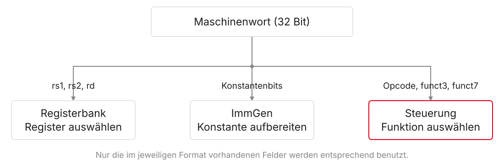
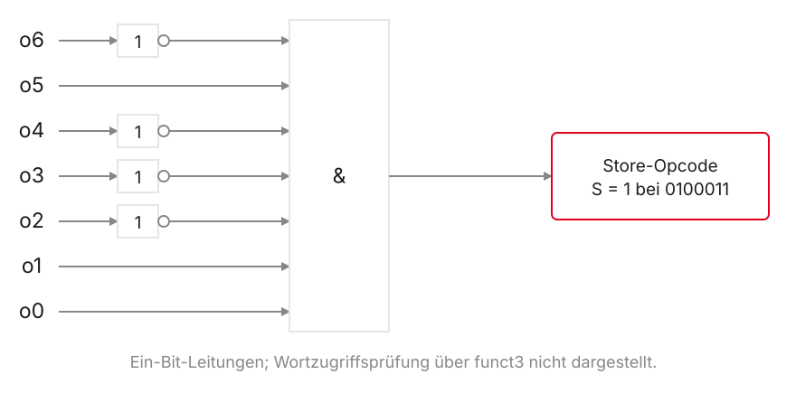
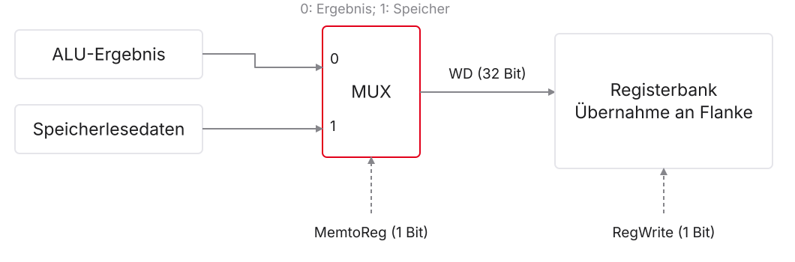
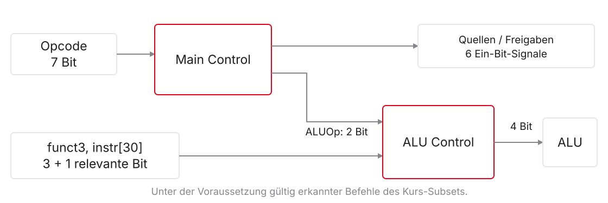
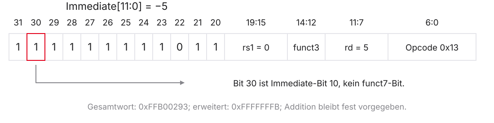
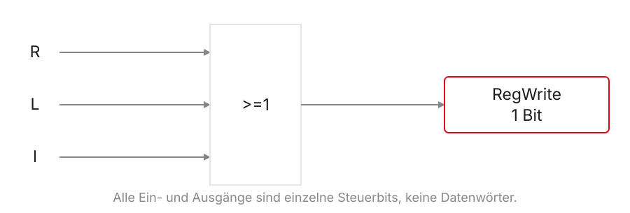
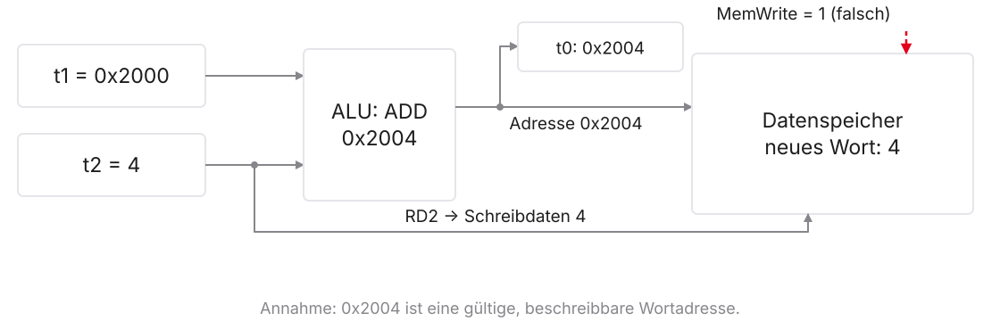

# Das Steuerwerk

::: notes
Einheit 5 hat erklärt, über welche Verbindungen Registerwerte, Adressen und Speicherinhalte verarbeitet werden. Jetzt klären wir, wie die passende Auswahl für den aktuellen Maschinenbefehl entsteht. Das Steuerwerk, auf Englisch Control Unit, erzeugt dafür Auswahl-, Freigabe- und Operationssignale. Ein korrektes Steuerwerk sorgt dafür, dass nur die vom Befehl verlangten Zustandsänderungen übernommen werden.

Die Befehlssatzarchitektur, englisch Instruction Set Architecture und kurz ISA, beschreibt die sichtbare Befehlswirkung. Unser Steuerwerk ist dagegen Teil einer konkreten Mikroarchitektur. RISC-V legt diese interne Zerlegung nicht fest. Wir beginnen mit dem bekannten Single-Cycle-Modell, das einen unterstützten Befehl in einer Taktperiode ausführt. Die Notizen erläutern die Herleitung als begleitendes Skript; die Folien und ihre Abbildungen dürfen beim Lesen danebenliegen.
:::

## Vom vorgegebenen Signal zur begründeten Schaltung

- Bisher: Welche Datenquelle und welches Schreibziel braucht der Befehl?
- Heute: Welche Befehlsbits erzeugen die passenden Steuersignale?
- Wahrheitstabellen aus der Befehlswirkung herleiten
- Hauptsteuerung und konkrete Rechenoperation trennen
- Fehler anhand bestimmter Daten und Adressen erklären

::: notes
Die neue Frage setzt die vorherige Vorlesung fort. Beim Laden eines Worts mussten Sie eine Konstante zur Adressrechnung auswählen und anschließend den Speicherinhalt in ein Register übernehmen. Diese Entscheidungen waren vorgegeben. Jetzt entsteht jede Entscheidung aus der Bedeutung des aktuellen Befehls.

Eine Wahrheitstabelle ordnet gültigen Eingaben ihre Ausgaben zu. Sie beschreibt zunächst eine Funktion, nicht zwingend einen gespeicherten Tabelleninhalt. Wir leiten die Einträge durch Fragen nach Operanden, Rechnung und Zustandsänderung her. Anschließend übersetzen wir Teile der Tabelle in logische Verknüpfungen. Die Hauptsteuerung ordnet den Datenweg; eine zweite Steuerfunktion bestimmt die genaue Rechenoperation. Zum Abschluss prüfen wir hypothetische Fehler und vergleichen die Funktionen mit Ripes, dem visuellen RISC-V-Simulator. Reale Ströme oder Gatterlaufzeiten messen wir damit nicht.
:::

## Voraussetzungen aus Einheit 1–5

| Bekannt | Heute weitergeführt |
|:---|:---|
| UND, ODER, Negation und Multiplexer | Bedingungen für Steuersignale |
| Maschinenwort und Registerfelder | Befehlsfamilie und konkrete Operation |
| Rechnen, Load, Store und Branch | Herleitung der Steuertabelle |
| Wert vor / Zustand nach der Flanke | Auswahl ist noch kein Schreibzugriff |

::: notes
Einheit 1 liefert kombinatorische Logik und flankengetriggerte Zustandsspeicher. UND ist nur wahr, wenn alle Eingänge wahr sind; ODER ist wahr, sobald mindestens einer wahr ist. Negation kehrt einen logischen Wert um. Ein Multiplexer, kurz MUX, wählt aus mehreren Datenquellen genau eine aus.

Einheit 2 erklärt das Maschinenwort, die codierten Registeradressen und den Unterschied zwischen Assemblertext und binärem Befehl. Einheiten 3 und 4 liefern Speicherzugriffe, Sprünge und Registerrollen. Einheit 5 verbindet diese Wirkungen mit dem Datenpfad. Sie müssen kein Karnaugh-Veitch-Diagramm, keinen Mikroprogrammentwurf und keine Pipeline kennen. Eine Pipeline würde mehrere Instruktionen überlappen und ist erst Thema von Einheit 7. Hier entwickeln wir kombinatorische Bedingungen mit den bereits bekannten Gattern und begründen ihre Wirkung an der nächsten Flanke.
:::

## Unser Modell und seine Grenzen

- Ausgangspunkt: `add`, `sub`, `and`, `or`, `lw`, `sw`, `beq`
- Gültige Befehle dieses Subsets sind zunächst vorausgesetzt
- 32-Bit-Daten, Instruktionen ohne C-Erweiterung, Little Endian
- Später: `addi` als ausdrücklich ergänzter Befehl
- Keine zusätzlichen Branch-Arten oder Sprünge mit Linkwert

::: notes
Ein Subset ist eine ausgewählte Teilmenge des Befehlssatzes. Wir beginnen genau mit den sieben Operationen aus Einheit 5. Load Word, kurz lw, liest ein 32-Bit-Wort; Store Word, kurz sw, schreibt es. Branch if Equal, kurz beq, springt bei gleichen Registerwerten. Die Registeroperationen add, sub, and und or bilden Summe, Differenz, bitweises UND beziehungsweise bitweises ODER.

Die C-Erweiterung für komprimierte Instruktionen bleibt ausgeschaltet; jeder betrachtete Maschinenbefehl belegt daher vier Byte. Little Endian bezeichnet die Byte-Reihenfolge eines Mehrbytewerts. Gültige, wortausgerichtete Speicheradressen und legale Codierungen der ausgewählten Befehle sind vorausgesetzt. Der Opcode allein ersetzt keine vollständige Befehlsprüfung. Später ergänzen wir Add Immediate, kurz addi, mit passender Steuerung; der benötigte Konstantenweg ist schon vorhanden. Die Behandlung nicht unterstützter Instruktionen und privilegierter Ausnahmen ist damit noch nicht implementiert.
:::

# 1. Vom Befehlswort zur Steuerfunktion

::: notes
Ein Befehlswort enthält verschiedene Arten von Information: Registeradressen, Konstanten und Kennungen der Operation. Die Steuerung muss nur diejenigen Bits zur Operationsentscheidung benutzen, die im jeweiligen Format tatsächlich diese Bedeutung haben.

Zuerst trennen wir daher Befehlsfamilie und Detailoperation. Eine Familie beschreibt hier Befehle mit ähnlichem Datenweg, etwa die Registerarithmetik. Ein Opcode, ausgeschrieben Operationscode, erkennt diese Gruppe. Weitere Funktionsfelder bestimmen innerhalb der Gruppe die konkrete Operation. Diese Trennung erklärt, weshalb ein einzelner Familienerkenner weder jede Registeroperation noch jede Speicherzugriffsbreite implementiert.
:::

## Derselbe Befehl versorgt mehrere Bausteine

{.nostretch fig-alt="Befehlsfelder verzweigen zur Registerbank, zum Immediate Generator und zur Steuerung"}

::: notes
Die Abbildung wird von oben nach unten gelesen. Das Maschinenwort liefert Registerfelder an die Registerbank, Konstantenbits an den Immediate Generator und Operationsfelder an die Steuerfunktionen. Der Immediate Generator, kurz ImmGen, setzt eine codierte Konstante zusammen und erweitert sie auf die Datenbreite. Die Pfeile zeigen Informationswege, keine zusätzlichen Taktzyklen.

rs1 und rs2 bedeuten Source Register 1 und 2: Es sind die Nummern der Quellregister. rd bedeutet Destination Register und bezeichnet das Zielregister. Diese Felder sind bei den entsprechenden Formaten je fünf Bit breit. Der Opcode liegt in den Bits 6 bis 0. funct3 und funct7 sind Funktionsfelder mit drei beziehungsweise sieben Bit. Die Registeradressen bestimmen nicht, ob add oder sub ausgeführt wird. Umgekehrt sagt die Operationskennung nicht, welcher Wert gerade in einem Register steht. S- und B-Format haben kein rd-Feld; I-Format benutzt die oberen zwölf Bits als Immediate. Die Zeichnung ordnet die jeweils vorhandenen Felder ihren Aufgaben zu.
:::

## Vier Familien, vier Opcode-Werte

| Unterstützte Befehle | Opcode binär | Hex | Gemeinsame Aufgabe |
|:---|:---:|:---:|:---|
| `add`, `sub`, `and`, `or` | `0110011` | `0x33` | Register → Rechnung → Register |
| `lw` | `0000011` | `0x03` | Speicherwort → Register |
| `sw` | `0100011` | `0x23` | Registerwort → Speicher |
| `beq` | `1100011` | `0x63` | Register vergleichen → PC wählen |

::: notes
Ein Opcode, also Operationscode, ist sieben Bit breit und steht in allen hier verwendeten Formaten an derselben Stelle. Binär- und Hexdarstellung bezeichnen dieselben Bitmuster. Sie sollten die Werte wiedererkennen können; entscheidend ist jedoch die daraus begründete Aufgabe.

Die erste Zeile umfasst nur unsere vier unterstützten Registeroperationen. lw heißt Load Word und lädt ein Wort in ein Register, sw heißt Store Word und speichert ein Registerwort. beq heißt Branch if Equal und wählt bei Gleichheit das Sprungziel. PC ist der Program Counter, das Register mit der Adresse des aktuellen Befehls. Andere reale Befehle können dieselben Opcodes besitzen: Weitere Loads benötigen beispielsweise eine Breiten- und Erweiterungssteuerung. Die Tabelle ist deshalb keine vollständige Beschreibung aller RISC-V-Instruktionen mit diesen Kennungen. Sie wird im Folgenden nur für die legal erkannten Befehle unseres Modells verwendet.
:::

## Opcode-Erkennung ist nicht die gesamte Decodierung

- `add` und `sub` haben denselben Opcode
- `lw` und `sw` benötigen auch die passende Wortzugriffskennung
- `beq` benötigt die Gleichheitsbedingung seiner Befehlsart
- Ein nicht unterstütztes Funktionsmuster ist kein Don't Care

::: notes
Decodierung bedeutet, ein Bitmuster seiner Befehlsbedeutung zuzuordnen. Ein Opcode erkennt zunächst eine Gruppe. Für eine gültige Operation müssen auch die jeweils relevanten Funktionsfelder passen. add und sub teilen den Opcode 0x33 und das dreibitige Funktionsfeld funct3 mit dem Wert 000. Das siebenbitige funct7 ist bei add 0000000 und bei sub 0100000.

Bei lw und sw kennzeichnet funct3 gleich 010 den hier unterstützten Wortzugriff; bei beq steht funct3 gleich 000 für Gleichheit. Die vereinfachte Hauptsteuerung verwendet anschließend den Opcode der bereits als gültig vorausgesetzten Instruktion. Eine vollständige Implementierung müsste nicht unterstützte oder illegale Muster erkennen und behandeln. Don't Care heißt dagegen nur, dass eine bestimmte Ausgabe für eine gültige Instruktion keine beobachtbare Wirkung hat. Es erlaubt weder das Umdeuten ungültiger Befehle noch unerlaubte Schreibzugriffe. Diese Unterscheidung verhindert falsche Schlussfolgerungen aus den später reduzierten Tabellen.
:::

## Einen Opcode mit Gattern erkennen

{.nostretch fig-alt="Sieben Opcode-Bits erkennen 0100011 mit Negation und einem IEC-UND-Gatter"}

$$S=\overline{o_6}\land o_5\land\overline{o_4}\land\overline{o_3}\land\overline{o_2}\land o_1\land o_0$$

::: notes
Die Größen o6 bis o0 sind die einzelnen Bits des siebenbitigen Operationscodes. S ist hier das Ergebnis „Store-Opcode erkannt“. Für das Muster 0100011 müssen o5, o1 und o0 eins sein, alle übrigen genannten Bits null. Eine Negation macht aus einer erwarteten Null eine Eins am nachfolgenden UND-Eingang. Die Formel ist daher genau dann eins, wenn alle sieben Stellen mit dem gewünschten Muster übereinstimmen.

Die Zeichnung zeigt links die sieben Leitungen. Rechtecke mit dem Symbol 1 und einem kleinen Ausgangskreis negieren die benötigten Bits; die übrigen Leitungen gehen direkt zum großen rechteckigen UND-Gatter mit dem Symbol &. IEC steht für International Electrotechnical Commission; die gezeigten rechteckigen Symbole entsprechen der im Kurs verwendeten Darstellung nach IEC 60617. Alle Wege sind Ein-Bit-Signale, die Leserichtung ist links nach rechts. Die Abbildung zeigt nur die Opcode-Erkennung, nicht die zusätzliche Prüfung des Wortzugriffs über funct3. S darf als Store-Freigabe erst unter der vereinbarten Voraussetzung eines gültigen sw verwendet werden. So entsteht aus einer Tabellenbedingung eine nachvollziehbare kombinatorische Schaltung.
:::

## Hauptsignale: Namen und Bitbreiten

| Signalgruppe | Namen | Anzahl Bits |
|:---|:---|:---:|
| Quellenwahl | `ALUSrc`, `MemtoReg` | 2 |
| Register / Speicher | `RegWrite`, `MemRead`, `MemWrite` | 3 |
| Branch-Freigabe | `Branch` | 1 |
| Rechenkategorie | `ALUOp` | 2 |

Sieben benannte Signale, insgesamt acht Bit. `PCSrc` wird daraus abgeleitet.

::: notes
ALU bedeutet Arithmetic Logic Unit, die arithmetisch-logische Recheneinheit. ALUSrc, ALU Source, wählt ihren zweiten Operanden: null bedeutet zweites Registerwort, eins bedeutet Immediate. MemtoReg, Memory to Register, wählt den Registerschreibwert: null bedeutet ALU-Ergebnis, eins bedeutet Speicherlesedaten.

RegWrite, Register Write, erlaubt das Schreiben eines Registers. MemRead, Memory Read, und MemWrite, Memory Write, steuern Lesen und Schreiben des Datenspeichers im Lehrmodell. Branch gibt die Prüfung eines beq frei. ALUOp, ALU Operation, ist eine zweibitige Rechenkategorie für die nachfolgende Detailsteuerung. Sechs Signale sind je ein Bit breit, ALUOp hat zwei Bit: Das ergibt sieben Namen und acht Leitungsbits. PCSrc, Program Counter Source, ist die Auswahl der nächsten Adresse im Program Counter und entsteht zusätzlich aus Branch und dem Vergleichsergebnis. Es ist kein achter unabhängiger Ausgang unserer Hauptsteuerung.
:::

## Die Steuerung rechnet zwischen den Flanken

- Im Modell: kombinatorische Haupt- und Detailsteuerung
- Kein eigener Ausführungstakt pro Steuerstufe
- Neue Befehlsbits benötigen endliche Decodierlaufzeit
- Vor der Übernahme müssen Daten und Freigaben stabil sein

::: notes
Kombinatorisch bedeutet, dass die stabilen Ausgaben nur von den aktuellen Eingaben abhängen. Unser Steuerwerk hat keinen eigenen gespeicherten Ablaufzustand. Ändert sich nach einer Taktflanke die Befehlsadresse, ändern sich anschließend Maschinenwort und Steuersignale mit endlichen Laufzeiten.

Die Hauptsteuerung und die nachfolgende Detailsteuerung sind zwei logische Funktionen, keine zwei Taktzyklen. Während sich die Signale ausbreiten, können Übergangswerte auftreten. Die Modellflanke darf erst kommen, wenn die für eine Zustandsänderung benötigten Daten und Freigaben gültig sind. Die Setup-Zeit bezeichnet die erforderliche Stabilitätsdauer vor der Flanke; die Hold-Zeit die Dauer danach. Beides stammt aus den Registergrundlagen der ersten Einheit. Konkrete Nanosekunden würden eine Implementierung oder ausdrücklich vereinbarte Lehrwerte benötigen. Unsere Tabellen beschreiben die gültige Zuordnung nach dem Einschwingen und ersetzen keine Timing-Analyse.
:::

## Wahrheitstabelle, Gatter und Mikroprogramm

- Wahrheitstabelle: Beschreibung einer Funktion
- Gatter oder Nachschlagetabelle: mögliche Realisierungen
- Mikroprogramm: gespeicherte Steuerfolgen mit Ablaufsteuerung
- RISC-V schreibt keine dieser internen Umsetzungen vor

::: notes
Eine Wahrheitstabelle ordnet Eingabekombinationen Ausgaben zu. Sie kann mit kombinatorischen Gattern oder einer Nachschlagetabelle realisiert werden. LUT steht für Look-Up Table; ROM für Read-Only Memory, einen nur lesbaren Speicher. Eine entsprechend verwendete Tabelle kann die Steuerfunktion direkt aus ihrer Eingangsadresse liefern. Aus der Anzahl theoretischer Tabellenzeilen folgt jedoch nicht die Zahl der Gatter.

Ein mikroprogrammiertes Steuerwerk benutzt gespeicherte Steuerwörter und eine Ablaufsteuerung für interne Schritte. Ein einzelner Opcode-Look-up ist daher nicht automatisch ein Mikroprogramm. ISA bedeutet Instruction Set Architecture und bezeichnet den sichtbaren Befehlssatzvertrag; RISC-V schreibt die interne Umsetzung nicht vor. Wir benutzen die Zerlegung in Haupt- und Detailsteuerung, weil sie sich verständlich herleiten und prüfen lässt. Eine garantiert kleinere Fläche oder höhere Frequenz ist daraus ohne konkreten Entwurf nicht ableitbar. Für unsere Aufgaben genügt die logische Funktion.
:::

# 2. Die Haupttabelle aus der Wirkung herleiten

::: notes
Die Bitfelder und Steuerziele sind bekannt. Nun füllen wir die Haupttabelle nicht durch Erinnern einzelner Nullen und Einsen, sondern durch die Wirkung jedes Befehls. Für jede Instruktion stellen wir dieselben fachlichen Fragen: Welche Operanden benötigt die Rechnung? Wird der Datenspeicher gelesen oder geschrieben? Soll ein Register einen neuen Wert erhalten? Ist eine Branch-Entscheidung vorgesehen?

Eine Tabellenzeile ist dann korrekt, wenn diese Quellen und Freigaben zusammen die geforderte Zustandsänderung erzeugen. Mit dieser Methode lassen sich später auch zusätzliche Befehle einordnen. Die konkrete Operation der Recheneinheit wird im nächsten Abschnitt präzisiert; hier reicht zunächst die Unterscheidung zwischen fest verlangter Addition, Vergleich und Registeroperation.
:::

## Vier Fragen für jede Tabellenzeile

1. Zweiter Rechenoperand: Register oder Immediate?
2. Datenspeicher: lesen, schreiben oder unverändert lassen?
3. Registerschreiben: erlaubt, und aus welcher Quelle?
4. PC: sequenziell oder abhängig vom Vergleich?

::: notes
Ein Immediate ist eine im Befehl codierte Konstante. Für die Registerrechnung brauchen wir zwei gelesene Registerwerte; für eine Speicheradresse dagegen Basisregister und Offset. Diese erste Frage legt die passende Quellenauswahl fest.

Anschließend prüfen wir den Datenspeicher. Lesen stellt ein Datenwort bereit, Schreiben verändert Speicherzustand, und ohne benötigten Zugriff bleiben beide Freigaben im Modell null. Ein Registerschreibwert benötigt zusätzlich die richtige Quelle, Zielnummer und Schreibfreigabe. Schließlich betrachten wir den PC, ausgeschrieben Program Counter: Er erhält normalerweise die nächste Instruktionsadresse um vier Byte weiter; bei beq kann er das Branch-Ziel erhalten. Ein Branch ist ein bedingter Sprung. Der PC ändert sich deshalb auch bei Befehlen, die keine allgemeinen Register schreiben. Diese Trennung verhindert, dass eine gesperrte Registerfreigabe irrtümlich als Stillstand des gesamten Prozessors verstanden wird.
:::

## Registeroperation: `add`, `sub`, `and`, `or`

| Entscheidung | Signal | Wert |
|:---|:---|:---:|
| Zweites Registerwort wählen | ALUSrc | 0 |
| Rechenergebnis zurückführen | MemtoReg | 0 |
| Zielregister schreiben | RegWrite | 1 |
| Datenspeicher unverändert | MemRead / MemWrite | 0 / 0 |
| Keine Branch-Freigabe | Branch | 0 |

::: notes
ALU ist die Arithmetic Logic Unit, die arithmetisch-logische Einheit. ALUSrc bedeutet ALU Source und wählt null für das zweite Registerwort. MemtoReg, Memory to Register, führt bei null ihr Rechenergebnis zurück. RegWrite, Register Write, erlaubt dessen Übernahme an der nächsten Flanke. MemRead und MemWrite bedeuten Memory Read und Memory Write; beide bleiben null, weil die Registeroperation keinen Datenspeicherzugriff benötigt. Branch ist die Freigabe einer bedingten Sprungentscheidung und bleibt ebenfalls null.

Zum Beispiel add t0, t1, t2 liest die Inhalte von t1 und t2 und schreibt ihre Summe nach t0. Die Namen sind temporäre Registeraliasnamen für x5, x6 und x7 in der Reihenfolge t0, t1, t2. Bei 7 und 3 ist der vorbereitete Schreibwert 10. sub, and und or benutzen dieselben Quellen und Schreibziele. Ihre konkrete Rechenfunktion unterscheiden wir daher getrennt von dieser gemeinsamen Tabellenzeile. Die Zeile gilt nur für die legalen Codierungen dieser vier Operationen.
:::

## `lw`: Adresse berechnen, Inhalt übernehmen

| Entscheidung | Signal | Wert |
|:---|:---|:---:|
| Offset wählen | ALUSrc | 1 |
| Gelesenes Wort wählen | MemtoReg | 1 |
| Zielregister schreiben | RegWrite | 1 |
| Nur Datenspeicher lesen | MemRead / MemWrite | 1 / 0 |
| Keine Branch-Freigabe | Branch | 0 |

::: notes
lw heißt Load Word und lädt ein 32-Bit-Wort. Die ALU, Arithmetic Logic Unit, berechnet dafür die effektive Adresse aus Basis und Offset. ALUSrc, ALU Source, muss eins sein, damit der zweite Operand die vorzeichenerweiterte Konstante und kein Registerwert ist. MemRead, Memory Read, gibt den Lesezugriff frei; MemWrite, Memory Write, bleibt null.

Beispiel: s1 enthält die Basis 0x2000, lw t0, 4(s1) soll das Wort an 0x2004 lesen, dort liegt 37. s1 ist der Registeralias x9, t0 der Alias x5. MemtoReg, Memory to Register, muss eins sein, damit der gelesene Wert 37 und nicht die Adresse zum Schreibport gelangt. RegWrite, Register Write, erlaubt die Übernahme nach t0. Branch ist null; es gibt keine bedingte Abweichung vom sequenziellen Kontrollfluss. Bis zur Flanke ist 37 nur vorbereitet. Der Datenspeicher bleibt bei diesem Load unverändert. Die Beispieladresse ist eine gültige didaktische Annahme und keine behauptete Ripes-Segmentbasis.
:::

## `sw`: Adresse und Schreibdaten getrennt

| Entscheidung | Signal | Wert |
|:---|:---|:---:|
| Offset für die Adresse wählen | ALUSrc | 1 |
| Kein Registerschreiben | RegWrite | 0 |
| Nur Datenspeicher schreiben | MemRead / MemWrite | 0 / 1 |
| Keine Branch-Freigabe | Branch | 0 |
| Register-Rückschreibquelle unerheblich | MemtoReg | X |

::: notes
sw heißt Store Word und schreibt ein 32-Bit-Wort. Die ALU, Arithmetic Logic Unit, addiert Basis und Offset als Adresse. ALUSrc, ALU Source, wählt daher das Immediate. RD2 bedeutet Read Data 2: Dieser zweite Registerlesewert erreicht über einen getrennten Abzweig die Speicher-Schreibdaten. Er verschwindet nicht, weil die ALU eine andere Quelle wählt.

Für sw t1, 4(s1) mit s1 gleich 0x2000 und t1 gleich 10 entstehen die Adresse 0x2004 und die Schreibdaten 10. s1 ist x9, t1 ist x6. MemWrite, Memory Write, erlaubt die Übernahme an der Flanke, MemRead, Memory Read, bleibt null. RegWrite, Register Write, ist null, denn das S-Format besitzt kein Zielregisterfeld. MemtoReg, Memory to Register, kann deshalb null oder eins sein; X bezeichnet diese begründete Entwurfsfreiheit. Branch bleibt null. Die Speicheradresse, der Datenwert und die Speicherfreigabe sind weiterhin verbindlich. Don't Care gilt nur für den unbenutzten Register-Rückschreibweg.
:::

## `beq`: Vergleich freigeben, nichts zurückschreiben

| Entscheidung | Signal | Wert |
|:---|:---|:---:|
| Zwei Registerwerte vergleichen | ALUSrc | 0 |
| Kein Register- oder Datenzugriff mit Wirkung | RegWrite / MemRead / MemWrite | 0 / 0 / 0 |
| Branch-Prüfung freigeben | Branch | 1 |
| Register-Rückschreibquelle unerheblich | MemtoReg | X |

::: notes
beq heißt Branch if Equal, also Sprung bei Gleichheit. ALUSrc, ALU Source, wählt das zweite Registerwort. Die ALU, Arithmetic Logic Unit, subtrahiert in unserem Lehrmodell die beiden Operanden. Ihr internes Zero-Signal ist eins, wenn das Ergebnis null und die Registerwerte gleich sind. Ein zusätzlicher Addierer bildet parallel das Sprungziel.

RegWrite, Register Write, bleibt null: Die Differenz wird nicht gespeichert. MemRead und MemWrite, Memory Read und Memory Write, sind ebenfalls null. MemtoReg, Memory to Register, ist wegen der gesperrten Registerübernahme unerheblich. Branch gleich eins bedeutet nur, dass die Bedingung berücksichtigt werden darf. PCSrc, Program Counter Source, wählt erst nach Verknüpfung mit Zero den nächsten Wert des Program Counter. Bei ungleichen Registern bleibt Branch also eins, obwohl kein Sprung genommen wird. Das Signal darf nicht aus dem tatsächlichen Sprungerfolg statt aus der Befehlsart hergeleitet werden.
:::

## Auswahl und Übernahme sind verschieden

{.nostretch fig-alt="MemtoReg wählt ein Datenwort, RegWrite erlaubt unabhängig davon die Registerübernahme"}

::: notes
Die Abbildung zeigt den Register-Rückschreibweg. ALU bedeutet Arithmetic Logic Unit, die arithmetisch-logische Einheit. Ihr Ergebnis und die Speicherlesedaten sind zwei 32-Bit-Quellen. MemtoReg, Memory to Register, ist das Ein-Bit-Auswahlsignal des MUX, also des Multiplexers. Er führt eine der Quellen an WD, ausgeschrieben Write Data, den Schreibdateneingang der Registerbank.

Unabhängig davon steuert RegWrite, Register Write, ob diese Daten an der aktiven Flanke überhaupt übernommen werden. Die grauen durchgezogenen Linien transportieren Daten; gestrichelte Linien zeigen Steuerinformation. Bei einem add liegt beispielsweise 10 an WD und RegWrite ist eins: Das Zielregister übernimmt 10. Bei sw ist RegWrite null; auch bei gültigem WD-Wert erfolgt kein Registerschreiben. A3, die fünf Bit breite Schreibadresse, bestimmt bei erlaubtem Schreiben das Ziel; sie ist hier zugunsten der Übersicht ausgelassen. Der MUX speichert selbst keinen Zustand. Diese Trennung erklärt das Don't Care der Register-Rückschreibquelle.
:::

## Don't Care heißt nicht unbekannt oder hochohmig

- X in der Tabelle: beide Auswahlwerte erfüllen dieselbe Befehlswirkung
- Auf einer konkreten Leitung liegt dennoch ein konkreter Wert an
- Unbekannter Simulationswert und hochohmiger Ausgang sind andere Begriffe
- Nicht benutzte Freigaben sind verbindlich 0

::: notes
Don't Care bedeutet „für diese spezifizierte Wirkung unerheblich“. Bei gesperrtem Registerschreibport ist es gleichgültig, welche Rückschreibquelle der Multiplexer auswählt. Beide Varianten erzeugen denselben Registerzustand. X beschreibt diese Freiheit für den Entwurf; es ist kein zusätzliches Auswahlbit neben null und eins.

Ein unbekannter Wert in einer Logiksimulation bedeutet dagegen, dass ein Wert nicht eindeutig bestimmt ist. Hochohmig bezeichnet einen elektrisch nicht treibenden Ausgang. Diese Begriffe erklären nicht das Tabellen-X. Insbesondere darf eine Speicher-Schreibfreigabe bei add nicht beliebig sein: Eine Eins könnte einen Speicherwert verändern und wäre daher beobachtbar. Dass ein Ausgang für das beabsichtigte Rechenergebnis nicht benötigt wird, reicht nicht als Begründung. Prüfen Sie alle betroffenen Zustandsspeicher. Die Auswahlsignale mit erlaubtem X können anschließend auf verschiedene Weise realisiert werden; Freigaben bleiben dagegen durch den Befehl eindeutig festgelegt.
:::

## Ein kleines Minimierungsbeispiel

| A | B | f |
|:---:|:---:|:---:|
| 0 | 0 | 0 |
| 0 | 1 | 1 |
| 1 | 0 | 0 |
| 1 | 1 | X |

Mögliche Realisierungen: $f=\overline{A}\land B$ oder $f=B$.

::: notes
A und B sind zwei logische Eingabebits; f ist ein Ein-Bit-Ausgang. Die ersten drei Tabellenzeilen legen seine Werte fest, die letzte erlaubt entweder null oder eins. Der Überstrich bezeichnet Negation, das Dach die UND-Verknüpfung.

Wählen wir im letzten Fall null, liefert die Formel „nicht A UND B“ die Folge 0, 1, 0, 0. Wählen wir dort eins, kann f direkt B sein; dann lautet die Folge 0, 1, 0, 1. Beide Funktionen erfüllen alle verbindlichen Fälle. Die zweite benötigt für diese isolierte Funktion keine zusätzliche Verknüpfung und veranschaulicht den möglichen Nutzen eines Don't Care. Dafür müssen Sie kein Karnaugh-Veitch-Diagramm beherrschen. Die Aussage ist eine logische Vereinfachung, keine Messung von Fläche, Energie oder Frequenz. Die Freiheit ist nur erlaubt, weil der Fall A gleich eins und B gleich eins ausdrücklich unerheblich ist; ein noch nicht untersuchter Fall dürfte nicht als X behandelt werden.
:::

## Zwischenstand: Quellen und Schreibfreigaben

| Befehl | ALUSrc | MemtoReg | RegWrite | MemRead | MemWrite | Branch |
|:---|:---:|:---:|:---:|:---:|:---:|:---:|
| R-Typ | 0 | 0 | 1 | 0 | 0 | 0 |
| `lw` | 1 | 1 | 1 | 1 | 0 | 0 |
| `sw` | 1 | X | 0 | 0 | 1 | 0 |
| `beq` | 0 | X | 0 | 0 | 0 | 1 |

Die konkrete Rechenoperation fehlt noch.

::: notes
ALU ist die Arithmetic Logic Unit, die Recheneinheit. ALUSrc wählt als ALU Source Registerwort oder Immediate; MemtoReg wählt als Memory to Register Rechenergebnis oder Speicherlesedaten. RegWrite, Register Write, erlaubt die Registerübernahme. MemRead und MemWrite erlauben als Memory Read und Memory Write die jeweiligen Speicherzugriffe. Branch kennzeichnet den unterstützten bedingten Sprung.

R-Typ bezeichnet hier das Registerformat für die legalen add-, sub-, and- und or-Befehle. Die Tabelle fasst die bereits hergeleiteten Quellen und Freigaben zusammen. X ist ausschließlich bei der unbenutzten Register-Rückschreibquelle erlaubt. Bei lw und sw wählen wir dieselbe Adressbildung, aber unterschiedliche Speicheraktionen. Bei Registeroperationen ist dagegen der Datenweg derselbe, obwohl add, sub, and und or verschiedene Ergebnisse berechnen. Alle Freigaben und Auswahlen sind somit noch nicht ausreichend, um eine konkrete Operation festzulegen. Diese offene Aufgabe führt zur Detailsteuerung. Die Tabelle beschreibt keine gesamte RISC-V-Implementierung und kein direkt übertragbares Ripes-Portformat.
:::

# 3. Die Rechenoperation zweistufig bestimmen

::: notes
Die bisherige Tabelle kann zwischen Registerrechnung, Speicherzugriff und Branch unterscheiden. Sie kann jedoch nicht aus dem gemeinsamen Opcode erkennen, welche Registeroperation gewünscht ist. ALU steht für Arithmetic Logic Unit, die arithmetisch-logische Einheit.

Wir ergänzen eine Rechenkategorie und eine nachfolgende Übersetzung in das konkrete ALU-Kommando. Zweistufig bedeutet hier eine kombinatorische Aufgabenteilung innerhalb desselben Single-Cycle-Takts. Die erste Funktion erkennt die grobe Aufgabe, die zweite berücksichtigt gegebenenfalls weitere Funktionsbits. Diese Struktur macht die Entscheidung nachvollziehbar, ist aber keine Vorschrift der RISC-V-Befehlssatzarchitektur und keine Garantie einer höheren Geschwindigkeit.
:::

## ALUOp ist die Kategorie, ALUControl das Kommando

{.nostretch fig-alt="Hauptsteuerung liefert ALUOp, Detailsteuerung kombiniert es mit Funktionsfeldern zu ALUControl"}

::: notes
In der Abbildung laufen die Operationsbits von links nach rechts. Der Opcode ist der siebenbitige Operationscode. Die Hauptsteuerung, englisch Main Control, erzeugt die bereits bekannten Quellen- und Schreibsignale sowie ALUOp. ALU bedeutet Arithmetic Logic Unit; ALUOp ist unsere zweibitige Operationskategorie. Sie wird zusammen mit relevanten Funktionsfeldern an die ALU Control, die Detailsteuerung der Recheneinheit, geführt.

funct3 ist das dreibitige Funktionsfeld; funct7 das siebenbitige. Für die vereinfachte Unterscheidung zwischen bereits legal erkanntem add und sub genügt später das Instruktionsbit 30. ALUControl ist dagegen das vierbitige konkrete Kommando an die Recheneinheit. Die roten Umrandungen heben die zwei Steuerfunktionen hervor, nicht den Signalwert eins. Pfeile und Beschriftungen geben Richtung und Bitbreite an. Die beiden Boxen sind keine getakteten Pipeline-Stufen. Eine vollständige Prüfung des Befehls muss weiterhin die nicht gezeigten relevanten Bits berücksichtigen; die reduzierte Operationswahl ersetzt diese Prüfung nicht.
:::

## Drei verwendete ALUOp-Kategorien

| ALUOp | Aufgabe | Im bisherigen Modell |
|:---:|:---|:---|
| `00` | Addition fest vorgeben | `lw`, `sw` |
| `01` | Subtraktion fest vorgeben | `beq`-Vergleich |
| `10` | Registeroperation über Funktionsfelder wählen | `add/sub/and/or` |
| `11` | nicht verwendet | kein unterstützter Fall |

::: notes
ALU heißt Arithmetic Logic Unit. ALUOp, ALU Operation, enthält zwei Bit und wird hier als binäres Wort notiert: 00, 01, 10 oder 11. Diese Codierung ist eine Kurskonvention. Die führende Null ist Teil der Zweibitdarstellung, kein separates Signal.

Load Word, lw, und Store Word, sw, brauchen immer eine Addition zur Adressbildung. Deshalb fordert die Hauptsteuerung 00 an, unabhängig von den Konstantenbits. Für Branch if Equal, beq, verlangt unser Modell 01, weil die Differenz der Registerwerte das interne Nullergebnis für den Gleichheitstest liefert. Bei den vier Registeroperationen bedeutet 10, dass die Detailsteuerung die Funktionsfelder auswerten muss. 11 ist nicht verwendet und keine freie Erlaubnis zum Schreiben. „Fest vorgeben“ bedeutet einen bestimmten Ausgang der kombinatorischen Funktion; es verlangt keine zusätzliche Instruktion. In Ripes kann der Branch-Vergleich über ein anderes Bauteil laufen, sodass diese Kategorie nicht als dortiger Portwert vorausgesetzt werden darf.
:::

## Vier interne ALUControl-Codes

| ALUControl | Rechenfunktion |
|:---:|:---|
| `0000` | bitweises UND |
| `0001` | bitweises ODER |
| `0010` | Addition |
| `0110` | Subtraktion |

Diese vier Bit sind weder Opcode noch ALUOp.

::: notes
ALU bedeutet Arithmetic Logic Unit, die arithmetisch-logische Einheit. ALUControl ist das konkrete Steuerwort an ihre Operationsauswahl. Die Tabelle verwendet vier Bit lange Codes als interne Kurskonvention, angelehnt an das klassische Lehrbuchmodell. RISC-V schreibt diese Leitungen oder ihre Bitmuster nicht vor.

Opcode heißt Operationscode und ist ein Feld im Maschinenwort. ALUOp ist dagegen die zweibitige Kategorie zwischen Haupt- und Detailsteuerung. ALUControl übersetzt diese Kategorie in die hier dargestellte Vierbitwahl. Bei Addition entsteht die Summe der Operanden, bei Subtraktion die Differenz des ersten minus des zweiten Operanden. Bitweises UND beziehungsweise ODER verknüpft je zwei Bits an derselben Position der 32-Bit-Wörter. Sie dürfen insbesondere 0110 nicht als RISC-V-Opcode von sub lesen. Der gleiche Befehl kann in einem anderen Hardwareentwurf ein anders codiertes internes Kommando erhalten und dennoch dieselbe Befehlswirkung haben.
:::

## Registeroperationen: Funktionsfelder auswerten

| Operation | funct3 | funct7 | ALUControl |
|:---|:---:|:---:|:---:|
| `add` | `000` | `0000000` | `0010` |
| `sub` | `000` | `0100000` | `0110` |
| `and` | `111` | `0000000` | `0000` |
| `or` | `110` | `0000000` | `0001` |

Voraussetzung: Opcode `0110011` und `ALUOp = 10`.

::: notes
Der Opcode ist der Operationscode für die Registergruppe. funct3 und funct7 sind Funktionsfelder mit drei und sieben Bit. Die ALU, Arithmetic Logic Unit, bekommt über ALUOp zunächst die Kategorie Registeroperation. ALUControl ist anschließend das vierbitige konkrete Kommando.

funct3 gleich 111 wählt in unserem Subset and, also bitweises UND; 110 wählt or, bitweises ODER. Bei 000 ist zusätzlich funct7 nötig: add hat 0000000, sub hat 0100000. Diese beiden gültigen Muster unterscheiden sich nur in Bit 30 des Instruktionsworts. Innerhalb dieser eingeschränkten Auswahl reicht das Bit daher als letzter Schalter. Es reicht nicht für beliebige Muster mit gleichem Opcode und funct3. Eine Instruktion mit einem anderen funct7 ist nicht stillschweigend add. Die Tabelle nennt deshalb die vollständigen gültigen Funktionsfelder statt einer scheinbar universellen Bit-30-Regel. Die schon hergeleiteten Quellen und Schreibfreigaben bleiben bei allen vier Zeilen gleich.
:::

## Dieselben Operanden, vier Ergebnisse

Ausgangswerte: `t1 = 7`, `t2 = 3`.

| Befehl | Rechnung im unteren Nibble | Ergebnis in `t0` |
|:---|:---|:---|
| `add t0, t1, t2` | $7+3$ | 10 |
| `sub t0, t1, t2` | $7-3$ | 4 |
| `and t0, t1, t2` | `0111` UND `0011` | 3 |
| `or t0, t1, t2` | `0111` ODER `0011` | 7 |

::: notes
Die Befehle sind RISC-V-Assembleranweisungen. t0, t1 und t2 sind die temporären Registeraliasnamen x5, x6 und x7. Wir betrachten vier unabhängige Ausführungen mit denselben Quellwerten; das Ergebnis wird jeweils nach t0 geschrieben. Ein Nibble bezeichnet vier Bit. Da beide positiven Beispielwerte nur diese unteren Stellen benötigen, können wir ihre bitweisen Ergebnisse dort vollständig erkennen; die übrigen Bits sind null.

Die ALU, Arithmetic Logic Unit, erhält dieselben Operanden, aber unterschiedliche ALUControl-Kommandos. Die Summe ist 10, die Differenz 4. Bei UND bleibt ein Bit nur stehen, wenn beide Operanden es besitzen: 0111 und 0011 ergeben 0011. Bei ODER genügt ein gesetztes Bit: Es entsteht 0111. Alle vier Ergebnisse werden erst mit erlaubter Registerfreigabe an der Flanke gespeichert. Diese Gegenüberstellung zeigt, weshalb die gemeinsame Haupttabellenzeile noch keine vollständige Operationsentscheidung ist.
:::

## Die vollständige Detailzuordnung unseres Subsets

| ALUOp | Zusatzbedingung | ALUControl |
|:---:|:---|:---:|
| `00` | bereits gültiger Additionsfall | `0010` |
| `01` | bereits gültiger `beq` | `0110` |
| `10` | gültige `add`-Felder | `0010` |
| `10` | gültige `sub`-Felder | `0110` |
| `10` | gültige `and`-Felder | `0000` |
| `10` | gültige `or`-Felder | `0001` |

::: notes
ALU steht für Arithmetic Logic Unit. ALUOp ist die zweibitige Kategorie, ALUControl das vierbitige Kommando. Die Tabelle beschreibt die Detailsteuerung für bereits gültig erkannte Befehle. Im Additionsfall 00 muss sie das Kommando 0010 liefern, bei unserem beq-Vergleich 01 das Kommando 0110.

Für Kategorie 10 werden die Funktionsfelder der vorigen Tabelle benötigt. funct3 bezeichnet das dreibitige, funct7 das siebenbitige Funktionsfeld. Die gültigen add-, sub-, and- und or-Muster ergeben jeweils das konkrete Kommando. Konstantenbits von Speicherbefehlen müssen bei 00 nicht als Funktionskennung interpretiert werden: Die Aufgabe der ALU steht bereits fest. Diese Nichtauswertung ist erlaubt, weil die Instruktion schon als gültiger Additionsfall erkannt ist. Dagegen dürfen nicht unterstützte Funktionsmuster bei 10 nicht als beliebige der vier Operationen behandelt werden. Die Aufgabenteilung spart vor allem Verwechslungen beim Herleiten; eine konkrete Fläche oder Decodiergeschwindigkeit lässt sich aus dieser Tabelle allein nicht bestimmen.
:::

# 4. Transfer: das Modell um addi erweitern

::: notes
addi bedeutet Add Immediate: Addiert wird ein Registerwert mit einer codierten Konstante, das Ergebnis geht in ein Zielregister. Den Befehl kennen Sie aus Einheit 2; er gehörte bisher ausdrücklich nicht zu unserem sieben Befehle umfassenden Datenpfadmodell.

Der benötigte I-Immediate-Weg und die Addition existieren bereits für den Load. Der Register-Rückschreibweg des Rechenergebnisses existiert bereits für Registerarithmetik. Deshalb kann die passende Kombination dieser Wege addi ermöglichen. Es fehlt die Erkennung des gültigen Befehls und seine korrekte Hauptsteuerzeile. Mit dieser Erweiterung erhält unser Modell acht unterstützte Operationen; daraus folgt weiterhin keine vollständige Unterstützung aller Immediate-Befehle.
:::

## addi verbindet zwei bekannte Datenwege

```asm
addi t0, t1, -5      # vorher: t1 = 7; Ergebnis: t0 = 2
```

- Zweiter Operand: Immediate wie bei `lw`
- Rückschreibquelle: Rechenergebnis wie bei `add`
- Kein Datenspeicherzugriff und kein Branch
- Opcode `0010011`, funct3 `000`

::: notes
Der RISC-V-Befehl addi, Add Immediate, addiert den Inhalt von rs1 mit einer vorzeichenbehafteten zwölf Bit breiten Konstante und schreibt nach rd. rs1 bedeutet Source Register 1, rd Destination Register. t1 ist der Registeralias x6 und enthält hier 7; t0 ist x5 und soll 2 erhalten.

Opcode heißt Operationscode. Die Kennung 0010011 bezeichnet die Immediate-Rechengruppe, nicht einen Load. funct3, das dreibitige Funktionsfeld, muss für addi 000 sein. Die ALU, Arithmetic Logic Unit, bekommt 7 und den auf 32 Bit erweiterten Wert minus fünf; daraus entsteht 2. Für die Quellenwahl eignet sich der Immediate-Weg des Load Word, kurz lw. Zur Registerübernahme muss dagegen das Rechenergebnis statt eines Speicherwerts gewählt werden. Diese Kombination erklärt die Erweiterung aus bekannten Funktionen und nicht durch ein neues, auswendig zu lernendes Steuerwort.
:::

## Warum Bit 30 hier keine Subtraktion bedeutet

{.nostretch fig-alt="Beim I-Format von addi gehört Instruktionsbit 30 zur zwölfbitigen Konstante minus fünf"}

Beispiel: `addi t0, x0, -5` → Maschinenwort `0xFFB00293`.

::: notes
addi bedeutet Add Immediate und benutzt das I-Format. x0 ist das Architekturregister, das immer null liefert und Schreibzugriffe verwirft. t0 ist der Alias x5. Die Instruktion soll daher minus fünf in x5 erzeugen.

Im Bild stehen links die zwölf Immediate-Bits 31 bis 20, danach rs1, funct3, rd und Opcode. rs1 bezeichnet Source Register 1, rd Destination Register, funct3 ein dreibitiges Funktionsfeld und Opcode den Operationscode. Minus fünf ist im zwölf Bit breiten Zweierkomplement 1111 1111 1011. Bit 30, rot umrandet, ist das zweite Bit dieses Felds und entspricht Immediate-Bit 10. Es ist in diesem Beispiel eins. Anders als im R-Format besitzt es hier keine funct7-Bedeutung. Nach der Vorzeichenerweiterung ergibt sich 0xFFFFFFFB. Der Gesamtbefehl setzt rs1 gleich null, rd gleich fünf, funct3 gleich null und Opcode gleich 0x13: Daraus folgt das Maschinenwort 0xFFB00293. Ein Blick nur auf Bit 30 würde die Additionsaufgabe irrtümlich verändern. Die korrekte Steuerung muss zuerst das Format und die Kategorie berücksichtigen.
:::

## Die neue Hauptsteuerzeile für addi

| Signal | Wert |
|:---|:---:|
| ALUSrc | 1 |
| MemtoReg | 0 |
| RegWrite | 1 |
| MemRead / MemWrite | 0 / 0 |
| Branch | 0 |
| ALUOp | `00` |

Danach: `ALUControl = 0010`, auch bei gesetztem Bit 30.

::: notes
ALU bedeutet Arithmetic Logic Unit. ALUSrc, ALU Source, ist eins und wählt den Immediate. MemtoReg, Memory to Register, ist null und wählt das ALU-Ergebnis. RegWrite, Register Write, ist eins und erlaubt die Registerübernahme. MemRead und MemWrite, Memory Read und Memory Write, bleiben null, da addi keine Daten aus dem Speicher benötigt oder verändert. Branch ist ebenfalls null.

ALUOp, unsere zweibitige Kategorie, muss 00 sein: Addition ist bereits durch den gültig erkannten addi festgelegt. ALUControl, das vierbitige Kommando, wird damit 0010. Der Inhalt von Instruktionsbit 30 hat in dieser Kategorie keine zusätzliche Operationsfunktion. Bei addi t0, t1, -5 mit t1 gleich 7 wird der vorzeichenerweiterte Immediate zum Registerwert addiert und 2 nach t0 übernommen. Die Zeile ähnelt dem Load bei ALUSrc, aber der Registerrechnung bei MemtoReg. Die erforderliche Befehlsprüfung umfasst Opcode 0x13 und funct3 000; andere Immediate-Operationen sind weiterhin außerhalb unseres Modells.
:::

## Verständnischeck: auch eine positive Konstante

```asm
addi t0, t1, 1024    # t1 = 7; instr[30] = 1
```

1. Ist die Konstante im zwölf Bit breiten Feld darstellbar?
2. Welche ALUOp- und ALUControl-Werte gelten?
3. Welcher Wert wird in `t0` geschrieben?

::: notes
addi heißt Add Immediate. Die Aliasnamen t0 und t1 stehen für x5 und x6; t1 liefert den Wert 7. Eine vorzeichenbehaftete zwölf Bit breite Konstante umfasst minus 2048 bis plus 2047. 1024 ist daher gültig und hat das Bitmuster 0100 0000 0000. Immediate-Bit 10 ist eins und liegt an Instruktionsbit 30, obwohl die Konstante positiv ist.

ALU bedeutet Arithmetic Logic Unit. Die Hauptsteuerkategorie ALUOp bleibt 00, das konkrete Kommando ALUControl bleibt 0010 für Addition. Die Recheneinheit bildet 7 plus 1024 gleich 1031; dieser Wert wird an der nächsten freigegebenen Flanke in t0 übernommen. Das Gegenbeispiel zeigt, dass ein gesetztes Bit 30 weder generell ein negatives Immediate noch eine Subtraktion bedeutet. Bei einem gültigen addi ist die Addition unabhängig davon festgelegt. Die Aufgabe lässt sich vollständig auf Papier lösen und prüft die Trennung von Feldbedeutung und zufälligem Einzelbitwert.
:::

# 5. Von Tabellen zu Bedingungen und Fehlerfolgen

::: notes
Für acht unterstützte Operationen sind nun alle Quellen, Schreibfreigaben und Rechenkategorien begründet. Die Tabelle kann als Spezifikation gelesen oder in kombinatorische Bedingungen übersetzt werden.

Dabei wollen wir zwei Fähigkeiten entwickeln: Gemeinsame Bedingungen erkennen und eine fehlerhafte Tabellenzeile anhand ihrer tatsächlichen Folgen untersuchen. Ein Fehler ist nicht automatisch zufälliger Inhalt oder ein garantierter Absturz. Datenweg und Ausgangszustand bestimmen, welche Adresse und welcher Wert betroffen sind. Die folgenden Beispiele sind gedachte Decoderänderungen am Lehrmodell; sie behaupten keinen Fehler eines unveränderten Simulators.
:::

## Die erweiterte Tabelle: Quellen und Freigaben

| Befehl | ALUSrc | MemtoReg | RegWrite | MemRead | MemWrite | Branch |
|:---|:---:|:---:|:---:|:---:|:---:|:---:|
| R-Typ | 0 | 0 | 1 | 0 | 0 | 0 |
| `lw` | 1 | 1 | 1 | 1 | 0 | 0 |
| `sw` | 1 | X | 0 | 0 | 1 | 0 |
| `beq` | 0 | X | 0 | 0 | 0 | 1 |
| `addi` | 1 | 0 | 1 | 0 | 0 | 0 |

::: notes
Die ALU ist die Arithmetic Logic Unit. ALUSrc bedeutet ALU Source und wählt Registerwort oder Immediate. MemtoReg bedeutet Memory to Register und wählt ALU- oder Speicherwert. RegWrite, Register Write, erlaubt Registerschreiben; MemRead und MemWrite, Memory Read und Memory Write, die Speicherzugriffe. Branch gibt den beq-Vergleich für die PC-Auswahl frei.

R-Typ bezeichnet hier das Registerformat für die legalen add-, sub-, and- und or-Befehle. Die neue addi-Zeile ist nun eine tatsächlich hergeleitete Erweiterung gegenüber dem ursprünglichen Subset. X bezeichnet eine für den gültigen Befehl unerhebliche Register-Rückschreibquelle. Jede andere Spalte bleibt verbindlich. Für die Speicherzugriffe lw und sw, ausgeschrieben Load Word und Store Word, sind die beiden Speicherfreigaben jeweils gegensätzlich. Diese gegenseitige Ausschließung ist eine Modellregel, keine Aussage, dass jeder reale Speicher beim gleichzeitigen Lesen und Schreiben einen elektrischen Kurzschluss erzeugt. Die Registergruppe meint weiterhin genau die vier angegebenen Operationen mit ihren gültigen Funktionsfeldern.
:::

## Die erweiterte Tabelle: Rechenaufgabe

| Befehl | ALUOp | Detailentscheidung |
|:---|:---:|:---|
| `add/sub/and/or` | `10` | funct3 und funct7 |
| `lw`, `sw`, `addi` | `00` | Addition steht fest |
| `beq` | `01` | Subtraktion zum Gleichheitstest |

Die Tabellen beschreiben gemeinsam dieselbe Steuerfunktion.

::: notes
ALU bedeutet Arithmetic Logic Unit, die arithmetisch-logische Einheit. ALUOp ist ihre zweibitige Aufgabenkategorie. funct3 und funct7 sind die drei beziehungsweise sieben Bit breiten Funktionsfelder zur Auswahl unserer Registeroperation. Die endgültige Vierbitwahl heißt ALUControl.

Wir teilen die gesamte Haupttabelle auf zwei Folien, damit die Signalspalten lesbar bleiben. Diese Aufteilung führt keine zusätzliche zeitliche Phase ein. Für Load Word, lw, Store Word, sw, und Add Immediate, addi, wird dieselbe Addition benötigt, obwohl das Rechenergebnis unterschiedliche Aufgaben hat: Adresse bei den Speicherbefehlen, Registerwert bei addi. Branch if Equal, beq, benutzt im Lehrmodell Subtraktion zur Gleichheitsprüfung. Die Registergruppe muss dagegen die konkrete Funktion aus den gültigen Funktionsfeldern bestimmen. Quellenwahl und Rechenfunktion müssen zusammenpassen; eine korrekte Kategorie bei falsch gewähltem Operand führt weiterhin zu einer falschen Befehlswirkung.
:::

## Bedingungen aus erkannten Befehlsgruppen

R: Registergruppe, L: `lw`, S: `sw`, B: `beq`, I: `addi`.

$$\mathrm{RegWrite}=R\lor L\lor I$$

$$\mathrm{ALUSrc}=L\lor S\lor I$$

$$\mathrm{MemRead}=L,\qquad\mathrm{MemWrite}=S,\qquad\mathrm{Branch}=B$$

::: notes
R, L, S, B und I sind hier Ein-Bit-Erkennungssignale für einen gültigen Befehl unseres erweiterten Subsets. R erkennt eine der vier Registeroperationen, L Load Word, S Store Word, B Branch if Equal und I Add Immediate. Bei genau einer gültigen Instruktion ist genau eines dieser Gruppensignale eins; sie schließen sich gegenseitig aus.

RegWrite heißt Register Write und darf bei Registeroperation, Load oder addi schreiben. Das ODER-Zeichen in der Formel bedeutet „mindestens eines dieser Signale ist eins“. ALUSrc bedeutet ALU Source für die Arithmetic Logic Unit und muss bei Load, Store oder addi den Immediate wählen. MemRead und MemWrite sind Memory Read und Memory Write und können direkt dem jeweiligen Gruppensignal folgen. Branch ist die Freigabe des unterstützten bedingten Sprungs. Die Formeln beziehen sich auf die hier benannten gültigen Gruppen, nicht allein auf ungeprüfte Opcode-Vergleiche. Sie sind eine mögliche logische Beschreibung unserer Tabelle. Die noch freie Rückschreibquellenauswahl behandeln wir separat.
:::

## Ein Registerschreibsignal als ODER-Schaltung

{.nostretch fig-alt="Die erkannten Gruppen R, L und I führen über ein rechteckiges IEC-ODER-Gatter zu RegWrite"}

::: notes
Die Abbildung zeigt links die drei gültig erkannten Befehlsklassen R, L und I. R ist die Registergruppe, L steht für Load Word und I für Add Immediate. Jede Leitung trägt ein Bit. RegWrite, ausgeschrieben Register Write, ist ebenfalls ein Ein-Bit-Signal und erlaubt die Übernahme am Registerschreibport.

IEC steht für International Electrotechnical Commission. Das rechteckige Gatter mit dem Symbol >=1 ist die im Kurs verwendete ODER-Darstellung nach IEC 60617. Es liefert eins, sobald wenigstens ein Eingang eins ist. Bei einem gültigen Store oder beq sind alle drei Eingänge null, weshalb kein allgemeines Register geschrieben wird. Die grauen Pfeile zeigen den Signalweg von links nach rechts; sie markieren keinen Datenworttransport und keinen gemessenen Strom. Diese Schaltung ist eine mögliche Realisierung der zuvor hergeleiteten Formel. Sie enthält weder einen gespeicherten Tabelleninhalt noch einen zusätzlichen Takt. Die konkrete Zielregisternummer und der Schreibwert kommen weiterhin aus dem Datenpfad, nicht aus diesem ODER-Gatter.
:::

## Zwei zulässige MemtoReg-Funktionen

Für gültige Befehle unseres erweiterten Modells sind beide zulässig:

$$\mathrm{MemtoReg}_a=L$$

$$\mathrm{MemtoReg}_b=L\lor S$$

Sie unterscheiden sich nur bei `sw`, wo `RegWrite = 0`.

::: notes
MemtoReg bedeutet Memory to Register und wählt den Register-Rückschreibwert. Null führt das Ergebnis der Arithmetic Logic Unit, kurz ALU, durch, eins die Speicherlesedaten. L ist das Erkennungssignal für einen gültigen Load Word; S für einen gültigen Store Word. RegWrite, Register Write, erlaubt oder sperrt die Registerübernahme.

Bei L gleich eins wählen beide Funktionen den Speicher. Bei Registerarithmetik oder addi sind L und S null; beide wählen das Rechenergebnis. Beim Store ist nur S eins: Die erste Funktion liefert null, die zweite eins. RegWrite ist dabei jedoch null, weshalb keine der Quellen in ein Register übernommen wird. Bei beq liefern beide ebenfalls null und sind zulässig. Die Tabelle würde dort auch eins erlauben, aber die konkrete Funktion muss diese Freiheit nicht ausschöpfen. So können unterschiedliche interne Steuerwerte dieselbe Befehlswirkung erfüllen. Das ist auch der Grund, weshalb ein konkreter MUX-Wert im Simulator nicht einem Tabellen-X widersprechen muss.
:::

## PCSrc bleibt eine abgeleitete Entscheidung

$$\mathrm{PCSrc}=\mathrm{Branch}\land\mathrm{Zero}$$

| Befehl / Ergebnis | Branch | Zero | PCSrc |
|:---|:---:|:---:|:---:|
| `beq`, gleiche Werte | 1 | 1 | 1 |
| `beq`, ungleiche Werte | 1 | 0 | 0 |
| `sub`, Ergebnis null | 0 | 1 | 0 |

::: notes
PC steht für Program Counter, das Register mit der aktuellen Instruktionsadresse. PCSrc, Program Counter Source, wählt seinen nächsten Wert. Branch ist das Erkennungssignal für unseren gültigen beq, ausgeschrieben Branch if Equal. Zero ist der kombinatorische Ein-Bit-Ausgang der Arithmetic Logic Unit, kurz ALU, der ein Nullergebnis meldet.

Die UND-Verknüpfung benötigt beide Einsen. Bei beq mit gleichen Registerwerten wählt der PC das vorbereitete Ziel; bei ungleichen Werten die Adresse des alten PC plus vier. Ein sub kann ebenfalls null erzeugen, hat aber Branch gleich null und löst keinen Sprung aus. Beispiel: Bei einer Branch-Adresse 0x100 und dem fertigen Byteoffset zwölf sind die Kandidaten 0x104 und 0x10C. ImmGen, der Immediate Generator, enthält das implizite Bit null im Byteoffset bereits; es folgt kein zweiter Shift. Zero ist kein gespeichertes RISC-V-Statusregister. Andere Branch-Arten erfordern zusätzliche Vergleichs- und Decodierfunktionen, die wir hier nicht ergänzt haben.
:::

## Fehlerfall: MemWrite ist bei add irrtümlich 1

{.nostretch fig-alt="Eine falsche Speicherfreigabe schreibt bei add die Daten 4 an die aus der Summe gebildete Adresse 0x2004"}

::: notes
Die Abbildung beschreibt eine gedachte Decoderänderung: MemWrite, Memory Write, wird bei einem add irrtümlich aktiviert. Unverändertes Ripes wird diesen Fehler nicht einfach ausführen. Die ALU, Arithmetic Logic Unit, erhält t1 gleich 0x2000 und t2 gleich 4; diese Registeraliasnamen bedeuten x6 und x7. Ihre Summe ist 0x2004.

Das Ergebnis liegt zugleich auf dem Speicher-Adressweg und dem Register-Rückschreibweg. RD2, Read Data 2, trägt weiterhin den zweiten Registerwert 4 zum Speicher-Schreibdatenport. Falls 0x2004 eine gültige, beschreibbare Wortadresse im Lehrmodell ist, schreibt die falsche Freigabe dort an der nächsten Flanke das Wort 4. Gleichzeitig kann t0, der Alias x5, bei korrekter Registerfreigabe die Summe 0x2004 erhalten. Rot hebt ausschließlich die falsche Speicherfreigabe hervor. Adresse und Schreibdaten sind bestimmt, nicht zufällig. Ob ein größerer Programmablauf dadurch scheitert, hängt von der Bedeutung des überschriebenen Worts ab; ein Absturz folgt daraus nicht zwingend.
:::

## Fehlerfall: RegWrite ist bei sw irrtümlich 1

```asm
sw t1, 12(s1)       # s1 = 0x2000; t1 = 37
```

Zusätzlich fehlerhaft: `RegWrite = 1`, `MemtoReg = 0`.

- Speicher schreibt weiterhin 37 an `0x200C`
- Bits 11:7 enthalten `01100`, also die Nummer 12
- Register `x12` erhält zusätzlich den Adresswert `0x200C`

::: notes
sw bedeutet Store Word. Der Basisregisteralias s1 ist x9 und enthält 0x2000; t1 ist x6 und enthält 37. Die ALU, Arithmetic Logic Unit, addiert den Offset zwölf und liefert die effektive Adresse 0x200C. Die korrekte Speicher-Schreibfreigabe erlaubt dort die Übernahme von 37.

Das S-Format hat kein rd, also kein Destination-Register-Feld. Die Bits 11 bis 7 enthalten stattdessen die unteren fünf Immediate-Bits. Zwölf ist dort 01100. Ein fest an diese Positionen angeschlossener fünfbitiger Registeradressport sieht daher die Nummer x12. RegWrite, Register Write, müsste null sein. Ist es im Gedankenexperiment fälschlich eins und MemtoReg, Memory to Register, null, wird zusätzlich das ALU-Adresswort 0x200C nach x12 geschrieben. Dieses Fehlerbild ist vollständig bestimmt. Die sonst erlaubte freie Rückschreibquellenauswahl setzt eine korrekt gesperrte Registerfreigabe voraus. Wird diese Voraussetzung verletzt, kann auch eine zuvor unerhebliche Auswahl beobachtbar werden.
:::

## Verständnischeck: Welche Änderung bleibt folgenlos?

Bei einem korrekten `sw` wird genau ein Signal geändert:

1. `MemtoReg` wechselt von 0 auf 1.
2. `RegWrite` wechselt von 0 auf 1.
3. `MemWrite` wechselt von 1 auf 0.

Welche Änderung erhält die Befehlswirkung sicher?

::: notes
sw heißt Store Word und muss ein Registerwort in den Datenspeicher übernehmen. MemtoReg, Memory to Register, wählt dagegen die Register-Rückschreibquelle. RegWrite, Register Write, ist bei einem korrekten Store null; MemWrite, Memory Write, ist eins.

Nur Änderung eins erhält die spezifizierte Befehlswirkung sicher. Das Registerschreiben bleibt gesperrt, der Speicherwert kommt direkt vom zweiten Registerlesewert und nicht von MemtoReg. Änderung zwei kann ein Register überschreiben, dessen Nummer aus den Immediate-Bits stammt. Eine Ausnahme wie eine zufällig ausgewählte Nullregisteradresse rechtfertigt keine allgemeine Freigabe. Änderung drei unterbindet den vorgeschriebenen Speicherzugriff; allenfalls ein zufällig schon gleicher Speicherinhalt würde das sichtbare Endbild verdecken. Die Begründung soll die Wirkung für alle gültigen Ausgangszustände erklären und nicht nur ein günstiges Zahlenbeispiel. Diese Frage übt den Unterschied zwischen garantierter Entwurfsfreiheit und zufälligem Nichtauffallen eines Fehlers.
:::

# 6. Auf Papier vorhersagen, in Ripes vergleichen

::: notes
Das Lehrmodell liefert eine begründete Steuertabelle. Ripes ist ein visueller RISC-V-Simulator mit eigener Mikroarchitektur. Wir vergleichen deshalb die geforderten Funktionen und Ergebnisse, nicht ungeprüft sämtliche internen Bitcodes.

Der Papierteil des Übungsblatts enthält Tabellenherleitung, Detaildecodierung, eine Boolesche Bedingung und Fehleranalyse. Boolesch bedeutet hier eine Funktion über null und eins. Die Simulatoraufgabe ergänzt Beobachtungen an vorhandenen Ports. Das folgende Beobachterprogramm ist die Vorlesungsdemonstration. Im Übungsblatt folgt ein neuer Bitprüfpfad aus beispiele/lab_06_bitpruefung.s: minus 13 plus 21 ergibt acht, die ODER-Verknüpfung minus fünf, der spätere UND-Vergleich wieder acht. Am Prüfpunkt steht t5 auf zwölf; nach der ausdrücklich verlangten Speicheränderung dagegen auf minus eins. Die jeweiligen Labels trennen Initialisierung und Kernbefehle; eine feste Anzahl Schritte pro Quelltextzeile wird nicht vorausgesetzt.
:::

## Was sich in Ripes unterscheiden kann

| Funktion | Kursmodell | In der verwendeten Version prüfen |
|:---|:---|:---|
| Branch-Vergleich | Recheneinheit subtrahiert | eigener Registervergleicher möglich |
| Zielbildung | zusätzlicher Addierer | Haupt-Recheneinheit möglich |
| Register-Rückschreibquelle | Ergebnis oder Speicher | zusätzliche Linkwertquelle möglich |
| Steueranzeige | Kursnamen und Codierung | konkrete Portnamen, Breiten, Werte |

::: notes
Ripes simuliert eine konkrete RISC-V-Mikroarchitektur. Zwei Schaltungen können dieselbe Befehlswirkung erfüllen, obwohl ihre inneren Bauteile unterschiedlich angeordnet sind. Ein eigener Branch-Vergleicher kann beispielsweise die Registergleichheit prüfen, während die Haupt-Recheneinheit bereits die Zieladresse berechnet. Das entspricht der Funktion unseres Lehrmodells, obwohl kein Subtraktionsergebnis an derselben Stelle sichtbar ist.

Notieren Sie Version und gewählten Prozessor. Ein Rückschreib-Multiplexer, also eine Quellenauswahl, kann zusätzlich den Linkwert des alten Program Counter plus vier führen. Dieser Wert dient Sprüngen mit Rücksprungadresse und gehört nicht zum Zwei-Wege-Modell unserer Basistabelle. Mehr Eingänge können andere Auswahlcodes erfordern. Die Funktion beim Load bleibt dagegen eindeutig: Das geladene Speicherwort muss zum Registerschreibport gelangen. Farben allein belegen weder einen Bitwert noch ein Don't Care; verwenden Sie Beschriftung, Breite und angezeigten Wert.
:::

## Ein Beobachtungsschritt hat ein Vorher und ein Nachher

1. RV32-Single-Cycle wählen, C deaktivieren
2. Bei der interessierenden Maschineninstruktion anhalten
3. Vor Clock Quellen, Rechenfunktion und Freigaben notieren
4. Einmal Clock, dann Register, Speicher und PC prüfen
5. Beobachtetes Portformat von der Papiertabelle trennen

::: notes
RV32 bezeichnet die 32-Bit-RISC-V-Variante; Single Cycle heißt hier ein Taktzyklus pro unterstütztem Befehl. C ist die Erweiterung für komprimierte Instruktionen und bleibt für unsere Vier-Byte-Beispiele deaktiviert. Clock bezeichnet den Simulationsschritt zum nächsten Taktzustand, keine Messung realer Zeit. PC, Program Counter, ist die Adresse des aktuellen Maschinenbefehls.

Vor Clock gehören Operanden und Freigaben zum Befehl, auf den der PC zeigt. Nach Clock können die Leitungen bereits die nächste Instruktion darstellen; lesen Sie dann den gespeicherten Zustand statt dieselbe Leitungsanzeige als vergangenes Ergebnis. Das Disassembly ist die Darstellung der echten Maschineninstruktionen. li und la sind Pseudoinstruktionen für Konstanten und Adressen und können mehrere echte Befehle erzeugen. Deshalb zählt ein Quelltextabschnitt nicht automatisch als ein Schritt. Einmalig beobachtete Farben werden nicht als versionsübergreifende Bedeutung angenommen.
:::

## Das vorhandene Beobachterprogramm

Datei: `beispiele/vl6_mux_beobachter.s`.

- Datenwort `slot` wird mit 0 angelegt
- `la s1, slot` bereitet seine tatsächliche Adresse vor
- Ab Label `Beobachtung` beginnt der zu untersuchende Ablauf
- Vor `Pruefpunkt` anhalten; Exit gehört nicht zur Tabelle

::: notes
Das Programm ist RISC-V-Assembler für die im Kurs verwendete Ripes-Umgebung. .data und .text sind Direktiven für Daten und Instruktionen; .word legt ein 32-Bit-Wort an. slot ist ein Symbol für dessen Adresse, .align 2 fordert in diesem Kontext die Ausrichtung auf vier Byte. la, Load Address, ist eine Pseudoinstruktion und lädt diese Adresse in s1, den Registeralias x9. Es lädt nicht den Inhalt des Worts.

Beobachtung und Pruefpunkt sind Labels zur Orientierung. Die echte Adresse von slot wird im Simulator abgelesen und als B notiert. Ab Beobachtung verwendet die Rechnung die hier unterstützten Befehle einschließlich der neu ergänzten addi. Am Prüfpunkt folgt eine Initialisierung von a7, dem Architekturregister x17, und ecall, ein Environment Call. Die Dienstkonvention hängt vom Simulator ab und ist kein allgemeiner Vertrag für Funktionsaufrufe. Für unsere Beobachtung genügt das Anhalten vor dem Exit; sein Ablauf wird nicht als Teil des Steuerwerks erklärt.
:::

## Der Datenabschnitt des Traces

Anfang: Wort an $B$ ist 0.

| Ausgeführter Befehl | Änderung nach Clock |
|:---|:---|
| `addi t0, x0, 5` | `t0 = 5` |
| `add t1, t0, t0` | `t1 = 10` |
| `sw t1, 0(s1)` | Wort an $B$ ist 10 |
| `lw t2, 0(s1)` | `t2 = 10` |

::: notes
Die Tabelle zeigt den Anfang des vorhandenen RISC-V-Assemblerprogramms. Add Immediate, addi, erzeugt fünf aus dem immer null liefernden x0 und der Konstanten. Die Aliasnamen t0, t1 und t2 bezeichnen x5, x6 und x7; s1 ist x9 mit der tatsächlichen Wortadresse B.

Danach addiert add den Wert fünf mit sich selbst und erzeugt zehn. Store Word, sw, schreibt diesen Wert an B. Load Word, lw, liest anschließend genau dieses Wort zurück. Für das Schreiben ist die Speicherfreigabe aktiv, für das Laden zusätzlich die Registerübernahme mit Speicher als Quelle. Alle Aussagen sind Vorhersagen aus der Instruktionswirkung und dem initialisierten Wort, keine Behauptung eines bereits gemessenen Simulatorlaufs. Notieren Sie vor jedem Schritt die funktional ausgewählten Quellen; vergleichen Sie danach den gespeicherten Zustand. Ein Fehler bei der Rückschreibquelle des Load wäre an einer Adresse statt des erwarteten Werts zehn im Register erkennbar.
:::

## Die Branches machen den Prüfpunkt eindeutig

| Aktueller Befehl | Bedingung | Folge |
|:---|:---|:---|
| `beq t0, t1, Falsch_angenommen` | $5=10$ ist falsch | nächste Instruktion |
| `addi t3, x0, 1` | keine Branch-Bedingung | `t3 = 1` |
| `beq t1, t2, Pruefpunkt` | $10=10$ ist wahr | Sprung zum Prüfpunkt |

Dort: `t0 = 5`, `t1 = 10`, `t2 = 10`, `t3 = 1`, Speicherwort 10.

::: notes
beq bedeutet Branch if Equal, also bedingter Sprung bei gleichen Registerwerten. t0 bis t3 sind die Registeraliasnamen x5 bis x7 sowie x28 für t3. Falsch_angenommen und Pruefpunkt sind Ziel-Labels. Der erste Vergleich ist bei fünf und zehn falsch, daher wird addi t3, x0, 1 ausgeführt. Add Immediate addiert die Konstante eins zum Nullregister und bereitet den Markerwert eins vor.

Der zweite Vergleich prüft t1 gegen das zurückgeladene t2. Beide sind zehn, also wird zum Prüfpunkt gesprungen. Die dazwischen platzierte Instruktion mit dem Markerwert 99 wird übersprungen. In beiden beq-Fällen ist die Branch-Freigabe aktiv; nur das Vergleichsergebnis und damit die tatsächlich gewählte nächste Adresse unterscheiden sich. Der Prüfpunkt beschreibt den Zustand vor den Exit-Anweisungen. Prüfen Sie Zieladressen im Disassembly, nicht anhand einer angenommenen Segmentbasis oder einer festen Expansion der vorhergehenden Adress-Pseudoinstruktion.
:::

## Ihr Prüfverfahren für eine unbekannte Tabellenzeile

- Gültigen Befehl und Format feststellen
- Operanden und Rechenfunktion bestimmen
- Schreibziel, Schreibwert und Freigabe begründen
- Branch-Freigabe vom Sprungerfolg trennen
- X nur bei nachweislich unerheblicher Auswahl verwenden

::: notes
Eine tragfähige Steueranalyse beginnt mit der Befehlsbedeutung und dem vereinbarten Modell. Die Register- und Konstantenfelder beschreiben Quellen; die Operationsfelder beschreiben die Aufgabe. Anschließend müssen der ausgewählte Datenweg und die konkrete Rechnung zusammenpassen. Erst dann ist zu prüfen, welche Zustandselemente an der Flanke einen neuen Wert übernehmen.

X bedeutet Don't Care, eine für diese spezifizierte Wirkung unerhebliche Auswahl. Es ist weder ein fehlender Tabellenwert noch die Erlaubnis, eine Freigabe beliebig zu setzen. Ein Branch ist eine bedingte Kontrollflussänderung: Seine Befehlsart bleibt gleich, auch wenn die Bedingung falsch ist. Das Prüfverfahren kann an der Aufgabe zur addi-Erweiterung und an den hypothetischen Fehlerfällen erneut verwendet werden. Die Tabellen sind deshalb ein begründeter Arbeitsbehelf, kein Ersatz für die Erklärung ihrer Eingangsannahmen. Das Quiz fragt diese Unterscheidungen ab, statt nur Signalnamen zu wiederholen.
:::

## Vom Steuerwerk zur nächsten Vorlesung

- Datenweg und Steuerung erfüllen gemeinsam die Befehlswirkung
- Zweistufige Decodierung bleibt hier innerhalb eines Takts
- Unterschiedliche interne Codes können dieselbe Wirkung erzielen
- Nächste Frage: Wie lassen sich mehrere Befehle zeitlich überlappen?

::: notes
Die Kernerkenntnis ist die Verbindung aus Quellenwahl, Rechenfunktion und freigegebener Zustandsänderung. Eine richtig gewählte Quelle allein speichert nichts; eine Freigabe mit falschem Schreibwert speichert das Falsche. Bei der Registerarithmetik ist außerdem eine Detailentscheidung nötig, weil die gemeinsame Befehlsgruppe mehrere Operationen enthält.

Unser kombinatorisches Steuerwerk erfüllt zusammen mit dem Single-Cycle-Datenpfad die Wirkung der unterstützten Befehle. Single Cycle bedeutet weiterhin eine Taktperiode je Instruktion, obwohl die Steuerfunktion in zwei logische Teile zerlegt ist. Unterschiedliche konkrete Auswahlwerte bei gesperrtem Registerschreiben dürfen dieselbe Wirkung haben. Mit dieser Grundlage können Sie Tabellen herleiten und beobachtete Schaltungen funktional vergleichen. Einheit 7 führt die Pipeline ein: Durch zusätzliche Register werden Verarbeitungstätigkeiten verschiedener Instruktionen überlappt. Dann entstehen neue Abhängigkeiten zwischen gleichzeitig bearbeiteten Befehlen. Diese Probleme sind keine Voraussetzung für die heutigen Übungen, sondern der nächste begründete Schritt.
:::
