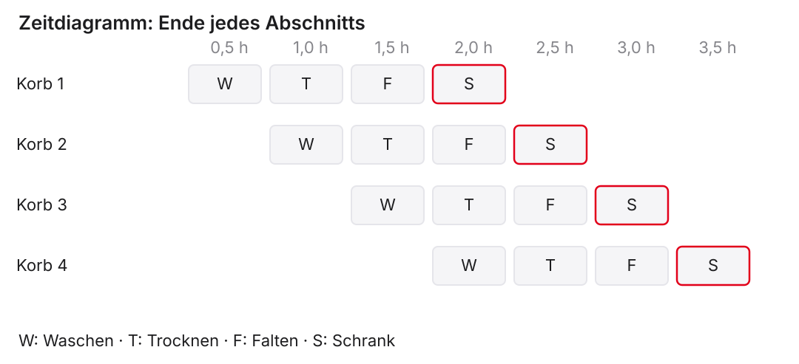
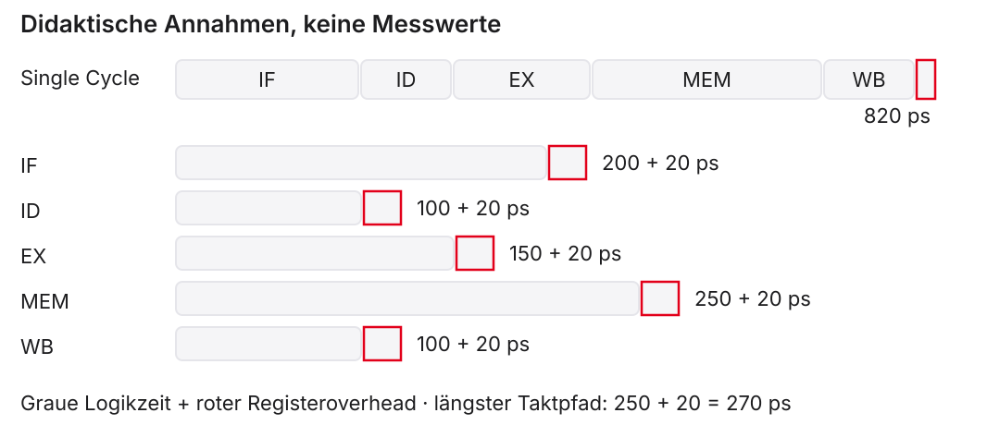
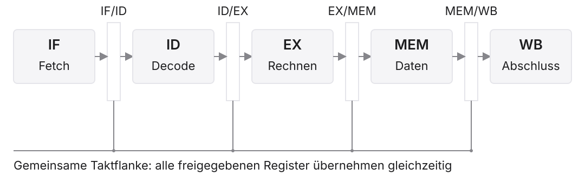
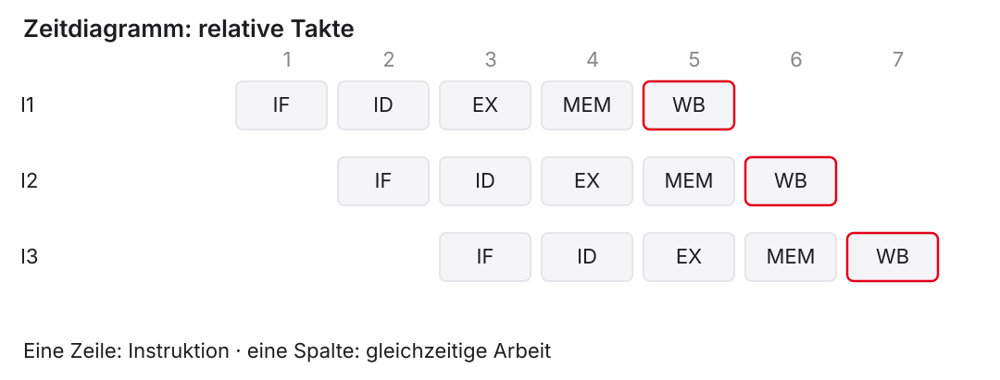
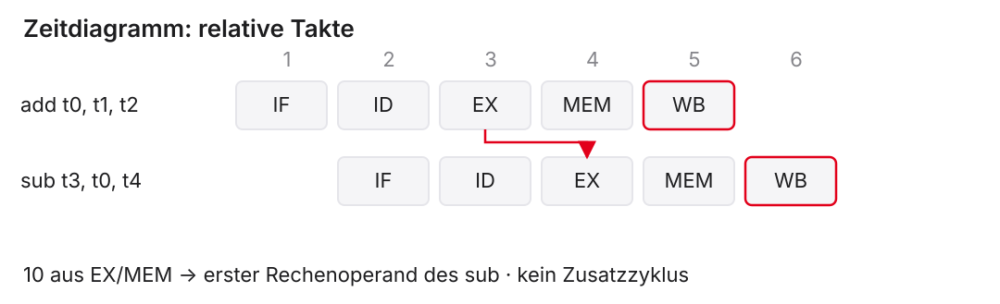
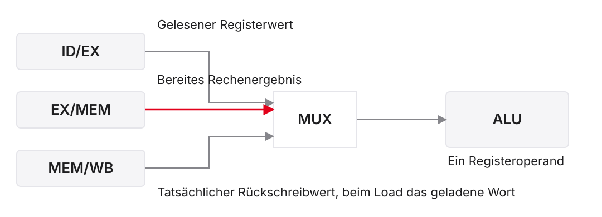
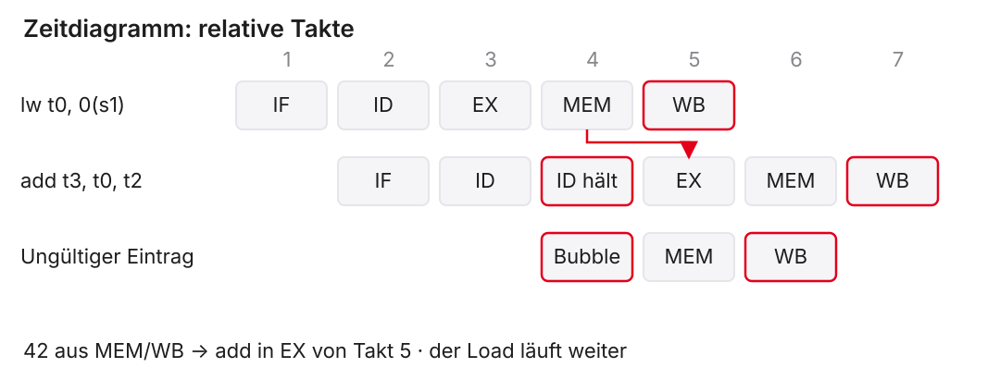
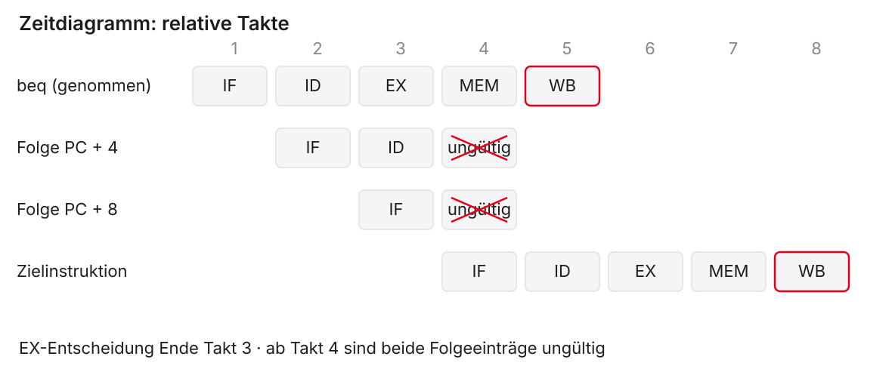
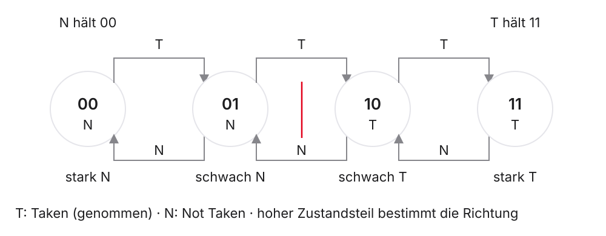

# Performance und Pipelining

::: notes
Der Single-Cycle-Datenpfad aus Einheit 5 und das Steuerwerk aus Einheit 6 erklären, wie ein unterstützter Befehl korrekt ausgeführt wird. Single Cycle bedeutet, dass jeder dieser Befehle eine vollständige Taktperiode belegt. Jetzt fragen wir, wie viel Zeit eine ganze Befehlsfolge benötigt und ob mehrere Befehle gleichzeitig unterschiedliche Teile des Datenpfads nutzen können.

Performance bezeichnet hier die Leistung bezogen auf eine bestimmte Aufgabe: etwa eine kürzere Programmlaufzeit oder einen höheren Durchsatz. Pipelining ist die zeitliche Überlappung aufeinanderfolgender Arbeitsschritte. Diese Mikroarchitektur muss weiterhin dieselben sichtbaren Register- und Speicherergebnisse liefern wie die sequenzielle Ausführung. Die Notizen erläutern Begriffe, Modellannahmen und Beispiele als begleitendes Skript. Die zugehörige Folie darf beim Lesen danebenliegen.
:::

## Was Sie heute erklären können sollen

1. Laufzeit aus Befehlszahl, Takten und Taktperiode bestimmen
2. Ein Pipeline-Zeitdiagramm lesen und selbst ergänzen
3. Verfügbare Ergebnisse rechtzeitig weiterleiten
4. Nötiges Warten von verworfener Arbeit unterscheiden
5. Dieselbe Arbeit durch zulässiges Umsortieren beschleunigen

::: notes
Die Lernziele bilden eine Argumentationskette. Zuerst brauchen wir eine messbare Größe für Geschwindigkeit. Dann zeigt ein Zeitdiagramm, weshalb Überlappung den Durchsatz erhöht. Eine Datenabhängigkeit stellt anschließend die Frage, ob ein benötigter Wert rechtzeitig vorliegt. Forwarding, auf Deutsch Weiterleitung, nutzt einen bereits verfügbaren Wert. Ein Stall hält eine Instruktion fest, wenn der Wert noch fehlt. Ein Flush verwirft jüngere Arbeit, wenn sie zu einem falschen Sprungpfad gehört.

Instruction Scheduling bedeutet, vorhandene Befehle unter Erhaltung des Ergebnisses umzuordnen. Es ersetzt eine unproduktive Warteposition durch unabhängige Arbeit. Alle fünf Ziele sind auf Papier prüfbar; der Simulator macht die gleichen Zusammenhänge sichtbar. Sie müssen keine Kenntnisse über tiefe Pipelines, Betriebssysteme oder spezielle Compileroptimierungen mitbringen.
:::

## Anschluss an Einheit 1–6

| Bekannt | Neue Frage |
|:---|:---|
| Register übernehmen Werte an der Flanke | Welche Instruktion besitzt den gespeicherten Wert? |
| Quellenwahl und Schreibfreigabe | Wie reisen Daten und Steuerung gemeinsam? |
| Load, Store und Branch | Wann liegen Daten und nächstes Ziel vor? |
| Assembler und Maschinenbefehle | Welche Befehle zählen für die Laufzeit? |

::: notes
Die Grundlagen werden weiterverwendet, nicht voraussetzungslos ersetzt. Ein Register speichert einen Zustand an einer Taktflanke. Ein Multiplexer wählt eine Datenquelle, eine Schreibfreigabe erlaubt die Übernahme. In der Pipeline müssen diese Informationen zusätzlich der richtigen Instruktion zugeordnet bleiben.

Load Word, kurz lw, lädt ein 32-Bit-Wort; Store Word, kurz sw, schreibt es. Ein Branch ist ein bedingter Sprung, etwa Branch if Equal, kurz beq, bei gleichen Registerwerten. Diese Wirkungen kennen Sie aus Einheit 3. Assemblertext beschreibt die Befehle symbolisch; Maschinenbefehle sind die tatsächlich codierten Instruktionen. Die bisherige Steuerung erkennt die Operation und wählt passende Wege. Neu sind deren zeitliche Überlappung und die Behandlung von Abhängigkeiten. Eine Pipeline verändert den internen Ablauf, nicht die Bedeutung einer Addition oder eines Speicherzugriffs.
:::

## Vereinbarung für alle Zeitdiagramme

- Fünf Stufen, in Programmreihenfolge, höchstens ein neuer Befehl je Takt
- Getrennte Zugriffe auf Befehls- und Datenspeicher
- Ein Speicherzugriff braucht im Modell eine Stufe
- Takt 1 beginnt beim Fetch der betrachteten Kernfolge
- Gezählt wird bis zum Ende der letzten Abschlussstufe

::: notes
Unser Modell ist eine fünfstufige In-order-Pipeline. In order bedeutet: Befehle schreiten in Programmreihenfolge fort. Es wird höchstens eine neue Instruktion je Takt aufgenommen. Die Pipeline ist vor der betrachteten Folge leer; Anfangswerte sind schon hergestellt. Getrennte Zugriffe auf Befehle und Daten vermeiden den hier betrachteten Speicherkonflikt. Speicheradressen sind gültig und wortausgerichtet. Langsame Speicherantworten und Cachefehler werden nicht modelliert.

Die Basis ist RV32I, also der 32-Bit-RISC-V-Ganzzahlbefehlssatz. Die C-Erweiterung für komprimierte Instruktionen ist ausgeschaltet; betrachtete Maschinenbefehle sind vier Byte lang. Die Rechenbeispiele nutzen die in Einheit 6 ergänzte Addition mit Konstante, addi. Ein in WB am Taktende geschriebener Wert kann im Kursmodell erst in ID des folgenden Takts aus der Registerbank gelesen werden; ein WB→ID-Lesebypass ist nicht vorhanden. Diese Konvention wird beim Warten ohne Forwarding und beim gleichzeitigen Registerzugriff ausdrücklich berücksichtigt.
:::

## Vereinbarung für Abhängigkeiten und Sprünge

- Forwarding aus EX/MEM und MEM/WB für bereite Werte
- Unmittelbare Load-Nutzung in EX: ein Wartezyklus
- Branch-Entscheidung in EX, zunächst sequenzieller Fetch
- Genommener Branch: zwei jüngere Einträge verwerfen
- Andere Ripes-Konfigurationen können andere Zeitdiagramme haben

::: notes
EX bedeutet Execute, also Rechnen; MEM bedeutet Memory Access, den Datenzugriff; WB bedeutet Write Back, den Abschluss mit gegebenenfalls Registerschreiben. EX/MEM und MEM/WB heißen die Register zwischen den jeweiligen Stufen. Sie halten Ergebnisse, die Forwarding direkt an einen jüngeren Verbraucher weiterleiten kann. Nur der jüngste passende Produzent darf den benötigten Wert liefern. Gültigkeit und Schreibwirkung müssen geprüft werden.

Ein Load liefert das Wort erst nach dem Datenzugriff. Benötigt der unmittelbar nächste Befehl es schon in EX, entsteht im Modell ein Wartezyklus. Ein Branch wird in EX entschieden. Bis dahin holt der Prozessor die sequenziellen Folgeinstruktionen. Ist der Sprung genommen, werden zwei jüngere Einträge ungültig. Die fünf Stufen und diese Regeln sind Mikroarchitekturentscheidungen; die Instruction Set Architecture, kurz ISA, ist die Befehlssatzarchitektur und schreibt sie nicht vor. Ripes ist ein visueller Lehrsimulator, dessen konkrete Variante im Labor dokumentiert wird.
:::

# 1. Laufzeit, Latenz und Durchsatz

::: notes
Eine korrekt arbeitende Schaltung kann für eine Aufgabe unterschiedlich viel Zeit benötigen. Ein einzelner Takt sagt wenig aus, solange wir seine Dauer und die Zahl benötigter Takte nicht kennen. Außerdem kann ein System viele Aufträge rasch hintereinander abschließen, obwohl ein einzelner Auftrag lange unterwegs ist.

Deshalb trennen wir zunächst Laufzeit der gesamten Aufgabe, Latenz eines Auftrags und Durchsatz vieler Aufträge. Die Stationsmetapher macht den Unterschied sichtbar. Danach übertragen wir ihn auf den bekannten Datenpfad und berechnen mit ausdrücklich angenommenen Stufenzeiten einen konkreten Gewinn. Diese Rechnung liefert die Grundlage dafür, später die Kosten von Wartezyklen und falschen Sprungpfaden zu bewerten.
:::

## Was zählt als Befehlszahl?

- Dynamisch abgeschlossene Maschineninstruktionen zählen
- Schleifen können dieselbe Instruktion mehrfach ausführen
- Pseudoinstruktionen können mehrere Maschinenbefehle ergeben
- Hardware-Bubbles und verworfene Befehle zählen nicht zu $N$

```asm
addi t0, x0, 3
Loop:
  addi t0, t0, -1
  bne  t0, x0, Loop
```

::: notes
Die dynamische Befehlszahl $N$ zählt tatsächlich abgeschlossene Maschineninstruktionen einer betrachteten Ausführung. Eine statische Liste zählt dagegen die verschiedenen Befehlspositionen im Programm. Im RISC-V-Code setzt addi, Add Immediate, das Register t0 zunächst auf 3; x0 liefert immer null. Die Schleife verringert t0 dreimal um eins. bne, Branch if Not Equal, springt zweimal zurück, solange t0 ungleich null ist, und fällt beim dritten Vergleich durch. Es schließen daher $1+3+3=7$ Maschineninstruktionen ab. Diese Zählung beschreibt die Befehlssatzwirkung, unabhängig von der später betrachteten Pipeline. t0 ist ein temporäres Register, hier x5; Loop ist eine Sprungmarke und selbst keine Instruktion.

Ein Assembler-Pseudobefehl wie la, Load Address, wird vom Assembler in echte Maschinenbefehle umgesetzt. Seine Quellzeile ist deshalb keine verlässliche Zähleinheit. Auch spekulativ geholte, später verworfene Instruktionen erhöhen $N$ nicht; sie können aber Zeit kosten. Eine Hardware-Bubble ist ein ungültiger Pipeline-Eintrag und ebenfalls kein zusätzlich abgeschlossener Programmbefehl.
:::

## Drei Größen bestimmen die Laufzeit

$$t_\mathrm{CPU}=N\cdot \mathrm{CPI}\cdot T,\qquad
\mathrm{CPI}=\frac{C}{N},\qquad f=\frac{1}{T}$$

- $N$: dynamisch abgeschlossene Instruktionen
- $C$: benötigte Taktzyklen
- $T$: Taktperiode, $f$: Taktfrequenz
- Gleiche Aufgabe und gleiche Zählgrenzen vergleichen

::: notes
CPU bedeutet Central Processing Unit, die zentrale Verarbeitungseinheit. $t_\mathrm{CPU}$ ist ihre betrachtete Ausführungszeit. $N$ ist die dynamische Zahl abgeschlossener Maschineninstruktionen. $C$ ist die Zahl der dafür benötigten Takte. CPI, ausgeschrieben Cycles per Instruction, bezeichnet die mittleren Takte pro Instruktion und ergibt sich aus $C/N$. $T$ ist die Taktperiode in Sekunden; die Taktfrequenz $f$ in Hertz ist ihr Kehrwert. Damit folgt auch unmittelbar $t_\mathrm{CPU}=C\cdot T$.

Im Lehrmodell zählen wir vom Beginn des ersten Fetch bis zum Ende der letzten Abschlussstufe, einschließlich Füllung, Wartezyklen und Leerung. Ein anderer Messbereich kann einen anderen mittleren CPI liefern. Höhere Frequenz allein beweist keine kürzere Laufzeit: Eine Variante mit kürzerem Takt kann mehr Takte benötigen. Änderungen der Befehlszahl, des mittleren CPI und der Periode müssen gemeinsam betrachtet werden. Bei einem System mit Betriebssystem wären Wartezeiten außerhalb dieses Prozessorausschnitts gesondert zu behandeln.
:::

## Rechnen: Ein kürzerer Takt genügt nicht

Didaktisches Beispiel für dieselbe Aufgabe, $N=1000$:

| Variante | CPI | Taktperiode | Laufzeit |
|:---|:---:|:---:|:---:|
| A | $1$ | $2\,\mathrm{ns}$ | $2\,\mathrm{\mu s}$ |
| B | $1{,}5$ | $1\,\mathrm{ns}$ | $1{,}5\,\mathrm{\mu s}$ |

$$S=\frac{t_A}{t_B}\approx 1{,}33$$

::: notes
CPI bedeutet Cycles per Instruction, die mittlere Zahl benötigter Takte je abgeschlossener Instruktion. In beiden Varianten führen wir für dieselbe Aufgabe $N=1000$ Maschineninstruktionen aus. Die angenommenen CPI-Werte enthalten bereits alle Kosten des gewählten Messbereichs. Eine Nanosekunde, ns, entspricht $10^{-9}$ Sekunden; eine Mikrosekunde, $\mu s$, entspricht $10^{-6}$ Sekunden.

A braucht $1000\cdot1\cdot2\,\mathrm{ns}=2000\,\mathrm{ns}=2\,\mathrm{\mu s}$. B braucht $1000\cdot1{,}5\cdot1\,\mathrm{ns}=1500\,\mathrm{ns}=1{,}5\,\mathrm{\mu s}$. Der Speedup $S$, also Beschleunigungsfaktor, ist die alte durch die neue Laufzeit: $2/1{,}5=4/3\approx1{,}33$. Obwohl der Takt doppelt so häufig läuft, ist die Aufgabe nur etwa ein Drittel schneller. Die zusätzlichen Takte dämpfen den Gewinn. Diese Werte sind eine Modellrechnung, kein Hardwarevergleich. Nun untersuchen wir, wo Überlappung die benötigte Zeit tatsächlich verkürzt.
:::

## Vier Stationen, vier Aufträge

- Vier Körbe, je vier Arbeitsschritte mit 30 Minuten
- Jede Station bearbeitet höchstens einen Korb gleichzeitig
- Kein zusätzlicher Aufwand zwischen den Stationen
- Ohne Überlappung: $4\cdot4\cdot30\,\mathrm{min}=8\,\mathrm{h}$

::: notes
Die Waschsalonmetapher trennt erstmals Auftragsdauer und Gesamtleistung. Ein Korb wird gewaschen, getrocknet, gefaltet und eingeordnet. Jede Station braucht als didaktische Annahme 30 Minuten und besitzt eigene Kapazität; auch Falten und Einordnen können gleichzeitig mit Waschen stattfinden. Eine Station kann währenddessen keinen zweiten Korb bearbeiten. Transportzeiten und zusätzliche Pufferkosten fehlen bewusst.

Ohne Überlappung durchläuft der erste Korb alle vier Stationen, bevor der zweite beginnt. Ein Korb braucht $4\cdot30=120$ Minuten, also zwei Stunden. Vier Körbe brauchen 480 Minuten oder acht Stunden. Das ist die Latenz eines Korbs multipliziert mit der Auftragszahl. Die einzelnen Stationen warten während der übrigen Arbeitsschritte. Startet der nächste Korb dagegen, sobald die erste Station frei ist, nutzen wir mehrere Stationen gleichzeitig, ohne eine einzelne Bearbeitung kürzer zu machen.
:::

## Überlappung im Zeitdiagramm

{.nostretch fig-alt="Vier Körbe durchlaufen vier Stationen überlappend in sieben Halbstunden"}

::: notes
Die horizontale Achse zeigt sieben Zeitabschnitte von jeweils 30 Minuten, also bis 3,5 Stunden. Jede Zeile beschreibt einen Korb. W steht für Waschen, T für Trocknen, F für Falten und S für das Einordnen in den Schrank. Die grauen Kästen markieren normale Bearbeitung; rote Konturen markieren die Fertigstellungen. Jeder Korb durchläuft vier aufeinanderfolgende Abschnitte. Der zweite Korb beginnt einen Abschnitt später als der erste und endet entsprechend später.

Korb 1 ist nach zwei Stunden fertig, Korb 4 nach 3,5 Stunden. Damit beträgt der Beschleunigungsfaktor für genau vier Körbe $8/3{,}5\approx2{,}29$. Nach der ersten Fertigstellung endet alle 30 Minuten ein weiterer Korb. Diese stationäre Rate ist viermal so hoch wie die sequenzielle Rate von einem Korb je zwei Stunden. Für die endliche Folge beträgt der Gewinn trotzdem nur etwa 2,29, weil das Fließband zuerst gefüllt und zuletzt geleert wird.
:::

## Latenz und Durchsatz getrennt beantworten

| Größe | Bedeutung | Waschsalon |
|:---|:---|:---|
| Latenz | Dauer eines einzelnen Auftrags | $2\,\mathrm{h}$ |
| Stationärer Durchsatz | Abschlüsse je Zeit bei laufendem Band | $2$ Körbe je Stunde |
| Gesamtzeit | Dauer der betrachteten Folge | $3{,}5\,\mathrm{h}$ |

Eine Prozessorpipeline kann die Einzellatenz auch erhöhen.

::: notes
Latenz misst die Dauer vom Start bis zum Abschluss eines einzelnen Auftrags. Durchsatz misst die Zahl abgeschlossener Aufträge je Zeiteinheit. Stationär bedeutet hier, dass das Band gefüllt ist und fortgesetzt Aufträge eingehen. Die Gesamtzeit einer endlichen Folge enthält zusätzlich die Füllung und Leerung. Im Waschsalon braucht jeder Korb unverändert zwei Stunden; nach der Füllung kommen zwei Körbe je Stunde heraus. Vier Körbe enden nach 3,5 Stunden.

Daraus folgt keine allgemeine Zusage, dass eine Prozessorpipeline die Einzellatenz unverändert lässt. Registergrenzen brauchen Zeit, und alle Stufen müssen im gemeinsamen Taktplan voranschreiten. Ungleiche Stufen führen zu Warteanteilen in kürzeren Stufen. Ein einzelner Befehl kann deshalb länger benötigen, obwohl viele Befehle insgesamt schneller fertig werden. Die nächste Rechnung quantifiziert genau diesen Unterschied für den Datenpfad.
:::

## Angenommene Laufzeiten des Datenpfads

{.nostretch fig-alt="Stufenzeiten 200, 100, 150, 250 und 100 ps mit je 20 ps Registeroverhead"}

::: notes
Die Abbildung zeigt fünf reine Logiklaufzeiten: IF, Instruction Fetch oder Befehlsholen, 200 Pikosekunden; ID, Instruction Decode oder Decodieren und Registerlesen, 100 Pikosekunden; EX, Execute oder Rechnen, 150 Pikosekunden; MEM, Memory Access oder Datenzugriff, 250 Pikosekunden; WB, Write Back oder Rückschreiben, 100 Pikosekunden. ps bedeutet Pikosekunde, also $10^{-12}$ Sekunden. Grau zeigt Logikzeit; der rote kurze Abschnitt zeigt den effektiven Registeroverhead von 20 ps. Dieser fasst Ausgangsverzögerung und Übernahmebedingungen eines Taktpfads zusammen.

Im Single-Cycle-Modell läuft der angenommene längste relevante Pfad durch alle fünf Bereiche: $200+100+150+250+100+20=820\,\mathrm{ps}$. In der Pipeline begrenzt die längste Stufe den Takt: $\max(200,100,150,250,100)+20=270\,\mathrm{ps}$. Der Registeroverhead fällt je Taktpfad an, nicht zusätzlich viermal im Single-Cycle-Takt. Alle Zahlen sind erfundene Lehrwerte. Der tatsächliche kritische Pfad ist ein vollständiger Signalweg und hängt auch von neuer Steuer- und Weiterleitungslogik ab.
:::

## Ein Befehl kann länger unterwegs sein

$$L_\mathrm{single}=820\,\mathrm{ps},\qquad
L_\mathrm{pipe}=5\cdot270\,\mathrm{ps}=1350\,\mathrm{ps}$$

- Single Cycle: ein langer Takt
- Pipeline: fünf kürzere Takte
- Der Vorteil muss aus mehreren überlappten Befehlen entstehen

::: notes
$L$ bezeichnet die Latenz eines isolierten Befehls vom Beginn des Befehlsholens bis zum Ende seiner Abschlussstufe. Der Index single bezeichnet das Single-Cycle-Modell, pipe das Pipeline-Modell. ps bedeutet Pikosekunde. Für den angenommenen Single-Cycle-Takt von 820 ps beträgt die betrachtete Latenz 820 ps. In der fünfstufigen Pipeline benötigt derselbe Befehl ohne Wartezyklen fünf Perioden von je 270 ps, also 1350 ps.

Die Pipeline erhöht hier die Einzellatenz um 530 ps. Sie muss dafür nicht fünfmal so viel Logik ausführen: Kürzere Stufen warten innerhalb ihrer gemeinsamen Periode, und Registergrenzen verursachen Aufwand. Daraus folgt nicht, dass die Pipeline insgesamt schlechter ist. Sobald weitere Befehle überlappen, kann bereits nach jedem kurzen Takt eine weitere Instruktion abschließen. Die isolierte Latenz und die stationäre Abschlussrate beantworten verschiedene Fragen.
:::

## Warum $N+4$ Takte?

Für eine leere fünfstufige Pipeline ohne Zusatzzyklen:

$$C=N+5-1=N+4,\qquad \mathrm{CPI}_\mathrm{endlich}=1+\frac{4}{N}$$

- Erster Abschluss nach fünf Takten
- Danach ein weiterer Abschluss je Takt
- Füllung und Leerung gemeinsam einmal berücksichtigen

::: notes
$N$ ist die Zahl abgeschlossener Maschineninstruktionen, $C$ die dafür benötigte Taktzahl. CPI bedeutet Cycles per Instruction, mittlere Takte je Instruktion. Die erste Instruktion durchläuft fünf Stufen und endet in Takt 5. Die übrigen $N-1$ Instruktionen enden ohne Zusatzkosten jeweils einen Takt später. Insgesamt ergeben sich daher $5+(N-1)=N+4$ Takte.

Man darf nicht zusätzlich vier Takte Füllung und noch einmal vier Takte Leerung addieren. Beide Randwirkungen sind bereits in dieser Gesamtzählung enthalten. Für drei Instruktionen sind es sieben Takte; für zwanzig sind es 24. Der endliche CPI beträgt $24/20=1{,}2$. Der oft genannte ideale CPI von 1 ist hier ein stationärer Grenzwert langer Folgen. Abhängigkeiten, Fehlvorhersagen und längere Speicherzugriffe würden Zusatzzyklen erzeugen; sie sind in dieser Folie ausdrücklich ausgeschlossen.
:::

## Vergleich für zwanzig Instruktionen

$$t_\mathrm{single}=20\cdot820\,\mathrm{ps}=16400\,\mathrm{ps}$$

$$t_\mathrm{pipe}=24\cdot270\,\mathrm{ps}=6480\,\mathrm{ps}$$

$$S=\frac{16400}{6480}\approx2{,}53$$

Für sehr große $N$: $S\rightarrow820/270\approx3{,}04$.

::: notes
$t$ bezeichnet die Gesamtzeit der betrachteten Folge, $S$ den Speedup oder Beschleunigungsfaktor. ps bedeutet Pikosekunde. Alle zwanzig Instruktionen schließen ab, und es gibt in dieser Rechnung keine Zusatzzyklen. Im Single-Cycle-Modell ergibt sich $20\cdot820=16400$ ps. Die anfangs leere Pipeline benötigt $20+4=24$ Takte und damit $24\cdot270=6480$ ps. Das Verhältnis ist ungefähr 2,5309 und wird auf 2,53 gerundet.

Für eine allgemeine Folge lautet das Verhältnis $S(N)=N\cdot820/((N+4)\cdot270)$. Wenn $N$ sehr groß wird, wird der Randanteil $4/N$ klein. Der Grenzwert ist daher $820/270\approx3{,}04$, nicht fünf. Der Idealwert fünf bräuchte unter anderem fünf gleich lange Stufen, vernachlässigbaren Registeraufwand und eine lange Folge ohne Zusatzzyklen. Die tatsächliche Stufenzahl allein garantiert keinen solchen Gewinn.
:::

## Kurzaufgabe: Was sagt CPI allein?

Zwei Ausführungen derselben Aufgabe:

- A: $\mathrm{CPI}=1$, $T=820\,\mathrm{ps}$
- B: $\mathrm{CPI}=1{,}2$, $T=270\,\mathrm{ps}$
- Beide schließen zwanzig Instruktionen ab

Welche Ausführung ist schneller? Begründen Sie Ihre Antwort.

::: notes
CPI bedeutet Cycles per Instruction, die mittlere Taktzahl pro abgeschlossener Instruktion. $T$ ist die Taktperiode, ps eine Pikosekunde. Die Aufgabe übernimmt bewusst das bisherige Zahlenmodell. Variante A ist der Single-Cycle-Fall; Variante B enthält die Füllung und Leerung der fünfstufigen Pipeline bereits in ihrem endlichen CPI.

A benötigt $20\cdot1\cdot820=16400$ ps, B $20\cdot1{,}2\cdot270=6480$ ps. B ist deshalb schneller, obwohl ihr CPI größer ist. Die kleinere Taktperiode überwiegt. Wer die Füllung jetzt nochmals addiert, zählt sie doppelt. Wer nur CPI vergleicht, ignoriert die Periodendauer. Diese begründete Rechnung ist das Muster für eine Klausurantwort. Damit ist der mögliche Nutzen geklärt; nun müssen wir erklären, wie Daten und Steuerung mehrerer Instruktionen gleichzeitig korrekt zugeordnet bleiben.
:::

# 2. Die fünf Stufen und ihre Register

::: notes
Die Zeitrechnung nimmt an, dass mehrere Instruktionen gleichzeitig unterschiedliche Arbeitsschritte ausführen können. Diese Überlappung erfordert gespeicherte Zwischenzustände. Der alte Datenpfad wird deshalb durch Registergrenzen in Taktstufen geteilt.

Eine Mikroarchitektur ist die konkrete interne Umsetzung eines Befehlssatzes. RISC-V schreibt die hier gewählten fünf Stufen nicht vor. Wir untersuchen, welche Werte an einer Grenze gespeichert werden und weshalb Daten, Zielregisternummer und Steuerung derselben Instruktion zusammenbleiben müssen. Erst diese Zuordnung macht die schnellere Taktfolge funktional korrekt. Danach kann ein Zeitdiagramm sowohl die Belegung jeder Stufe als auch die Lage jedes Befehls zeigen.
:::

## Aufgaben der fünf Stufen

| Stufe | Aufgabe |
|:---|:---|
| IF — Instruction Fetch | Maschinenbefehl holen |
| ID — Instruction Decode | Decodieren, Register lesen, Steuerung bilden |
| EX — Execute | Rechnen, Adresse oder Branch bestimmen |
| MEM — Memory Access | Gegebenenfalls Daten lesen oder schreiben |
| WB — Write Back | Gegebenenfalls Register schreiben, Abschluss |

::: notes
IF, Instruction Fetch, holt den Maschinenbefehl an der Adresse des Program Counter, kurz PC. ID, Instruction Decode, erkennt die Operation, liest Quellregister und erzeugt die passenden Steuersignale. EX, Execute, führt die Rechnung aus: Eine Addition erzeugt einen Wert, ein Load oder Store eine Datenadresse, ein Branch die Sprungentscheidung und Zieladresse. MEM, Memory Access, greift bei Speicherbefehlen auf den Datenspeicher zu. WB, Write Back, schließt den Befehl ab und schreibt gegebenenfalls ein Register.

Nicht jeder Befehl nutzt jede Funktion. add durchläuft MEM ohne Datenzugriff. sw hat keine Register-Schreibwirkung in WB; seine Speicherwirkung liegt in MEM. Trotzdem durchlaufen die Einträge im Modell denselben Stufenplan. WB als Abschluss zu zählen ist daher nicht gleichbedeutend mit einem aktiven Registerschreibport. Diese Unterscheidung verhindert falsche Befehlszählungen.
:::

## Register machen aus Bereichen Taktstufen

{.nostretch fig-alt="Fünf Funktionsbereiche mit vier Registergrenzen und gemeinsamem Takt"}

::: notes
Die Abbildung wird von links nach rechts gelesen. IF heißt Instruction Fetch, ID Instruction Decode, EX Execute, MEM Memory Access und WB Write Back: Befehlsholen, Decodieren, Rechnen, Datenzugriff und Rückschreiben. Die vier schmalen senkrechten Register sind IF/ID, ID/EX, EX/MEM und MEM/WB. Der Schrägstrich benennt jeweils die beiden benachbarten Stufen. Die grauen orthogonalen Pfeile zeigen vorwärts übernommene Informationspakete. Die gemeinsame Taktlinie unterhalb der Register zeigt, dass die Grenzen gleichzeitig aktualisiert werden.

Ein Register besteht hier aus vielen flankengetriggerten Speicherelementen. Es hält die Ausgänge der vorherigen Stufe während der Verarbeitung in der nächsten Stufe stabil. Ohne diese Speicherung wäre das Zeichnen von fünf Bereichen noch keine Pipeline. Die Stufen sind auch keine nacheinander geöffneten Schleusen: An einer Flanke übernehmen alle freigegebenen Register ihren jeweiligen Eingangszustand.
:::

## Daten und Steuersignale gehören zusammen

Für einen Store im Paket:

- Zieladresse und zu schreibender Registerwert
- `MemWrite` als Speicher-Schreibfreigabe
- Zugehöriger Befehls-PC und Gültigkeit
- Freigabe aus ID wandert bis zum Store in MEM

::: notes
Ein Store schreibt einen Registerwert an eine berechnete Datenadresse. MemWrite heißt Memory Write und ist die Speicher-Schreibfreigabe. ID, Instruction Decode, bildet diese Freigabe beim Decodieren. EX, Execute, berechnet die Adresse. MEM, Memory Access, benötigt die Freigabe erst zwei Stufen nach ID. Dazwischen wandert sie zusammen mit dem Befehl über ID/EX und EX/MEM. Der Befehls-PC, Program Counter, bezeichnet die Adresse dieser Instruktion und darf nicht mit der inzwischen weitergelaufenen Fetch-Adresse verwechselt werden.

Für einen Registerschreiber müssen ebenso RegWrite, die Register-Schreibfreigabe, und rd, Destination Register oder Zielregisternummer, bis zum passenden Rückschreiben mitreisen. Gültigkeit kennzeichnet, ob der Eintrag überhaupt eine aktive Instruktion repräsentiert. Ein ungültiger Eintrag darf weder Register noch Speicher schreiben und keinen Sprung auslösen. Würde MEM dagegen das gerade in ID erzeugte MemWrite benutzen, könnte ein jüngerer Store den Datenweg einer älteren Addition zum Schreiben freigeben. Die zeitliche Zuordnung ist deshalb genauso wichtig wie der richtige Bitwert.
:::

## Ein Zeitdiagramm in zwei Richtungen lesen

{.nostretch fig-alt="Drei unabhängige Instruktionen durchlaufen IF bis WB in sieben Takten"}

::: notes
IF, Instruction Fetch, ID, Instruction Decode, EX, Execute, MEM, Memory Access, und WB, Write Back, sind die fünf Bearbeitungsstufen. Jede Zeile in der Abbildung steht für eine dynamische Instruktion I1, I2 oder I3. Die horizontale Achse zählt relative Takte vom ersten Fetch an. Die drei Instruktionen sind unabhängig; alle nötigen Werte sind vor dem Start bereit.

Lesen Sie zunächst eine Zeile: I1 wird in Takt 1 geholt und endet nach WB in Takt 5. Ihre Latenz umfasst fünf Takte. Lesen Sie dann eine Spalte: In Takt 3 steht I1 in EX, I2 in ID und I3 in IF. Verschiedene Stufen bearbeiten verschiedene Instruktionen gleichzeitig. Die rot umrandeten WB-Felder enden in Takten 5, 6 und 7 und markieren die Abschlüsse. Drei Befehle brauchen somit sieben Takte. Eine leere Zelle bedeutet keinen Eintrag dieser Zeile; sie beweist keine elektrische Abschaltung einer Hardwarekomponente.
:::

## Drei Arten von Konflikten

| Konflikt | Frage | Beispiel / Behandlung |
|:---|:---|:---|
| Structural Hazard | Reicht die Ressource gleichzeitig? | Ein Speicherport / getrennte Zugriffe |
| Data Hazard | Ist der benötigte Wert bereit? | Registerabhängigkeit / Forwarding oder Stall |
| Control Hazard | Gehört die Folge zum richtigen Pfad? | Branch / Vorhersage und Flush |

::: notes
Ein Hazard ist ein Konflikt, der den planmäßigen korrekten Fortschritt gefährdet. Structural Hazard bezeichnet einen Ressourcenkonflikt: Ein gemeinsamer einportiger Speicher kann nicht im selben Takt einen Befehl holen und ein Datenwort lesen. Getrennte Zugriffe oder passende Mehrportressourcen lösen dieses Problem. Ein gemeinsamer Adressraum allein erzwingt noch keinen solchen Konflikt.

Ein Data Hazard betrifft einen benötigten Datenwert, der noch nicht regulär verfügbar ist. Forwarding leitet ihn weiter, wenn er bereits berechnet wurde; ein Stall hält den Verbraucher fest, wenn er noch fehlt. Ein Control Hazard betrifft die Unsicherheit über den nächsten Befehlsfluss, etwa bei einem bedingten Sprung. Eine Vorhersage ermöglicht vorläufigen Fetch; ein Flush verwirft falsche Folgearbeit. Nicht jeder Hazard kostet einen Wartezyklus. Unser Modell nimmt ausreichende Speicher- und Registerports an und konzentriert sich im Folgenden auf Daten- und Kontrollabhängigkeiten.
:::

# 3. Registerabhängigkeiten und Forwarding

::: notes
Die bislang gezeigten Instruktionen waren unabhängig. Nun schreibt eine ältere Instruktion einen Wert, den eine jüngere benötigt. Die Programmwirkung legt fest, welchen Wert der Leser erhalten muss. Durch Überlappung kann der Leser jedoch beginnen, bevor das reguläre Registerschreiben abgeschlossen ist.

Read After Write, kurz RAW, bezeichnet diese Leser-nach-Schreiber-Abhängigkeit. Sie ist kein elektrischer Zusammenstoß. Zunächst bestimmen wir Produzent, Verbraucher und den richtigen Datenwert. Anschließend vergleichen wir Warten und Weiterleitung. Forwarding, auch Bypassing genannt, ist eine zusätzliche Datenverbindung, die ein bereits verfügbares Ergebnis vor dem regulären Registerlesen nutzbar macht.
:::

## Ein konkretes Produzent-Verbraucher-Paar

Anfang: `t1 = 7`, `t2 = 3`, `t4 = 4`, alter `t0 = 99`.

```asm
add t0, t1, t2
sub t3, t0, t4
```

$$t0=7+3=10,\qquad t3=10-4=6$$

Die Quelle `t0` muss den neuen Wert liefern.

::: notes
Der RISC-V-Befehl add t0, t1, t2 addiert die Inhalte von t1 und t2 und schreibt das Ergebnis nach t0. sub t3, t0, t4 bildet danach die Differenz und schreibt t3. Die Namen t0, t1, t2, t3 und t4 bezeichnen temporäre Register, hier x5, x6, x7, x28 und x29. Ihre Anfangswerte sind ausdrücklich angegeben; die Folge ist ein isolierter Lehrausschnitt ohne Initialisierung oder Programmabschluss.

t0 ist das Ziel des ersten und die erste Quelle des zweiten Befehls. Die Abhängigkeit heißt RAW, Read After Write. Die sequenzielle Wirkung verlangt zunächst $7+3=10$ und dann $10-4=6$. Verwendete sub den alten Wert 99, entstünde fälschlich 95. Wir vergleichen also keine gleichen Registernummern als Datenwerte: Die Nummer x5 identifiziert die Quelle, der benötigte Datenwert ist 10. Diese Trennung ist die Grundlage der Hardwareerkennung.
:::

## Der ungeänderte Ablauf würde zu früh lesen

| Befehl | 1 | 2 | 3 | 4 | 5 | 6 |
|:---|:---:|:---:|:---:|:---:|:---:|:---:|
| `add` | IF | ID | EX | MEM | WB | |
| `sub` | | IF | ID | EX | MEM | WB |

- `sub` liest in ID von Takt 3 zunächst den alten Registerwert
- `add` schreibt erst in WB von Takt 5
- Das Problem betrifft den Operandenwert, nicht die Befehlsreihenfolge

::: notes
IF steht für Instruction Fetch, ID für Instruction Decode, EX für Execute, MEM für Memory Access und WB für Write Back. Das Raster zeigt den ungehaltenen Stufenplan. add rechnet in EX von Takt 3 und schreibt t0 in WB von Takt 5. sub liest t0 schon in ID von Takt 3 und würde ohne weitere Behandlung in EX von Takt 4 mit dem veralteten Wert rechnen.

Die Instruktionen überholen sich dabei nicht. In order bedeutet, dass die jüngere Instruktion hinter der älteren bleibt. Der Fehler entstünde allein durch zu frühen Datenzugriff. Im Zahlenbeispiel sind t0 und t3 die beteiligten temporären Register: t0 soll 10 statt 99 liefern, t3 soll 6 statt 95 erhalten. Ein korrektes Pipeline-Modell verhindert diese falsche Wirkung. Entweder wartet der Verbraucher auf das Registerschreiben, oder er erhält das bereits berechnete Ergebnis über einen zusätzlichen Weg.
:::

## Warten ohne Forwarding

Im Kursmodell wird der neue Registerwert erst im Folgetakt lesbar:

| Befehl | 1 | 2 | 3 | 4 | 5 | 6 | 7 | 8 | 9 |
|:---|:---:|:---:|:---:|:---:|:---:|:---:|:---:|:---:|:---:|
| `add` | IF | ID | EX | MEM | WB | | | | |
| `sub` | | IF | ID | ID hält | ID hält | ID liest | EX | MEM | WB |

Drei Zusatzzyklen. Bei Schreiben und Lesen im selben Takt wären es zwei.

::: notes
Forwarding heißt Weiterleitung eines Werts vor dem regulären Registerzugriff. Hier fehlt diese Verbindung; eine Hazard-Erkennung hält stattdessen den Verbraucher fest. IF ist Instruction Fetch, ID Instruction Decode, EX Execute, MEM Memory Access und WB Write Back. Im Raster bleibt sub in ID, während add weiterläuft und t0 in Takt 5 schreibt. Nach der ausdrücklich vereinbarten Registerbankkonvention kann sub den neuen Wert erst in ID von Takt 6 lesen. Es rechnet dann in Takt 7 und endet in Takt 9. Gegenüber dem ungehaltenen Abschluss in Takt 6 sind das drei Zusatzzyklen.

Das ist eine Modellannahme. Eine Registerbank, die innerhalb eines Takts zuerst schreibt und danach denselben Wert liest, könnte sub bereits in ID von Takt 5 versorgen; dann wären es zwei Zusatzzyklen. Auch ein zusätzlicher Rückweg zum Registerleseeingang würde das Modell verändern. Fehlendes Forwarding bedeutet mit ausreichender Erkennung längeres Warten, nicht zwangsläufig ein falsches Ergebnis. Die nächste Frage lautet, wann das Ergebnis 10 tatsächlich erstmals bereitsteht.
:::

## Das Ergebnis existiert schon vor WB

{.nostretch fig-alt="add berechnet 10 in EX von Takt 3, sub erhält sie in EX von Takt 4 aus EX/MEM"}

::: notes
IF, Instruction Fetch, ID, Instruction Decode, EX, Execute, MEM, Memory Access, und WB, Write Back, sind die Stufen im Zeitraster. Die obere Zeile ist add, die untere sub. Die horizontale Achse zählt relative Takte. Der rote orthogonale Pfeil verbindet die Berechnung des Ergebnisses 10 in EX von Takt 3 mit dessen Nutzung in EX von Takt 4. An der dazwischenliegenden Flanke wurde das Ergebnis im Register EX/MEM gespeichert.

sub braucht nicht den alten in ID gelesenen t0-Wert zu verwenden. Ein Multiplexer vor dem Recheneingang ersetzt ihn durch den passenden weitergeleiteten Wert. Mit t4 gleich 4 berechnet sub deshalb $10-4=6$ ohne zusätzlichen Wartezyklus. t0 und t4 sind temporäre Register. Das spätere Write Back bleibt erforderlich, damit der reguläre Registerzustand stimmt. Die Weiterleitung transportiert den Wert von einer früheren Berechnung zu einer späteren; sie ist keine Rückreise in der Zeit.
:::

## Registerwerte vor dem Recheneingang

{.nostretch fig-alt="ID/EX, EX/MEM und MEM/WB liefern wählbare Registerwerte an einen Multiplexer vor der ALU"}

::: notes
Die Abbildung zeigt einen der Registeroperandenwege, nicht den gesamten Prozessor. ID bedeutet Instruction Decode, EX Execute, MEM Memory Access und WB Write Back. Das Register ID/EX liefert den regulär gelesenen Wert. EX/MEM hält das Ergebnis eines direkt vorausgehenden Rechenbefehls. MEM/WB hält den tatsächlichen Rückschreibwert einer weiter vorausgehenden Instruktion, bei einem Load also das geladene Wort. Die grauen orthogonalen Leitungen enden am MUX, Multiplexer, der eine Quelle auswählt. Der rote Weg hebt das direkte Forwarding hervor. ALU bedeutet Arithmetic Logic Unit, die arithmetisch-logische Recheneinheit.

Das Schema gilt getrennt für die benutzten Registerquellen rs1 und rs2, Source Register 1 beziehungsweise Source Register 2. Beim zweiten Recheneingang entscheidet ALUSrc, Arithmetic Logic Unit Source, danach noch zwischen Registerwert und Immediate, der codierten Konstante. Forwarding ersetzt also keinen Immediate. Bei einem Store bleibt der zu schreibende Registerwert ein eigener Datenweg; er darf nicht mit dem Adressoffset verwechselt werden. Selektorcodes sind interne Konventionen und werden hier nicht als Ripes-Portwerte behauptet.
:::

## Wann darf ein Ergebnis weitergeleitet werden?

Für jede tatsächlich benutzte Registerquelle prüfen:

1. Produzent ist gültig und hat `RegWrite = 1`
2. Sein `rd` ist ungleich `x0`
3. Sein `rd` passt zur Quellenregisternummer
4. Das benötigte Ergebnis ist rechtzeitig verfügbar
5. Kein jüngerer passender Produzent hat Vorrang

::: notes
Produzent heißt die ältere Instruktion, die das Registerergebnis erzeugt. RegWrite ist die Register-Schreibfreigabe; rd bedeutet Destination Register, die Zielregisternummer. x0 ist das feste Nullregister und verwirft Registerschreibversuche. Quellenregisternummern heißen rs1 und rs2, Source Register 1 beziehungsweise Source Register 2. Verglichen werden ihre fünf Bit breiten Nummern, nicht die 32-Bit-Inhalte.

Jede Bedingung verhindert einen eigenen Fehler. Ein ungültiger Eintrag oder ein Store ohne Registerschreiben liefert kein neues Registerergebnis. Ein Rechenversuch mit Ziel x0 darf dessen sichtbare Null nicht durch einen Zwischenwert ersetzen. Eine unbenutzte Feldposition, etwa die vermeintliche zweite Registerquelle eines Immediate-Befehls, darf keinen falschen Treffer auslösen. Schließlich ist Verfügbarkeit entscheidend: EX/MEM, das Register zwischen Execute und Memory Access, enthält bei einem Load erst die Adresse. Das geladene Wort liegt erst nach dem Speicherzugriff in MEM/WB, zwischen Memory Access und Write Back. Ein älterer Wert darf einen noch ausstehenden jüngeren Wert desselben Registers nicht ersetzen.
:::

## Zwei Treffer: Der jüngere Produzent gewinnt

```asm
add  t0, t1, t2    # erzeugt 10
addi t0, t0, 1     # erzeugt 11
sub  t3, t0, t4    # muss 11 nutzen
```

Anfang: `t1 = 7`, `t2 = 3`, `t4 = 4`.

Beim `sub` in EX: `addi` in MEM, `add` in WB.

::: notes
add bildet die Summe, addi, Add Immediate, erhöht sie um die codierte Konstante 1, und sub bildet die Differenz. t0, t1, t2, t3 und t4 sind temporäre Register. Mit den angegebenen Anfangswerten schreibt add zunächst 10, addi danach 11 und sub schließlich $11-4=7$. EX steht für Execute, MEM für Memory Access und WB für Write Back.

Wenn sub in Takt 5 rechnet, befindet sich addi in MEM und add in WB. Beide Zielregisternummern lauten t0. Das jüngere addi ist aber der letzte vorausgehende Schreiber in Programmreihenfolge. Sein Ergebnis 11 aus EX/MEM, dem Register zwischen Execute und Memory Access, gewinnt gegenüber dem älteren Wert 10 aus MEM/WB, zwischen Memory Access und Write Back. Das Beispiel erklärt den Vorrang nicht als Geschwindigkeitsregel, sondern als Erhaltung der sequenziellen Bedeutung. Würde der jüngere Treffer zu einem Load gehören und sein Wert noch fehlen, wäre Warten nötig; der ältere Wert wäre kein zulässiger Ersatz.
:::

## Nullregister: Ein Treffer ist noch kein Datenfluss

```asm
add t0, t1, t2
add x0, t0, t0
sub t3, x0, t4
```

Anfang: `t1 = 7`, `t2 = 3`, `t4 = 4`.

Welche Zahl muss `sub` als ersten Operanden erhalten?

::: notes
Die drei Zeilen sind ein isolierter RISC-V-Lehrausschnitt. add t0, t1, t2 erzeugt 10. add x0, t0, t0 berechnet intern 20, doch x0 ist das architektonische Nullregister und übernimmt keine Registerdaten. sub t3, x0, t4 muss deshalb null als ersten und 4 als zweiten Operanden verwenden. Die temporären Register t0 bis t4 dienen als Datenregister, t3 als Ergebnisziel.

Das Ergebnis lautet $0-4=-4$, als 32-Bit-Bitmuster 0xFFFFFFFC. Die Arithmetic Logic Unit, kurz ALU, darf intern zwar 20 anzeigen; dieser Wert ist aber keine erlaubte Quelle für einen Leser von x0. Die Bedingung rd ungleich x0, wobei rd Destination Register oder Zielregisternummer bedeutet, unterdrückt eine solche falsche Weiterleitung. Eine Übungsantwort muss daher den benötigten Wert null begründen, nicht lediglich gleiche Registernummern nennen.
:::

## Sonderfall: WB und ID im selben Takt

- Zwei unabhängige Befehle zwischen Schreiber und Leser
- Schreiber in WB, Leser gleichzeitig in ID
- Im Folgetakt ist der Schreiber nicht mehr in MEM/WB verfügbar
- Kursmodell: einen Takt halten und danach neu lesen
- Andere Registerbank oder zusätzlicher Lesebypass: anderes Modell

::: notes
WB bedeutet Write Back, das Registerschreiben; ID bedeutet Instruction Decode, einschließlich Registerlesen; EX bedeutet Execute, die Rechenstufe. Betrachten Sie einen Schreiber mit Fetch in Takt 1 und einen Leser mit Fetch in Takt 4. Zwei unabhängige Instruktionen liegen dazwischen. Der Schreiber ist in WB von Takt 5, der Leser in ID desselben Takts. Nach unserer Konvention liest er dort noch nicht den neu geschriebenen Wert.

Ohne Halt wäre er erst in EX von Takt 6. Zu diesem Zeitpunkt steht der Schreiber nicht mehr im MEM/WB-Register zwischen Memory Access und Write Back; die beiden üblichen EX-Weiterleitungsquellen reichen allein nicht. Eine ausreichende Hazard-Erkennung hält den Leser daher einen Takt in ID und lässt ihn in Takt 6 neu lesen. Eine Registerbank mit Schreiben vor Lesen oder ein zusätzlicher Rückweg von WB nach ID würde diesen Sonderfall anders behandeln. Die ALU, Arithmetic Logic Unit, ist die Recheneinheit. Deshalb verallgemeinern wir das stallfreie unmittelbare ALU-Paar nicht auf jede Entfernung zwischen Schreiber und Leser.
:::

# 4. Load-Use, Stall und Scheduling

::: notes
Ein Load liest seinen Nutzdatenwert später als eine Registeraddition. Das in der Rechenstufe erzeugte Ergebnis ist zunächst nur die Adresse. Load Use bedeutet, dass eine folgende Instruktion den geladenen Wert benötigt. Gerade die unmittelbare Nutzung stellt unsere kurze Taktperiode vor eine Grenze.

Wir unterscheiden drei Dinge: die nötige Verzögerung des Verbrauchers, den währenddessen freien Platz in der Pipeline und die Möglichkeit, diesen Platz mit unabhängiger Arbeit zu nutzen. Stall bezeichnet das Festhalten, Bubble den wirkungslosen Eintrag und Scheduling das zulässige Umsortieren vorhandener Befehle. Die Begriffe erklären verschiedene Teile desselben Ablaufs und dürfen nicht synonym verwendet werden.
:::

## Ein Load liefert zunächst nur eine Adresse

Anfang: `s1` zeigt auf ein gültiges Wort mit Wert 42, `t2 = 8`.

```asm
lw  t0, 0(s1)
add t3, t0, t2
```

- EX des Loads: Adresse aus Basis plus Offset
- MEM des Loads: Wort aus dem Datenspeicher
- Benötigtes Additionsergebnis: $42+8=50$

::: notes
lw bedeutet Load Word. Es lädt das 32-Bit-Wort an der Adresse $s1+0$ nach t0. s1 ist hier ein Basisregister, x9; t0, t2 und t3 sind temporäre Register. add addiert danach t0 und t2 und soll 50 nach t3 schreiben. Die Adresse ist gültig und wortausgerichtet. Der Ausschnitt zeigt nur die Kernfolge; der Anfangszustand wird als hergestellt vorausgesetzt.

EX, Execute, berechnet beim Load die Datenadresse. MEM, Memory Access, liest erst anschließend das Wort 42. Der Wert im Register EX/MEM, zwischen Execute und Memory Access, ist deshalb nicht 42, sondern die Adresse. Diese Adresse an add weiterzugeben wäre ein Datenfehler. In einem einzykligen Speicherzugriff liegt das Wort am Ende der MEM-Stufe bereit. Die unmittelbar folgende Addition würde es ohne Halt schon für EX desselben Takts benötigen. Der Stufenplan muss deshalb geändert werden.
:::

## Ein Wartezyklus macht den Wert rechtzeitig nutzbar

{.nostretch fig-alt="Load läuft weiter, add wird in ID gehalten, Bubble in EX und Weiterleitung aus MEM/WB im nächsten Takt"}

::: notes
IF, Instruction Fetch, ID, Instruction Decode, EX, Execute, MEM, Memory Access, und WB, Write Back, sind die Stufen der Abbildung. Oben läuft lw ohne Unterbrechung durch die fünf Stufen. In Takt 4 liest es das Wort 42. Die jüngere Addition steht in Takt 3 in ID und bleibt dort in Takt 4 gehalten. Das rot umrandete Haltefeld ist weiterhin dieselbe Instruktion, keine neue.

Die eigene Bubble-Zeile zeigt den ungültigen Eintrag in EX von Takt 4, danach in MEM von Takt 5 und WB von Takt 6. Der orthogonale rote Pfeil führt vom nach MEM bereiten Wort zur EX-Nutzung der Addition in Takt 5. Die Quelle ist jetzt MEM/WB, das Register zwischen Memory Access und Write Back. Mit t2 gleich 8 entsteht 50, das t3 erst in seinem WB von Takt 7 übernimmt. Das Modell nutzt einen zusätzlichen Takt statt eines längeren kombinatorischen Wegs durch Speicher und Addition innerhalb derselben kurzen Periode.
:::

## Was der Stall hält und was weiterläuft

An der betroffenen Taktgrenze:

| Teil | Aktion |
|:---|:---|
| PC | Fetch-Adresse halten |
| IF/ID | Verbraucher in ID halten |
| ID/EX | Ungültige Bubble einsetzen |
| EX/MEM und MEM/WB | Ältere Instruktionen weiterlaufen lassen |

::: notes
Stall heißt, den Fortschritt einer Instruktion vorübergehend zu halten. PC, Program Counter, bezeichnet hier die Fetch-Adresse. IF ist Instruction Fetch, ID Instruction Decode, EX Execute, MEM Memory Access und WB Write Back. Die Slash-Namen benennen die Register zwischen benachbarten Stufen. Beim Load-Use-Stall muss der Verbraucher in IF/ID erhalten bleiben, während nach ID/EX ein ungültiger Eintrag übernommen wird. Der PC wird nicht auf eine neue Instruktionsposition weitergeschaltet.

Der ältere Load darf gerade nicht mit angehalten werden: Er muss durch EX/MEM nach MEM gelangen, damit sein Datum verfügbar wird, und danach nach MEM/WB weiterlaufen. Die Logik hält also nicht die gesamte Pipeline. An der nächsten geeigneten Flanke wird der Verbraucher freigegeben. Dass eine Fetch-Adresse weiterhin am Befehlsspeicher anliegt, widerspricht dem Halt nicht; entscheidend ist, dass kein neuer Eintrag übernommen wird. Durch Festhalten und Invalidieren zugleich entstehen keine verlorenen oder doppelt ausgeführten Programmbefehle.
:::

## Bubble ist kein zusätzlicher NOP-Befehl

| Hardware-Bubble | Programm-NOP |
|:---|:---|
| Ungültiger / wirkungsloser Pipeline-Eintrag | `addi x0, x0, 0` |
| Keine bestätigte Instruktion | Echter Maschinenbefehl |
| Erhöht nicht $N$ | Zählt bei Ausführung zu $N$ |
| Darf keine Zustandswirkung haben | PC schreitet normal fort |

::: notes
Eine Bubble ist eine Lücke im aktiven Stufenplan. Sie kann durch ein Gültigkeitsbit mit Wert null repräsentiert werden oder durch vollständig unterdrückte Zustandswirkungen. Sie darf weder Register noch Speicher ändern noch einen Sprung auslösen. $N$ ist die Zahl abgeschlossener Programminstruktionen; eine Bubble erhöht sie nicht.

NOP bedeutet No Operation. Der echte RISC-V-NOP ist addi x0, x0, 0, also Add Immediate mit Ziel und Quelle x0 und Konstante null. Sein Maschinenwort lautet 0x00000013. x0 ist das Nullregister. Der normale Decoder kann eine Register-Schreibfreigabe setzen, doch x0 verwirft den Schreibversuch. Der PC, Program Counter, schreitet für diese echte Instruktion weiter, und sie zählt zur dynamischen Befehlszahl. Eine Simulatoranzeige mit dem Text nop oder einem grauen Feld beweist deshalb keine aus dem Programm geholte NOP-Instruktion. Man muss den gültigen Befehlsstrom und die Herkunft des Eintrags betrachten.
:::

## Load-Use-Erkennung prüft benutzte Quellen

- In EX steht ein gültiger Load mit Ziel `rd` ungleich `x0`
- In ID steht der mögliche Verbraucher
- Sein tatsächlich benutztes `rs1` oder `rs2` passt zu `rd`
- Dieser Wert wird schon in der nächsten EX-Stufe gebraucht

::: notes
IF steht für Instruction Fetch, EX für Execute und ID für Instruction Decode. Die Hazard Detection Unit, also die Erkennung nötiger Wartebedingungen, betrachtet hier den älteren Load in ID/EX und den jüngeren Eintrag in IF/ID, den Registern zwischen den benachbarten Stufen. rd bedeutet Destination Register, die Zielregisternummer; rs1 und rs2 bedeuten Source Register 1 beziehungsweise Source Register 2, die Quellregisternummern. x0 liefert stets null und ist kein wirksames Ziel für geladene Registerdaten.

Nicht jede Gleichheit irgendeines Befehlsfeldes verlangt einen Stall. Bei addi wird nur eine Registerquelle verwendet; die übrigen Bits gehören zur Konstanten. Bei add werden beide Registerquellen verwendet. Wir prüfen zusätzlich, wann die Quelle gebraucht wird. Unsere Beispiele benötigen sie in der nächsten EX-Stufe. Store-Daten oder ein früher Branch-Vergleich können je nach Datenpfad andere Zeitpunkte und eigene Weiterleitungen haben. Diese Folie beschreibt die klare unmittelbar folgende EX-Nutzung, keine vollständige Hazard-Schaltung für jeden RV32I-Befehl.
:::

## Papieraufgabe: Drei Befehle eintragen

Anfang: `a0` zeigt auf ein Wort mit Wert 42.

```asm
lw   t0, 0(a0)
addi t1, t0, 1
add  t2, t1, t1
```

- Zeichnen Sie das Raster bis zum letzten WB
- Markieren Sie gehaltene Stufen und die Bubble
- Benennen Sie beide Quellen des letzten `add` in EX

::: notes
lw, Load Word, lädt 42 nach t0. addi, Add Immediate, bildet daraus 43 in t1. add bildet $43+43=86$ in t2. a0 ist hier das Basisregister x10 und enthält zu Beginn die gültige wortausgerichtete Adresse. t0, t1 und t2 sind temporäre Register. IF bedeutet Instruction Fetch, ID Instruction Decode, EX Execute, MEM Memory Access und WB Write Back.

Die Lösung hat acht Takte. lw liegt in IF1, ID2, EX3, MEM4 und WB5. addi liegt in IF2, ID3, gehaltenem ID4, EX5, MEM6 und WB7. add liegt in IF3, gehaltenem IF4, ID5, EX6, MEM7 und WB8. Die Bubble belegt EX4, MEM5 und WB6. In EX5 erhält addi das Load-Wort aus MEM/WB, dem Register zwischen Memory Access und Write Back. In EX6 erhält add beide Registeroperanden mit Wert 43 aus EX/MEM, zwischen Execute und Memory Access. Für die benutzte Quelle t1 liegt kein zusätzliches Problem beim gleichzeitigen Registerschreiben und Lesen vor: Der Produzent steht zu dieser Zeit in MEM, und beide Eingänge werden weitergeleitet.
:::

## Scheduling verschiebt vorhandene Arbeit

Dieselben drei nötigen Befehle, `a5` startet bei null:

| A: ein Load-Use-Stall | B: unabhängige Arbeit dazwischen |
|:---|:---|
| `lw t0, 0(s1)` | `lw t0, 0(s1)` |
| `add a0, t0, t0` | `addi a5, a5, 1` |
| `addi a5, a5, 1` | `add a0, t0, t0` |

Ergebnisse jeweils: `t0 = 42`, `a0 = 84`, `a5 = 1`.

::: notes
Instruction Scheduling heißt, bereits benötigte Instruktionen zulässig umzuordnen. lw, Load Word, lädt aus dem Wort an der gültigen Adresse in s1 den Wert 42 nach t0. add verdoppelt diesen Wert und schreibt a0. addi, Add Immediate, erhöht den unabhängigen Zähler a5 von null auf eins. t0 ist ein temporäres Register, s1 das Basisregister, a0 das Ergebnisregister und a5 der unabhängige Zähler.

In A folgt die Verdopplung unmittelbar auf den Load und muss einen Takt warten. Die vorhandene Zählererhöhung kommt erst danach. In B steht dieselbe Erhöhung zwischen Produzent und Verbraucher. Sie verändert weder s1 noch t0 noch a0 und greift nicht auf den Speicher zu. Die Verdopplung erhält den Load-Wert dann über Forwarding, Weiterleitung, aus MEM/WB, dem Register zwischen Memory Access und Write Back. Beide Varianten haben dieselben drei Maschineninstruktionen und dieselben Endwerte. Eine neue zusätzliche Zählererhöhung wäre dagegen eine Änderung der Aufgabe. Die Beispiele stehen vollständig in beispiele/vl7_schedule_a.s und vl7_schedule_b.s.
:::

## Scheduling: Wann ist die Umordnung unzulässig?

```asm
lw   t0, 0(s1)
add  a0, t0, t0
addi s1, s1, 4
```

Darf `addi s1, s1, 4` vor den Load rücken?

::: notes
Die RISC-V-Folge lädt mit lw, Load Word, das Wort an der bisherigen Adresse in s1 nach t0. add verdoppelt es und schreibt a0. addi, Add Immediate, erhöht anschließend die Adresse s1 um vier Byte. s1 ist ein Basisregister, t0 ein temporäres Datenregister und a0 das Ergebnisregister. Das nächste Wort darf einen anderen Wert enthalten; wir nehmen beispielsweise 42 an der bisherigen und 99 an der nächsten Adresse an.

Die Erhöhung vor den Load zu verschieben wäre unzulässig: Der Load würde 99 statt 42 lesen, a0 würde 198 statt 84 erhalten. Einfügen zwischen Load und add kann dagegen unter den genannten Annahmen zulässig sein, weil der Load seine alte Adresse in EX, Execute, bereits verwendet, bevor die jüngere Erhöhung sie später zurückschreibt. Allgemein müssen Registerabhängigkeiten, mögliche Speicherüberschneidungen und der Kontrollfluss erhalten bleiben. Ein Compiler, also das Übersetzungswerkzeug von Quelltext in Maschinenbefehle, darf diese Bedingungen nicht durch vermeintlich bessere Auslastung ersetzen. Wir behaupten hier keinen tatsächlich ausgeführten Compilerlauf.
:::

# 5. Sprünge, Flush und Vorhersage

::: notes
Bisher war bekannt, welcher Befehl als Nächstes folgt. Ein bedingter Branch entscheidet dagegen erst nach einem Vergleich, ob die Ausführung an der Zieladresse oder an der sequenziellen Folgeadresse weitergeht. Der Fetch kann schon jüngere Instruktionen aufgenommen haben, bevor diese Entscheidung feststeht.

Ein Control Hazard ist dieser Konflikt zwischen frühem Befehlsholen und später bekanntem Kontrollfluss. Flush heißt, jüngere Einträge eines falschen Pfads zu verwerfen. Die richtige ältere Arbeit bleibt erhalten. Wir beginnen mit bereits bereiten Vergleichswerten, damit die Sprungwirkung nicht mit einem zusätzlichen Data Hazard, also einer Datenabhängigkeit, vermischt wird. Danach berechnen wir die Zeitkosten und ordnen einfache Vorhersagen ein.
:::

## Was muss für den Branch bekannt sein?

```asm
beq t0, t1, Ziel
```

$$\mathrm{taken}=\mathrm{Branch}\land\mathrm{Zero}$$

$$\mathrm{Zieladresse}=PC_\mathrm{Branch}+\mathrm{Byteoffset}$$

- Vergleich und Zielrechnung in EX
- Sonst sequenziell $PC_\mathrm{Branch}+4$

::: notes
beq bedeutet Branch if Equal, also Sprung bei gleichen Registerwerten. t0 und t1 sind temporäre Vergleichsregister. Ziel ist eine Assembler-Sprungmarke; der Assembler codiert den passenden relativen Byteoffset. EX, Execute, ist im Modell die Stufe für Vergleich und Zielrechnung. Branch ist die Freigabe für den erkannten beq. Zero zeigt an, dass die Differenz der beiden Registerwerte null ist. Das UND, $\land$, lässt den Sprung nur bei gültigem beq und Gleichheit zu. Zero ist ein internes Signal dieser Umsetzung, kein RISC-V-Statusflag.

$PC_\mathrm{Branch}$ bezeichnet den Program Counter dieser Branch-Instruktion. Zu dieser Adresse wird der bereits zusammengesetzte vorzeichenerweiterte Byteoffset addiert; kein weiterer Shift folgt. Die aktuelle Fetch-Adresse kann inzwischen weitergelaufen sein und ist keine geeignete Basis. Bei Nichtnahme folgt die Adresse vier Byte nach dem Branch. Für bne, Branch if Not Equal, würde eine ausdrücklich ergänzte Vergleichssteuerung die Gleichheitsbedingung umkehren; ihre Wirkung kennen Sie bereits aus der Assembler-Vorlesung. Das folgende Flush-Beispiel verwendet nur beq.
:::

## Bis zur Entscheidung wird sequenziell geholt

{.nostretch fig-alt="beq entscheidet in EX von Takt 3, zwei Folgeinstruktionen werden ungültig, Ziel startet in IF von Takt 4"}

::: notes
IF heißt Instruction Fetch, ID Instruction Decode, EX Execute, MEM Memory Access und WB Write Back. Die horizontale Achse zeigt relative Takte. beq, Branch if Equal, beginnt in IF1 und entscheidet in EX3. Seine Vergleichswerte sind vor dem Start bereit. Währenddessen werden die beiden jüngeren Instruktionen an $PC_\mathrm{Branch}+4$ und $PC_\mathrm{Branch}+8$ geholt. Der Program Counter des Branch ist die gemeinsame Bezugsadresse.

Die roten Kreuze markieren das Verwerfen an der Grenze zu Takt 4, falls der Sprung genommen wird. In Takt 4 sind diese Folgeeinträge bereits ungültig; sie erscheinen nicht als gültige EX- oder ID-Arbeit. Die Zielinstruktion startet in IF4. Der Branch selbst läuft weiter nach MEM und WB; ältere Arbeit bleibt ebenfalls erhalten. Die leeren wirkungslosen Plätze entstehen durch Flush und werden nicht als zusätzliche abgeschlossene Maschineninstruktionen gezählt. Wenn der Branch nicht genommen ist, passen die sequenziellen Folgeinstruktionen bereits und es fällt hier kein Flush an.
:::

## Flush muss Zustandswirkungen verhindern

Anfang: `t0 = t1 = 1`, `t2 = 77`, `t3 = 0`, Speicherwort null.

```asm
beq  t0, t1, Ziel
sw   t2, 0(s1)
addi t3, x0, 99
Ziel:
addi a0, x0, 7
```

Am Ziel abgeschlossen: Speicherwort 0, `t3 = 0`, `a0 = 7`.

::: notes
Die Kernfolge ist aus beispiele/vl7_flush.s entnommen. beq, Branch if Equal, wird genommen, weil t0 und t1 beide 1 enthalten. sw, Store Word, würde 77 in das Wort an der gültigen Adresse in s1 schreiben. addi, Add Immediate, würde t3 auf 99 setzen. Beide Instruktionen liegen jedoch im übersprungenen Pfad und dürfen keine bestätigte Wirkung haben. x0 ist das Nullregister. a0 ist das Ergebnisregister am Ziel; t0 bis t3 sind temporäre Register, s1 ist das Basisregister.

Im EX-Modell, also bei Entscheidung in Execute, werden IF/ID und ID/EX, die Register nach Instruction Fetch beziehungsweise Instruction Decode, an der entscheidenden Flanke ungültig. Der falsche Store erreicht keinen gültigen Speicherzugriff; die falsche Addition erreicht kein gültiges Registerschreiben. Nach dem Rückschreiben der Zielinstruktion bleibt das Speicherwort daher null, t3 bleibt null und a0 ist 7. Ein Flush bedeutet nicht, ältere richtige Ergebnisse zu löschen oder den Prozessor zurückzusetzen. Das vollständige Programm enthält zusätzliche Initialisierung und einen Abschluss außerhalb dieser Kernzählung.
:::

## Halten und Verwerfen lösen verschiedene Probleme

| Stall | Flush |
|:---|:---|
| Befehl gehört zur richtigen Ausführung | Jüngerer Befehl gehört zum falschen Pfad |
| Befehl bleibt erhalten | Befehl wird ungültig |
| Benötigte Daten noch nicht bereit | Kontrollfluss war anders als angenommen |
| Später weiterarbeiten | Keine bestätigte Zustandswirkung |

::: notes
Ein Stall hält eine gültige Instruktion fest. Beispielsweise wartet die Addition hinter einem Load darauf, dass das geladene Wort bereitsteht. Sie muss anschließend noch ausgeführt werden. Ein Flush verwirft dagegen jüngere Instruktionen, die aufgrund einer falschen Annahme über den Kontrollfluss geholt wurden. Sie dürfen gerade nicht später als gültige Arbeit weiterlaufen.

Beide Vorgänge können wirkungslose Pipeline-Einträge, sogenannte Bubbles, hinterlassen. Daraus folgt aber nicht, dass sie dasselbe tun. Beim Stall bleibt der Verbraucher gespeichert; beim Flush werden die betroffenen Einträge ungültig und der Fetch beginnt am korrekten Ziel. Wenn ein älterer Branch einen Pfad als falsch erkennt, darf ein dort liegender jüngerer Datenkonflikt die Korrektur nicht verhindern. Konkrete Prioritätslogik hängt vom Modell ab. Für die Papierbeispiele behandeln wir die Fälle getrennt und können dadurch deren Bedeutung und Zeitkosten eindeutig bestimmen.
:::

## Zwei verlorene Abschlussslots im EX-Modell

Zwei gültige Instruktionen: genommener Branch und Zielinstruktion.

$$C_\mathrm{ohne\ Konflikt}=2+4=6$$

$$C_\mathrm{mit\ Flush}=2+4+2=8$$

Nicht genommener Branch: keine zusätzliche Kontrollflusskorrektur.

::: notes
EX bedeutet Execute, die Entscheidungsstufe dieses Branch-Modells. $C$ bezeichnet die benötigte Taktzahl. Ein Branch, also bedingter Sprung, und die erste Zielinstruktion sind hier die beiden gültig abgeschlossenen Instruktionen. Der Branch beginnt in Fetch von Takt 1 und endet in Takt 5. Nach seiner Entscheidung in EX3 startet die Zielinstruktion erst in Fetch von Takt 4 und endet in Takt 8. Es sind daher acht Takte bis zum letzten Abschluss.

Ohne zusätzliche Kontrollflusskosten würden zwei Instruktionen sechs Takte benötigen. Die Differenz beträgt zwei. Penalty bedeutet diese zusätzlichen Kosten, nicht die Zahl aller bisherigen Branch-Stufen. Das Ergebnis gilt für sequenziellen Fetch bis zur EX-Entscheidung, bereite Operanden und ein Ziel außerhalb der schon geholten Folge. Bei Nichtnahme passt der sequenzielle Pfad und es entstehen hier keine zusätzlichen Kontrollflusszyklen. Eine andere Entscheidungsstufe, andere Vorhersage oder Datenabhängigkeit kann andere Kosten erzeugen.
:::

## Kosten einer längeren Folge berechnen

Nicht überlappende Zusatzkosten des Lehrmodells:

$$C=N+4+H+2F$$

$$\mathrm{CPI}=\frac{C}{N}=1+\frac{4}{N}+\frac{H}{N}+2\frac{F}{N}$$

- $H$: Anzahl zusätzlicher Wartezyklen
- $F$: Anzahl Fehlannahmen mit je zwei Korrekturzyklen

::: notes
$N$ zählt abgeschlossene Maschineninstruktionen, $C$ die Takte vom ersten Fetch bis zum letzten Abschluss einer anfangs leeren Pipeline. CPI heißt Cycles per Instruction, mittlere Takte pro Instruktion. $H$ zählt zusätzliche Wartezyklen, nicht die Zahl aller Loads oder aller Datenabhängigkeiten. $F$ zählt falsche Kontrollflussannahmen, die in diesem EX-Modell, Execute, jeweils zwei zusätzliche Takte verursachen. Bei der Annahme Not Taken, also nicht genommen, sind das die genommenen Branches.

Die Formel setzt voraus, dass diese Zusatzkosten vollständig auftreten und sich nicht gegenseitig überdecken. Bei komplizierteren überlappenden Konflikten muss das tatsächliche Zeitdiagramm gezählt werden; pauschales Addieren kann sonst doppelt zählen. Der Term $4/N$ gehört zur endlichen Füllung und Leerung. In einer langen stationären Folge wird er klein. Hardware-Bubbles und verworfene Instruktionen erhöhen die Taktkosten, werden aber nicht zusätzlich in $N$ aufgenommen. Genau diese Trennung hält die Laufzeitformel konsistent.
:::

## Rechenbeispiel mit Wartezyklen und Branches

Didaktische Annahmen: $N=100$, $H=10$, zwanzig Branches,
davon zwölf genommen, sequenzieller Fetch.

$$F=12,\qquad C=100+4+10+2\cdot12=138$$

$$\mathrm{CPI}=1{,}38,\qquad t=138\cdot270\,\mathrm{ps}=37260\,\mathrm{ps}$$

::: notes
$N=100$ ist die Zahl abgeschlossener Instruktionen einschließlich zwanzig bedingter Branches. $H=10$ sind zehn zusätzliche Wartezyklen. Bei sequenziellem Fetch, der Not-Taken-Annahme, wird der richtige Pfad für die zwölf genommenen Branches falsch angenommen; daher ist $F=12$. Alle Vergleichsdaten sind rechtzeitig bereit, jeder falsche Pfad verursacht zwei Zusatzzyklen, und die Kosten überdecken sich nicht. Es handelt sich um didaktische Vorgaben, nicht um gemessene Häufigkeiten.

$C$ ist die Gesamtzahl der Takte: $100+4+10+24=138$. CPI bedeutet Cycles per Instruction; $138/100=1{,}38$. Bei der angenommenen Periode 270 ps, Pikosekunden, ergibt sich $37260$ ps, also $37{,}26$ ns, Nanosekunden. Die Branches sind bereits in den hundert Instruktionen enthalten; sie dürfen nicht nochmals zu $N$ addiert werden. Auch die 24 verlorenen Slots sind keine zusätzlichen Programmbefehle. Eine Vorhersage könnte die Zahl $F$ ändern, würde aber weiterhin mit derselben abgeschlossenen Aufgabe verglichen.
:::

## Früher vergleichen verändert das Modell

- Vergleich und Zielrechnung schon in ID
- Mit bereiten Werten: nur eine jüngere Folgeinstruktion
- EX-Forwarding kommt für einen ID-Vergleich zu spät
- Neue Datenwege, mögliche Stalls und Taktgrenze mitprüfen

::: notes
ID steht für Instruction Decode, EX für Execute. Verlegt man die Branch-Entscheidung von EX nach ID, kann ein in Takt 1 geholter Branch bereits in Takt 2 entschieden werden. Bei Not-Taken-Annahme ist dann nur eine jüngere Folgeinstruktion betroffen; das Ziel kann in Fetch von Takt 3 beginnen. Unter bereiten Operanden und verfügbarer Zieladresse sinkt die zusätzliche Korrekturzeit auf einen Takt.

Das ist eine alternative Mikroarchitektur, kein kostenloser Austausch einer Beschriftung. Die Vergleichswerte müssen früher verfügbar sein. Ein direkt vorhergehender Rechenbefehl produziert seinen Wert möglicherweise erst in EX desselben Takts; das übliche EX-Forwarding bedient den früheren ID-Eingang nicht automatisch. Ein zusätzlicher Komparator, also Vergleichsbaustein, braucht eigene aktuelle Daten und eine passende Zielrechnung. Außerdem kann die erweiterte ID-Logik den kritischen Pfad verlängern. Die Folie erklärt deshalb eine mögliche Optimierung unter Bedingungen und ersetzt nicht die Annahmen unserer Papierdiagramme.
:::

## Statische Vorhersage: Eine feste Regel

- Not Taken: immer zunächst die sequenzielle Folge holen
- Backward Taken, Forward Not Taken: Rückwärtssprung bevorzugen
- Ein Schleifenbranch bleibt beim letzten Durchlauf rückwärts gerichtet
- Richtungsvorhersage und verfügbare Zieladresse sind getrennte Fragen

::: notes
Branch Prediction bedeutet Sprungvorhersage. Statisch heißt, dass eine feste Regel statt einer laufend angepassten Verlaufstabelle verwendet wird. Not Taken nimmt an, dass der Branch nicht genommen ist; der Fetch folgt zunächst der nächsten Instruktion. Backward Taken, Forward Not Taken bedeutet: Bei negativer Zielrichtung genommen vorhersagen, bei positiver nicht genommen. Die Regel ist eine Heuristik, also eine hilfreiche Vermutung, keine Garantie.

Bei einer Schleife, die von zehn auf null zählt, wird der rückwärts gerichtete bne, Branch if Not Equal, neunmal genommen und einmal nicht genommen. Beim letzten Vergleich ist die Zieladresse weiterhin rückwärts gerichtet; sie wird nur nicht verwendet. Die Ausführung läuft dann sequenziell weiter. Eine Taken-Vorhersage allein liefert dem Fetch noch keine Zieladresse. Die Zielinformation muss ebenfalls rechtzeitig vorliegen, sonst kann weitere Verzögerung entstehen. Unsere Beispiele behaupten deshalb keinen automatischen stallfreien Fetch allein durch richtiges Erraten der Richtung.
:::

## Dynamische Vorhersage: Ein Bit mit Anfangszustand

Ein isolierter Branch, keine Tabellenteilung, Startvorhersage N:

| Ausführung | 1 | 2 | 3 | 4 |
|:---|:---:|:---:|:---:|:---:|
| Tatsächlich | T | T | T | N |
| Vorhergesagt | N | T | T | T |
| Fehler? | ja | nein | nein | ja |

Nach jeder Entscheidung wird die nächste Vorhersage aktualisiert.

::: notes
Dynamische Branch Prediction, Sprungvorhersage, nutzt den beobachteten Verlauf. Eine Branch History Table, kurz BHT, kann für eine Sprungadresse einen Richtungszustand speichern. Im ausdrücklich vereinfachten Einbitmodell ist die nächste Vorhersage gleich der letzten tatsächlichen Entscheidung. N steht für Not Taken, nicht genommen; T steht für Taken, genommen. Wir betrachten einen isolierten Branch ohne konkurrierenden Tabelleneintrag und setzen den Anfangszustand auf N.

Für die tatsächliche Folge T, T, T, N lautet die Vorhersage N, T, T, T. Der erste Durchlauf ist falsch, weil das Anfangsbit N ist. Danach lernt der Zustand T und trifft zweimal. Beim letzten N ist die Vorhersage wieder falsch; anschließend wird auf N aktualisiert. Es gibt genau zwei Fehler. Ein anderes Anfangsbit ergäbe andere Kosten. Die Tabelle beschreibt Richtung, nicht Zieladresse oder eine vollständig implementierte Pipeline. Sie ist keine Behauptung über die in Ripes vorhandene Vorhersagelogik.
:::

## Vertiefung: Zwei Bit dämpfen einen Einzelwechsel

{.nostretch fig-alt="Vier Zustände eines saturierenden Zweibitzählers, Taken erhöht und Not Taken verringert den Zustand"}

::: notes
Der Zweibitzähler ist ein einfaches dynamisches Branch-Prediction-Modell, also eine lernende Sprungvorhersage. Die vier Zustände 00, 01, 10 und 11 entsprechen den Zahlen 0 bis 3. Bei Taken, T oder genommen, wird um eins erhöht, höchstens bis 3. Bei Not Taken, N oder nicht genommen, wird um eins vermindert, mindestens bis 0. Dieses Begrenzen nennt man Sättigung. Die Vorhersage ist N in 00 und 01 und T in 10 und 11.

Die Abbildung zeigt Zustände als Kreise. Graue Pfeile laufen von links nach rechts bei T, von rechts nach links bei N; die Randnotizen kennzeichnen das Halten bei Sättigung. Rot hebt die Grenze zwischen den beiden Vorhersagerichtungen hervor. Aus stark Taken, 11, führt ein einzelnes N zunächst zu schwach Taken, 10. Die nächste Vorhersage bleibt T. Aus schwach Taken, 10, würde ein N dagegen nach 01 führen und die Richtung ändern. Ein einzelner Fehler kippt somit nicht immer und auch nicht nie die Vorhersage. Anfangszustand und tatsächliche Folge müssen für eine konkrete Rechnung angegeben werden. Diese Vertiefung ist kein vorausgesetztes Simulatorfeature.
:::

## Vorläufige Arbeit braucht eine sichere Korrektur

- Früher Fetch kann sich auf eine Vorhersage stützen
- Beim Branch wird die Annahme geprüft
- Falsche jüngere Arbeit darf keinen Architekturzustand bestätigen
- Trefferquote allein bestimmt die Laufzeit noch nicht

::: notes
Spekulativ bedeutet vorläufig unter einer noch ungeprüften Annahme. In unserem einfachen Pipeline-Beispiel wird bereits vor dem Branch-Vergleich sequenziell geholt. Die Annahme betrifft den Kontrollfluss, nicht die Gültigkeit des Maschinenbefehls. Trifft sie zu, ist der frühe Fetch nützlich; andernfalls wird die jüngere Arbeit verworfen.

Architekturzustand heißt der vom Befehlssatz beschriebene Register- und Speicherzustand. Falsche Pfade dürfen darin keine bestätigte Wirkung hinterlassen. Größere Prozessoren können dafür zusätzliche Mechanismen benötigen; sie sind nicht Bestandteil dieses fünfstufigen Lehrmodells. Die Laufzeit hängt außer von der Trefferquote auch von der Korrekturzeit, der rechtzeitigen Zieladresse, Datenabhängigkeiten und der Taktperiode ab. Eine Richtungstabelle allein beweist daher keine gemessene Beschleunigung. Damit sind die Voraussetzungen geklärt, um Papierprognosen mit einer konkreten Simulatoransicht zu vergleichen.
:::

# 6. Vom Papier zu Ripes

::: notes
Ripes ist ein visueller Simulator für RISC-V-Prozessoren. Er kann Registerzustände, Datenpfade und Stufenbelegungen zeigen. Ein Simulatorlauf prüft jedoch immer eine bestimmte Version und ausgewählte Mikroarchitektur, nicht jede mögliche Umsetzung des Befehlssatzes.

Die praktische Arbeit beginnt mit einer Vorhersage aus dem vereinbarten Modell. Danach dokumentieren Sie die tatsächliche Konfiguration und vergleichen funktionale Ergebnisse sowie relative Stufenfolgen. Unterschiede bei Menünamen, Auflösungsstufe, Registerlesen oder Weiterleitungswegen sind zu erklären. Die hier angegebenen Sollwerte sind hergeleitete Erwartungen; ein eigener Ripes-Lauf wird durch die Folien nicht behauptet.
:::

## Eine Beobachtung nachvollziehbar dokumentieren

1. Version und RV32-Modell mit Forwarding und Hazard-Erkennung notieren
2. Komprimierte Instruktionen ausschalten, vor jedem Versuch zurücksetzen
3. Maschinenbefehle und Kernmarke identifizieren
4. Einzelne Clock-Schritte und verfügbare Stufentabelle verwenden
5. Datenquelle, Wert, Gültigkeit und Endzustand vergleichen

::: notes
RV32 bezeichnet ein RISC-V-Modell mit 32-Bit-Registerdaten. Forwarding heißt Ergebnisweiterleitung, Hazard-Erkennung die Behandlung nötiger Halte- oder Korrekturbedingungen. Wählen Sie eine fünfstufige Variante mit diesen Funktionen. Ohne Weiterleitung, aber mit Erkennung kann die Rechnung länger dauern und trotzdem richtig sein. Ohne ausreichende Behandlung kann sie falsche Operanden verwenden.

Ripes-Versionen unterscheiden sich in Menübezeichnungen und Darstellung. Die Stufenhistorie heißt in der Dokumentation unter anderem Show stage table; zeichnen Sie sie mit einzelnen Clock-Schritten auf und prüfen Sie, ob ein Run-Modus Ihrer Version sie ebenfalls erfasst. Ein Selektorwert oder eine Farbe allein genügt nicht als Nachweis. Notieren Sie den Namen des Ports, die produzierende Instruktion, den Zahlenwert und die konsumierende Quelle. Die Marke Kern in den Repository-Programmen begrenzt die betrachtete Befehlsfolge. Initialisierung, echte Programm-NOPs und Abschluss zählen bei einer globalen Laufzeitmessung zusätzlich und dürfen nicht mit der relativen Kernrechnung vermischt werden.
:::

## Drei Kernversuche und ihre Sollwerte

| Repository-Programm unter `beispiele/` | Funktionale Erwartung |
|:---|:---|
| `vl7_forwarding.s` | `t2 = 150`, `a0 = 100` |
| `vl7_loaduse.s` | `t0 = 42`, `a0 = 84` |
| `vl7_flush.s` | Speicherwort 0, `t3 = 0`, `a0 = 7` |

Erst die passenden Befehle abschließen lassen, dann Registerwerte ablesen.

::: notes
Die Dateien existieren im Repository und enthalten Initialisierung, Kernfolge und Abschluss. vl7_forwarding.s initialisiert die temporären Register t0 und t1 mit 50 und 100. add schreibt 150 nach t2; sub verwendet dieses Ergebnis und schreibt $150-50=100$ nach a0. Im Lehrmodell gibt es für dieses unmittelbare Rechenpaar keinen Zusatzzyklus.

vl7_loaduse.s lädt mit lw, Load Word, 42 nach t0 und verdoppelt es mit add nach a0 zu 84. Hier wird der Verbraucher einen Takt gehalten. vl7_flush.s verwendet beq, Branch if Equal, mit gleichen Werten und verwirft sw, Store Word, sowie eine Addition mit Konstante auf dem falschen Pfad. Das Datenwort und t3 bleiben null, a0 wird 7. t0 bis t3 sind temporäre Register; a0 ist das Ergebnisregister. Ein Rechenausgang ist noch kein zurückgeschriebener Registerwert. Das Ablesen erfolgt nach dem jeweiligen Write Back, dem Abschluss mit Registerschreiben. Speicherwirkungen des Store wären dagegen schon beim Datenzugriff sichtbar, wenn der Store gültig wäre.
:::

## Fairer Vergleich der Scheduling-Dateien

`vl7_schedule_a.s` und `vl7_schedule_b.s`:

- Gleiche drei Kerninstruktionen und gleiche Endwerte
- Modell A: $3+4+1=8$ Takte
- Modell B: $3+4=7$ Takte
- Gleiche Taktperiode: Kern-Speedup $8/7\approx1{,}14$

Übungsblatt: neue Viererfolgen `lab_07_schedule_a.s` / `_b.s`, neun bzw. acht Takte.

::: notes
Instruction Scheduling bedeutet zulässiges Umsortieren vorhandener Instruktionen. Die beiden vollständigen Dateien liegen unter beispiele/. Ihre Kernfolge enthält lw, Load Word, add zur Verdopplung und addi, Add Immediate, zur Erhöhung von a5. Der Anfangszustand ist gleich: Das Speicherwort ist 42 und a5 ist null. Am Ende sind t0 gleich 42, a0 gleich 84 und a5 gleich 1; t0 ist ein temporäres Register, a0 das Ergebnisregister und a5 der unabhängige Zähler.

Im anfangs leeren Lehrfenster braucht A wegen unmittelbarer Load-Nutzung acht Takte und B durch die dazwischengeschobene vorhandene Erhöhung sieben. Bei gleicher Periode ist das Laufzeitverhältnis $8/7\approx1{,}14$. CPI, Cycles per Instruction, beträgt im endlichen Kernfenster $8/3$ beziehungsweise $7/3$, einschließlich der Randkosten. Ein globaler Ripes-Zähler erfasst auch Initialisierung, echte NOPs, la-Expansion, also Load Address, und Abschluss. Man kann diese Zähler daher nicht ungeprüft als acht beziehungsweise sieben ausgeben. Die Verbesserung der Kernfolge ist eine Modellprognose, keine hier gemessene Simulatorzeit. Das Übungsblatt verwendet bewusst andere Operanden und vier Kerninstruktionen aus beispiele/lab_07_schedule_a.s und lab_07_schedule_b.s. Für das Wort minus neun entstehen t2 gleich minus neun, a0 gleich 39, a5 gleich drei und a6 gleich null. Dieselbe Umordnung spart dort einen Takt: neun gegenüber acht. Die drei Befehle und acht gegenüber sieben dieser Folie gehören ausschließlich zum Vorlesungsbeispiel.
:::

## Selbstkontrolle vor Übung und Quiz

- Welche Größe misst eine einzelne Instruktionsdauer?
- Warum kann ein höherer CPI trotzdem zur kürzeren Laufzeit führen?
- Welcher Wert liegt nach EX eines Loads vor?
- Was bleibt beim Stall erhalten, was wird beim Flush ungültig?
- Welche Bedingungen machen Scheduling zulässig?

::: notes
Die Dauer einer einzelnen Instruktion heißt Latenz. CPI bedeutet Cycles per Instruction, die mittleren Takte pro abgeschlossener Instruktion; bei gleicher Aufgabe zählt das Produkt aus Befehlszahl, CPI und Taktperiode. Ein höherer CPI kann deshalb durch eine deutlich kürzere Periode überkompensiert werden.

EX, Execute, erzeugt beim Load zunächst die Datenadresse. Erst MEM, Memory Access, liefert das Wort. Beim Stall bleibt der richtige Verbraucher gespeichert; die älteren Produzenten arbeiten weiter. Beim Flush werden jüngere Einträge eines falschen Sprungpfads ungültig. Scheduling darf dieselben nötigen Instruktionen umordnen, wenn Registerwerte, Speicherzugriffe und Kontrollfluss in ihrer beobachtbaren Wirkung erhalten bleiben. Die Papieraufgaben prüfen diese Begründungen und vollständige Zeitdiagramme. Das Quiz prüft ähnliche, leicht zu verwechselnde Aussagen. Als Literatur dienen Harris und Harris, Digital Design and Computer Architecture, RISC-V Edition, sowie zur Vertiefung Patterson und Hennessy, Computer Organization and Design, RISC-V Edition. Die nächste Einheit erweitert den Blick auf Ein- und Ausgabe sowie Systemzustände.
:::
