# I/O und Systemarchitektur

::: notes
I/O bedeutet Input/Output, auf Deutsch Ein- und Ausgabe. In den bisherigen Einheiten hat ein Programm Registerwerte berechnet, Speicher gelesen und geschrieben und seinen Kontrollfluss durch Sprünge geändert. Jetzt soll ein externer Schalter den Ablauf beeinflussen und eine Anzeige ein Ergebnis sichtbar machen. Der bekannte Datenpfad ist die Grundlage, aber noch kein vollständiges System aus Prozessor, Speicher und Geräten.

Systemarchitektur bezeichnet hier das Zusammenspiel dieser Komponenten und ihrer Softwareverträge. Eine höhere Pipeline-Abschlussrate allein legt weder Geräteadressen noch Unterbrechungsverhalten fest. Wir führen deshalb zuerst den Gerätezugriff und dann den Umgang mit Ereignissen ein. Erst danach erklären wir privilegierten Zustand und Dienste der Ausführungsumgebung. Die Notizen entwickeln diese Zusammenhänge als begleitenden Lerntext; die Folie darf beim Lesen sichtbar vorausgesetzt werden.
:::

## Drei Fragen führen durch die Einheit

1. Wie erreicht ein Speicherzugriff ein Gerät?
2. Wie reagiert ein Programm auf ein Ereignis?
3. Welcher Vertrag gilt beim Übergang zu einem Handler oder Dienst?

Ein durchgängiges Beispiel: Schalter lesen, Bit auswählen, Pixel setzen.

::: notes
Die erste Frage verbindet Speicherbefehle mit einer Adresskarte: Eine Adresse kann statt einer Speicherzelle ein Geräteregister auswählen. Die zweite Frage betrifft den zeitlichen Ablauf: Ein Programm kann regelmäßig nachsehen oder durch eine gemeldete Unterbrechung reagieren. Die dritte Frage betrifft den dabei benötigten Zustand und die Parameter einer Dienstanforderung.

Ein Handler ist die Routine, die einen Trap, also einen durch Exception oder Interrupt ausgelösten Kontrollübergang, behandelt. Ein Konsolendienst im Simulator ist eine andere Ebene. Wir verwenden deshalb einen Schalter und einen Pixel als einfachen Gerätefall und getrennte Papiermodelle für Trap und Dienst. So können Sie den Datenwert, die Adresse und den gerade geltenden Vertrag jeweils benennen. Die späteren Übungsaufgaben übertragen diese Regeln auf neue Beispiele: zwei ausgewählte Eingangsbits bestimmen den zweiten Pixel, vier gleiche Proben bestätigen einen Zustand und die Venus-Ausgabe berechnet dreimal n minus vier. Die Dateien lab_08_zweibit_anzeige.s und lab_08_messwertausgabe.s enthalten die passenden Vergleichsprogramme. Die Laborwerte und der Vierprobenfilter ersetzen nicht die anders gewählten Demonstrationswerte dieser Vorlesung.
:::

## Was aus Einheit 1–7 weiterverwendet wird

| Vorwissen | Anwendung |
|:---|:---|
| Bitmasken und Vergleich | Einen Eingang aus einem Wort isolieren |
| Basisadresse und Byteoffset | Das richtige Geräteregister auswählen |
| Stack und Registerrollen | Unterbrochenen Zustand erhalten |
| Zeitdiagramme und gültige Einträge | Ereignis und bestätigte Wirkung trennen |

::: notes
Eine Bitmaske wählt durch bitweises UND einzelne Positionen aus. Eine Basisadresse plus Byteoffset bestimmt die effektive Adresse eines Speicherzugriffs. Load Word, lw, liest ein 32-Bit-Wort; Store Word, sw, schreibt eines. Diese Befehle und bedingte Sprünge kennen Sie bereits. Funktionen und Stack erklären, wie Registerwerte vor einem normalen Aufruf gesichert werden.

Die Pipeline-Vorlesung unterscheidet berechnete Werte, bestätigten Zustand und verworfene jüngere Arbeit. Bei Traps muss der Prozessor ebenfalls eine nachvollziehbare Fortsetzungsstelle herstellen. Wir übernehmen dafür kein pauschales Branch-Zeitdiagramm. Privilegienstufen und Control and Status Registers, kurz CSRs oder Kontroll- und Statusregister, werden erst in dieser Einheit eingeführt. Kenntnisse über Linux, virtuelle Speicherverwaltung, Interruptcontroller oder Echtzeitsysteme werden nicht vorausgesetzt.
:::

## Drei Verträge auseinanderhalten

| Ebene | Was festgelegt wird |
|:---|:---|
| RISC-V-Befehlssatz | Bedeutung von Befehlen und privilegiertem Zustand |
| Plattform / Gerät | Adressen, Registerbreiten und Zugriffsnebenwirkungen |
| Ausführungsumgebung | Dienste, Parameter, Rückgaben und Registererhaltung |

::: notes
ISA bedeutet Instruction Set Architecture, die Befehlssatzarchitektur. Sie beschreibt beispielsweise, dass ein Speicherbefehl eine effektive Adresse verwendet oder dass ecall, Environment Call, eine synchrone Ausnahme auslöst. Sie definiert weder die Adresse unserer Schalter noch einen Dienst Print Integer. Eine Plattform legt fest, welche Adresse welches Gerät auswählt und was ein Zugriff bewirkt. Der Vertrag kann auch Nebenwirkungen eines Lesens enthalten.

Eine Ausführungsumgebung, etwa ein Simulator oder Betriebssystem, definiert den Dienst hinter einer Anfrage. ABI bedeutet Application Binary Interface, die binäre Schnittstellenkonvention für Parameter und Ergebnisse. Der normale Funktionsvertrag aus Einheit 4, ein Environment-Call-Vertrag und die Sicherung bei einem asynchronen Trap sind unterschiedliche Verträge. Gleiche Registerbezeichnungen machen sie nicht austauschbar. Diese Trennung verhindert später die falsche Annahme, ein beliebiger Dienst müsse automatisch alle s-Register erhalten.
:::

# 1. Geräteregister über Adressen erreichen

::: notes
Memory-Mapped I/O (Input/Output), kurz MMIO, ordnet Ein- und Ausgaberegistern Adressen im Speicheradressraum zu. Damit können passende Load- und Store-Befehle Geräte erreichen. Die neue Funktion liegt in der Adresszuordnung und im Verhalten des Zielgeräts, nicht in einer veränderten Bedeutung der Addition.

Wir beginnen mit dem Weg eines Zugriffs. Danach lesen wir eine konkrete Registerkarte und rechnen die Adresse eines Pixels aus. Das Schalterwort und das Farbwort sind unterschiedliche Datenformate, auch wenn beide über einen 32-Bit-Zugriff transportiert werden. Erst ihre bewusst vorgenommene Übersetzung ergibt die gewünschte Anzeige.
:::

## Dieselbe Adresseingabe, verschiedene Ziele

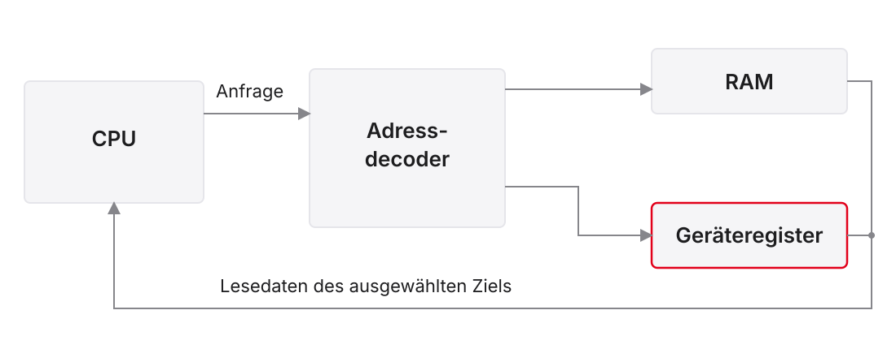{.nostretch fig-alt="Adresse und Zugriff wählen RAM oder Geräteregister, Lesedaten kommen vom ausgewählten Ziel zurück"}

::: notes
CPU bedeutet Central Processing Unit, die zentrale Verarbeitungseinheit. MMIO heißt Memory-Mapped I/O (Input/Output), Gerätezugriff über Adressen. RAM steht für Random Access Memory, hier der Arbeitsspeicher. Die Abbildung zeigt von links nach rechts eine Zugriffsanfrage aus Adresse, Lese- oder Schreibart und gegebenenfalls Schreibdaten. Der Adressdecoder wählt genau das passende Ziel: RAM oder Geräteregister. Die unteren orthogonalen Rückwege führen Lesedaten der jeweils gewählten Quelle zum Prozessor zurück.

Der Decoder ist kein Täuschungsmechanismus. Er implementiert die von der Plattform vorgesehene Zuordnung. Nicht jeder Speicherzugriff trifft RAM und nicht jede hohe Adresse ein Gerät. Der graue Pfad ist der normale Speicherweg; die rote Kontur hebt das Geräteregister hervor. Ein nicht zugeordneter oder unerlaubter Zugriff kann je nach Plattform eine Fehlerantwort erzeugen. Dass ein Zugriff im Datenpfad berechnet wurde, beweist noch keine gültige Wirkung am gewünschten Gerät.
:::

## Adressraum ist nicht eingebauter Speicher

$$2^{32}\,\mathrm{Byte}=4\,\mathrm{GiB}$$

- 32-Bit-Byteadressen benennen einen möglichen Adressraum
- Welche Bereiche vorhanden sind, legt die Plattform fest
- Gerätebereiche sind keine frei verfügbaren RAM-Arrays
- Zugriffstyp, Breite und Nebenwirkung gehören zur Registerkarte

::: notes
Eine Byteadresse identifiziert ein Byte. Bei 32 Adressbits gibt es $2^{32}$ mögliche Bytepositionen, also 4294967296 Byte oder vier Gibibyte, GiB. Ein GiB entspricht $2^{30}$ Byte und ist nicht identisch mit einem dezimalen Gigabyte. Daraus folgt weder, dass vier GiB Arbeitsspeicher eingebaut sind, noch dass alle Adressen zugreifbar sind.

RAM, Random Access Memory, ist hier gewöhnlicher Arbeitsspeicher. MMIO, Memory-Mapped I/O (Input/Output), bezeichnet dagegen Geräteregister im Adressraum. Eine Registerkarte beschreibt, welche Adressen existieren, ob sie lesbar oder schreibbar sind, welche Breite erlaubt ist und ob ein Zugriff etwas verändert. Manche Lesezugriffe quittieren ein Ereignis. Eine falsche Adresse landet deshalb nicht automatisch im Heap oder in RAM: Sie kann ein anderes Gerät, einen reservierten Bereich oder eine Fehlerreaktion treffen. Für die praktische Arbeit wird die Karte der tatsächlich angelegten Geräte verwendet.
:::

## Eine Karte lesen und Adressen rechnen

Didaktischer Ausschnitt, keine universellen Ripes-Adressen:

| Bereich / Register | Adresse | Vertrag |
|:---|:---|:---|
| Schalterwort | `0xF0000000` | Vier aktive High-Bits, lesen |
| Pixel 0 | `0xF0000020` | Farbwort, schreiben |
| Pixel 1 | `0xF0000024` | Farbwort, schreiben |
| Pixel 7 | `0xF000003C` | Letzter Pixel einer Zeile mit acht Zellen |

::: notes
Diese Adressen sind ausdrücklich ein Lehrbeispiel. In Ripes, dem visuellen RISC-V-Simulator, werden Basis, Größe und Symbole aus der angelegten Gerätekonfiguration gelesen. Aktiv High bedeutet, dass ein gesetztes Bit den aktiven Eingang repräsentiert. Für das Schalterwort verwenden wir vier Eingänge in den Bits 0 bis 3. Die Pixel werden hier mit vier Byte Abstand angeordnet.

Die Pixelbasis ist 0xF0000020. Pixel 1 liegt vier Byte weiter bei 0xF0000024. Pixel 7 liegt $7\cdot4=28$ Byte weiter bei 0xF000003C. Alle genannten Adressen sind wortausgerichtet. Ein Bytebereich von 32 Byte enthält bei vier Byte je Pixel acht Zellen. Die Adresse 0xF0000040 liegt unmittelbar dahinter und gehört nicht mehr zu dieser Matrix. Dieser Rechenweg nutzt die bekannte Array-Adressrechnung, ergänzt aber den Gerätevertrag statt gewöhnlicher Speicherzellen.
:::

## Auswahl aus oberen Adressbits

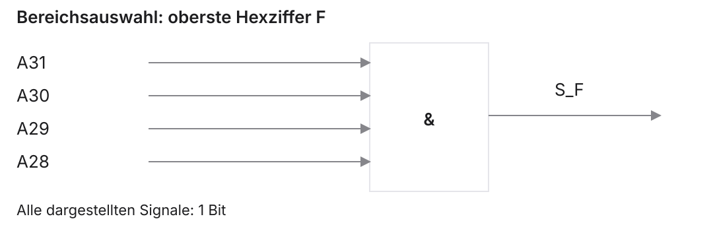{.nostretch fig-alt="Vier obere Adressbits werden mit einem rechteckigen UND-Gatter zur Auswahl des F-Bereichs verknüpft"}

$$S_F=A_{31}\land A_{30}\land A_{29}\land A_{28}$$

Die Auswahl erkennt einen Bereich; weitere Decodierung wählt das Gerät.

::: notes
$A_{31}$ bis $A_{28}$ sind die vier höchstwertigen Bits einer 32-Bit-Adresse. $S_F$ ist ein ein Bit breites Auswahlsignal für den Bereich mit oberster Hexziffer F. F entspricht dem Binärmuster 1111. Das UND, $\land$, ist deshalb genau dann eins, wenn alle vier Eingänge eins sind.

Die Abbildung liest sich von links nach rechts. Das rechteckige Gatter mit dem Zeichen & ist das UND-Symbol der im Kurs verwendeten IEC-Darstellung. IEC bezeichnet die International Electrotechnical Commission. Graue rechtwinklige Leitungen zeigen die vier ein Bit breiten Eingänge; der Ausgang ist ebenfalls ein Bit breit. Damit erkennt die Schaltung noch nicht die Schalteradresse oder den Zugriffstyp. Für 0xF0000000 und 0xF0000020 ist $S_F$ gleichermaßen eins; weitere Adressbits und Lese- oder Schreibsignale unterscheiden die Register. Der Decoder ist ein didaktischer Ausschnitt, keine vollständige Busimplementierung und kein Nachweis elektrischer Schlafzustände.
:::

## Schalterwort und Bitmaske

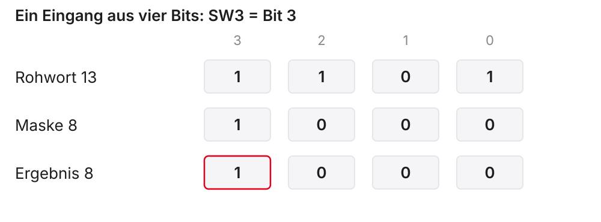{.nostretch fig-alt="Schalterwort 1101 und Maske 1000 ergeben 1000 für SW3"}

```asm
lw   t0, 0(s1)
andi t1, t0, 8
```

::: notes
lw, Load Word, liest das Schalterwort an der Basisadresse in s1 nach t0. andi, AND Immediate, verknüpft es bitweise mit der codierten Konstanten 8. s1 ist ein Basisregister, t0 und t1 sind temporäre Datenregister. Die Initialisierung von s1 ist im Ausschnitt bewusst vorausgesetzt.

Die Abbildung zeigt die unteren vier Bits. SW3 bedeutet Switch 3, den Eingang an Bitposition 3. Die Maske 8 ist binär 1000. Beim Rohwert 1101 sind SW3, SW2 und SW0 aktiv; das bitweise UND mit 1000 ergibt 1000, also 8. Das Ergebnis ist somit null oder acht, nicht automatisch null oder eins. Ein Vergleich mit ungleich null prüft den gewählten Eingang korrekt. Ein Vergleich des gesamten Rohworts mit acht würde beim zusätzlichen SW2 und SW0 dagegen scheitern. Ob die elektrische oder simulierte Aktivität tatsächlich durch eins angezeigt wird, muss der Gerätevertrag festlegen; hier gilt ausdrücklich aktiv High.
:::

## Aus Eingabebits wird ein Farbwort

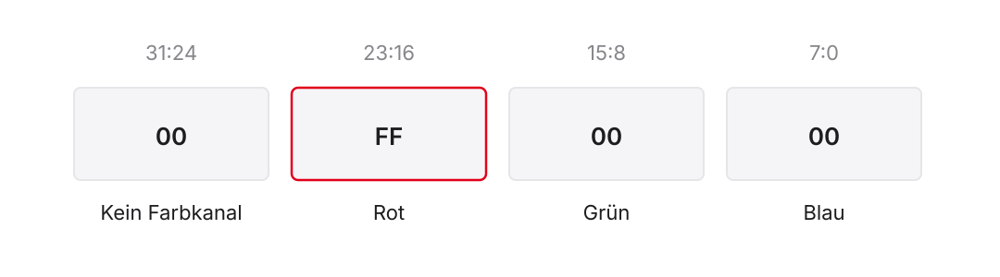{.nostretch fig-alt="Wort 00 FF 00 00 zerlegt in ungenutztes oberes Byte sowie Rot, Grün und Blau"}

- Modellformat: `0x00RRGGBB`
- Rot: `0x00FF0000`, Grün: `0x0000FF00`, Schwarz: `0`
- Maske 8 prüft SW3; sie ist selbst keine Farbe

::: notes
LED bedeutet Light Emitting Diode, eine Leuchtdiode. RGB bedeutet Red, Green, Blue, die drei Farbkanäle Rot, Grün und Blau. Im gelesenen Ripes-LED-Matrix-Quelltext werden je Pixel 24 Farbbits benutzt und die Zellen mit vier Byte Abstand adressiert. Wir schreiben ein 32-Bit-Wort und setzen das obere Byte auf null. Diese Zuordnung ist Gerätesemantik, keine RISC-V-Regel.

Die Abbildung zeigt das Wort 00 FF 00 00 nach absteigender Bitposition. Die Bytes stehen für das ungenutzte obere Byte sowie Rot, Grün und Blau. FF ist dezimal 255, die volle Intensität eines Acht-Bit-Kanals. Der Wert 0x00FF0000 bedeutet Rot und 0x0000FF00 Grün. Die Darstellung ist ein numerisches Wort, kein Beleg für die Byte-Reihenfolge im Speicher. Bei Little Endian würden die Bytes des roten Worts an aufsteigenden Adressen als 00 00 FF 00 liegen. SW3, Switch 3, wird mit der Maske acht geprüft; erst die anschließende Auswahl erzeugt ein geeignetes Farbwort.
:::

## Echo: Eingabe prüfen

Voraussetzung: exportierte Geräteadressen, mindestens vier Schalter.

```asm
li s1, SWITCHES_0_BASE
li s2, LED_MATRIX_0_BASE
loop:
    lw   t0, 0(s1)
    andi t1, t0, 8
    beq  t1, zero, off
```

::: notes
Das vollständige Lehrprogramm liegt in beispiele/vl8_sw3_rot.s. SWITCHES_0_BASE und LED_MATRIX_0_BASE sind die Basisadresssymbole der angelegten Ripes-Geräte; ihre Existenz und Werte werden im Export geprüft. LED bedeutet Light Emitting Diode, Leuchtdiode. li, Load Immediate, ist ein Pseudobefehl zum Laden einer Konstante, hier einer exportierten Adresse. Er kann mehrere Maschinenbefehle ergeben. s1 und s2 halten die Gerätebasen.

lw, Load Word, liest den aktuellen Schalterwert nach t0; andi, AND Immediate, isoliert Bit 3 nach t1. t0 und t1 sind temporäre Register. beq, Branch if Equal, springt zur Marke off, wenn das Maskenergebnis gleich zero, dem Nullregister x0, ist. loop und off sind Marken, keine zusätzlichen Instruktionen. Bei gesetztem Bit 3 geht die Ausführung in den Rot-Zweig der nächsten Folie. Alle übrigen Schalter bleiben für die Entscheidung unerheblich. Die beiden Folien zeigen zusammen eine dauerhafte Pegelanzeige, noch keine Ereigniszählung.
:::

## Echo: Beide Zustände schreiben

Fortsetzung des vorherigen Ausschnitts:

```asm
    li t2, 0x00FF0000
    j store
off:
    li t2, 0
store:
    sw t2, 0(s2)
    j loop
```

::: notes
li, Load Immediate, lädt hier das rote Farbwort beziehungsweise null nach t2. t2 ist ein temporäres Register für den auszugebenden Wert. j ist der Pseudobefehl für einen unbedingten Sprung ohne Rückkehrlink. sw, Store Word, schreibt das ausgewählte Wort in den ersten Pixel an der Basisadresse in s2. s2 ist das zuvor initialisierte Gerätebasisregister. off, store und loop sind Sprungmarken; die Fortsetzung gehört zur vorherigen Eingabeprüfung.

Ist Schalter 3 aktiv, setzt der obere Zweig t2 auf 0x00FF0000 und überspringt den Null-Zweig. Ist er inaktiv, gelangt die Ausführung direkt zu off und setzt t2 auf null. Beide Wege erreichen denselben Store. Dadurch wird eine zuvor rote Anzeige beim Ausschalten tatsächlich wieder schwarz. Ein Programm, das nur im aktiven Zweig schreibt, könnte dagegen den alten Ausgangszustand stehen lassen. Die beabsichtigte Endlosschleife wiederholt Lesen, Entscheidung und Schreiben. Ihre Geschwindigkeit ist ohne konkretes Zeitmodell keine gemessene Reaktionszeit.
:::

## Pixelindex, Bytegrenze und Lauflicht

Für acht Pixel mit Basis $B$:

$$A_i=B+4i,\qquad 0\leq i<8$$

- Offsets: 0, 4, 8, …, 28
- Bereichsgröße: 32 Byte, nächster Offset 32 ist außerhalb
- Vorigen Pixel löschen, sonst bleibt eine Spur
- Datei: `beispiele/vl8_lauflich.s`

::: notes
$B$ ist die Basisadresse, $i$ der gültige Pixelindex und $A_i$ die Adresse dieses Pixels. Jedes Register belegt im Modell einen vier Byte breiten Adressplatz. Acht Pixel benötigen daher 32 Byte. Der letzte erlaubte Offset ist 28; Offset 32 ist die exklusive Grenze und darf nicht geschrieben werden. LED bedeutet Light Emitting Diode, Leuchtdiode.

Das vorhandene Programm beispiele/vl8_lauflich.s legt eine grüne Anzeige als umlaufendes Lauflicht an. Es löscht zuerst alle acht Pixel, setzt dann einen Pixel grün, wartet in einer Zählschleife, löscht denselben Pixel und rückt um vier Byte weiter. Nach Offset 28 kehrt es zu null zurück. Es handelt sich nicht um ein Hin-und-her-Muster. Der Delay-Zähler wird pro Pixel neu geladen. 10000 Iterationen können im Simulator die Darstellung verlangsamen, belegen aber ohne Periode und Taktkosten keine feste Millisekundendauer. Die Datei setzt eine Matrix mit einer Zeile und acht Pixeln sowie den passenden Basisexport voraus.
:::

## Lesen kann einen Gerätezustand verändern

Beispiel eines Ereignisregisters:

1. Taste kurz drücken und vor der Abfrage loslassen
2. Gerät merkt das Ereignis
3. Lesen liefert eins und löscht die gespeicherte Meldung
4. Nächstes Lesen liefert ohne neues Ereignis null

Ein Pegelregister und ein Ereignisregister sind unterschiedliche Verträge.

::: notes
Ein Pegelregister zeigt den gegenwärtigen Zustand; ein Ereignisregister kann eine zwischenzeitliche Änderung speichern. Read to clear bedeutet, dass das Lesen eine gespeicherte Meldung löscht. Deshalb darf man einen Gerätezugriff nicht allgemein durch wiederholtes Lesen gewöhnlichen RAMs ersetzen. RAM heißt Random Access Memory, hier Arbeitsspeicher.

Der gelesene Ripes-D-Pad-Quelltext enthält aktuell eine Druckspeicherung: Eine Richtung liefert eins, wenn sie gerade gehalten wird oder seit der letzten Lesung gedrückt wurde. Die Lesung löscht die gespeicherte Druckmeldung; ein weiterhin gehaltener Pegel bleibt dennoch eins. D-Pad bedeutet Directional Pad, eine Richtungstastensteuerung. Es verwendet getrennte Register für die Richtungen. Diese Quellenprüfung beweist nicht dieselbe Eigenschaft jeder installierten Ripes-Version. Im Labor sind Registerkarte und Versionsverhalten maßgeblich. Für die späteren Pegel- und Entprellaufgaben vereinbaren wir deshalb ausdrücklich ein reines Pegelregister ohne Lese-Nebenwirkung.
:::

## C: Wiederholte Zugriffe sichtbar machen

Lehrausschnitt, Adresse nur unter passendem Gerätevertrag:

```c
#include <stdint.h>
void wait_sw3(void) {
    volatile uint32_t * const switches =
        (volatile uint32_t *)0xF0000000u;
    while ((*switches & 8u) == 0u) { }
}
```

::: notes
C ist hier die Programmiersprache. wait_sw3 ist eine Funktion ohne Parameter und Rückgabewert; sie kehrt erst beim erkannten aktiven Eingang zurück. stdint.h liefert uint32_t, einen vorzeichenlosen Ganzzahltyp mit genau 32 Bit, sofern die Zielimplementierung ihn bereitstellt. switches ist ein konstanter Zeiger auf ein volatile-qualifiziertes Datenobjekt. const betrifft hier den Zeigerwert, volatile den angesprochenen Registerzugriff. Die feste Adresse ist ausschließlich eine didaktische Plattformannahme; Integer-zu-Zeiger-Abbildung und zulässige Zugriffbreite müssen zur Zielumgebung passen.

Der Ausdruck *switches liest das Gerätewort, das bitweise UND mit 8u prüft Bit 3. u kennzeichnet vorzeichenlose Konstanten. Solange das ausgewählte Bit null ist, wird die Schleife wiederholt. volatile verpflichtet den Compiler, die vorgesehenen beobachtbaren Zugriffe gemäß seiner Zieldefinition auszuführen; er darf die Abfrage nicht einfach als unveränderlichen gewöhnlichen Speicherwert behandeln. Ohne volatile kann eine Optimierung wiederholte Loads zusammenfassen oder aus der Schleife ziehen. Das ist eine Möglichkeit, kein Beleg für einen bestimmten Compilerlauf und nicht ausschließlich eine Eigenschaft einer einzelnen Optimierungsoption.
:::

## volatile ersetzt keinen vollständigen Hardwarevertrag

| Ebene | Benötigte Regel |
|:---|:---|
| Compiler | Vorgesehene Gerätezugriffe tatsächlich ausführen |
| Speicherpfad | Passende Attribute, Breiten und Ordnung |
| Gerät | Bedeutung und Nebenwirkung jedes Zugriffs |

volatile ist keine allgemeine Cache-Abschaltung, Sperre oder Speicherbarriere.

::: notes
volatile ist ein Qualifizierer der Sprache C. Er betrifft die vom Compiler erzeugten beobachtbaren Zugriffe. Ein Hardware-Cache speichert dagegen Daten im Speicherpfad. Ob ein Gerätebereich dort geeignet behandelt wird, entscheiden Speicherattribute und die konkrete Plattform. Eine volatile-Deklaration schaltet einen Hardware-Cache nicht automatisch aus.

MMIO bedeutet Memory-Mapped I/O (Input/Output), Zugriff auf Geräte über Speicheradressen. Die Reihenfolge mehrerer solcher Zugriffe kann zusätzliche Plattformregeln oder einen Fence, eine Ordnungsanweisung, benötigen. Diese Einheit implementiert keine solche Barriere für eine unbekannte Plattform. Auch Atomarität und Kommunikation zwischen Kernen sind eigene Fragen. Umgekehrt ist ein Geräteregister nicht immer spontan veränderlich: Ein Konfigurationsregister kann einen geschriebenen Wert halten, während ein Statusregister sich ohne Prozessorstore ändert. Gemeinsam benötigen sie einen Gerätevertrag. Ein ausgeführtes lw ist deshalb nicht in jedem beliebigen System automatisch ein sichtbar neuer externer Buszyklus.
:::

## Kurzaufgabe: Adresse, Maske oder Datenwort?

Im vereinbarten Schalter-Pixel-Modell:

- Rohwort `0b0101`, Maske `8`
- Pixelbasis `0xF0000020`, Index `3`
- Welcher Wert wird an welche Adresse geschrieben?
- Was ändert sich bei Rohwort `0b1101`?

::: notes
Das Rohwort ist der gelesene Eingabewert. Die Maske acht wählt Bit 3; MMIO bedeutet Memory-Mapped I/O (Input/Output), Gerätezugriff über Adressen. Für 0101 ergibt das bitweise UND mit 1000 null. Schalter 3 ist inaktiv, also wird das Farbwort null geschrieben. Index 3 liegt $3\cdot4=12$ Byte hinter der Pixelbasis, daher an 0xF000002C.

Bei Rohwort 1101 ergibt dieselbe Maske acht. Der Eingang ist aktiv und das gewählte Farbwort ist 0x00FF0000, Rot. Die Adresse bleibt 0xF000002C. Der ausgewählte Eingangsbitwert acht ist weder diese Adresse noch schon das rote Farbwort. Auch die Basis darf nicht mit dem Offset zwölf verwechselt werden. Diese vier getrennten Größen sind ein typischer Klausurfall: Eingabewort, Maskenergebnis, effektive Adresse und Ausgabeinhalt. Die Rechnung verwendet ausdrücklich den didaktischen Gerätevertrag, nicht eine behauptete installierte Ripes-Konfiguration.
:::

# 2. Abfragen, Ereignisse und Unterbrechungen

::: notes
Der Gerätezugriff ist jetzt bekannt. Die neue Frage ist, wie oft er stattfinden soll und ob ein Pegel eine dauerhafte Anzeige oder ein einmaliges Ereignis auslösen soll. Eine LED kann solange rot sein, wie ein Eingang aktiv ist. Ein Zähler soll denselben gehaltenen Druck dagegen nur einmal zählen. LED bedeutet Light Emitting Diode, Leuchtdiode.

Polling ist die programmgesteuerte Abfrage. Busy Waiting bedeutet, dass ein Programm während des Wartens ständig prüft. Ein Interrupt meldet eine Unterbrechungsanforderung unabhängig vom gerade bearbeiteten Befehl. Keiner dieser Begriffe ersetzt die Entprellung eines realen Kontakts. Wir trennen zunächst die Abfragezeit von der Ereigniserkennung und klären danach, welchen Kontrollübergang ein Interrupt benötigt.
:::

## Periodisches Polling und eine kurze Eingabe

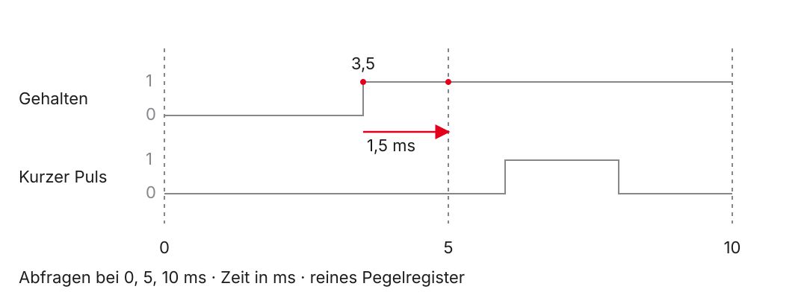{.nostretch fig-alt="Abfragen bei 0, 5 und 10 ms erkennen einen gehaltenen Pegel, können einen kurzen Puls zwischen zwei Abfragen aber verpassen"}

::: notes
Die horizontale Achse zeigt die Zeit in Millisekunden, ms. Die Abfragen liegen bei 0, 5 und 10 ms. Die erste Signalzeile zeigt einen Pegel, der bei 3,5 ms aktiv wird und bestehen bleibt. Die Abfrage bei 5 ms erkennt ihn. Die Verzögerung bis zum Erkennen beträgt im Diagramm 1,5 ms. Rote Markierungen kennzeichnen den Ereignisbeginn und die erste passende Abfrage.

Die zweite Zeile zeigt einen kurzen aktiven Puls zwischen 6 und 8 ms. Ein reines Pegelregister ist bei beiden benachbarten Abfragen, 5 und 10 ms, null. Der Puls kann daher vollständig übersehen werden. Periodisches Polling ist trotzdem kein grundsätzlicher Fehler: Es kann zwischen anderer Arbeit stattfinden und bei genügend langen Zuständen ausreichen. Eine Geräte-Ereignisspeicherung oder andere Benachrichtigung wäre für solche kurzen Pulse nötig. Diese Folie nimmt bewusst ein Pegelregister ohne Speichern und ohne Lese-Nebenwirkungen an. Sie ist keine Behauptung über den vorher besprochenen Ripes-D-Pad.
:::

## Abfragekosten und Reaktionszeit berechnen

Didaktische Annahmen:

- Alle $5\,\mathrm{ms}$ eine Abfrage mit $100$ Takten
- Frequenz $10\,\mathrm{MHz}$, keine zusätzlichen Wartezeiten

$$t_\mathrm{Abfrage}=\frac{100}{10^7}\,\mathrm{s}=10\,\mathrm{\mu s}$$

$$\mathrm{Zeitanteil}=\frac{10\,\mathrm{\mu s}}{5\,\mathrm{ms}}=0{,}2\,\%$$

::: notes
Die Frequenz beträgt zehn Megahertz, MHz, also zehn Millionen Takte je Sekunde. Eine Mikrosekunde, $\mu s$, ist $10^{-6}$ Sekunden; eine Millisekunde, ms, ist $10^{-3}$ Sekunden. Hundert Takte je Abfrage ergeben $100/10^7$ Sekunden oder zehn Mikrosekunden. Eine Abfrage alle fünf Millisekunden benötigt bei diesen Annahmen zehn Mikrosekunden von fünftausend Mikrosekunden, also 0,002 oder 0,2 Prozent der Prozessorzeit.

Die übrige Zeit kann das Programm andere Arbeit erledigen. Das ist periodisches Polling, nicht ununterbrochenes Busy Waiting. Ein bestehen bleibendes Ereignis kann bis ungefähr eine Abfrageperiode auf die nächste Prüfung warten; anschließend kommen Verarbeitungskosten hinzu. Ein kurzer Pegel kann trotzdem verpasst werden. Die Zahlen enthalten bereits alle angenommenen Taktkosten des Abfrageabschnitts. Reale Unterbrechungen, längere Speicherantworten und ein verzögerter Aufruf würden die Zeiten verändern. Eine bloße Schleifenanzahl ohne Frequenz und Taktkosten hätte diese Aussage nicht erlaubt.
:::

## Ein gehaltener Druck soll nur einmal zählen

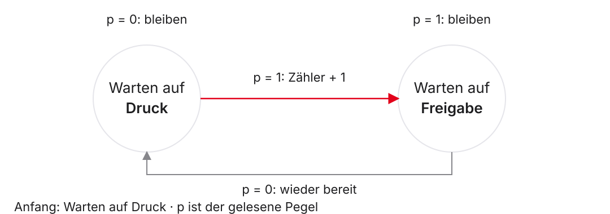{.nostretch fig-alt="Zwei Zustände warten auf Druck und Freigabe, nur der Übergang zum Druck erhöht den Zähler"}

::: notes
Die Abbildung ist ein Zustandsdiagramm für einen binären Pegel p. Null bedeutet freigegeben, eins gedrückt. Anfangszustand ist Warten auf Druck. Sobald dort p gleich eins beobachtet wird, steigt der Ereigniszähler genau einmal und die Erkennung wechselt nach Warten auf Freigabe. Solange der Pegel eins bleibt, wird nicht nochmals gezählt. Erst p gleich null stellt die Bereitschaft für einen neuen Druck her.

Die Kreise repräsentieren Softwarezustände, die gerichteten orthogonalen Pfeile deren Übergänge. Rot hebt den einzigen zählenden Übergang hervor; Randnotizen zeigen das Halten im jeweiligen Zustand. Für die Folge 0, 0, 1, 1, 1, 0, 0, 1, 0 entstehen zwei Ereignisse. Die Erkennung löst das Mehrfachzählen eines gehaltenen Pegels, aber nicht das Prellen. Eine Folge 0, 1, 0, 1 kann zweimal zählen, obwohl sie von nur einem mechanischen Druck stammt. Die Aufgabe setzt ein reines Pegelregister voraus; ein gespeichertes Ereignisregister benötigt einen eigenen passenden Ablauf.
:::

## Entprellen ist eine zusätzliche Filteraufgabe

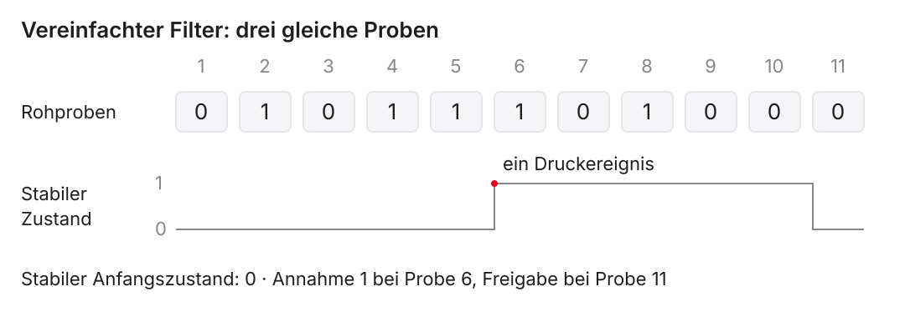{.nostretch fig-alt="Elf Rohproben werden mit drei gleichen Proben zur stabilen Zustandsänderung gefiltert"}

Vereinfachtes Abtastmodell: Erst drei aufeinanderfolgende gleiche
Proben ändern den angenommenen stabilen Zustand.

::: notes
Mechanisches Prellen ist das schnelle wiederholte Öffnen und Schließen eines Kontakts. Debouncing, Entprellen, soll solche Zwischenwechsel von einer beabsichtigten stabilen Betätigung unterscheiden. Die Abbildung zeigt elf diskrete Proben, kein gemessenes analoges Signal. Die Rohfolge lautet 0, 1, 0, 1, 1, 1, 0, 1, 0, 0, 0. Der angenommene stabile Anfangszustand ist null.

Im vereinfachten Filter zählt eine Serie gleicher Proben. Bei jeder abweichenden Probe beginnt die Serie neu. Nach den drei Einsen an Position 4 bis 6 wird der stabile Zustand bei Probe 6 eins; dabei entsteht ein Druckereignis. Die kurzen Wechsel danach reichen nicht zum Umschalten. Erst die drei Nullen an Position 9 bis 11 setzen ihn bei Probe 11 zurück. Ein bloßer Druck-Freigabe-Zähler sähe dagegen drei Druckereignisse. Rot markiert die akzeptierte steigende Änderung. Bei einer Millisekunde Probenabstand liegen erste und dritte Probe einer Serie zwei Millisekunden auseinander; daraus folgt kein garantiert durchgehend stabiler mechanischer Pegel. Ein echtes Zeitfenster und die Abtastrate müssen zur Hardware passen.
:::

## Was eine Interrupt-Anforderung zusätzlich braucht

- Gerät oder Controller meldet eine anstehende Anforderung
- Prozessor prüft Quelle, Freigaben und Priorität
- Handler bearbeitet und gegebenenfalls quittiert die Ursache
- Zwischen Ereignis und Behandlung liegt eine Latenz
- Ein Interrupt ersetzt weder Gerätevertrag noch Entprellung

::: notes
Interrupt Request, kurz IRQ, heißt Unterbrechungsanforderung. Sie kann als Pegel, Flanke, interner Timerzustand oder Meldung eines Controllers entstehen. Der Prozessor muss unter den jeweiligen Freigabe- und Prioritätsregeln entscheiden, ob er sie annimmt. Ein Handler ist die Behandlungsroutine. Quittieren heißt, die anstehende Ursache gemäß dem Gerätevertrag zu bearbeiten oder ihre Meldung zurückzusetzen.

Ein Interrupt kann andere Arbeit unterbrechen; Schlafen ist keine Voraussetzung. Dadurch entsteht auch keine automatische Zusage für Energieersparnis oder sofortige Reaktion. Eine weiter anstehende Ursache kann nach der Rückkehr erneut gemeldet werden. Polling und Interrupt sind daher Entwurfsalternativen mit unterschiedlichen Kosten und Reaktionsbedingungen. Für die Ripes-Schalteraufgabe wird kein tatsächlich vorhandener IRQ-Pfad behauptet. Das folgende privilegierte Papiermodell erklärt einen angenommenen Interrupt, unabhängig vom Geräteversuch.
:::

# 3. Traps und privilegierter Zustand

::: notes
Ein Trap ist ein architektonischer Kontrollübergang aufgrund einer Exception oder eines Interrupts. Exception bezeichnet eine synchrone, einem Befehl zugeordnete Ausnahme. Ein Interrupt ist relativ zum betrachteten Befehlsstrom asynchron. Nicht jeder Trap ist ein Fehler: ecall, Environment Call, fordert absichtlich einen Dienst der Ausführungsumgebung an.

Jetzt erklären wir, welche Informationen beim Übergang erhalten werden und welche Aufgaben bei der Software verbleiben. Dieser Teil ist ein benanntes privilegiertes Lehrmodell. Die Sichtbarkeit einer LED, Light Emitting Diode oder Leuchtdiode, oder einer Venus-Konsolenausgabe beweist keinen solchen Hardwareeintritt. Die Trennung erlaubt uns, mit bekannten Register- und Stackkenntnissen sichere Fortsetzung herzuleiten, ohne einen vollständigen Kernel vorauszusetzen.
:::

## Exception und Interrupt am Befehlsstrom erkennen

| Fall | Bezug zum Programm | Beispiel |
|:---|:---|:---|
| Exception | Auslösende Instruktion | `ecall`, unerlaubte Instruktion |
| Interrupt | Asynchroner Anlass | Timer- oder externe Anforderung |
| Branch / Funktionssprung | Gewöhnlicher Befehlsfluss | `beq`, `jal` |

::: notes
ecall, Environment Call, löst eine synchrone Exception aus. Eine unerlaubte Instruktion oder ein unzulässiger privilegierter Registerzugriff kann ebenfalls eine Exception verursachen. Ein Interrupt ist gegenüber dem normalen Befehlsstrom asynchron; auch ein im Prozessor integrierter Timer kann ihn auslösen. Die Unterscheidung lautet deshalb nicht einfach intern gegen extern.

beq, Branch if Equal, ist ein gewöhnlicher bedingter Sprung. jal, Jump and Link, ist ein gewöhnlicher Sprung mit Rückkehrlink, etwa für einen Funktionsaufruf. Sie erzeugen durch ihre reguläre Wirkung keinen Trap. Auch nicht jeder Rechen-Sonderfall ist eine Exception: Ganzzahlüberlauf in RV32I, dem 32-Bit-Ganzzahlbefehlssatz, setzt kein Überlaufflag und löst keinen Trap aus. Ein Nullzeigerzugriff in C hat undefiniertes Verhalten und ist kein garantierter Hardware-Access-Fault. Für die folgenden Rechnungen verwenden wir nur die ausdrücklich genannten architektonischen Fälle.
:::

## Modellgrenzen dieses Trap-Teils

- RV32 mit Machine Mode M und User Mode U
- Traps gehen nach M, keine Delegation an einen anderen Modus
- Grundmodell: `mtvec` im Direct-Modus
- Gültiger ausgerichteter Stack; keine verschachtelten Traps
- Kein implementierter Interruptcontroller und kein Simulator-Handler

::: notes
RV32 bezeichnet ein RISC-V-Modell mit 32-Bit-Registerbreite. Machine Mode, M, ist die privilegierte Maschinenstufe. User Mode, U, ist eine eingeschränkte Anwendungsstufe. Wir nehmen beide als vorhanden an. Kleine Systeme können nur M implementieren. Die besprochenen Traps werden nicht an eine andere Privilegienstufe delegiert. mtvec bedeutet Machine Trap-Vector Base Address, das Register für Handlerbasis und Einsprungmodus. Direct wählt für alle betrachteten M-Traps dieselbe Basis.

Die Software hat einen gültigen Stack, dessen Zeiger sp, Stack Pointer, vor dem isolierten Handlerausschnitt auf 16 Byte ausgerichtet ist. Im Handler werden keine weiteren maskierbaren Interrupts freigegeben; verschachtelte Ausnahmen werden im Beispiel ausgeschlossen. Ein realer Übergang aus U könnte einen eigenen vertrauenswürdigen Handlerstack benötigen. Diese zusätzliche Einrichtung ist hier nicht implementiert. Die Modelle dienen zur Erklärung und Papierarbeit, nicht als vollständiger Bootcode für Ripes oder Venus.
:::

## Privilegienstufen und Rechte

| Modus | Rolle im Kurs |
|:---|:---|
| M — Machine | Firmware und unser Trap-Modell |
| S — Supervisor | Einordnung größerer Betriebssysteme |
| U — User | Eingeschränkte Anwendungen |

Ein Modusname allein legt keine vollständige MMIO-Speicherschutzkarte fest.

::: notes
M bedeutet Machine Mode, S Supervisor Mode und U User Mode. M ist die grundlegende höchste Privilegienstufe; S und U sind nicht in jedem kleinen RISC-V-System vorhanden. Firmware ist hier die hardwarenahe Systemsoftware. Größere Betriebssysteme können einen Supervisor-Kernel, also privilegierten Systemkern, nutzen. Unser ausführlich gerechneter Handler arbeitet dagegen in M.

CSR bedeutet Control and Status Register, Kontroll- und Statusregister. Zugriff und schreibbare Werte hängen vom jeweiligen CSR und den Rechten ab. M-Rechte erlauben nicht, beliebig in nicht vorhandene oder nur lesbare Register zu schreiben. Ein unerlaubter Zugriff kann eine Illegal-Instruction-Exception auslösen. MMIO heißt Memory-Mapped I/O (Input/Output). Dass ein Programm in U läuft, sperrt Gerätebereiche nicht allein durch diese Bezeichnung; passende Speicherschutz- oder Übersetzungsregeln müssen eingerichtet sein. Diese Einheit erklärt die Rollen, implementiert aber kein Linux-System und keine vollständige Schutzkarte.
:::

## CSRs haben einen eigenen Zugriff

| Integerregister | MMIO-Register | CSR |
|:---|:---|:---|
| `x0`–`x31` | Geräteadresse | CSR-Kennung |
| Rechenbefehle | Passende `lw` / `sw` | Zicsr-Befehle |
| Programmdaten | Gerätedaten / Status | Prozessorsteuerung / Status |

::: notes
CSR bedeutet Control and Status Register, Kontroll- und Statusregister. CSRs sind nicht weitere Nummern der Integerregisterbank und keine gewöhnlichen Speicheradressen. Ein zwölf Bit breiter CSR-Spezifikator kann 4096 Kennungen bezeichnen; daraus folgt nicht, dass 4096 Register implementiert sind. Zicsr bezeichnet die RISC-V-Erweiterung mit den CSR-Zugriffsbefehlen. Sie wird zusätzlich zur Ganzzahlbasis betrachtet.

MMIO heißt Memory-Mapped I/O (Input/Output). lw, Load Word, und sw, Store Word, erreichen hier Geräte über eine effektive Speicheradresse, nicht über eine CSR-Kennung. Die Integerregister x0 bis x31 halten Programmdaten, wobei x0 fest null liefert. Ein Trap speichert Steuerinformationen in ausgewählten CSRs, erstellt aber keine automatische Kopie aller Integerregister. Diese Unterscheidung erklärt, weshalb der Handler später selbst seine veränderten Programmdaten sichern muss. Ein zulässiges CSR kann auch für weniger privilegierten Code lesbar sein; nicht alle sind pauschal unsichtbar.
:::

## Vier Register erklären den Trap-Ablauf

| Register | Benötigte Information |
|:---|:---|
| `mtvec` | Wohin geht der Handler? |
| `mepc` | Wo soll die Ausführung fortgesetzt werden? |
| `mcause` | Warum erfolgte der Übergang? |
| `mstatus` | Welche Freigaben und bisherigen Rechte gelten? |

::: notes
CSR heißt Control and Status Register, Kontroll- und Statusregister. mtvec, Machine Trap-Vector Base Address, speichert Handlerbasis und Modus. mepc, Machine Exception Program Counter, speichert die relevante Fortsetzungs- oder auslösende Befehlsadresse. mcause, Machine Trap Cause, enthält Interruptkennzeichen und Ursache. mstatus, Machine Status, enthält unter anderem Freigaben und gespeicherten vorherigen Privilegienstaat.

Die vier Register beantworten verschiedene Fragen. Eine Dienstnummer wie Print Integer ist kein mcause-Code. Die gerade im Fetch verwendete Adresse ist nicht automatisch die richtige mepc-Adresse. Die Schreibwirkung auf diese CSRs rettet auch nicht t0 oder a0. Wir werden deshalb zuerst Ziel und Ursache decodieren, dann Freigaben und Eintritt verfolgen und schließlich die zusätzliche Kontextrettung erläutern. Einzelne Registerfelder können nur bestimmte Werte erlauben; die hier verwendeten Werte sind als unterstützt angenommen.
:::

## mtvec: Basisadresse und Einsprungmodus

$$\mathrm{BASE}=\mathrm{mtvec}\land_{\mathrm{bit}} \mathtt{0xFFFFFFFC}$$

| Beispielwert | Modus | Einsprung |
|:---|:---|:---|
| `0x00000100` | Direct | `0x100` |
| `0x00000101` | Vectored | Exception: `0x100` |
| `0x00000101` | Vectored | Interrupt: Basis plus viermal Ursachencode |

::: notes
mtvec bedeutet Machine Trap-Vector Base Address. Die beiden niedrigsten Bits geben den Modus an: 00 für Direct, 01 für Vectored. BASE ist die Basisadresse mit diesen Modusbits entfernt. Die Formel verwendet ausdrücklich bitweises UND, $\land_{\mathrm{bit}}$, mit 0xFFFFFFFC, nicht eine logische Aussage über zwei Wahrheitswerte. Die Basis ist mindestens auf vier Byte ausgerichtet; eine Implementierung kann im Vectored-Modus strengere Ausrichtung verlangen.

Im Direct-Modus führen alle betrachteten Traps nach BASE. Im Vectored-Modus führen synchrone Exceptions weiterhin nach BASE, Interrupts dagegen nach $\mathrm{BASE}+4\cdot\mathrm{Ursachencode}$. Bei Interruptcode elf und dem als unterstützt angenommenen Wert 0x101 wäre das $0x100+44=0x12C$. Nicht der vollständige Registerinhalt 0x101 wird blind in den Program Counter, PC, kopiert. Für die weiteren Hauptbeispiele bleibt Direct vereinbart. Vectored ist eine kleine begrenzte Vertiefung, kein nachgewiesenes Simulatorfeature.
:::

## mcause: Kennzeichen vor Ursachencode

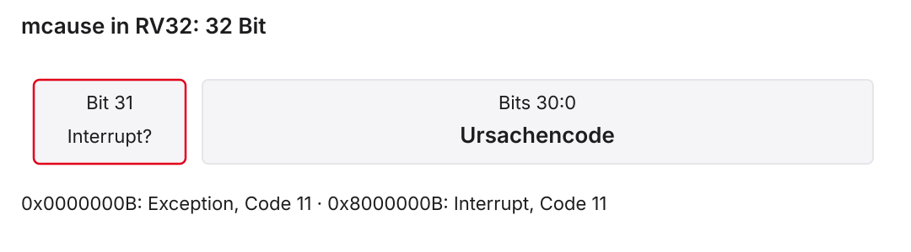{.nostretch fig-alt="RV32-mcause trennt Bit 31 für Interrupt von den 31 Bits des Ursachencodes"}

- `0x00000008`: Environment Call aus U
- `0x0000000B`: Environment Call aus M
- `0x8000000B`: Machine External Interrupt

::: notes
mcause bedeutet Machine Trap Cause. In RV32, der 32-Bit-Variante, ist Bit 31 das Interruptkennzeichen. Die übrigen Bits bilden den Ursachencode. Die Abbildung liest sich von hoher zu niedriger Bitposition: Das rot umrandete einzelne Bit links trennt Interrupt und synchrone Exception, der breite graue Bereich rechts enthält den Code. Das Zeichen U steht für User Mode, M für Machine Mode.

0x00000008 hat kein Interruptbit und Code acht: Environment Call, ecall, aus U. 0x0000000B hat ebenfalls kein Interruptbit, aber Code elf: ecall aus M. 0x8000000B hat Bit 31 gesetzt und denselben niedrigen Code elf: ein Machine External Interrupt. Die Art und der Code müssen gemeinsam ausgewertet werden. Der External Interrupt kennzeichnet noch nicht das konkrete Gerät; dafür kann ein Controllervertrag weitere Informationen liefern. Die Dienstkennung für eine Konsolenausgabe steht dagegen nach dem Softwarevertrag in einem Integerregister und ist keine Trap-Ursache.
:::

## mepc: Fortsetzen, erneut versuchen oder überspringen?

| Anlass | Bedeutung / Behandlung |
|:---|:---|
| Interrupt | Gespeicherte Fortsetzungsadresse verwenden |
| Behebbarer Fehler | Auslösende Instruktion gegebenenfalls erneut versuchen |
| Bewusst bearbeiteter 32-Bit-`ecall` | Nach dem Dienst auf nächste Instruktion setzen |

Kein pauschales `mepc += 4` für alle Traps.

::: notes
mepc bedeutet Machine Exception Program Counter. Bei einer synchronen Exception zeigt es auf die auslösende Instruktion. Der Handler muss entscheiden, ob sie nach Behebung erneut ausgeführt, bewusst übersprungen oder die Ausführung beendet wird. Bei einem angenommenen Interrupt enthält mepc die geeignete Fortsetzungsadresse; dort ist kein allgemeines Überspringen erforderlich.

ecall, Environment Call, ist selbst eine 32-Bit-Instruktion. Ist der Dienst in unserem Modell vollständig bearbeitet und soll er nicht erneut angefordert werden, erhöht der Handler ihre Adresse um vier Byte. Ein ecall an 0x00400040 setzt die Fortsetzung dann auf 0x00400044. Ein Interrupt mit mepc gleich 0x00400040 kehrt hingegen zu 0x00400040 zurück. Dass andere RISC-V-Instruktionen in einer C-Erweiterung komprimiert sein könnten, rechtfertigt kein pauschales vier Byte für beliebige fehlerhafte Befehle; ecall selbst bleibt 32 Bit. Venus-Konsolendienste stellen die Fortsetzung intern bereit und belegen dadurch keine sichtbare mepc-Implementierung.
:::

## mstatus: Freigabe und gespeicherter Zustand

| Feld | Bits im RV32-Grundmodell | Funktion |
|:---|:---:|:---|
| MIE | 3 | Machine-Interrupt-Freigabe |
| MPIE | 7 | Gespeicherte bisherige Freigabe |
| MPP | 12:11 | Gespeicherter bisheriger Modus |

U wird als 0, M als 3 codiert. Andere Statusfelder bleiben außerhalb der Rechnung.

::: notes
mstatus heißt Machine Status. MIE ist Machine Interrupt Enable, die globale Freigabe maskierbarer Machine-Interrupts beim laufenden M-Programm, in Bit 3. MPIE ist Machine Previous Interrupt Enable, die gespeicherte vorherige Freigabe, in Bit 7. MPP ist Machine Previous Privilege, der gespeicherte vorherige Modus, in den beiden Bits 12 und 11. M bedeutet Machine Mode und U User Mode. Im angenommenen M/U-System ist U mit null und M mit drei codiert.

Eine Maske für MIE ist $2^3=8$, für MPIE $2^7=128$. Der reine MPP-Feldanteil für M wäre $3\cdot2^{11}=6144$, hexadezimal 0x1800. Diese einzelnen Felder beschreiben nicht den gesamten mstatus-Inhalt. Beispielsweise enthält 0x80 im isolierten Bitbeispiel MPIE gleich eins und MIE gleich null. Das Setzen von MIE unter Erhaltung der übrigen Bits ergibt 0x88. Der aktuelle Modus ist außerdem eigener Prozessorzustand und darf nicht einfach aus dem gerade gespeicherten MPP-Feld abgelesen werden. Diese Trennung wird beim Eintritt und bei mret, Machine Return, wichtig.
:::

## Freigabebit setzen, übrigen Status erhalten

```asm
li    t1, 8
csrrs x0, mstatus, t1
```

- MIE ist Bit 3, Maske acht
- `csrrs` setzt die maskierten schreibbaren Bits
- `csrw mstatus, t1` wäre ein ganzer Register-Schreibversuch

::: notes
mstatus bedeutet Machine Status. MIE bedeutet Machine Interrupt Enable, die globale Freigabe maskierbarer Machine-Interrupts bei Ausführung in M. Es liegt in Bit 3; die Maske ist deshalb $2^3=8$. t1 ist ein temporäres Register für die Maske. li, Load Immediate, ist ein Pseudobefehl. csrrs heißt Control and Status Register Read and Set: Der bisherige CSR-Wert wird gelesen und die durch die Quelle gesetzten Bits werden im schreibbaren Registerzustand gesetzt. x0 verwirft hier den gelesenen alten Wert.

csrw ist eine Pseudoinstruktion für einen ganzen CSR-Schreibversuch über csrrw, Read and Write. Würde man mstatus mit acht oder gar eins ersetzen, würden andere schreibbare Statusfelder verändert; eins setzt nicht MIE. csrrc, Read and Clear, löscht entsprechend maskierte Bits. Eine CSR-Instruktion verbindet den Zugriff ohne eine Lücke zwischen getrennten Lese- und Schreibbefehlen, ersetzt aber keine allgemeine Mehrkernsperre oder Speicherbarriere. Vor einer Freigabe müssen Zielroutine und Quelle korrekt eingerichtet sein.
:::

## Wann wird ein maskierbarer M-Interrupt angenommen?

Für unser Programm, das gerade in M läuft:

$$\mathrm{Annahme}=P\land E\land\mathrm{MIE}$$

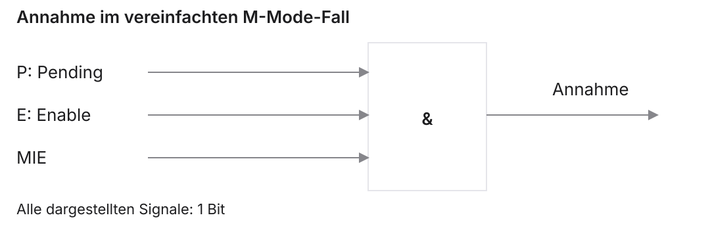{.nostretch fig-alt="Pending, Quellenfreigabe und MIE führen im vereinfachten M-Mode-Modell über ein UND-Gatter zur Annahme"}

::: notes
M heißt Machine Mode, die privilegierte Maschinenstufe. P ist die anstehende Meldung der betrachteten Interruptquelle, Pending. E ist deren einzelne Freigabe, Enable. MIE, Machine Interrupt Enable, ist die globale Freigabe in mstatus, Machine Status. Das UND, $\land$, verlangt im vereinfachten Fall alle drei Bedingungen. Die Abbildung zeigt ein rechteckiges IEC-UND-Gatter; IEC steht für International Electrotechnical Commission. Alle dargestellten Leitungen sind ein Bit breit.

Die Formel setzt ausdrücklich voraus, dass wir bereits in M laufen, die Quelle nach M gerichtet und die weitere Prioritätsentscheidung geklärt ist. Für niedrigere Privilegienstufen und Delegation gelten zusätzliche Regeln; dort ist diese Formel keine vollständige allgemeine Aussage. MIE gleich eins allein genügt also nicht. MIE gleich null verhindert im betrachteten M-Fall den maskierbaren Interrupt, aber keine synchronen Exceptions wie ecall, Environment Call. Ein anstehender Interrupt kann bis zur Freigabe warten; ob das Gerät eine Meldung speichert, gehört wiederum zum Quellenvertrag.
:::

## Hardwareeintritt: Was wird gespeichert?

Bei einem angenommenen Trap nach M:

- Fortsetzungs- oder Befehlsadresse nach `mepc`
- Art und Ursache nach `mcause`
- Bisheriges MIE nach MPIE, MIE auf null
- Bisheriger Modus nach MPP, aktueller Modus nach M
- Einsprung nach der `mtvec`-Regel

::: notes
M ist Machine Mode. mepc heißt Machine Exception Program Counter, das Register für die relevante Befehlsadresse. mcause heißt Machine Trap Cause, für Art und Ursache. mstatus, Machine Status, enthält MIE, Machine Interrupt Enable, sowie MPIE, Machine Previous Interrupt Enable, und MPP, Machine Previous Privilege. MPIE speichert den bisherigen Freigabewert und MPP die bisherigen Rechte. mtvec, Machine Trap-Vector Base Address, legt Basis und Einsprungmodus fest.

Die Hardware übernimmt beim betrachteten Eintritt die genannten Informationen. Sie setzt MIE auf null, wechselt nach M und wählt das Handlerziel. Dadurch werden weitere maskierbare M-Interrupts im Modell zunächst gesperrt. Eine synchrone Exception wäre dadurch nicht grundsätzlich ausgeschlossen; unser Beispiel nimmt keine weitere Exception im Handler an. Die Integerregister werden nicht pauschal auf einen Sicherungsstack geschrieben. Das ist die nächste Softwareaufgabe. Der Übergang enthält auch kein automatisches normales Funktionslink-Schreiben nach ra, Return Address.
:::

## Ein vollständiger Zustandsdurchlauf

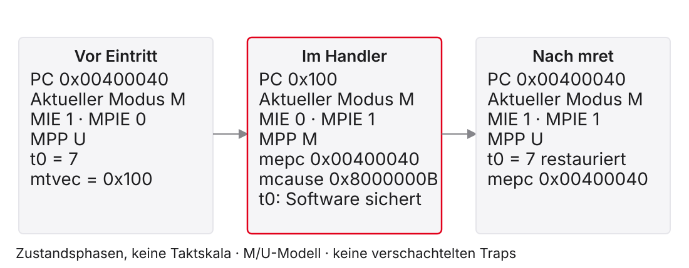{.nostretch fig-alt="M-Interrupt speichert PC und Freigaben, Handler sichert t0, mret stellt aktuellen Modus M und PC wieder her"}

::: notes
PC bedeutet Program Counter, die Befehlsadresse. M und U bedeuten Machine und User Mode. mepc ist Machine Exception Program Counter, mcause Machine Trap Cause und mtvec Machine Trap-Vector Base Address. MIE bedeutet Machine Interrupt Enable, MPIE Machine Previous Interrupt Enable und MPP Machine Previous Privilege. Die drei Spalten zeigen Zustandsphasen, keine festgelegten Taktzahlen.

Vor dem Ereignis läuft das Programm in M, seine Fortsetzungsadresse ist 0x00400040 und t0 enthält 7. MIE ist eins; die zunächst ungenutzten gespeicherten Felder MPIE und MPP sind null beziehungsweise U. mtvec ist 0x100 im Direct-Modus. Ein angenommener Machine External Interrupt setzt mcause auf 0x8000000B, mepc auf 0x00400040, MPIE auf eins, MIE auf null und MPP auf M. Der aktuelle Modus bleibt M und der PC wird 0x100. Der Handler muss den temporären Registerwert t0 selbst erhalten. Nach Wiederherstellung führt mret, Machine Return, zur Adresse 0x00400040 im gespeicherten Modus M zurück. MIE wird aus MPIE wieder eins; MPIE wird eins und MPP im angenommenen M/U-System auf U gesetzt. Dieser neue MPP-Wert ist der gespeicherte Feldzustand, nicht der aktuelle Modus nach Rückkehr.
:::

## Ein Trap ist kein Branch mit fester Penalty

- Ältere bestätigte Arbeit bleibt bestehen
- Eine Exception muss zur auslösenden Instruktion passen
- Jüngere falsche Arbeit darf keine bestätigte Wirkung erhalten
- Wie viele Stufen warten oder verworfen werden, bestimmt die Umsetzung

::: notes
Eine Pipeline überlappt Instruktionen und besitzt deshalb mehrere mögliche Befehlsadressen gleichzeitig. Eine präzise Behandlung ordnet eine synchrone Exception der richtigen Instruktion zu und stellt eine nachvollziehbare Fortsetzung her. Ein ecall, Environment Call, verlangt nicht, dass ein jüngerer bereits geholter Store danach noch unkontrolliert den Speicher verändert. Ältere korrekt bestätigte Arbeit wird nicht einfach zurückgesetzt.

Die zwei verworfenen Folgeinstruktionen des beq-Beispiels aus Einheit 7 waren eine Annahme seiner konkreten Branch-Auflösung. Daraus folgt weder, dass jeder Trap nur IF/ID löscht, noch dass er zwei Zyklen kostet. IF, Instruction Fetch, und ID, Instruction Decode, sind Befehlsholen und Decodieren. Ein Trap kann zusätzliche Steuer-, Status- und Privilegienübergänge verlangen. Die ISA, Instruction Set Architecture oder Befehlssatzarchitektur, definiert den relevanten Zustand; Stufenzahl und Kontrolllogik sind Mikroarchitektur. Wir rechnen deshalb hier Zustandsphasen statt ungeprüfter Pipelinezyklen.
:::

## Warum der Handler auch t-Register sichern muss

Vor dem Interrupt: `t0 = 7`.

Handler nutzt `t0 = 99` für seine Arbeit.

Ohne Sicherung würde das unterbrochene Programm mit 99 weiterrechnen.

Ein asynchroner Eintritt ist kein vorbereiteter Funktionsaufruf.

::: notes
t0 ist ein temporäres Integerregister, x5. Bei einer normalen Funktion ist es nach der üblichen ABI, Application Binary Interface oder binären Funktionskonvention, caller-saved: Der Aufrufer muss einen noch benötigten Wert vorher sichern. Ein Interrupt tritt jedoch asynchron auf. Das unterbrochene Programm hat gerade keinen Aufruf vorbereitet und konnte seinen Wert 7 nicht vorsorglich retten.

Der Handler, die Behandlungsroutine, muss deshalb jedes von ihm veränderte und für die Fortsetzung relevante Integerregister sichern und wiederherstellen. Das gilt auch für temporäre t- und Argumentregister a-, unabhängig von deren Rolle beim gewöhnlichen Funktionsaufruf. CSR bedeutet Control and Status Register, Kontroll- und Statusregister. Die automatische Speicherung von Ursache und Rückkehradresse in CSRs ersetzt keine Sicherung von t0. Ein Handler, der ein s-Register selbst überschreibt, muss auch dieses erhalten. Der Stackzeiger wird beim reservierten Frame vorübergehend verändert und vor der Rückkehr wiederhergestellt.
:::

## Ein 16-Byte-Frame hält einen Registerwert

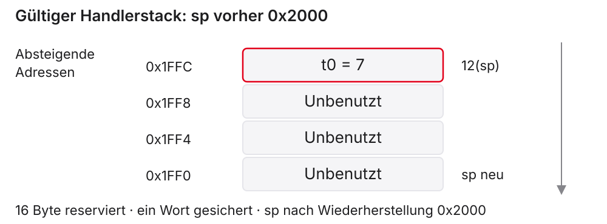{.nostretch fig-alt="Stack von 0x2000 nach 0x1FF0 reserviert 16 Byte, t0 wird bei 0x1FFC gesichert"}

::: notes
sp heißt Stack Pointer, der Stackzeiger. Vor dem Ausschnitt ist sp gleich 0x2000 und auf 16 Byte ausgerichtet. Der Handler reserviert mit einer Verringerung um 16 einen Frame, einen Bereich für lokale Sicherungen. Der neue sp ist 0x1FF0. Die Abbildung zeigt von oben nach unten absteigende Adressen. Jedes dargestellte Wort belegt vier Byte. Der gespeicherte t0-Wert 7 liegt bei $0x1FF0+12=0x1FFC$.

Die anderen zwölf Byte sind in diesem minimalen Beispiel unbenutzt. Der Frame erhält die im Kurs verwendete Ausrichtung; er ist nicht durch die Trap-Hardware vorgeschrieben. t0 ist ein temporäres Integerregister. Der rote Bereich kennzeichnet seine Sicherung, die grauen Bereiche die übrigen Framewörter. Bei der Wiederherstellung wird zuerst das Wort an 12(sp) gelesen und dann sp um 16 erhöht. Ein echter Übergang aus einem nicht vertrauenswürdigen User-Programm dürfte dessen Stack nicht ungeprüft benutzen. Das Beispiel setzt den geeigneten Handlerstack ausdrücklich voraus.
:::

## Prolog und Epilog eines isolierten Leaf-Ausschnitts

Lehrmodell: gültiger Stack, nur `t0` verändert, kein Unteraufruf.

```asm
addi sp, sp, -16
sw   t0, 12(sp)
csrr t0, mcause
# Hier ist die Ursache in t0 verfügbar.
lw   t0, 12(sp)
addi sp, sp, 16
mret
```

::: notes
Der Ausschnitt demonstriert ausschließlich Sicherung, Ursachenlesen und Wiederherstellung. Leaf heißt, dass kein Unteraufruf erfolgt. sp ist Stack Pointer, der Stackzeiger; t0 ist das einzige hier benutzte temporäre Register. addi, Add Immediate, reserviert und löst den 16-Byte-Frame. sw, Store Word, sichert t0; lw, Load Word, lädt denselben Wert zurück. csrr ist die Pseudoinstruktion für einen CSR-Lesezugriff über csrrs mit Quelle x0. CSR bedeutet Control and Status Register. mcause, Machine Trap Cause, liefert Art und Ursache. mret bedeutet Machine Return.

Der Code ist keine vollständige Interruptbehandlung: Er enthält weder Gerätequittierung noch Quellenwahl, Bootkonfiguration oder Ausnahmepolitik. Auf echter Hardware könnte eine nicht quittierte Meldung sofort wieder auftreten. Diese Auslassungen sind beabsichtigt, damit der Zusammenhang von Registerwert und Stack zunächst isoliert bleibt. Bei einer bewusst bearbeiteten ecall-Exception müsste die Fortsetzung zusätzlich nach der vereinbarten Dienstpolitik gesetzt werden. Ein normaler ret wäre keine Ersatz-Rückkehr.
:::

## Ein Unteraufruf vergrößert die Sicherungsaufgabe

- `call` verändert `ra` und kann Caller-Saved-Register verändern
- Unterbrochener Code hat diese Werte nicht vorher gesichert
- `ra`, `t0`–`t6`, `a0`–`a7`: 16 Wörter, 64 Byte
- Zusätzlich selbst veränderte s-Register berücksichtigen
- Bereits gesicherte Trap-Information vor Verschachtelung schützen

::: notes
call ist eine Assembler-Pseudoinstruktion für einen Funktionsaufruf. ra, Return Address, hält den normalen Funktionslink. Die temporären Register t0 bis t6 sind sieben Register; a0 bis a7 sind acht Argument- und Rückgaberegister. Zusammen mit ra sind es sechzehn Wörter à vier Byte, also 64 Byte. Diese Register können bei einem Unteraufruf nach der üblichen Integer-ABI, Application Binary Interface, verändert werden.

Ein Handler darf daraus keine Freigabe zur Zerstörung des unterbrochenen Zustands ableiten. Er muss die dort noch benötigten Werte erhalten. s-Register bleiben über eine ABI-konforme Unterfunktion erhalten, müssen aber zusätzlich gesichert werden, wenn der Handler sie selbst verändert. Andere Registerklassen, etwa Gleitkomma, liegen außerhalb unseres Modells. Bei verschachtelten Traps könnten außerdem mepc, Machine Exception Program Counter, mcause, Machine Trap Cause, und frühere Statusfelder überschrieben werden. Unser Beispiel schließt solche Verschachtelung aus. Der kleine 16-Byte-Leaf-Frame der vorherigen Folie ist daher kein ausreichender Rahmen für beliebige Unteraufrufe.
:::

## mret stellt mehr als eine Sprungadresse her

- Ziel aus `mepc`, aktueller Modus aus MPP
- MIE wird aus MPIE wiederhergestellt
- Danach MPIE auf eins, MPP auf niedrigsten unterstützten Modus
- Integerregister muss die Software vorher restauriert haben

`ret` verwendet dagegen den normalen Link in `ra`.

::: notes
mret bedeutet Machine Return. mepc, Machine Exception Program Counter, liefert das Rückkehrziel. MPP, Machine Previous Privilege, liefert den gespeicherten bisherigen Modus. MIE, Machine Interrupt Enable, wird aus MPIE, Machine Previous Interrupt Enable, wiederhergestellt. Danach setzt das betrachtete Grundmodell MPIE auf eins und MPP auf den niedrigsten unterstützten Modus; in unserem M/U-Modell ist das U, User Mode. M ist Machine Mode. Weitere Statusfelder liegen außerhalb des hier gerechneten Ausschnitts.

Der aktuelle Modus nach der Rückkehr ist der vorher in MPP gespeicherte Modus, nicht der danach zur Vorbereitung zurückgesetzte MPP-Wert. Deshalb kann die Ausführung nach M zurückkehren, obwohl das Feld anschließend U enthält. ret ist dagegen ein normaler Funktionsrücksprung über ra, Return Address. ra kann eine gültige Funktionsadresse besitzen, ist aber nicht automatisch die Trap-Fortsetzung. mret restauriert auch nicht von selbst t0 oder den Stackframe; diese Softwareaufgabe muss vor dem Rückkehrbefehl beendet sein.
:::

## Kurzaufgabe: Zwei Anlässe, dieselbe Adresse

Anfang: `mtvec = 0x100`, relevante Befehlsadresse `0x00400040`.

| Fall | mcause | Gespeicherte Adresse |
|:---|:---|:---|
| M-Interrupt, Code 11 | `0x8000000B` | `mepc = 0x00400040` |
| M-`ecall` | `0x0000000B` | `mepc = 0x00400040` |

Wie unterscheiden sich Behandlung und Rückkehrziel?

::: notes
M ist Machine Mode. mtvec heißt Machine Trap-Vector Base Address; 0x100 wählt Direct und die Handlerbasis 0x100. mcause ist Machine Trap Cause; mepc ist Machine Exception Program Counter. Die beiden Fälle sind unabhängig und verwenden denselben Zahlenwert für mepc. Beim Interrupt bezeichnet er die richtige Fortsetzungsadresse. Der Handler behandelt die Quelle und kehrt ohne pauschale Erhöhung nach 0x00400040 zurück.

Beim ecall, Environment Call, ist 0x00400040 die Adresse der auslösenden 32-Bit-Instruktion. Ist der gewünschte Dienst bewusst bearbeitet und soll er nicht erneut aufgerufen werden, erhöht der Handler mepc auf 0x00400044. Das Interruptbit in mcause trennt die Fälle, obwohl der niedrige Code jeweils elf ist. MIE, Machine Interrupt Enable, gleich null könnte den maskierbaren Interrupt im M-Fall verhindern; es verhindert die synchrone ecall-Exception nicht. Ein bloßer Test auf niedrigen Code elf oder eine pauschale mepc-Erhöhung wäre daher keine korrekte Musterlösung.
:::

# 4. Dienste einer Ausführungsumgebung

::: notes
Die Trap-Erklärung beantwortet, wie ein architektonischer Kontrollübergang zustande kommt. Sie sagt noch nicht, welcher Dienst angefordert wird, welche Parameter er erhält und welche Register danach gültig bleiben. Ein System Call, Systemaufruf, ist eine durch den Softwarevertrag definierte Dienstanforderung.

ecall bedeutet Environment Call. In einem Hardwaremodell löst er eine synchrone Exception aus; ein Simulator kann die Anfrage dagegen intern im Hostprogramm behandeln. Wir verwenden Venus für konkrete Konsolendienste. Die sichtbare Ausgabe beweist weder einen laufenden Betriebssystemkernel noch unsere privilegierten Registeränderungen. Diese Ebene setzt deshalb einen eigenen Dienstvertrag voraus und übernimmt nicht pauschal die Funktionskonvention.
:::

## ecall ist kein normaler jal-Aufruf

| Normaler Funktionsaufruf | Environment Call |
|:---|:---|
| Sprungziel und Link durch Aufrufbefehl | Anfrage an die Ausführungsumgebung |
| `ra` dient als Rückkehrlink | Trap- beziehungsweise Simulatorfortsetzung |
| Funktions-ABI | Vertrag des konkreten Diensts |

Die Dienstnummer steht nicht im operandlosen `ecall`-Befehl.

::: notes
jal bedeutet Jump and Link. Beim normalen Funktionsaufruf wird ein Rückkehrlink nach ra, Return Address, geschrieben; ret springt über diesen Link zurück. ABI heißt Application Binary Interface, die binäre Parameter- und Registerkonvention. Der Aufrufer und die Funktion halten den vereinbarten Funktionsvertrag ein.

ecall, Environment Call, hat dagegen keine Operanden und enthält keine Print-Dienstnummer. Der Softwarevertrag legt vorherige Registerbelegung, Rückgaben und Registererhaltung fest. Die Hardwarewirkung ist ein Trap, nicht ein gewöhnliches Link-Schreiben nach ra; ein Simulator kann die Anfrage zusätzlich abfangen. Ein echter Betriebssystemdienst kann Rechte und Zeiger prüfen und über eine privilegierte Rückkehr fortsetzen. In Venus übernimmt der Simulator die Fortsetzung. Der gleiche Integerregistername a0 bedeutet deshalb je nach Vertrag Dienstkennung, Argument oder Rückgabewert. Auch ein normaler Funktionsaufruf nach einer Dienstanforderung wäre erneut nach seinem eigenen Vertrag zu beurteilen.
:::

## Venus, Ripes und Linux unterscheiden

| Umgebung | Dienstkennung | Erstes Argument |
|:---|:---|:---|
| Venus des Kurses | `a0` | `a1` |
| Ripes-Dokumentation | `a7` | `a0` |
| Linux auf RISC-V | `a7` | `a0` |

Gleiche Registerbelegung bedeutet nicht gleiche Dienstnummern.

::: notes
Venus ist der im Kurs verlinkte RISC-V-Instruktionssimulator. Seine Environmental-Calls-Dokumentation legt die Kennung in a0 und Argumente ab a1 fest. Ripes ist der visuelle Simulator; seine gelesene Environment-Call-Tabelle verwendet a7 für die Kennung und a0 für das erste Argument. Linux auf RISC-V verwendet ebenfalls a7 und Argumente ab a0, aber seine Dienstliste ist eine andere. Die a-Register sind die aus Einheit 4 bekannten Argument- und Rückgaberegister.

ABI bedeutet Application Binary Interface, die binäre Schnittstellenkonvention. Eine Print-Integer-Kennung eins ist im jeweiligen Simulator definiert und nicht durch den RISC-V-Befehlssatz vorgegeben. Das Kopieren einer Venus-Sequenz nach Ripes ohne Umbelegung wäre deshalb falsch. Ebenso beweist die Übereinstimmung von Ripes und Linux bei den Registern keine identische Ausgabeoperation. Im Labor verwenden wir für Konsole ausschließlich den dokumentierten Venus-Vertrag; die installierte Version bleibt zu prüfen.
:::

## Drei Venus-Dienste für die Aufgaben

| a0 | Dienst | a1 | Wirkung |
|:---:|:---|:---|:---|
| 1 | Print Integer | Zahlenwert | Ganze Zahl ausgeben |
| 4 | Print String | Adresse | Nullterminierten Text ausgeben |
| 10 | Exit | Kein Argument benötigt | Programm beenden |

::: notes
a0 und a1 sind Integerregister für die im Venus-Vertrag festgelegte Kennung und das erste Argument. Print Integer bedeutet Ganzzahl ausgeben, Print String Zeichenfolge ausgeben und Exit Programm beenden. Bei Kennung eins ist a1 der eigentliche Zahlenwert. Bei Kennung vier ist a1 dagegen die Startadresse einer Bytefolge, die durch ein Nullbyte endet. Kennung zehn beendet ohne normale Fortsetzung.

ecall, Environment Call, fordert den vorher vorbereiteten Dienst an. Die Tabelle stammt aus der gelesenen Venus-Environmental-Calls-Dokumentation der Kurslinie. Sie beschreibt keine RISC-V-Befehlssatzoperation Print Integer und keinen nachgewiesenen privilegierten Kernel. Registererhaltung und Rückgaben anderer Dienste müssen gesondert dokumentiert werden; diese drei Einträge rechtfertigen keine universelle Clobber-Liste. Ein String darf auch nicht pauschal als Wortarray mit vier Byte pro Zeichen behandelt werden. Das folgende Programm zeigt Adresse, Terminator und Dienstkennung gemeinsam.
:::

## Ein vollständiges Hello World für Venus

```asm
.data
msg: .asciiz "Hello World!\n"
.text
.globl main
main:
    la a1, msg
    li a0, 4
    ecall
    li a0, 10
    ecall
```

::: notes
Der RISC-V-Assemblercode ist das vorhandene Programm beispiele/vl8_hello.s. .data beginnt den Datenbereich. .asciiz legt die Bytefolge Hello World!, einen Zeilenumbruch und ein Nullbyte an. msg ist ihre Marke. .text beginnt den Befehlsbereich; .globl main exportiert die Eintrittsmarke main für die vereinbarte Kursumgebung. Diese Direktiven sind keine Maschineninstruktionen.

la, Load Address, lädt die Adresse von msg nach a1, nicht dessen ersten Zeichenwert. li, Load Immediate, setzt a0 auf die Venus-Dienstkennung vier. Beide sind Pseudoinstruktionen und können je nach Konstante und Adresse expandieren. ecall, Environment Call, fordert Print String an. Das Nullbyte beendet die Ausgabe, wird aber nicht als sichtbares Zeichen gedruckt. Danach fordert Kennung zehn in a0 Exit an. Die erwartete Ausgabe ist Hello World! mit Zeilenumbruch. Das Programm stellt keinen eigenen Trap-Handler auf und setzt mtvec, Machine Trap-Vector Base Address, nicht selbst. Ein tatsächlicher Venus-Lauf wird hier nicht behauptet.
:::

## EVA mit festem Eingabewert

Ausschnitt aus `beispiele/vl8_eva.s`, vor dem ersten Dienst:

```asm
.data
n: .word 21
newline: .asciiz "\n"
.text
# Eintrittsmarke und Abschluss stehen in der Datei.
la   t0, n
lw   t1, 0(t0)
slli a1, t1, 1
li   a0, 1
ecall
```

::: notes
EVA bedeutet Eingabe, Verarbeitung, Ausgabe. Eingabe ist hier das vorbereitete Speicherwort 21, kein interaktiver Tastaturwert. .word legt ein vier Byte breites Wort an; n ist seine Marke. newline bezeichnet eine nullterminierte Bytefolge mit Zeilenumbruch. Die vollständige Datei beispiele/vl8_eva.s enthält die Eintrittsmarke main und den nachfolgenden Print-String- und Exit-Dienst. Der Ausschnitt lässt diese Teile ausdrücklich aus.

la, Load Address, setzt das temporäre Register t0 auf die Adresse von n. lw, Load Word, lädt 21 nach dem temporären Register t1. slli, Shift Left Logical Immediate, schiebt dessen 32-Bit-Wert um ein Bit nach links und schreibt 42 nach a1. Hier ergibt das Verdoppeln ohne Überlauf $21\cdot2=42$. li, Load Immediate, setzt a0 auf eins; ecall, Environment Call, fordert Venus Print Integer an. Die nächste Anfrage setzt ihre Argumente neu. Die erwartete Gesamtdateiausgabe lautet 42 mit Zeilenumbruch. Die Datensegmentbasis wird wortausgerichtet vorausgesetzt; das Wort vor dem String vermeidet im gegebenen Aufbau eine Verschiebung durch vorangehende Textbytes.
:::

## Registererhaltung gehört zum Dienstvertrag

- Aus `ecall` folgt keine allgemeine Caller-Saved-Liste
- Ein t-Register ist nicht automatisch verloren
- Ein s-Register ist nicht automatisch über jeden Dienst sicher
- Benötigte Register anhand der dokumentierten Umgebung beurteilen
- Nicht dokumentierte Erhaltung nicht als Fehlerlauf erfinden

::: notes
Caller saved bedeutet beim gewöhnlichen Funktionsvertrag, dass der Aufrufer einen noch benötigten Registerwert selbst sichern muss. Callee saved bedeutet, dass die aufgerufene Funktion ihn erhält. t-Register sind dort temporäre, s-Register erhaltene Register. ABI heißt Application Binary Interface. ecall, Environment Call, ist aber keine gewöhnliche Funktion mit automatisch derselben Clobber-Regel. Clobbering heißt das Überschreiben eines weiter benötigten Registerwerts.

Die konkrete Umgebung muss beschreiben, welche Parameter, Ergebnisse und Nebenwirkungen gelten. Aus der Venus-Diensttabelle allein folgt weder, dass t0 zerstört wird, noch dass s0 garantiert unverändert bleibt. Eine Schleife mit t0 über eine Ausgabe darf deshalb nicht ohne Nachweis als sicher endlos beschrieben werden. Einfach auf s0 umzusteigen beweist ebenfalls keine allgemeine Portabilität. Eine kleine bewusste Lösung kann eine benötigte Größe zwischen Diensten neu aus einer klaren Datenquelle laden. Eine Sicherung auf dem Stack ist nur dann ausreichend, wenn auch der weitere Vertrag, etwa gültiger und erhaltener Stack sowie Speicher, feststeht.
:::

## Papierfall mit ausdrücklich vereinbartem Clobber-Vertrag

Fiktiver Dienst, kein behaupteter Venus-Vertrag:

- Darf `t0` sowie `a0` und `a1` verändern
- Erhält `s0`, `sp` und den benutzten Datenspeicher
- Ein Zähler muss nach jeder Anfrage weiterlaufen

Welche zwei Sicherungsstrategien sind unter diesen Angaben zulässig?

::: notes
Clobber-Vertrag bedeutet die ausdrücklich zugelassenen Registeränderungen eines Diensts. ecall, Environment Call, ist hier nur der Auslöser einer fiktiven Lehrumgebung. t0 ist ein temporäres Register; a0 und a1 sind Parameterregister, s0 ein hier ausdrücklich erhaltenes Register und sp der Stack Pointer. Die Aufgabe macht keine Aussage über tatsächliche Venus-Registererhaltung.

Unter dem angegebenen Vertrag kann der Zähler in s0 gehalten werden: Der Dienst muss seinen Inhalt erhalten. Alternativ kann ein Zähler aus t0 vor der Anfrage in einem gültigen 16-Byte-ausgerichteten Frame gespeichert und danach aus demselben Datenspeicher zurückgeladen werden. Der Vertrag erhält sp und diesen Speicher, sodass die Adresse der Sicherung erhalten bleibt. Ohne genau diese Angaben wären beide Schlussfolgerungen zu weitgehend. Wer nur die übliche Rolle von s0 bei Funktionen nennt, hat die wesentliche Begründung noch nicht geliefert. Entscheidend ist die für diese Anfrage vereinbarte Erhaltung.
:::

# 5. Vorhersagen mit Werkzeugen vergleichen

::: notes
Ripes und Venus dienen in dieser Einheit verschiedenen sichtbaren Experimenten. Ripes zeigt den Gerätezugriff mit Schaltern und Pixeln. Venus zeigt die Konsolendienste. Beide besitzen weitere Funktionen, die hier nicht vorausgesetzt werden. Ein erfolgreicher Versuch prüft immer die gewählte Version und Konfiguration.

Die Papierarbeit kommt vor dem Versuch: Sie legen Eingabewert, Maske, Adresse, Ausgabewort beziehungsweise Dienstregister fest. Anschließend werden diese Größen in der tatsächlichen Umgebung geprüft. Die privilegierten Trap-Zustandsbilder bleiben getrennte Lehrmodelle, solange keine geeignete Hardware- oder Systemsimulation dafür verwendet wurde. Weder eine LED-Farbe, Light Emitting Diode oder Leuchtdiode, noch eine Textausgabe allein ersetzt diesen Nachweis.
:::

## Ripes: Karte vor Programm prüfen

1. Version und Prozessormodell dokumentieren
2. Mindestens vier Schalter und passende LED-Matrix anlegen
3. Basis, Größe, Breite und Exports aus der Registerkarte lesen
4. Echo mit Rohwerten 0, 5, 8 und 13 prüfen
5. Für Lauflicht genau eine Zeile mit acht Pixeln verwenden

::: notes
Ripes ist der visuelle RISC-V-Simulator. LED bedeutet Light Emitting Diode, Leuchtdiode. Die offiziellen MMIO-Unterlagen, Memory-Mapped I/O (Input/Output), empfehlen für interaktive Geräteversuche unter anderem das Single-Cycle-Modell. Dieses Modell der Installation kann mehr Befehle unterstützen als unser kleiner selbst hergeleiteter Datenpfad aus Einheit 5; seine Konfiguration ist eigenständig zu dokumentieren.

Die Geräte werden im I/O-Bereich, Input/Output oder Ein- und Ausgabe, angelegt. Registerkarte und exportierte Symbole bestimmen die Programmadressen. Der Echo-Code erwartet mindestens vier Schalter und einen vorhandenen ersten Pixel. Für die Rohwerte null und fünf ist Bit 3 null, daher bleibt die Anzeige schwarz. Acht und dreizehn setzen Bit 3 und erzeugen Rot. Beim Lauflicht muss die tatsächliche Bytegröße acht Pixeln à vier Byte entsprechen. Ein Gerätetausch kann Adressen verändern. Menünamen, Farben und die sichtbare Reaktionsdauer werden nicht ohne eigenen Lauf als geprüft ausgegeben.
:::

## Venus: Vor jedem ecall die Argumente prüfen

- Print Integer: `a0 = 1`, `a1` ist ein Wert
- Print String: `a0 = 4`, `a1` ist eine Adresse
- Exit: `a0 = 10`
- `la` lädt eine Adresse; `lw` lädt deren Daten
- Eintrittsmarke und Nullterminator gehören zum Programm

::: notes
Venus ist der Kurs-Instruktionssimulator. ecall, Environment Call, nutzt dort a0 als Dienstkennung und a1 als erstes Argument. Print Integer gibt den Zahlenwert aus, Print String die nullterminierte Bytefolge an der angegebenen Adresse; Exit beendet. Die a-Register sind Integerregister mit einer hier konkret festgelegten Dienstrolle.

la heißt Load Address und ist eine Pseudoinstruktion. lw heißt Load Word und liest vier Byte an der effektiven Adresse. Würde eine Stringadresse statt eines Zahlenwerts an Print Integer übergeben, erhielte man eine Zahl statt des gewünschten Texts. Würde man umgekehrt den Wert 42 als Stringadresse verwenden, läse der Dienst an einer anderen, möglicherweise ungültigen Stelle; das Ergebnis ist ohne Speichervertrag nicht garantiert. .globl main und die Startkonvention der verwendeten Venus-Variante sind zu prüfen. Die Dateien vl8_hello.s und vl8_eva.s haben klare erwartete Ausgaben, aber keinen in dieser Überarbeitung behaupteten Simulatorlauf.
:::

## Selbstkontrolle und Übergang zur Übung

Transfer: Zweibit-Anzeige, Vierprobenfilter und Messwert $3n-4$.

- Wie unterscheiden sich Pegel, Ereignis und entprellter Zustand?
- Welche Trap-Daten und Register muss der Handler erhalten?
- Welcher Dienstvertrag bestimmt Ausgabe und Registererhaltung?

::: notes
RAM steht für Random Access Memory, hier Arbeitsspeicher. Ein Geräteregister besitzt dagegen einen eigenen Zugriffstyp und möglicherweise Lese- oder Schreibnebenwirkungen. Ein Pegel ist ein gegenwärtiger Zustand, ein Ereignis eine relevante Änderung oder gespeicherte Meldung. Entprellen filtert Kontaktwechsel; bloßes Warten auf Freigabe löst diese Aufgabe nicht vollständig.

mepc bedeutet Machine Exception Program Counter. Ein Interrupt verwendet die passende gespeicherte Fortsetzungsadresse; ein bewusst bearbeiteter 32-Bit-ecall, Environment Call, wird in unserem Modell um vier Byte übersprungen. Die Hardware speichert Ursache, Adresse und Statusinformationen, die Software erhält benötigte veränderte Integerregister. Venus-Ausgabe und Registererhaltung sind durch den Dienstvertrag bestimmt, nicht durch die normale Funktionskonvention. Papieraufgaben und Quiz prüfen genau diese Abgrenzungen. Literaturgrundlage sind Harris und Harris, Digital Design and Computer Architecture, RISC-V Edition, sowie ergänzend Patterson und Hennessy, Computer Organization and Design, RISC-V Edition. Die nächste Einheit verbindet die gelernten Mechanismen mit C-Übersetzung und einer abschließenden Anwendung.
:::
