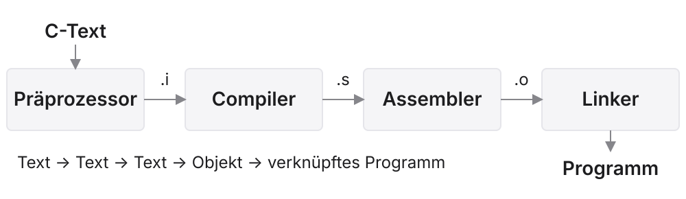
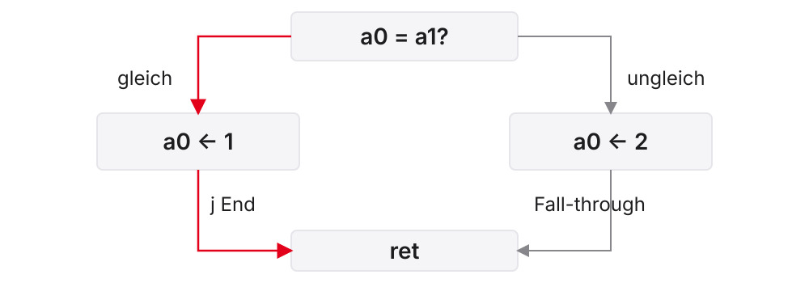
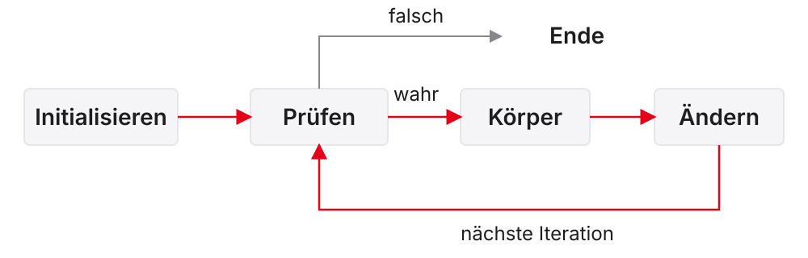
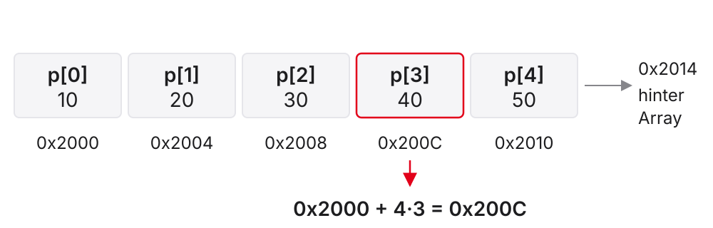
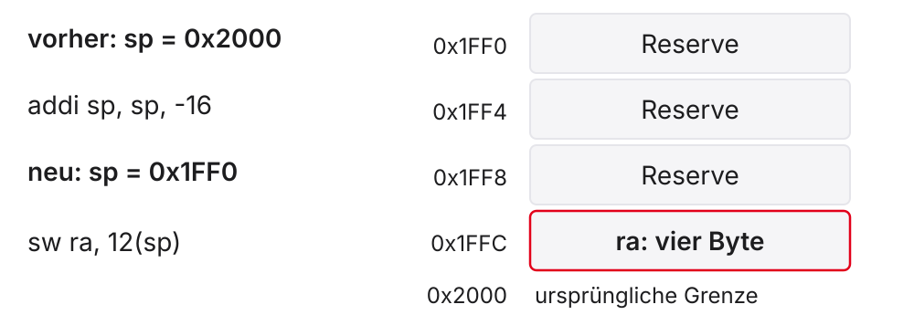
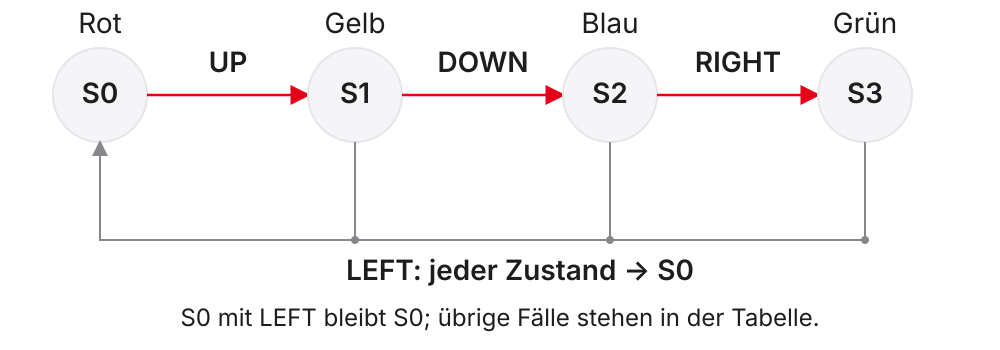
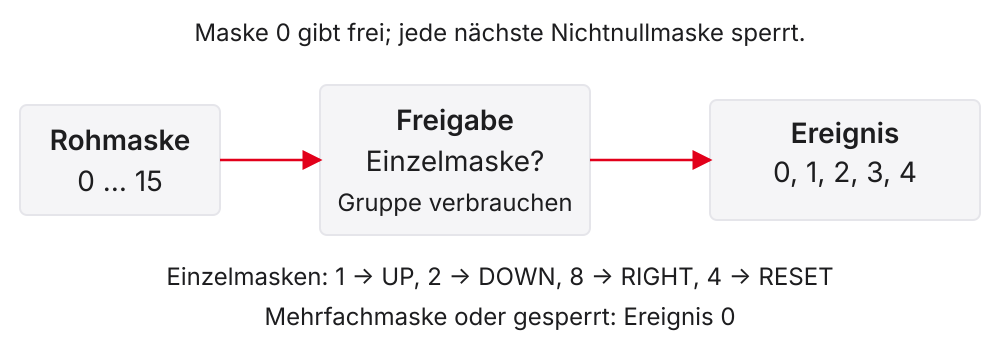
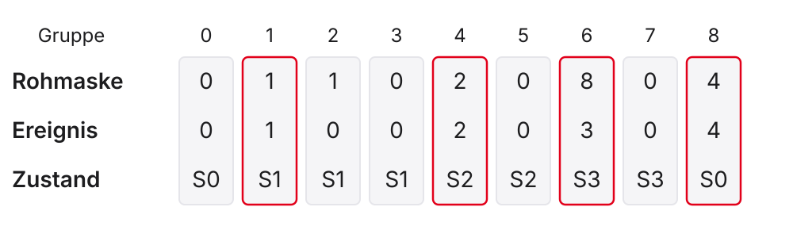
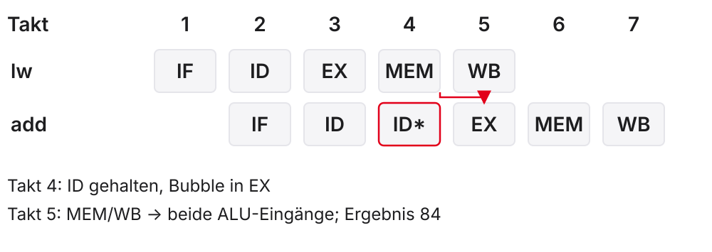

# C, Assembler und Abschlussprojekt

::: notes
C ist die hier betrachtete höhere Programmiersprache. Assemblertext beschreibt Maschinenoperationen symbolisch. Die letzte Einheit verbindet die Ebenen, statt einen weiteren Prozessorbaustein vorauszusetzen: Aus einer Bedingung werden Vergleiche und Sprünge, aus einem Arrayindex eine Byteadresse, und aus einer Funktion ein Ablauf nach dem bekannten Registervertrag.

Das Abschlussprojekt nutzt diese Mechanismen für ein Code-Schloss. Sein gespeicherter Zustand, die Erkennung eines Eingabeereignisses und die Ausgabe einer Farbe werden getrennt entwickelt und anschließend zusammengesetzt. Die Notizen erklären Begriffe, Annahmen, Code und Rechenwege als begleitendes Skript. Manuelle Assemblerformen sind Lehrübersetzungen, keine behaupteten Compilerergebnisse. Ein Simulatorversuch muss zusätzlich die konkrete Gerätekarte berücksichtigen.
:::

## Ziele der abschließenden Einheit

1. Dateien und Aufgaben der Werkzeugkette unterscheiden
2. C-Bedingungen und Schleifen nachvollziehbar übersetzen
3. Werte über normale Funktionsaufrufe korrekt erhalten
4. Ereignis und Zustandsübergang getrennt entwerfen
5. Ergebnisse durch Traces und Grenzfälle prüfen

::: notes
Die Werkzeugkette, auf Englisch Toolchain, führt vom Quelltext über Übersetzung und Bindung zum für eine Umgebung bestimmten Programm. Ein Trace ist eine schrittweise Verfolgung mit angegebenem Anfangszustand. Er zeigt nicht nur einen Endwert, sondern auch den tatsächlich durchlaufenen Kontrollpfad. Grenzfälle prüfen zum Beispiel eine Schleife ohne Durchlauf oder einen ungültigen Zustandswert.

Die ersten drei Ziele wiederholen Register, Sprünge, Speicher und Funktionen aus den bisherigen Einheiten. Neu ist ihre systematische Verbindung mit C und einem endlichen Zustandsautomaten. Im Projekt kommt ein bloß gehaltener Tastenzustand nicht automatisch einem neuen Ereignis gleich. Deshalb wird die Eingabe vor der Übergangsfunktion aufbereitet. Die Papieraufgaben folgen denselben Entscheidungen und verlangen jeweils eine Begründung. Die Aufgabentypen dienen der Vorbereitung; konkrete Klausurregeln werden daraus nicht abgeleitet.
:::

## Bekanntes Wissen gezielt verbinden

| Einheit | Heute benötigt |
|:---|:---|
| 1–3: Werte, Befehle und Speicher | Masken, Vergleiche und Arrayadressen |
| 4: Funktionen und Stack | Argumente, Rückkehrlink und Sicherung |
| 5–7: Datenpfad und Pipeline | Befehlswirkung und Zeitmodell unterscheiden |
| 8: Geräte und Dienste | Registerkarte, Eingabesemantik und Ausgabe |

::: notes
Ein Wert und seine Adresse sind verschiedene Größen. Eine Bitmaske wählt Positionen aus, ein Sprung verändert den Kontrollfluss. Die Funktions-ABI, Application Binary Interface oder binäre Aufrufkonvention, legt Registerrollen, Stackausrichtung und Rückgaben fest. Genau diese Kenntnisse nutzen wir für die folgenden Assemblerfunktionen.

Die ISA, Instruction Set Architecture oder Befehlssatzarchitektur, beschreibt die beobachtbare Befehlswirkung. Ein Datenpfad und eine Pipeline sind konkrete Mikroarchitekturen. Ein C-Programm bekommt deshalb nicht allein durch eine Registerzuordnung eine feste Laufzeit. Auch MMIO, Memory-Mapped Input/Output oder Gerätezugriff über Speicheradressen, bleibt ein Plattformvertrag. Wir verwenden für das Projekt die Geräteexports der Installation und für Rechenbeispiele ausdrücklich angegebene Werte. Optimierungstheorie, Linkerskripte und ein Betriebssystemkernel werden nicht vorausgesetzt.
:::

## Gemeinsame Annahmen

- RV32I, keine komprimierten Instruktionen in den Kernbeispielen
- ILP32: `int` und Zeiger je 32 Bit, Arrayelement hier vier Byte
- Skalare Argumente und Ergebnisse nach dem bekannten Funktionsvertrag
- Arrayzugriffe gültig; betrachtete vorzeichenbehaftete C-Rechnungen ohne Überlauf
- Lehrübersetzung, Simulatorbeobachtung und Compilerausgabe getrennt

::: notes
RV32I bezeichnet die 32-Bit-RISC-V-Ganzzahlbasis. Die C-Erweiterung für komprimierte Instruktionen ist ausgeschaltet; betrachtete Maschinenbefehle belegen vier Byte. Das hat nichts mit der Programmiersprache C zu tun. ILP32 benennt ein Datenmodell mit 32-Bit-int, long und Zeigern. In unseren Arraybeispielen belegt daher ein int vier Byte.

ABI bedeutet Application Binary Interface, die binäre Funktionskonvention. Wir behandeln kleine Ganzzahlergebnisse in a0, Argumente ab a0 und 16-Byte-Stackausrichtung. Andere Rückgabeformen liegen außerhalb. Die Zahlenbeispiele sind so gewählt, dass C-Rechnungen mit vorzeichenbehafteten int-Werten definiert bleiben. Die Maschine rechnet dagegen mit 32-Bit-Mustern modulo $2^{32}$. Nicht jede solche Bitoperation entspricht einer definierten C-Operation für alle Eingaben. Diese Grenzen werden bei Multiplikation, Vergleich und Arrays wieder aufgegriffen.
:::

# 1. Von C zu einem Programm für das Ziel

::: notes
Quelltext läuft nicht unmittelbar im bekannten Datenpfad. Eine Werkzeugkette bereitet ihn auf, übersetzt ihn, codiert die Maschinenbefehle und verbindet die benötigten Teile. Anschließend muss die Ausführungsumgebung das Programm laden und starten. Das sind verschiedene Aufgaben, auch wenn ein einzelner Treiberbefehl mehrere davon anstößt.

Wir benutzen die klassische Trennung in Präprozessor, Compiler, Assembler und Linker. Sie ist ein verständliches Modell der Verarbeitungsschritte, keine Zusage, dass jede Implementierung vier unabhängige Prozesse startet. An den erzeugten Dateitypen erkennen Sie, welchen Stand ein Programm erreicht hat und weshalb eine Objektdatei oder ein Assemblertext noch nicht automatisch in Venus läuft.
:::

## Werkzeugkette und Zwischenergebnisse

{.nostretch fig-alt="Quelltext wird vorverarbeitet, übersetzt, assembliert und mit weiteren Objekten verbunden; Laden und Start folgen separat"}

::: notes
Die Abbildung beginnt oben links beim C-Text, verläuft durch die vier Werkzeugfelder von links nach rechts und endet unten rechts beim Programm. Aus C-Quelltext entsteht durch den Präprozessor ein vorverarbeiteter Text. Der Compiler prüft und übersetzt die Sprachstruktur, hier zu Assemblertext. Das Assemblerwerkzeug erzeugt ein Objekt mit Code, Daten und weiteren Informationen. Der Linker verbindet dieses Objekt mit passenden weiteren Objekten und löst ihre Beziehungen. Die grauen Felder benennen Verarbeitungsschritte; die Pfeile zeigen die Reihenfolge und die Beschriftungen die jeweiligen Zwischendateien.

Die Endungen .c, .i, .s und .o kennzeichnen hier typische Zwischenergebnisse. ELF heißt Executable and Linkable Format, ein verbreitetes Format für Objekte und Programme; allein die Endung .elf beweist keine Ausführbarkeit. Laden und Starten sind anschließend eigene Aufgaben der Umgebung. Ein mit einer Toolchain erstelltes Programm braucht passende Eintrittsadresse, Speicherbelegung und gegebenenfalls Laufzeit. Venus, der Kurs-Instruktionssimulator, erwartet dagegen seinen unterstützten Assemblertext und seinen Dienstvertrag.
:::

## Den Treiber gezielt anhalten

| Option | Ergebnis des betrachteten Aufrufs |
|:---|:---|
| `-E` | Vorverarbeiteter Text |
| `-S` | Assemblertext |
| `-c` | Objektdatei, noch nicht gelinkt |
| Ohne diese Stoppoptionen | Linkschritt, falls Eingaben und Zielumgebung passen |

Compileroptionen sind kein Beweis für eine bereits erfolgreiche Ausführung.

::: notes
GCC bedeutet GNU Compiler Collection. Sein Treiber kann mehrere Verarbeitungsschritte koordinieren. -E stoppt nach der Vorverarbeitung, -S nach der Übersetzung zu Assemblertext und -c nach Erzeugung einer Objektdatei. Eine .o-Datei kann bereits Maschinenbefehle enthalten, aber noch offene Beziehungen zu Symbolen anderer Dateien besitzen.

Ohne eine dieser Stoppoptionen kann der Treiber den Linker aufrufen. Auch dann fehlen bei einem unpassenden Ziel möglicherweise Bibliotheken, Startcode oder ein Speicherlayout. Die Optionen sind keine Aussage, dass der erzeugte Text oder das Programm schon im Simulator ausgeführt wurde. Ein Header wird nicht zum Programmstart, und eine Fehlermeldung des Linkers ist nicht automatisch eine falsche Syntax im C-Code. Diese Unterscheidungen helfen, einen Buildfehler der richtigen Stufe zuzuordnen.
:::

## Host und Ziel ausdrücklich wählen

Aufrufschema bei vorhandener passender RISC-V-Toolchain:

```bash
riscv64-unknown-elf-gcc \
  -march=rv32i -mabi=ilp32 -O2 -S \
  beispiele/vl9_control.c -o control.s
```

Ein gewöhnliches `gcc` auf dem Arbeitsrechner wählt dessen eigenes Ziel.

::: notes
Host ist der Rechner, auf dem die Werkzeuge laufen; Target ist das Ziel, für das sie Code erzeugen. GCC heißt GNU Compiler Collection. Eine entsprechend gebaute riscv64-unknown-elf-gcc-Toolchain kann auch ein RV32-Ziel unterstützen; der Name allein garantiert das nicht. -march=rv32i wählt die RISC-V-Ganzzahlbasis, -mabi=ilp32 das 32-Bit-Daten- und Aufrufmodell. -O2 wählt eine Optimierungsstufe. -S fordert Assemblertext und -o den Ausgabepfad control.s an.

Die Datei beispiele/vl9_control.c existiert im Repository. Der gezeigte Aufruf ist eine Arbeitsanleitung, kein protokollierter Cross-Compiler-Lauf. Ein auf dem Host aufgerufenes gcc ohne passendes Ziel erzeugt nicht automatisch RV32-Code. Die Zeilenfortsetzung mit Rückstrich ist Shellsyntax. Auch ein korrekt erzeugter Assemblertext benötigt für Ausführung noch eine passende Umgebung. Bei einem Vergleich dokumentieren Sie Toolchainversion, Ziel und sämtliche relevanten Optionen.
:::

## Deklaration, Implementierung und offenes Symbol

- Ein Header kann eine Funktion deklarieren
- Die Implementierung kann in einem anderen Objekt liegen
- Der Assembler kennt nicht jede endgültige Zieladresse
- Relocation beschreibt noch anzupassende Stellen
- Der Linker verbindet kompatible Teile

::: notes
Eine Deklaration beschreibt, wie eine Funktion aufgerufen wird, zum Beispiel Name, Parameter und Rückgabe. Die Implementierung enthält ihre eigentliche Arbeit. Ein include der üblichen stdio.h-Deklarationen liefert deshalb nicht automatisch den Maschinenkörper von printf, der formatierten Ausgabefunktion.

Ein Symbol benennt eine Funktion oder Datenposition. Ein noch undefiniertes externes Symbol kann in einem anderen Objekt bereitgestellt werden. Relocation, Relokation oder Adressanpassung, hält fest, welche codierte Stelle nach der Platzierung angepasst werden muss. Manche lokale Beziehungen kann bereits der Assembler bestimmen. Andere werden beim Linken aufgelöst. Der Linker verbindet passende Code- und Datenbereiche und kann Bibliotheken einbeziehen. Er erzeugt aber weder einen beliebigen Gerätevertrag noch automatisch eine funktionierende Ausgabe für jedes Bare-Metal-System, also ein System ohne Betriebssystem. Startcode, Bibliothek und Umgebung müssen zusammenpassen.
:::

## Optimierung erhält Verhalten, keine feste Schablone

Vorhandene C-Funktion:

```c
int constant_sum(void) {
    int a = 5;
    int b = 10;
    return a + b;
}
```

Das Ergebnis ist 15; eigene Register für `a` und `b` sind nicht vorgeschrieben.

::: notes
constant_sum ist eine Funktion ohne Parameter mit einer int-Rückgabe. a und b sind lokale Variablen mit den Werten fünf und zehn. Die Addition ergibt 15 und hat hier keinen vorzeichenbehafteten Überlauf. Eine Übersetzung kann die Variablen einzeln abbilden oder die konstante Rechnung zusammenfassen. Der Quelltext verlangt die Rückgabe 15, nicht zwei bestimmte Speicherorte.

Registerallokation ist die Auswahl der Register für benötigte Werte. Bei hoher Registerbelastung, Register Pressure, kann Spilling Werte vorübergehend in den Speicher auslagern. Die ABI, Application Binary Interface, erzwingt nicht s0 für die erste lokale Variable. Veränderte erhaltene s-Register müssten in einer normalen Funktion allerdings restauriert werden. -O0 garantiert keine solche Registerzuordnung, -O2 oder -O3 keinen bestimmten Pipelineplan. Die Folie zeigt Quellcode aus beispiele/vl9_control.c und eine begründete mögliche Optimierung, keinen erfundenen Compileroutput.
:::

# 2. Kontrollfluss und Adressrechnung übersetzen

::: notes
Die folgenden Assemblerformen sind manuelle Lehrübersetzungen. Sie sollen dieselbe beobachtbare Wirkung wie der angegebene C-Code haben, verlangen aber keine bestimmte Ausgabe eines Compilers. Wir legen die Registerrollen jeweils lokal fest und begründen Sprünge durch die zugehörige Bedingung.

Ein Label ist eine Marke für eine Codeadresse, kein Befehl und keine gespeicherte Variable. Ein bedingter Sprung entscheidet, welcher Block ausgeführt wird. Eine Rückkante erzeugt Wiederholung. Für Arrays kommt zusätzlich die Umrechnung vom Elementindex zum Byteoffset hinzu. Diese drei Mechanismen reichen bereits für viele verständliche Programme und für wesentliche Teile des Abschlussprojekts.
:::

## C lesen: Ein kleiner Sprachschlüssel

```c
int plus_one(int x) {
    return x + 1;
}
```

- `int`: hier vorzeichenbehafteter 32-Bit-Ganzzahltyp
- `=` weist zu, `==` prüft Gleichheit
- `{ ... }` fasst Anweisungen zu einem Block zusammen
- `return` liefert das Ergebnis und beendet die Funktion
- `p[i]` liest das Arrayelement mit Index `i`

::: notes
Für die folgenden Beispiele genügt dieser kleine Ausschnitt der C-Sprache. int benennt den Ganzzahltyp, plus_one den Funktionsnamen und x den Parameter. Die Klammern hinter dem Namen enthalten die Parameterliste; die geschweiften Klammern begrenzen den Funktionskörper. return gibt das berechnete Ergebnis zurück und beendet diesen Funktionsaufruf. Mit x gleich drei entsteht hier vier. Die zuvor vereinbarte Voraussetzung eines darstellbaren Ergebnisses gilt weiterhin.

Ein Semikolon beendet die gezeigte Anweisung. Das einzelne Gleichheitszeichen weist einer Variablen einen Wert zu, das doppelte prüft Gleichheit. Ein Array enthält aufeinanderfolgende Elemente gleichen Typs; sein erster Index ist null. In unseren Beispielen bezeichnet p einen Zeiger auf solche Elemente und p[i] den Wert an Position i. unsigned kennzeichnet einen vorzeichenlosen Typ, etwa für eine Länge. if, while und for werden unmittelbar mit ihren Beispielen erklärt. Ein gesonderter C-Sprachkurs wird für diese kleinen Übersetzungsmuster nicht vorausgesetzt.
:::

## Gleichheit: genau einen Zweig ausführen

```c
int choose(int a, int b) {
    if (a == b) {
        return 1;
    } else {
        return 2;
    }
}
```

`a == b` liefert 1, sonst 2.

::: notes
choose ist eine int-Funktion mit den Parametern a und b. == prüft Gleichheit, während = eine Zuweisung wäre. Bei gleichen Werten wird eins zurückgegeben, bei verschiedenen zwei. Die beiden Zweige schließen sich aus; es wird nicht erst der eine und danach der andere ausgeführt. choose(5,5) ergibt eins, choose(5,10) zwei.

Nach der normalen ABI, Application Binary Interface oder binären Aufrufkonvention, liegen diese skalaren Parameter in a0 und a1 und die Rückgabe in a0. Die Parameternamen a und b sind nicht dieselben Dinge wie die Registernamen a0 und a1, auch wenn die Namen ähnlich aussehen. Gleichheit von Bitmustern benötigt keine getrennte signed- und unsigned-Sprungvariante. Der Compiler könnte den Fall anders anordnen. Wir verwenden im nächsten Ausschnitt die umgekehrte Bedingung, damit der Gleichheitszweig ohne ersten Sprung weiterläuft.
:::

## Gleichheit als Branch und gemeinsames Ende

```asm
choose:
    bne a0, a1, choose_else
    li  a0, 1
    j   choose_end
choose_else:
    li  a0, 2
choose_end:
    ret
```

Ohne den Sprung zum Ende würde auch der Else-Zweig erreicht.

::: notes
bne heißt Branch if Not Equal. Die Funktion springt bei ungleichen Parametern in a0 und a1 zum Else-Zweig. Bei Gleichheit setzt li, Load Immediate, die Rückgabe in a0 auf eins. j ist ein unbedingter Pseudobefehl ohne Rückkehrlink und überspringt die nachfolgende Zuweisung zwei. ret springt über ra, Return Address, zum normalen Aufrufer zurück. Das ist eine manuelle Funktionsübersetzung, kein vollständiges Programm mit Einstieg und Ausgabe.

Die ABI, Application Binary Interface, erlaubt dieser Leaf-Funktion, also einer Funktion ohne Unteraufruf, die Argumentregister zu verändern. Sie benutzt kein erhaltenes s-Register und braucht für diesen Ablauf keinen Stackframe. Fehlt j choose_end, läuft die Ausführung bei Gleichheit anschließend in choose_else und überschreibt eins mit zwei. Dieser Fehler ist durch einen Trace mit gleichen Parametern erkennbar. Ein einziges Beispiel mit ungleichen Parametern würde ihn dagegen nicht aufdecken.
:::

## Kontrollfluss als gerichteter Graph

{.nostretch fig-alt="Gleichheitsentscheidung führt entweder zum Then- oder zum Else-Block; beide treffen sich vor der Rückkehr"}

::: notes
Die Abbildung zeigt einen Kontrollflussgraphen, also die möglichen Reihenfolgen von Programmblöcken. Oben steht die Prüfung der Parameterregister a0 und a1, links die Rückgabe eins bei Gleichheit und rechts die Rückgabe zwei bei Ungleichheit. In beiden Fällen wird das Ergebnis nach a0 geschrieben. Beide Wege treffen sich am gemeinsamen Ende. Die Pfeile kennzeichnen mögliche Folgeblöcke, keine Taktzahlen oder physikalischen Leitungen.

Then bedeutet den bei wahrer Bedingung ausgeführten Zweig, Else den anderen. Im Graphen ist j End der unbedingte Sprung zum gemeinsamen Ende; ret bedeutet die Rückkehr zum Aufrufer. Rot hebt die Überspringkante nach dem Then-Zweig hervor. Diese Kante ist für die Anordnung nötig, bei der der Else-Block danach im Speicher steht. Der Graph macht dadurch den vorherigen fehlenden-Sprung-Fehler räumlich sichtbar. Eine andere gültige Übersetzung könnte beide Zweige unmittelbar zurückkehren lassen und hätte dann keinen gemeinsamen Endblock. Der Quelltext bestimmt die Wirkung, nicht zwingend genau diesen Graphen.
:::

## while: Prüfung vor jedem Durchlauf

```c
int count_to_ten(int i) {
    while (i < 10) {
        i++;
    }
    return i;
}
```

Start 0: zehn Körperausführungen und elf Prüfungen.

::: notes
count_to_ten ist eine int-Funktion mit Anfangsparameter i. Die Bedingung i kleiner zehn wird vor dem Körper geprüft. i++ erhöht i um eins. Bei Start null wird für die Werte null bis neun erhöht; die letzte Prüfung mit i gleich zehn beendet die Schleife. Damit entstehen zehn Körperausführungen, aber elf Bedingungsprüfungen. Die Rückgabe ist zehn.

Bei Start zehn oder zwölf gibt es keinen Körperdurchlauf; die Rückgabe bleibt zehn beziehungsweise zwölf. Ein while-Körper wird also nicht zwingend einmal ausgeführt. Die Werte bleiben in diesen Beispielen im definierten int-Bereich. Ein optimierender Compiler könnte diese Wirkung ohne eine tatsächlich durchlaufene Zählschleife herstellen. Die folgende manuelle Übersetzung behält die Schritte bewusst bei, damit Prüfung, Rückkante und Abbruch nachvollziehbar sind.
:::

## while: Die Abbruchbedingung invertieren

```asm
count_to_ten:
    li t0, 10
count_test:
    bge a0, t0, count_end
    addi a0, a0, 1
    j count_test
count_end:
    ret
```

::: notes
a0 enthält den Parameter i und anschließend die skalare Rückgabe nach der ABI, Application Binary Interface. t0 ist ein temporäres Register mit der Grenze zehn. li, Load Immediate, ist ein Pseudobefehl. bge, Branch if Greater or Equal, prüft vorzeichenbehaftet, ob der Abbruchfall i größer oder gleich zehn vorliegt. addi, Add Immediate, erhöht a0 um eins. j springt zur Kopfprüfung zurück; ret kehrt über ra, Return Address, zurück.

Die Marken count_test und count_end bezeichnen Adressen. Bei Start null wird bge elfmal geprüft; bei Start zwölf wird der Körper vollständig übersprungen. Diese Funktion ruft keine andere auf und verändert kein erhaltenes s-Register. Der temporäre Grenzwert t0 bleibt deshalb für diesen Ablauf verfügbar. Würde man im Körper einen Unteraufruf ergänzen, müsste man seine möglichen Änderungen von t0 neu berücksichtigen. Die Form ist keine Garantie einer tatsächlichen Compilerübersetzung.
:::

## signed und unsigned sind unterschiedliche Vergleiche

Das Bitmuster `0xFFFFFFFF`:

| Betrachtung | Wert | Vergleich mit 10 |
|:---|:---:|:---|
| Vorzeichenbehaftet | $-1$ | kleiner |
| Vorzeichenlos | $4294967295$ | größer |

`bge` und `bgeu` prüfen unterschiedliche Ordnungen.

::: notes
Signed bedeutet vorzeichenbehaftet, unsigned vorzeichenlos. Das 32-Bit-Muster 0xFFFFFFFF ist als Zweierkomplement minus eins, als vorzeichenlose Zahl 4294967295. Gegen zehn ist es deshalb im ersten Fall kleiner und im zweiten größer. bge, Branch if Greater or Equal, verwendet die vorzeichenbehaftete Ordnung; bgeu, Branch if Greater or Equal Unsigned, die vorzeichenlose.

Bei count_to_ten mit dem int-Anfangswert minus eins muss die Schleife bis zehn laufen. Eine Ersetzung durch bgeu würde sofort abbrechen und die Wirkung ändern. Ein explizit vorzeichenloser Index mit gegebener Grenze benötigt dagegen eine passende unsigned-Prüfung. Gleichheit ist hiervon nicht betroffen, weil dieselben Bitmuster verglichen werden. Die Interpretation wird vom jeweiligen Datentyp und der Aufgabe bestimmt; ein Register trägt dafür kein automatisch mitgespeichertes C-Typkennzeichen.
:::

## for: Vier Phasen auseinanderhalten

{.nostretch fig-alt="Initialisierung erfolgt einmal, Prüfung entscheidet über Körper und Ende, Update führt zur nächsten Prüfung zurück"}

::: notes
Die Abbildung zeigt eine kopfgesteuerte Schleife von links nach rechts mit einer Rückkante unter den vier Phasen. Zuerst wird einmal initialisiert. Dann entscheidet die Bedingung, ob der Körper ausgeführt wird oder die Schleife endet. Nach dem Körper folgt das Update und die Rückkante zur erneuten Prüfung. Rot markiert den wiederholten Weg. Die Pfeile beschreiben Kontrollfluss, keine Pipeline-Takte.

Ein for mit Initialisierung, Bedingung und Update kann in diesem einfachen Fall durch entsprechend angeordneten while-Code dargestellt werden. Dabei müssen die genauen Sprachregeln erhalten bleiben. Insbesondere muss ein continue, also das vorzeitige Fortsetzen des nächsten Durchlaufs, bei for noch das Update erreichen. Einfach an einen while-Kopf zu springen wäre nicht für jeden solchen Fall gleichwertig. Wir übersetzen zunächst eine Folge ohne continue und können dadurch die vier Phasen eindeutig zuordnen.
:::

## Summe von null bis vier

```c
int sum_0_to_4(void) {
    int sum = 0;
    for (int i = 0; i < 5; i++) {
        sum += i;
    }
    return sum;
}
```

$$0+1+2+3+4=10$$

::: notes
sum_0_to_4 ist eine Funktion ohne Parameter. sum beginnt bei null. i beginnt ebenfalls bei null und ist im Schleifenbereich gültig. Vor jedem Körperdurchlauf wird i kleiner fünf geprüft. sum += i addiert den aktuellen Index; danach erhöht i++ den Index. Die addierten Werte sind null, eins, zwei, drei und vier, nicht fünf. Alle Zwischenwerte liegen im definierten int-Bereich.

Die Summe entwickelt sich zu 0, 1, 3, 6 und 10. Die Prüfung findet sechsmal statt, der Körper fünfmal. Die entsprechende vorhandene manuelle Assemblerfunktion steht in beispiele/vl9_sum_0_to_4.s. Eine Summe der Werte eins bis zehn mit Ergebnis 55 wäre eine andere Aufgabenstellung. Der Funktionsname, die Grenze und die tatsächlich addierten Werte helfen, solche ähnlich aussehenden Aufgaben sicher auseinanderzuhalten.
:::

## Arrayindex wird zum Byteoffset

{.nostretch fig-alt="Fünf int-Wörter ab 0x2000, Index 3 liegt zwölf Byte weiter an 0x200C"}

$$A_i=B+4i,\qquad 0\leq i<n$$

::: notes
$B$ ist die Arraybasis, $i$ der Elementindex, $n$ die Anzahl vorhandener Elemente und $A_i$ die Adresse des ausgewählten int-Worts. Im vereinbarten ILP32-Modell, mit 32-Bit-int, long und Zeigern, benötigt ein int vier Byte. p bezeichnet den Zeiger auf das erste Arrayelement. Die Abbildung zeigt die angenommenen Werte 10, 20, 30, 40 und 50 an aufsteigenden wortausgerichteten Adressen ab 0x2000.

Der rote Rahmen hebt Index drei hervor; die übrigen grauen Felder zeigen seine Nachbarelemente. Index drei hat den Byteoffset $3\cdot4=12$ und die Adresse 0x200C; dort steht der Wert 40. Index vier liegt bei 0x2010. Die Adresse 0x2014 liegt eine Position hinter dem Array und darf nicht als sechstes Element geladen werden. Adresse, Offset und gelesener Wert sind verschiedene Größen. Die Positionsrechnung setzt gültigen Index, passendes Objekt und keine unzulässige Adressrechnung voraus. Ein Shift um zwei prüft diese Voraussetzungen nicht von selbst.
:::

## Arraysumme in C: Grenze vor dem Lesen

Vorhandene Funktion aus `beispiele/vl9_control.c`:

```c
int sum_array(const int *p, unsigned int n) {
    int sum = 0;
    unsigned int i;
    for (i = 0; i < n; i++) {
        sum += p[i];
    }
    return sum;
}
```

::: notes
p ist ein Zeiger auf das erste int-Element des Arrays. const bedeutet hier, dass die Funktion die Elemente nicht über diesen Zeiger verändert. n ist die Anzahl vorhandener Elemente und unsigned int ein vorzeichenloser Ganzzahltyp. Auch i, der Index, ist vorzeichenlos. Die lokale vorzeichenbehaftete Variable sum wird vor der Schleife auf null gesetzt. Im vereinbarten ILP32-Modell haben int, long und Zeiger 32 Bit.

Die Initialisierung i gleich null erfolgt einmal. Vor jedem Zugriff wird i kleiner n geprüft, nach jedem Körperdurchlauf wird i um eins erhöht. sum += p[i] liest das ausgewählte Element und addiert es zum bisherigen Summenwert. return liefert die Summe zurück. Für n gleich null wird kein Element gelesen. Die Funktion benötigt n gültige Elemente und darstellbare vorzeichenbehaftete Zwischensummen; sie prüft die tatsächliche Objektgröße nicht selbst. Der folgende Assemblerkörper bildet einen einzigen erfolgreichen Durchlauf ab. Die vollständige Übersetzung muss zusätzlich Initialisierung, Grenzvergleich, Rückkante und Rückgabe enthalten.
:::

## Der Körper einer Arraysumme

Lehrrollen: `t0` Basis, `t1` Index, `t2` Summe.

```asm
slli t3, t1, 2
add  t4, t0, t3
lw   t5, 0(t4)
add  t2, t2, t5
```

Länge vorher prüfen; der Shift allein verhindert keinen Zugriff außerhalb.

::: notes
slli heißt Shift Left Logical Immediate. Die Verschiebung des gültigen Index t1 um zwei bildet den Byteoffset t3. add addiert ihn zur Basis t0 und schreibt die effektive Adresse nach t4. lw, Load Word, liest das dortige vier Byte breite Wort nach t5. Die zweite Addition erhöht die laufende Summe t2. t0 bis t5 sind temporäre Register; ihre Zuordnung ist hier eine bewusste Lehrentscheidung.

Für Index drei am Array ab 0x2000 entsteht der Offset zwölf, die Adresse 0x200C und das gelesene Wort 40. Die Speicherladung liefert nicht den Offset. Dieser Ausschnitt ist nur der Körper einer vorher geprüften Schleife, nicht die ganze Funktion. Die komplette Lehrfunktion liegt in beispiele/vl9_sum_array.s. Ihre C-Entsprechung in vl9_control.c verlangt n gültige Elemente und Zwischenadditionen ohne signed-Überlauf. Die Folge enthält außerdem eine unmittelbare Datenabhängigkeit nach dem Load; daraus kann im Pipeline-Modell ein Stall entstehen, obwohl die funktionale Summe richtig bleibt.
:::

## Grenze, Null-Länge und C-Gültigkeit

Für `sum_array(p, n)`:

- `n = 0`: kein Zugriff, Ergebnis null
- Fünf gültige Werte 10, 20, 30, 40, 50: Ergebnis 150
- Index immer kleiner als die vorhandene Länge
- Jede betrachtete vorzeichenbehaftete Zwischenaddition muss definiert sein

::: notes
sum_array ist die Funktion aus beispiele/vl9_control.c. p zeigt auf die Elemente, n ist eine vorzeichenlose Länge, sum die vorzeichenbehaftete int-Summe und i der vorzeichenlose Index. Für n gleich null ist die Kopfbedingung sofort falsch und p wird nicht dereferenziert, also kein Element über den Zeiger gelesen. Für die fünf genannten Werte sind die Zwischenstände 10, 30, 60, 100 und 150.

Ein vorzeichenbehafteter C-Überlauf hat undefiniertes Verhalten. Dass ein RISC-V-add einen 32-Bit-Wert modulo $2^{32}$ bildet, rechtfertigt daher keine Gleichsetzung für beliebige Eingaben. Auch die benötigten Adressen müssen innerhalb des vorhandenen Arrays liegen. Ein Compiler kann unter den Sprachvoraussetzungen optimieren. Die manuelle Übersetzung ist für die benannten gültigen Fälle gedacht; sie stellt keine automatische Grenzprüfung für beliebige Zeiger und Längen bereit.
:::

## Kurzaufgabe: Den ersten Fehler suchen

Lehrfragment eines If-Else mit Ergebnis in `a0`:

```asm
bne a0, a1, Else
li  a0, 1
Else:
li  a0, 2
```

Welcher Test zeigt den Fehler, und welche Kante fehlt?

::: notes
a0 und a1 sind die beiden Parameterregister; nach dem Fragment soll a0 das Ergebnis enthalten. bne bedeutet Branch if Not Equal. Bei Ungleichheit wird Else direkt erreicht und zwei geschrieben. Dieser Test allein würde einen korrekten Eindruck erwecken. Bei Gleichheit läuft dagegen zunächst li, Load Immediate, mit eins und danach ebenfalls die Zuweisung zwei. Der Endwert ist fälschlich zwei.

Zwischen der ersten Zuweisung und Else fehlt ein unbedingter Sprung zu einem gemeinsamen Ende, oder alternativ eine direkte Rückkehr aus dem Gleichheitszweig. Der geeignete Gegenbeispieltest lautet etwa a0 gleich fünf und a1 gleich fünf. Der erwartete Wert ist eins. Ein nachvollziehbarer Trace benennt hier die erste abweichende Kontrollkante statt nur festzustellen, dass der Endwert falsch ist. Das Fragment enthält absichtlich weder Funktionsmarke noch ret; es dient ausschließlich der Fehleranalyse.
:::


# 3. Funktionen und Aufrufkonvention

::: notes
Die bisherigen Muster beschreiben einzelne Kontrollstrukturen. Sobald eine Funktion eine andere aufruft, muss zusätzlich klar sein, welche Werte einen Aufruf überleben und wohin die aufgerufene Funktion zurückkehrt. Die Aufrufkonvention, Application Binary Interface oder ABI, legt diese Schnittstelle zwischen getrennt übersetzten Funktionen fest.

Die Beispiele setzen die Konvention aus Einheit 8 voraus: a0 bis a7 dienen der Parameterübergabe, a0 enthält hier das skalare Ergebnis, ra, Return Address, die Rücksprungadresse und sp, Stack Pointer, den Stackzeiger. Wir beginnen mit einer Blattfunktion ohne weitere Aufrufe. Anschließend kommt ein Aufruf hinzu, bei dem die Rücksprungadresse gesichert werden muss. Diese Unterscheidung erklärt den Stackframe aus dem tatsächlichen Bedarf.
:::

## Blattfunktion: Kein Aufruf, kein Frame nötig

C-Lehrbeispiel: `int calc(int a) { return a * 2; }`

Manuell für gültige C-Eingaben übersetzt:

```asm
calc:
    slli a0, a0, 1
    ret
```

Beispiel: `a = -3` → Ergebnis `-6`

::: notes
Eine Blattfunktion ruft keine weitere Funktion auf. Im gewählten Application Binary Interface, ABI, kommt der Parameter a in a0 an und das skalare Ergebnis wird in a0 zurückgegeben. slli bedeutet Shift Left Logical Immediate und verschiebt um die konstante Bitanzahl eins. Für das Beispiel minus drei entsteht das 32-Bit-Muster von minus sechs. ret ist ein Pseudobefehl für die Rückkehr über ra, Return Address, das Register mit der Rücksprungadresse.

Die gezeigte Funktion verändert keine callee-saved Register, benötigt keinen lokalen Speicher und überschreibt ra nicht durch einen weiteren Aufruf. Deshalb braucht sie hier keinen Stackframe. Die Gleichheit zum vorzeichenbehafteten C-Ausdruck gilt nur, wenn das mathematische Doppelte als int darstellbar ist: im vereinbarten 32-Bit-Modell von $-2^{30}$ bis $2^{30}-1$ einschließlich. Außerhalb dieses Bereichs hat die C-Multiplikation undefiniertes Verhalten, während die Maschinenverschiebung weiterhin ein Bitmuster liefert. Dies ist ein manuelles Lehrbeispiel, keine Ausgabe eines ausgeführten Compilers.
:::

## Ein weiterer Aufruf verändert `ra`

Lehrfunktion `double_plus_one(a) = calc(a) + 1`:

```asm
double_plus_one:
    addi sp, sp, -16
    sw   ra, 12(sp)
    call calc
    addi a0, a0, 1
    lw   ra, 12(sp)
    addi sp, sp, 16
    ret
```

`calc` ist die Blattfunktion der vorherigen Folie.

::: notes
double_plus_one erhält ihren Parameter und liefert ihr Ergebnis in a0 gemäß dem Application Binary Interface, ABI. addi bedeutet Add Immediate und verändert zunächst sp, Stack Pointer, um minus 16. sw, Store Word, sichert die eingehende Rücksprungadresse ra, Return Address, zwölf Byte oberhalb dieses neuen Stackzeigers. call ist ein Pseudobefehl für einen Funktionsaufruf und schreibt eine neue Rücksprungadresse nach ra. Ohne Sicherung wäre die Rückkehr zum ursprünglichen Aufrufer verloren.

calc verdoppelt den Parameter und kehrt zur Addition eins zurück. Mit minus drei als Eingabe entsteht minus fünf, mit 21 entsteht 43. lw, Load Word, holt danach die ursprüngliche Rücksprungadresse zurück. Der Stackzeiger wird vollständig wiederhergestellt, bevor ret zum Aufrufer springt. Die reservierten 16 Byte halten die vereinbarte Stackausrichtung ein, obwohl nur vier Byte Nutzdaten gespeichert werden. Der Ausschnitt definiert double_plus_one vollständig und setzt die bereits gezeigte calc-Funktion voraus; beide zusammen stehen in beispiele/vl9_calls.s. Beide C-Zwischenresultate müssen darstellbar sein.
:::

## Stackframe als Adressrechnung

{width=88% fig-alt="Stack wächst von 0x2000 nach 0x1FF0, ra liegt als Wort bei 0x1FFC"}

Vier Byte für `ra`, insgesamt 16 Byte reserviert.

::: notes
sp bedeutet Stack Pointer und zeigt vor dem Aufruf in diesem Zahlenbeispiel auf 0x2000. Der Stack wächst zu kleineren Adressen. addi, Add Immediate, verändert hier den Stackzeiger. Nach der Subtraktion von 16 Byte, hexadezimal 0x10, steht sp auf 0x1FF0. Die Speicheradresse des gesicherten ra, Return Address, ergibt sich aus dem neuen sp plus zwölf Byte, also 0x1FFC. sw, Store Word, speichert den Registerwert an dieser Adresse. Ein Wort belegt die vier Byte 0x1FFC bis 0x1FFF.

Die Abbildung zeigt Adressen von oben nach unten zunehmend. Der rote Rahmen markiert den belegten Bereich für die Rücksprungadresse, die grauen Felder die übrigen reservierten Byte. Diese dienen hier nur dazu, einen 16-Byte-Frame zu bilden. Das konkrete Adressbeispiel ist ein Lehrmodell, kein gemessener Speicherstand. Für die Rückkehr müssen der gespeicherte ra-Wert und der ursprüngliche Stackzeiger wiederhergestellt werden. Die Funktionsschnittstelle legt keine feste Adresse 0x2000 fest; erforderlich sind ein gültiger Stackbereich und die passende Ausrichtung.
:::

## Welche Werte überleben einen Aufruf?

| Registergruppe | Verantwortung bei einem normalen Funktionsaufruf |
|---|---|
| `a0–a7`, `t0–t6` | Aufrufer sichert noch benötigte Werte |
| `s0–s11` | Aufgerufene Funktion erhält eingehende Werte |
| `ra` | Verschachtelter Aufruf überschreibt Rücksprungadresse |
| `sp` | Bei Rückkehr wiederherstellen, Ausrichtung beachten |

Beispiel: Ein Zähler in `t0` ist nach `call calc` nicht zugesichert.

::: notes
Die Registergruppen sind Teil des Application Binary Interface, ABI, also der vereinbarten Binärschnittstelle für normale Funktionsaufrufe. a bezeichnet Argumentregister, t temporäre Register und s gesicherte Register. Die erste Gruppe ist caller-saved: Wer ihren alten Inhalt nach dem Aufruf noch braucht, muss ihn vorher sichern. Dass die konkrete calc-Funktion nur a0 verändert, ist keine allgemeine Zusicherung für andere Implementierungen.

Die s-Register sind callee-saved. Eine aufgerufene Funktion darf sie benutzen, muss aber vor ihrer Rückkehr die eingehenden Werte wiederherstellen. ra steht für Return Address und sp für Stack Pointer. Der gezeigte Stackframe sichert ra, weil ein weiterer Aufruf diese Adresse überschreibt. Für einen Schleifenzähler, der mehrere Aufrufe überleben muss, kommt beispielsweise ein korrekt gesichertes s-Register oder ein Stackplatz infrage. Diese Regeln betreffen normale Aufrufe. Aus ihnen folgt keine allgemeine Registererhaltung für ecall, den umgebungsabhängigen Systemdienst aus Einheit 8.
:::

## Funktion, Programmeinstieg und Dauerbetrieb

- `ret` benötigt eine gültige Rücksprungadresse
- Ein Programmeinstieg braucht eine passende Laufzeitumgebung
- Ein Systemdienst über `ecall` folgt der jeweiligen Umgebung
- Das Code-Schloss läuft dauerhaft in seiner Hauptschleife

::: notes
ret ist eine Rückkehr über ra, Return Address. Eine isolierte Funktion ist deshalb noch kein vollständiges Programm: Ein Aufrufer muss Parameter, gegebenenfalls einen Stack und eine gültige Rücksprungadresse bereitstellen. Ein vom Linker erzeugtes Programm benötigt außerdem einen passenden Einstieg und gegebenenfalls Initialisierung durch die Laufzeitumgebung.

ecall heißt Environment Call. Welche Dienstnummern und Register damit verbunden sind, hängt vom Ausführungssystem ab. In der im Kurs verwendeten Venus-Konvention stehen beispielsweise die Dienstnummer in a0 und ein Argument in a1. Diese Konvention ist weder eine Eigenschaft des RISC-V-Befehlssatzes noch automatisch für Ripes gültig. Das folgende Ripes-Projekt beendet sich bewusst nicht durch ret oder einen Systemdienst, sondern wiederholt Eingabelesen, Zustandsberechnung und Anzeige. Seine Hilfsfunktionen sind Blattfunktionen; der Einstieg selbst kehrt nicht zu einem Aufrufer zurück. Dadurch benötigt diese konkrete Struktur keine Sicherung einer eingehenden Rücksprungadresse.
:::

# 4. Abschlussprojekt: Code-Schloss

::: notes
Das Abschlussprojekt verbindet die Kontrollstrukturen dieser Einheit mit den Ein- und Ausgaben aus Einheit 8. Ein D-Pad, Directional Pad, liefert vier Richtungstasten; eine LED-Matrix zeigt den Zustand durch die Farbe eines Pixels. LED bedeutet Light Emitting Diode. Die Bedienregel ist bewusst klein genug, um sie vollständig mit einer Tabelle und kurzen Tests zu prüfen.

Zunächst beschreiben wir das gewünschte Verhalten ohne Speicheradressen oder Register. Danach übersetzen wir Rohwerte in Ereignisse und erst dann Ereignisse in Zustandsübergänge. Diese Reihenfolge hilft, einen falschen Übergang von einem falsch erkannten Tastendruck zu unterscheiden. Das Programm ist ein Lehrmodell für eine endliche Zustandsmaschine und kein Sicherheitskonzept für ein reales Türschloss.
:::

## Vier Zustände und eine klare Bedienregel

| Zustand | Anzeige | Fortschritt |
|---|---|---|
| S0 | Rot | Geschlossen, erwartet UP |
| S1 | Gelb | UP erkannt, erwartet DOWN |
| S2 | Blau | UP und DOWN erkannt, erwartet RIGHT |
| S3 | Grün | Offen, bleibt bis LEFT offen |

`LEFT` setzt jeden Zustand auf S0 zurück.

Falsche einzelne Codetaste in S0–S2 → S0.

::: notes
Die Zustände S0 bis S3 beschreiben den bisher erreichten Fortschritt der Eingabefolge UP, DOWN, RIGHT. Die Anzeige verwendet Rot, Gelb, Blau und Grün, damit dieser Fortschritt beobachtbar ist. LEFT ist unabhängig vom aktuellen Fortschritt eine Rücksetztaste. In S3 verändern UP, DOWN und RIGHT den offenen Zustand nicht; nur LEFT schließt wieder.

Eine falsche einzelne Codetaste in S0, S1 oder S2 verwirft den bisherigen Fortschritt. Beispielsweise führt S1 mit erneutem UP nach S0 und nicht nach S1. Ein fehlendes Eingabeereignis verändert einen gültigen Zustand nicht. Mehrere Tasten gelten nicht als gültige einzelne Codetaste; sie erzeugen gemäß der folgenden Eingaberegel kein Ereignis. Die Zustandsmaschine soll also keine Priorität aus der Reihenfolge der Speicherzugriffe ableiten. Diese Regeln sind die gemeinsame Spezifikation für Vorlesung, Übung, Quiz und das vollständige Lehrprogramm.
:::

## Zustandsgraph: Erfolgsweg und Rücksetzen

{width=92% fig-alt="UP, DOWN, RIGHT führen über vier Zustände zum offenen Schloss, LEFT führt zurück"}

Die vollständige Tabelle ergänzt die übrigen Fälle.

::: notes
Der Graph zeigt die vier Zustände des Code-Schlosses als Knoten. Die roten Kanten markieren die erfolgreiche Folge UP, DOWN, RIGHT von S0 über S1 und S2 nach S3. Die graue Rücksetzlinie führt mit LEFT von den drei späteren Zuständen nach S0. Auch LEFT in S0 führt wieder nach S0; diese Selbstkante ist aus Platzgründen im Hinweis beschrieben. Die Farbnamen über den Zuständen bezeichnen die Ausgabe, die rote Kantenfarbe selbst kennzeichnet den Erfolgsweg und ist keine zusätzliche Anzeigefarbe.

Ein Zustandsgraph kann bei vielen Selbst- und Rückkanten unübersichtlich werden. Deshalb stellt diese Abbildung bewusst die Orientierung bereit, während die nächste Folie alle Übergänge tabellarisch festlegt. Insbesondere fehlen hier die Rückkehr bei einer falschen einzelnen Codetaste und die Selbstübergänge ohne Ereignis. Man darf die ausgelassenen Fälle nicht als beliebige Implementierungsfreiheit interpretieren.
:::

## Vollständige Übergangstabelle

Ereignisse: 0 keines, 1 UP, 2 DOWN, 3 RIGHT, 4 RESET durch LEFT.

| Aktueller Zustand | 0 | 1 | 2 | 3 | 4 |
|---|---:|---:|---:|---:|---:|
| S0 | S0 | S1 | S0 | S0 | S0 |
| S1 | S1 | S0 | S2 | S0 | S0 |
| S2 | S2 | S0 | S0 | S3 | S0 |
| S3 | S3 | S3 | S3 | S3 | S0 |

Ungültiger Zustandswert → S0, auch ohne Ereignis.

::: notes
Die Tabelle beschreibt eine endliche Zustandsmaschine, englisch Finite State Machine, kurz FSM. Die Zeile ist der aktuelle Zustand, die Spalte das bereits erkannte Ereignis und der Eintrag der Folgezustand. Das Ereignis null bedeutet keine neue gültige Einzeltaste. Die Ereigniscodes sind eine Softwareschnittstelle und nicht die Bitpositionen der späteren Rohmaske.

Jeder gültige Zustand hat für jedes Ereignis genau einen Folgezustand. Die erste Spalte erhält den Zustand, die letzte setzt ihn zurück. Die drei mittleren Spalten bilden den Erfolgsweg beziehungsweise die beschriebenen Fehlerfälle. S3 bleibt bei Codetasten offen. Ein beschädigter Zustand, beispielsweise der Zahlenwert 99, wird unabhängig vom Ereignis nach S0 korrigiert. Dieser Zusatzfall steht außerhalb der vier Tabellenzeilen, gehört aber zur Implementierung. Entscheidend ist, das Ergebnis tatsächlich in das Zustandsregister zu schreiben; ein Sprung zu einer Marke namens S0 allein verändert noch keine gespeicherten Daten.
:::

## Rohwerte einmal pro Abfrage lesen

D-Pad-Register relativ zur exportierten Basisadresse:

| Taste | Wortoffset | Bit in unserer Rohmaske |
|---|---:|---:|
| UP | 0 Byte | 1 |
| DOWN | 4 Byte | 2 |
| LEFT | 8 Byte | 4 |
| RIGHT | 12 Byte | 8 |

Alle vier Register jeweils einmal lesen und daraus eine Maske bilden.

::: notes
Das D-Pad, Directional Pad, ist das Eingabegerät des Ripes-Projekts. Seine Register werden über Memory-Mapped Input/Output, MMIO, also Speicheradressen für Ein- und Ausgabe, gelesen. Ein Wort ist hier vier Byte breit. Die Tabelle nennt relative Offsets, keine universellen Basisadressen. Für die konkrete Installation müssen Geräte eingerichtet und die exportierten Symbole geprüft werden.

Der im Kurs dokumentierte Ripes-Quellstand meldet eine gehaltene Taste oder einen seit dem letzten Lesen erfassten Druck. Das Lesen löscht den gespeicherten Druckindikator. Deshalb liest die Hilfsfunktion jedes Richtungsregister genau einmal pro Abfrage, verwendet dessen niedrigstes Bit und kombiniert die vier Ergebnisse zu einer Rohmaske. Ein vorher erfasster kurzer Druck kann dadurch sichtbar werden. Die vier nacheinander ausgeführten Lesezugriffe bilden jedoch keine atomare Aufnahme aller Tasten zum exakt gleichen Zeitpunkt. Die Bedienregel bezieht sich auf die so gewonnene Abfragegruppe. Das konkrete Geräteverhalten muss am installierten Ripes überprüft werden.
:::

## Rohmaske ist noch kein Ereignis

{width=92% fig-alt="Freigabe und Einzelmaskenprüfung erzeugen aus Rohwerten akzeptierte Ereignisse"}

Mehrere gesetzte Bits: kein Ereignis, aber Gruppe verbraucht.

::: notes
Die Abbildung trennt drei Größen: Rohmaske, Eingabefreigabe und Ereignis. Die roten Pfeile zeigen ihren Datenfluss von links nach rechts. Die Rohmaske entsteht aus den vier Geräteabfragen. Die Freigabe merkt sich, ob eine vollständig leere Abfragegruppe seit der letzten Betätigung erkannt wurde. Erst dann erzeugt eine neue nichtleere Gruppe gegebenenfalls ein Ereignis. Die Zuordnung lautet Rohmaske eins zu UP-Ereignis eins, zwei zu DOWN-Ereignis zwei, acht zu RIGHT-Ereignis drei und vier zu RESET-Ereignis vier. Die Zahlen acht und drei zeigen besonders deutlich, dass beide Codierungen verschieden sind.

Beim Start ist die Freigabe geschlossen. Eine leere Gruppe öffnet sie. Die erste nichtleere Gruppe schließt sie wieder, auch wenn mehrere Bits gesetzt sind und deshalb kein Ereignis entsteht. Ein verbleibender Einzelwert nach einem Mehrfachdruck wird damit nicht nachträglich als neue Betätigung gewertet. Erst vollständiges Loslassen, in Form einer leeren Abfragegruppe, erlaubt das nächste Ereignis. Dies verhindert Mehrfachwertung beim Halten; es ist keine Zusicherung einer physikalischen Entprellung.
:::

## Beispieltrace: Drücken und Loslassen

{width=94% fig-alt="Neun Abfragegruppen zeigen Rohmasken, Ereignisse und Fortschritt bis zum Rücksetzen"}

Jede Spalte ist eine Abfragegruppe, keine feste Zeitdauer.

::: notes
Der Trace beginnt mit S0 und einer geschlossenen Eingabefreigabe. Die erste Rohmaske null öffnet die Freigabe. Danach erzeugt die Maske eins das UP-Ereignis und führt nach S1. Ein weiterer Wert eins bei gehaltener Taste erzeugt kein neues Ereignis; S1 bleibt erhalten. Erst null gibt die nächste Betätigung frei. Auf die Maske zwei folgt damit DOWN und S2. Nach erneutem null führt die Maske acht zu RIGHT und S3. Nach einer weiteren leeren Gruppe führt vier zu RESET und S0.

Die Zeilen zeigen die Rohmaske, das abgeleitete Ereignis und den Zustand nach der Verarbeitung. Die Werte gehören jeweils zu derselben Abfragegruppe. Der rote Rahmen markiert die drei gültigen Codeereignisse und das Rücksetzen. Eine Ausführungsgeschwindigkeit wird nicht behauptet. Bei einer Mehrfachmaske wie drei wären UP und DOWN gemeinsam beobachtet worden. Sie würde kein Ereignis auslösen und müsste vollständig verschwinden, bevor eine neue gültige Einzeltaste verarbeitet werden kann.
:::

## Reine Übergangsfunktion

`beispiele/vl9_next_state.s`

- Eingabe: `a0` Zustand, `a1` Ereignis
- Ausgabe: `a0` Folgezustand
- Keine Gerätezugriffe, keine Ausgabe, kein Stackframe
- Ungültigen Zustand zuerst erkennen

Fragment des Anfangs:

```asm
li   t0, 3
bgtu a0, t0, next_zero
li   t0, 4
beq  a1, t0, next_zero
```

::: notes
Die vollständige manuelle Funktion next_state steht in der genannten Datei. Sie setzt die Übergangstabelle um und kann unabhängig vom Gerät geprüft werden. a0 und a1 sind gemäß dem Application Binary Interface, ABI, die Parameterregister; a0 wird anschließend zum Ergebnisregister. t0 ist ein temporäres Register. Der Ereignisparameter muss einen gültigen Code von null bis vier enthalten.

bgtu bedeutet Branch if Greater Than Unsigned und ist ein Pseudobefehl für einen vorzeichenlosen Größer-Vergleich. Jeder 32-Bit-Zustandswert außerhalb null bis drei wird damit nach next_zero geleitet; auch das Bitmuster für minus eins liegt vorzeichenlos außerhalb des Bereichs. beq bedeutet Branch if Equal und prüft anschließend Ereignis vier, RESET. Der gezeigte Anfang ist ausdrücklich ein Fragment, keine vollständige Funktion. Die Datei enthält auch alle anderen Tabellenfälle und Rückkehrbefehle. Die Funktion verwendet nur temporäre und Argumentregister, ruft keine weitere Funktion auf und braucht deshalb keinen Stackframe.
:::

## Vollständiges Ripes-Lehrprogramm

`beispiele/vl9_code_lock.s` enthält:

1. Dauernde Hauptschleife und Freigabemerker
2. `read_sample`: vier Gerätewerte → Rohmaske
3. `next_state`: Zustand und Ereignis → Folgezustand
4. `state_colour`: Zustand → RGB-Wort

Geräte: ein D-Pad und eine LED-Matrix, erstes Pixel.

::: notes
Die Datei enthält das vollständige manuelle Ripes-Lehrprogramm einschließlich aller Hilfsfunktionen. RGB bedeutet Red, Green, Blue; das verwendete LED-Gerät, Light Emitting Diode, erwartet im dokumentierten Kursstand ein Farbwort 0x00RRGGBB. Ein Store Word schreibt es in das erste Pixel der über die Symbole adressierten LED-Matrix. Die Symbolnamen D_PAD_0_BASE und LED_MATRIX_0_BASE müssen zu den eingerichteten Geräten passen.

Die Hauptschleife hält den Zustand in s0, die beiden Basisadressen in s1 und s2 und die Freigabe in s3. Diese gesicherten Register überleben die normalen Funktionsaufrufe gemäß dem Application Binary Interface, ABI. Die Blattfunktionen verändern sie nicht. Da die Hauptschleife nie zum ursprünglichen Einstieg zurückkehrt, braucht sie dessen Rücksprungadresse nicht zu sichern. Alle Hilfsfunktionen kehren jeweils über die durch call gesetzte Adresse zurück. Das Programm ist als vollständige Lehrvorlage bereitgestellt, nicht als Bericht über einen ausgeführten Ripes-Lauf. Die Übung enthält die konkreten Geräteprüfungen und Solltraces für diesen Lauf.
:::

## Zustandsberechnung muss gespeichert werden

Teil der Hauptschleife:

```asm
update:
    mv   a0, s0
    call next_state
    mv   s0, a0
    call state_colour
    sw   a0, 0(s2)
    j    main_loop
```

Auch bei Ereignis 0 wird `next_state` aufgerufen.

::: notes
s0 ist das gesicherte Register mit dem aktuellen Zustand, s2 die Basisadresse der LED-Matrix. LED bedeutet Light Emitting Diode. a0 enthält vor dem ersten Aufruf den Zustand, a1 bereits das erkannte Ereignis. mv bedeutet Move und ist ein Pseudobefehl für die Registerkopie. call ruft die reine Übergangsfunktion auf; diese liefert ihren Folgezustand gemäß dem Application Binary Interface, ABI, in a0. Die zweite Kopie schreibt ihn tatsächlich nach s0.

state_colour erhält denselben Folgezustand in a0 und ersetzt ihn durch das RGB-Farbwort, Red, Green, Blue. sw bedeutet Store Word und schreibt vier Byte zum ersten Pixel an Offset null. j ist ein unbedingter Sprung zur nächsten Abfrage. Der Ausschnitt setzt die übrige Hauptschleife und die Hilfsfunktionen aus beispiele/vl9_code_lock.s voraus. Er wird auch ohne neues Ereignis durchlaufen. So kann ein beschädigter Zustandswert wie 99 in S0 zurückgeführt werden. Ohne die Rückkopie nach s0 würde zwar eine Funktion null zurückgeben, der nächste Durchlauf aber erneut mit dem alten Wert arbeiten.
:::

## Tests aus der Spezifikation ableiten

| Test | Erwartung |
|---|---|
| UP, DOWN, RIGHT mit Freigabe dazwischen | S0 → S1 → S2 → S3 |
| UP halten | Nur erster gültiger Druck zählt |
| Mehrfachdruck, dann nur eine Taste gehalten | Kein neues Ereignis |
| S1 und neuer UP-Druck | S0 |
| S3 und neuer DOWN-Druck | S3 |
| LEFT in jedem Zustand | S0 |
| Zustandswert 99, kein Ereignis | S0 wird gespeichert |

::: notes
Die Tabelle ist eine Sammlung von Sollfällen, keine Behauptung über bereits ausgeführte Simulatorversuche. Zwischen zwei gültigen neuen Betätigungen muss jeweils eine vollständig leere Abfragegruppe liegen. Auch LEFT kann erst dann als neues Ereignis entstehen. Die Übergangsfunktion selbst kennt diese Freigaberegel nicht; sie sieht nur den bereits aufbereiteten Ereigniscode.

Ein geeigneter Testbericht enthält daher neben dem sichtbaren Farbwechsel die Rohmaske, den Ereigniscode und den Zustand. Bei UP halten sollte die Rohmaske wiederholt eins sein, aber nur beim ersten freigegebenen Auftreten Ereignis eins entstehen. Bei einem Mehrfachdruck muss auch der Übergang zu einer noch gehaltenen einzelnen Taste ereignislos bleiben. Für den Zusatzfall 99 genügt keine grüne oder rote Anzeige als alleiniger Nachweis: Es ist ausdrücklich zu prüfen, dass das Zustandsregister anschließend null enthält. Diese Tests unterscheiden Fehler der Eingabeerkennung, der Übergangstabelle und der Speicherung.
:::

# 5. Rückblick: Eine Anweisung durch alle Ebenen

::: notes
Das Projekt verwendet bekannte Maschinenanweisungen für Registerkopien, Vergleiche und Speicherzugriffe. Zum Abschluss verbinden wir diese Anweisungen erneut mit dem Hardwaremodell aus den Einheiten 5 bis 7. Die Befehlssatzarchitektur, Instruction Set Architecture oder ISA, beschreibt ihre sichtbare Wirkung. Datenpfad und Steuerwerk legen fest, wie unser Lehrprozessor diese Wirkung hervorbringt.

Wir betrachten dafür eine Load-Anweisung und eine direkt folgende Addition. Auf Programmebene geht es um eine Datenabhängigkeit, im Datenpfad um Quellen und Ziele und in der Pipeline um den Zeitpunkt der Verfügbarkeit. Die Wiederholung führt keine neue Prozessorarchitektur ein. Sie macht sichtbar, wie die verschiedenen Kursthemen beim Lesen und Prüfen eines Programms zusammenwirken.
:::

## Hauptsteuerung des bekannten Teilmodells

| Signal | `lw` | `sw` | `beq` | `add/sub/and/or` |
|---|---:|---:|---:|---:|
| RegWrite | 1 | 0 | 0 | 1 |
| ALUSrc | 1 | 1 | 0 | 0 |
| MemRead | 1 | 0 | 0 | 0 |
| MemWrite | 0 | 1 | 0 | 0 |
| MemtoReg | 1 | X | X | 0 |
| Branch | 0 | 0 | 1 | 0 |
| ALUOp | 00 | 00 | 01 | 10 |

`X`: Wert ohne Einfluss auf das Ergebnis in diesem Fall.

::: notes
Diese Tabelle wiederholt die Hauptsteuerung des eingeschränkten Einzyklusmodells aus den Einheiten 5 und 6. RegWrite aktiviert das Schreiben eines Registers. ALUSrc wählt für den zweiten Eingang der Arithmetic Logic Unit, ALU, zwischen Registerwert und Immediate. MemRead und MemWrite aktivieren Datenlesen beziehungsweise Datenschreiben. MemtoReg wählt beim Rückschreiben Speicherwert oder ALU-Ergebnis. Branch kennzeichnet den bedingten Sprung und ALUOp ist die zweibittige Kategorie für die weitere ALU-Steuerung.

Bei lw, Load Word, addiert die ALU Basis und Offset, liest den Speicher und schreibt das gelesene Wort in ein Register. sw, Store Word, berechnet ebenfalls eine Adresse, schreibt aber kein Register. Deshalb ist MemtoReg dort ohne Einfluss und als X markiert. X darf nicht als Erlaubnis für einen unbeabsichtigten Speicherzugriff verstanden werden; MemWrite ist eindeutig festgelegt. ALUOp gleich 10 fasst die vier genannten Registeroperationen zusammen. Deren Unterscheidung erfolgt durch die separate ALU-Steuerung mit Funktionsfeldern. Diese internen Steuercodes sind keine RISC-V-Opcodewerte und decken nicht sämtliche Befehle des Projekts ab.
:::

## Load-Use: Wert ist erst nach MEM verfügbar

```asm
lw  t0, 0(a0)
add t1, t0, t0
```

{width=90% fig-alt="Load in MEM Takt 4, gehaltene Decode-Stufe und Addition mit Forwarding in Takt 5"}

Lehrmodell mit Forwarding: ein Stall, insgesamt sieben Takte.

::: notes
lw bedeutet Load Word und liest das Wort an der Adresse in a0 nach t0. add benötigt diesen Wert unmittelbar für beide Operanden und schreibt nach t1. Eine Read-After-Write-Abhängigkeit liegt vor: Der Verbraucher liest einen Wert, den die ältere Anweisung erst erzeugen muss.

Die Pipeline verwendet die fünf Stufen IF, Instruction Fetch, ID, Instruction Decode mit Registerlesen, EX, Execute, MEM, Memory Access, und WB, Write Back. Im Kursmodell gibt es Forwarding von EX/MEM und MEM/WB sowie einen Load-Use-Stall. lw hat seine Daten erst am Ende von MEM in Takt vier. Ohne Pause läge EX der Addition ebenfalls in Takt vier und damit zu früh. Der rote Rahmen markiert die gehaltene ID-Stufe, der rote Pfeil die Weiterleitung zum Verbraucher. Die Addition bleibt deshalb einen Takt in ID; in EX entsteht eine Bubble ohne architektonische Schreibwirkung. In Takt fünf wird der Speicherwert von MEM/WB zu beiden Eingängen der ALU, Arithmetic Logic Unit, weitergeleitet. Zwei Anweisungen benötigen ideal sechs Takte vom leeren bis zum geleerten Prozessor, mit diesem Stall sieben. Das Beispiel benötigt keinen gleichzeitigen Registerbankschreib- und -lesezugriff auf dasselbe Register.
:::

## Fehleranalyse: Die erste Abweichung eingrenzen

Bei einer falschen Anzeige prüfen Sie der Reihe nach:

1. Stimmen Basisadresse, Offset und gelesene Rohmaske?
2. Entsteht das passende einzelne Ereignis?
3. Liefert die Übergangstabelle den erwarteten Zustand?
4. Wird das Ergebnis in `s0` gespeichert?
5. Passt das Farbwort zum Zustand und LED-Gerät?

::: notes
Die Prüfreihenfolge folgt dem Datenfluss und kann bei einem konkreten Solltrace abgearbeitet werden. MMIO bedeutet Memory-Mapped Input/Output, also Ein- und Ausgabe über Speicheradressen. Eine falsche Basisadresse oder ein falscher Offset kann bereits die Rohmaske verfälschen. Die Eingabefreigabe entscheidet danach, ob eine nichtleere Gruppe ein neues Ereignis darstellt.

Erst wenn dieses Ereignis korrekt ist, lohnt der Vergleich mit der Zustandsübergangstabelle. s0 ist das gesicherte Register, in dem die Hauptschleife den Fortschritt speichert. Ein korrekt berechnetes Ergebnis ist wirkungslos, wenn es nicht dorthin kopiert wird. Abschließend werden Zustand und RGB-Farbwort, Red, Green, Blue, sowie das Format des LED-Geräts, Light Emitting Diode, verglichen. Bei jeder Stufe wird ein erwarteter Zwischenwert dem beobachteten gegenübergestellt. Ein Testbericht sollte den ersten Unterschied benennen und nach einer Korrektur auch die angrenzenden Fälle prüfen, etwa Halten und Mehrfachdruck.
:::

## Transferaufgaben für Papier und Simulator

- C-Bedingung in passende Vergleichsrichtung übersetzen
- Arrayadresse und Schleifenanzahl begründen
- Stackadresse und Registerverantwortung berechnen
- Eingabetrace mit Übergangstabelle vervollständigen
- Einen Load-Use-Stall im bekannten Modell einzeichnen

Übungsblatt 9 enthält Aufgaben und getrennte Musterlösungen.

::: notes
Diese Aufgaben greifen ausschließlich die im Kurs eingeführten Modelle auf. Bei C-Kontrollfluss zählen die Bedeutung der Bedingung und die Richtung der Sprungkante. Bei Arrays gehören Elementgröße, gültiger Indexbereich und tatsächlicher Speicherzugriff zusammen. Beim Stack ist die Adresse aus dem veränderten Stackzeiger zu berechnen; außerdem muss begründet werden, welcher Wert einen Aufruf überleben soll.

Für einen Eingabetrace werden Rohmaske und Freigabe zuerst in Ereignisse übersetzt. Danach liefert die Zustandstabelle den neuen Fortschritt. Eine Pipelinezeichnung braucht eine klare Stufenlegende und die vereinbarten Weiterleitungspfade. Diese Aufgaben können ohne Simulator bearbeitet werden und eignen sich zur Vorbereitung auf vergleichbare Klausuraufgaben. Die konkrete Prüfungsgestaltung wird dadurch nicht festgelegt. Die praktische Aufgabe ergänzt das Papiermodell durch einen dokumentierten Ripes-Lauf mit den Geräten der eigenen Installation.
:::

## Das sollten Sie jetzt erklären können

1. Welche Datei erzeugt jede Stufe der Werkzeugkette?
2. Warum braucht `a == b` eine passende Abzweigung?
3. Wann benötigt eine Funktion einen Stackframe?
4. Warum sind Rohmaske und Ereignis verschieden?
5. Wie verbindet eine Speicheranweisung Software und Datenpfad?

::: notes
Die Werkzeugkette führt vom präprozessierten C-Text über Assemblertext und Objektdatei zum verknüpften Programm. Die Objektdatei kann noch offene Symbole und Relokationen enthalten; der Programmeinstieg braucht außerdem eine passende Umgebung. Ein Vergleich in C muss durch einen Maschinenvergleich mit der richtigen Vorzeicheninterpretation und einer vollständigen Kontrollflussstruktur umgesetzt werden.

Ein Stackframe entsteht aus konkretem Speicher- und Sicherungsbedarf, etwa der durch einen weiteren Aufruf überschriebenen Rücksprungadresse. Rohmasken beschreiben die beobachteten Tastenbits, Ereignisse dagegen die gemäß Freigaberegel akzeptierte neue Betätigung. Eine Speicheranweisung berechnet im Datenpfad eine Adresse, aktiviert den richtigen Speicherzugriff und führt gegebenenfalls Daten zu einem Zielregister zurück. Diese Antworten verbinden die bisherigen Einheiten. Die zusätzliche Notizspur erläutert Begriffe, Voraussetzungen, Beispiele und Lösungen so, dass das PDF-Handout auch als begleitendes Skript gelesen werden kann.
:::
