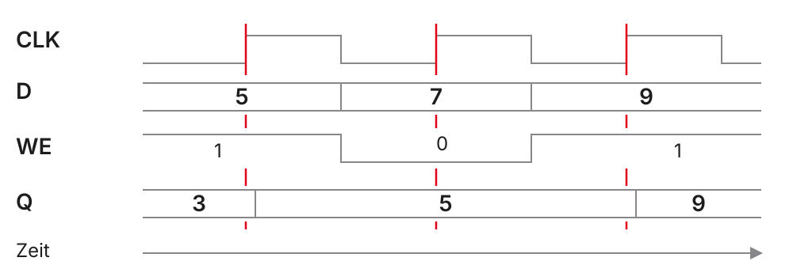
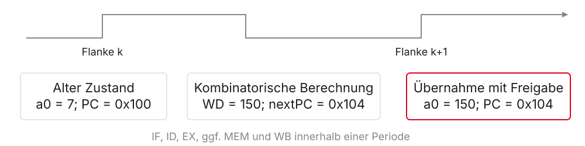
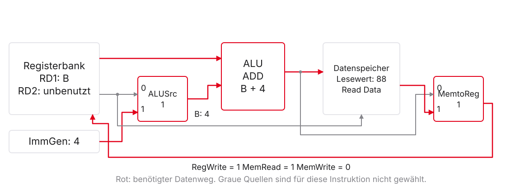
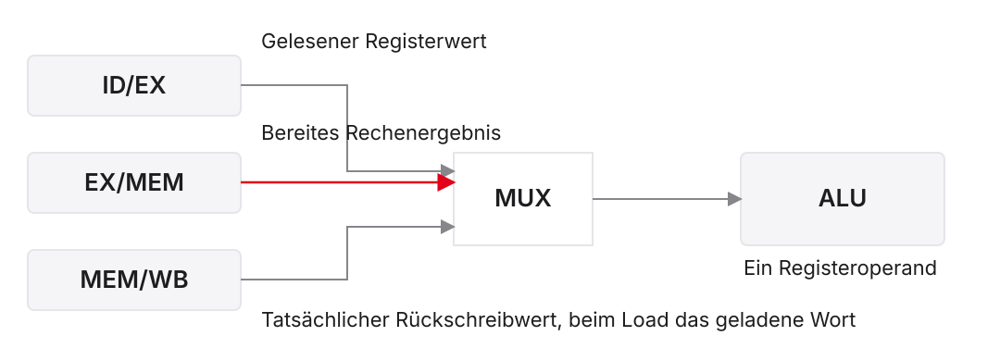

## Sieben Vorlesungen, ein Zusammenhang

| Grundlage | Darauf aufbauende Frage |
|:---|:---|
| 1: Bits, Logik, Register | Wie werden Werte dargestellt und gespeichert? |
| 2–3: Befehle, Speicher, Sprünge | Welche Zustandsänderung beschreibt das Programm? |
| 4: Funktionen und Stack | Was bleibt über einen Aufruf hinweg erhalten? |
| 5–6: Datenpfad und Steuerung | Welche Quellen und Freigaben bewirken den Befehl? |
| 7: Pipeline und Performance | Wann sind Ergebnisse verfügbar, wie lange dauert es? |

::: notes
Die Wiederholung folgt derselben Abstraktionskette wie die Veranstaltung. Zunächst beschreiben Bits Werte, kombinatorische Logik berechnet neue Werte und Register halten den Zustand. Der Befehlssatz legt fest, welche Zustandsänderungen ein Programm verlangen darf. Speicherzugriffe und Sprünge verbinden einzelne Rechnungen zu vollständigen Abläufen. Funktionen benötigen zusätzlich einen verlässlichen Vertrag zwischen aufrufendem und aufgerufenem Code.

Datenpfad und Steuerwerk realisieren diesen Vertrag in Hardware. Eine Pipeline überlappt mehrere Befehle, muss aber dieselben sichtbaren Ergebnisse liefern. Deshalb fragen wir bei jeder Aufgabe zuerst nach der Befehlswirkung und anschließend nach ihrer zeitlichen Umsetzung. Ein richtig berechneter Endwert beweist noch keine korrekte Registererhaltung oder ein korrektes Zeitdiagramm. Umgekehrt sagt eine niedrige Taktzahl ohne Taktperiode wenig über die Laufzeit aus. Die Folien enthalten kurze Entscheidungs- und Rechenaufgaben. Versuchen Sie, die Antwort vor dem Lesen der Notizen zu begründen; das macht Lücken im Verständnis sichtbar.
:::

## Den Vertrag vor der Rechnung festlegen

- ISA: RV32I, 32-Bit-Register, Byteadressen, hier Little Endian
- Keine komprimierten Befehle: echte Instruktionen belegen vier Byte
- ABI: ILP32, skalare Rückgabe in `a0`, Stackausrichtung 16 Byte
- Datenpfad: acht ausdrücklich unterstützte Befehle aus Vorlesung 5–6
- Pipeline: fünf Stufen und die Konventionen aus Vorlesung 7

::: notes
ISA bedeutet Instruction Set Architecture, also Befehlssatzarchitektur. RV32I ist die 32-Bit-Ganzzahlbasis von RISC-V. Ein Architekturregister hält 32 Bit; eine Speicheradresse bezeichnet ein Byte. Little Endian ist die im Kurs vereinbarte Byteordnung. Ohne die komprimierte Erweiterung C belegen die betrachteten echten Instruktionen vier Byte. Ein Pseudobefehl ist dagegen keine verlässliche Zähleinheit.

ABI steht für Application Binary Interface, die binäre Aufrufkonvention. ILP32 bezeichnet hier das Datenmodell mit 32-Bit-int, long und Zeigern sowie die passende Ganzzahlkonvention. Einfache skalare Rückgaben stehen in a0. Der Stackzeiger ist während standardkonformer Funktionen auf 16 Byte ausgerichtet.

Unser Datenpfad unterstützt Addition, Subtraktion, bitweises UND und ODER, also add, sub, and und or. Dazu kommen lw, Load Word oder Wort laden, sw, Store Word oder Wort speichern, beq, Branch if Equal oder Gleichheitssprung, und seit Vorlesung 6 addi, Add Immediate oder Addition einer Konstanten. Andere bekannte Befehle sind damit nicht automatisch implementiert. Die Pipeline ist ebenfalls ein Lehrmodell. Trennen Sie Befehlswirkung, Aufrufvertrag und Hardwaremodell ausdrücklich; so vermeiden Sie, eine lokale Vereinfachung als allgemeine RISC-V-Regel zu verwenden.
:::

## ISA und Mikroarchitektur beantworten andere Fragen

```asm
add a0, t0, t1
```

| Ebene | Was lässt sich daraus ableiten? |
|:---|:---|
| ISA | Alte Quellwerte addieren, untere 32 Bit nach `a0` |
| ABI | `a0` ist ein Argument- und Rückgaberegister |
| Mikroarchitektur | Konkreter Datenweg, Taktzahl, Konfliktbehandlung |

Gleiche Befehlswirkung verlangt keine gleiche Ausführungszeit.

::: notes
ISA heißt Instruction Set Architecture, Befehlssatzarchitektur. Sie legt die sichtbare Wirkung einer Instruktion fest. add liest hier die alten Registerwerte aus t0 und t1, addiert modulo zwei hoch 32 und schreibt nach a0. t0 und t1 sind die temporären Register x5 und x6, a0 ist x10. Welche Werte gerade darin stehen, muss die Aufgabe zusätzlich angeben.

ABI bedeutet Application Binary Interface, die binäre Aufrufkonvention. Sie gibt den Registern Rollen beim Zusammenarbeiten von Funktionen. Dass a0 häufig eine Rückgabe trägt, ändert die Hardwarewirkung von add nicht. Außerhalb einer Aufrufgrenze ist es weiterhin ein beschreibbares Ganzzahlregister.

Eine Mikroarchitektur ist die konkrete Realisierung des Befehlssatzes. Ein Single-Cycle-Prozessor führt den Befehl innerhalb einer langen Periode aus; eine Pipeline kann seine Teilaufgaben auf mehrere kürzere Perioden verteilen und mit anderen Instruktionen überlappen. Beide müssen dieselbe beobachtbare Addition liefern. Taktzahl und Forwarding ergeben sich daher nicht aus dem ISA-Namen allein. Auch RISC-V als regelmäßig aufgebauter, erweiterbarer Befehlssatz garantiert weder einen bestimmten internen Aufbau noch eine höhere Geschwindigkeit. In Klausuraufgaben müssen Behauptungen zur Zeit stets zu den genannten Modellannahmen passen.
:::

## Bitmuster brauchen eine Interpretation

Für acht Bit:

$$1010\,1100_2=\mathtt{0xAC}$$

| Lesart | Wert |
|:---|---:|
| Ohne Vorzeichen | $172$ |
| Zweierkomplement | $172-256=-84$ |
| Vorzeichenerweitert auf 32 Bit | `0xFFFFFFAC` |

Selbsttest: Welchen Wert hat das Muster `0x7C` in beiden Lesarten?

::: notes
Ein Bitmuster enthält für sich genommen keine Information darüber, ob es eine vorzeichenlose Zahl, eine Zahl im Zweierkomplement, eine Adresse oder Befehlsbits beschreibt. Hexadezimal fasst jeweils vier Bits in einer Ziffer zusammen: 1010 ergibt A und 1100 ergibt C. Der vorzeichenlose Wert ist die Summe der gesetzten Zweierpotenzen, hier 128 plus 32 plus 8 plus 4 gleich 172.

Im achtbittigen Zweierkomplement hat das höchste Bit das Gewicht minus 128. Gleichwertig ziehen wir bei gesetztem höchstem Bit 256 vom vorzeichenlosen Wert ab: 172 minus 256 ergibt minus 84. Die Vorzeichenerweiterung wiederholt dieses höchste Bit in den neu hinzukommenden Stellen. Das 32-Bit-Muster 0xFFFFFFAC beschreibt deshalb weiterhin minus 84. Nullerweiterung zu 0x000000AC würde stattdessen den Wert 172 erhalten.

Beim Selbsttest ist 0x7C gleich 01111100, also 64 plus 32 plus 16 plus 8 plus 4 gleich 124. Das höchste Bit ist null, daher liefern beide Lesarten 124. Der achtbittige Zweierkomplementbereich reicht von minus 128 bis 127; für minus 128 existiert in derselben Breite kein positives Gegenstück.
:::

## Übertrag und Überlauf getrennt prüfen

Beispiel mit acht Bit:

$$0110\,1000_2+0011\,0100_2=1001\,1100_2$$

- Unsigned: $104+52=156$, kein Übertrag aus Bit 7
- Signed: zwei positive Operanden, negatives Ergebnis $-100$
- Vorzeichenbehafteter Überlauf trotz fehlenden äußeren Übertrags

RV32I-Rechnungen behalten die unteren 32 Bit; kein Überlauf-Flag.

::: notes
Die Rechnung nutzt absichtlich nur acht Bit, damit alle Stellen sichtbar bleiben. Unsigned bedeutet ohne Vorzeichen, signed hier Zweierkomplement. Die mathematische Summe 156 passt in den vorzeichenlosen Bereich von null bis 255; es entsteht kein neuntes Ergebnisbit. Im Zweierkomplement ist 156 dagegen außerhalb des Bereichs minus 128 bis 127. Das gespeicherte Muster 0x9C wird als minus 100 gelesen. Zwei positive Summanden und ein negatives Ergebnis zeigen den vorzeichenbehafteten Überlauf.

Der umgekehrte Fall ist ebenfalls möglich: 0xFF plus eins ergibt in acht Bit null mit äußerem Übertrag. Signed ist dies minus eins plus eins gleich null und damit ohne Überlauf. Die Prüfungen beantworten unterschiedliche Fragen. Bei einer Addition im Zweierkomplement entsteht Überlauf genau dann, wenn gleichnamige Vorzeichen der Eingaben zu einem andersnamigen Vorzeichen des Ergebnisses führen.

RV32I, die 32-Bit-RISC-V-Ganzzahlbasis, rechnet bei add und addi modulo zwei hoch 32. Die oberen herausfallenden Bits werden verworfen; ein Überlauf erzeugt weder ein arithmetisches Statusflag noch allein deshalb einen Trap. Aus der vorzeichenbehafteten Lesart eines Registers folgt keine andere Additionsschaltung.
:::

## Logik: auswählen und bitweise rechnen

Ein Ein-Bit-Multiplexer mit Auswahl $S$:

$$Y=(\overline{S}\land A)\lor(S\land B)$$

Ein Volladdierer mit eingehendem Übertrag $C_\mathrm{in}$:

$$Z=A\oplus B\oplus C_\mathrm{in}$$
$$C_\mathrm{out}=(A\land B)\lor(A\land C_\mathrm{in})\lor(B\land C_\mathrm{in})$$

Selbsttest: $S=1$ sowie $A=B=C_\mathrm{in}=1$ — welche Ausgaben?

::: notes
Kombinatorische Logik berechnet ihre Ausgabe aus den aktuellen Eingaben, ohne selbst einen gespeicherten Ablaufzustand zu besitzen. Ein Multiplexer wählt einen von mehreren Eingängen. In der ersten Gleichung bedeutet das Dach logisches UND, das nach unten offene Zeichen logisches ODER und der Überstrich Negation. Bei S gleich null bleibt A, bei S gleich eins B. Für Wortdaten wird diese Auswahl für alle Bitpositionen parallel ausgeführt.

Der Volladdierer addiert zwei Eingangsbits A und B sowie den eingehenden Übertrag C-in. Z ist das Summenbit; das eingekreiste Plus steht für exklusives ODER. C-out ist genau dann eins, wenn mindestens zwei der drei Eingaben eins sind. Für A, B und C-in gleich eins ergibt die Summe drei, binär 11: Z ist eins und C-out ebenfalls eins. Für S gleich eins ist die Multiplexerausgabe B, hier also eins. Die beiden Schaltungen sind getrennte Beispiele.

Bitweise Maschinenoperationen führen die Logik unabhängig je Position aus. Eine UND-Maske erhält ausgewählte Bits, eine ODER-Maske setzt Bits, exklusives ODER kippt Bits. Eine UND-Maske mit 0x0F erhält beispielsweise das untere Nibble, also die unteren vier Bits. Für Vereinfachungen gilt beispielsweise $(A\land B)\lor(A\land\overline{B})=A\land(B\lor\overline{B})=A$: Das Eingangsbit B ändert hier den Ausgang nicht.
:::

## Register: Die Flanke entscheidet

{.nostretch fig-alt="Zeitdiagramm: Daten 5, 7, 9 und Schreibfreigaben 1, 0, 1 ergeben nach den drei steigenden Flanken Ausgaben 5, 5, 9"}

Selbsttest: Warum erscheint der Eingabewert 7 nie am Ausgang?

::: notes
Die Abbildung zeigt von oben nach unten CLK, Clock oder Takt, D als Dateneingang, WE, Write Enable oder Schreibfreigabe, und Q als gespeicherten Ausgang. Die Zeit läuft nach rechts. Die drei roten senkrechten Markierungen kennzeichnen steigende Flanken, keine Zeitintervalle. Q beginnt mit drei. An der ersten Flanke sind D gleich fünf und WE gleich eins; nach der Übernahmeverzögerung erscheint fünf. An der zweiten Flanke liegt zwar sieben an D, aber WE ist null. Q bleibt deshalb fünf. An der dritten Flanke wird bei WE gleich eins der Wert neun übernommen.

Die Höhe des Takts allein genügt nicht für eine weitere Übernahme. Das verwendete Register reagiert auf die aktive Flanke und ist kein während der gesamten hohen Phase transparenter Speicher. Setup-Zeit bezeichnet die erforderliche Stabilität vor der Flanke, Hold-Zeit die erforderliche Stabilität danach. Die Zeichnung nimmt diese Bedingungen als erfüllt an und ist nicht maßstäblich für konkrete Verzögerungen.

Der Selbsttest trennt Quellenwert und Zustandsänderung: Ein gültiger Wert kann am Eingang vorhanden sein, ohne gespeichert zu werden. Dieselbe Unterscheidung begegnet später bei RegWrite für die Registerbank und MemWrite für den Datenspeicher.
:::

## Registerbank und Nullregister

```asm
# Anfang: t0 = 18, t1 = 7
add  t0, t0, t1
sub  x0, t0, t1
addi t2, x0, -6
```

| Danach | Wert |
|:---|---:|
| `t0` | $25$ |
| `x0` | $0$ |
| `t2` | $-6$ |

::: notes
Der RV32I-Assemblercode beschreibt drei nacheinander ausgeführte Instruktionen. RV32I ist die 32-Bit-Ganzzahlbasis von RISC-V. t0, t1 und t2 sind Namen für die temporären Register x5, x6 und x7; x0 ist das feste Nullregister. add addiert die beiden alten Quellwerte und schreibt das Ergebnis in das links stehende Zielregister. Quelle und Ziel dürfen dieselbe Registernummer besitzen: Die erste Instruktion liest 18 und sieben und hinterlässt 25 in t0.

sub bildet anschließend 25 minus sieben gleich 18. Weil das Ziel x0 ist, wird der Schreibversuch verworfen; x0 liest weiterhin null. addi, Add Immediate, addiert die codierte Konstante minus sechs zum Nullwert und schreibt das 32-Bit-Muster 0xFFFFFFFA nach t2.

Eine Registerbank hat im Kursmodell zwei Leseports und einen Schreibport. Die Quellennummern wählen gespeicherte Daten aus; sie sind nicht selbst die Operandenwerte. Der Befehlsvertrag verbietet weder das Lesen und Schreiben desselben Registers noch benötigt er dafür grundsätzlich eine zweite Instruktion. Zusätzliche Wartezyklen zwischen verschiedenen Instruktionen sind erst eine Frage der konkreten Pipeline.
:::

## Dieselben Bits, andere Operation

Anfang: `t0 = 0xFFFFFFF0`, Schiebebetrag vier.

| Operation | Ergebnis |
|:---|:---|
| `srli t1, t0, 4` | `0x0FFFFFFF` |
| `srai t1, t0, 4` | `0xFFFFFFFF` |
| `slli t1, t0, 4` | `0xFFFFFF00` |

Bei Vergleich mit `x0`: `blt` nimmt den Sprung, `bltu` nicht.

::: notes
Das Muster 0xFFFFFFF0 beschreibt im 32-Bit-Zweierkomplement minus 16, vorzeichenlos aber 4294967280. Die logische Rechtsverschiebung srli, Shift Right Logical Immediate, füllt die oberen vier Stellen mit Nullen und liefert 0x0FFFFFFF. Die arithmetische Rechtsverschiebung srai, Shift Right Arithmetic Immediate, wiederholt das bisherige höchste Bit und ergibt 0xFFFFFFFF, also minus eins. Die Linksverschiebung slli, Shift Left Logical Immediate, schiebt vier Nullen nach und verwirft die oberen vier Bits. Das Ergebnis ist 0xFFFFFF00; die Ausgangsbreite bleibt 32 Bit.

blt bedeutet Branch if Less Than und vergleicht die Quellen vorzeichenbehaftet. Minus 16 ist kleiner als null, daher wird ein gültiges Ziel genommen. bltu, Branch if Less Than Unsigned, verwendet dieselben Bits vorzeichenlos: 4294967280 ist nicht kleiner als null. Das Register selbst speichert keinen Typ.

Bei registergesteuerten Shifts der 32-Bit-RISC-V-Ganzzahlbasis RV32I zählen nur die unteren fünf Bits des Schiebebetragsregisters; ein Inhalt 36 bewirkt daher ebenfalls vier Stellen. Bei den gezeigten Immediate-Shifts muss der codierte Schiebebetrag zwischen null und 31 liegen. Die allgemeine zwölfbittige signed-Immediate-Regel lässt sich darauf nicht unverändert anwenden.
:::

## Immediate und Pseudobefehl unterscheiden

- `addi` und logische I-Immediates: zwölf Bit mit Vorzeichenerweiterung
- Bereich: $-2048$ bis $2047$
- `andi t0, t1, -1` erhält alle Bits von `t1`
- `li t0, 2048` ist erlaubt, braucht aber mehrere echte RV32I-Befehle

Selbsttest: Ist `addi t0, x0, 2048` ein gültiger Maschinenbefehl?

::: notes
Ein Immediate ist eine im Maschinenwort codierte Konstante. Bei addi, Add Immediate, ist das Feld zwölf Bit breit und wird vor der 32-Bit-Addition vorzeichenerweitert. Der Zweierkomplementbereich ist minus zwei hoch elf bis zwei hoch elf minus eins, also minus 2048 bis 2047. Der Selbsttest ist deshalb zu verneinen: 2048 passt nicht als positive Zahl in dieses Feld.

Auch andi, AND Immediate, verwendet ein vorzeichenerweitertes Immediate. Minus eins wird zu 32 Einsen und erhält bei bitweisem UND jedes Bit des Registers t1. Die zwölf Bits werden nicht einfach als positive Maske 0x00000FFF verwendet. Für spezielle Shift-Immediates gelten die zuvor besprochenen zusätzlichen Formatregeln.

li bedeutet Load Immediate und ist ein Pseudobefehl des Assemblers. Zum Laden von 2048 ist beispielsweise die echte Folge lui t0, 1 und addi t0, t0, -2048 möglich: 4096 minus 2048 ergibt 2048. lui, Load Upper Immediate, setzt dazu die oberen 20 Bits und unten zwölf Nullen. Die konkrete Expansion wird am Maschinenlisting geprüft. Für Takt- und Befehlszählungen zählen die expandierten Instruktionen; Direktiven, Labels und Kommentare zählen nicht als ausgeführte Befehle.
:::

## Maschinenwort: Felder vor Hexziffern

| Format | Felder von Bit 31 nach Bit 0 |
|:---|:---|
| R | funct7 · rs2 · rs1 · funct3 · rd · opcode |
| I | imm[11:0] · rs1 · funct3 · rd · opcode |

- `rd`, `rs1`, `rs2` codieren Registernummern mit je fünf Bit
- Opcode und Funktionsfelder bestimmen gemeinsam die Operation
- I-Format: Bits 24–20 gehören zum Immediate, nicht zu `rs2`

::: notes
R bezeichnet das Registerformat, I das Immediate-Format. Im R-Format sind die Feldbreiten von links nach rechts sieben, fünf, fünf, drei, fünf und sieben Bit. Im I-Format ersetzt das zwölfbittige Immediate die oberen beiden Felder. rd heißt Destination Register oder Zielregister; rs1 und rs2 heißen Source Register eins und zwei. opcode ist der siebenbittige Operationscode, funct3 und funct7 sind zusätzliche drei- beziehungsweise siebenbittige Funktionsfelder. Die Punkte in der Tabelle trennen Felder; sie sind keine Rechenzeichen.

Die Registernummer x10 wird als 01010 codiert, unabhängig davon, welcher Datenwert gerade in x10 liegt. add und sub teilen opcode und funct3, unterscheiden sich aber in funct7. Der Opcode allein bestimmt daher nicht immer die vollständige Operation.

Besonders wichtig für die spätere Hazard-Erkennung ist die Formatabhängigkeit: Bei addi ist das Bitfenster 24 bis 20 Teil der Konstanten. Ein zufälliger Zahlenvergleich dieses Fensters mit einem älteren Zielregister beweist keine Datenabhängigkeit. Erst der decodierte Befehl sagt, welche Register tatsächlich gelesen werden. Codieren Sie deshalb zunächst Felder und Breiten, setzen Sie anschließend das Wort zusammen und gruppieren Sie erst zuletzt in Hexziffern.
:::

## Papiercheck: Ein negatives addi codieren

```asm
addi x12, x9, -20
```

| Feld | Inhalt |
|:---|:---|
| imm[11:0] | `1111 1110 1100` |
| rs1 / funct3 | `01001` / `000` |
| rd / opcode | `01100` / `0010011` |

Welche Hexdarstellung entsteht? Lösung und Rückprüfung in den Notizen.

::: notes
addi, Add Immediate, liest hier x9, addiert minus 20 und schreibt nach x12. Die Registerinhalte werden für die Codierung nicht benötigt. Zwölfbittiges Zweierkomplement für minus 20 erhalten wir als 4096 minus 20 gleich 4076, hexadezimal FEC. Das ergibt die zwölf Bits 111111101100. rs1, Source Register eins, ist neun, binär 01001. rd, Destination Register, ist zwölf, binär 01100. Für addi gilt funct3 gleich 000 und opcode gleich 0010011.

Mit den richtigen Bitpositionen ergibt sich das Wort aus 0xFEC00000 für das Immediate, 0x00048000 für rs1, 0x00000600 für rd und 0x13 für den Opcode. Die disjunkten Felder ergeben zusammen 0xFEC48613. Zur Rückprüfung isolieren wir Bits 31 bis 20 und erhalten FEC; als zwölfbittige Zahl mit gesetztem Vorzeichenbit bedeutet dies 4076 minus 4096 gleich minus 20. Bits 19 bis 15 ergeben neun, Bits elf bis sieben zwölf.

Little Endian betrifft erst die Ablage dieses fertigen Worts im Speicher: An aufsteigenden Adressen stünden die Bytes 13, 86, C4, FE. Die Feldreihenfolge im 32-Bit-Wort wird dadurch nicht umgedreht. Diese Rechnung ist eine manuelle Codierung, kein behaupteter Toolchain-Lauf.
:::

## Speicher: Adresse, Inhalt und Byteordnung

Ein Wort `0xA1B2C3D4` liegt ab der gültigen Adresse `0x2400`.

| Byteadresse | 0x2400 | 0x2401 | 0x2402 | 0x2403 |
|:---|:---:|:---:|:---:|:---:|
| Inhalt hex | D4 | C3 | B2 | A1 |

- Little Endian: niederwertigstes Byte an der kleinsten Adresse
- Wortausrichtung: effektive Adresse durch vier teilbar
- Ein 32-Bit-Adressraum bedeutet nicht vier GiB eingebauten Speicher

::: notes
Ein Speicherzugriff benötigt eine Adresse und liefert oder verändert den dort gespeicherten Inhalt. Die angenommene Adresse 0x2400 ist keine Zahl aus dem Datenwort. Little Endian bestimmt die Reihenfolge der vier Bytes: D4 enthält die niederwertigsten acht Bits und liegt an der kleinsten Adresse. Ein Wortlesezugriff auf 0x2400 setzt daraus wieder 0xA1B2C3D4 zusammen.

Alignment bedeutet Ausrichtung. Für die im Kurs verwendeten natürlich ausgerichteten Wortzugriffe prüfen wir die effektive Byteadresse modulo vier. Die Basis 0x23FE wäre beispielsweise nicht wortausgerichtet; zusammen mit einem Offset von zwei ergäbe sie aber die korrekt ausgerichtete Zugriffsadresse 0x2400. Entscheidend ist daher nicht der Offset allein. Der Umgang mit fehlgerichteten Zugriffen außerhalb unseres Modells hängt von der Ausführungsumgebung ab.

32-Bit-Byteadressen unterscheiden theoretisch zwei hoch 32 Bytepositionen, also vier GiB, Gibibyte. Daraus folgt weder, dass alle Adressen gültig sind, noch dass so viel Arbeitsspeicher bestückt ist. Für Papierrechnungen werden deshalb Gültigkeit und Inhalt der verwendeten Speicherbereiche angegeben. Prüfen Sie bei einer Speicheransicht zusätzlich, ob sie Bytes oder bereits zusammengesetzte Wörter zeigt.
:::

## Zugriffsbreite und Erweiterung

Weiterhin: `s0 = 0x2400`, Byte dort `0xD4`.

| Befehl | Wirkung |
|:---|:---|
| `lb t0, 0(s0)` | `t0 = 0xFFFFFFD4`, also $-44$ |
| `lbu t1, 0(s0)` | `t1 = 0x000000D4`, also $212$ |
| `sb t2, 1(s0)`, `t2 = 0x12345678` | Nur Byte `0x2401` wird `0x78` |

Das anschließende `lw` ab `0x2400` liefert `0xA1B278D4`.

::: notes
s0 ist hier das Basisregister x8. lb heißt Load Byte und liest ein Byte, das anschließend auf die 32-Bit-Registerbreite vorzeichenerweitert wird. Das Byte D4 hat den vorzeichenlosen Wert 212; sein höchstes Bit ist eins. Als achtbittiges Zweierkomplement beschreibt es deshalb 212 minus 256 gleich minus 44. Die Erweiterung zu 0xFFFFFFD4 erhält diesen Wert.

lbu, Load Byte Unsigned, liest genau dieselbe Bytezelle, erweitert jedoch mit Nullen und liefert 212. Der Speicherinhalt wird von keinem der beiden Loads verändert. Der Unterschied entsteht bei der Aufbereitung zum Registerwort.

sb, Store Byte, schreibt nur die unteren acht Bits von t2 an die effektive Adresse s0 plus eins, also 0x2401. Der Wert 0x78 ersetzt dort C3. Die übrigen Bytes D4, B2 und A1 bleiben erhalten. Ein anschließendes lw, Load Word, auf der ausgerichteten Basisadresse setzt die Bytes D4, 78, B2, A1 zum Wort 0xA1B278D4 zusammen. Entsprechend liest oder schreibt ein Halbwortbefehl zwei Byte; lh erweitert anhand von Bit 15, lhu mit Nullen. Breite und Erweiterungsart sind Teile des Befehlsvertrags.
:::

## Arrays: Index in Byteoffset übersetzen

Angenommen: vier Byte pro Element, Basis `s0 = 0x3500`, Index `t0 = 3`.

```asm
slli t1, t0, 2
add  t1, s0, t1
lw   a0, 0(t1)
```

$$\mathrm{Adresse}(A[3])=\mathtt{0x3500}+4\cdot3=\mathtt{0x350C}$$

Bei bereits fortgeschaltetem Pointer nicht noch einmal den Index addieren.

::: notes
Der Code ist ein Ausschnitt der 32-Bit-RISC-V-Ganzzahlbasis RV32I für ein gültiges Array mit mindestens vier 32-Bit-Elementen. s0 hält die Basisadresse, t0 den nichtnegativen Index. slli, Shift Left Logical Immediate, verschiebt den Index um zwei Stellen und berechnet damit für diesen gültigen kleinen Index zwölf Byte. add bildet aus der Basis und diesem Byteoffset die Adresse 0x350C in t1. lw, Load Word, liest das dort gespeicherte Wort nach a0. Der Wert des Elements wurde nicht vorgegeben; aus seiner Adresse allein lässt er sich nicht bestimmen.

Das Immediate eines Loads ist ein konstanter signed-Byteoffset, kein variabler Registerindex. Deshalb ist eine Schreibweise mit t0 als lw-Offset kein Ersatz für die vorgelagerte Rechnung. Die Alternative ist ein laufender Pointer: Nach jedem verarbeiteten Wort wird die Adresse um vier erhöht. Dann darf der Schleifenindex nicht zusätzlich in dieselbe Adresse eingerechnet werden.

Die Skalierung mit vier gilt für die hier vereinbarte Elementbreite. Ein Bytearray benötigt Faktor eins, ein Halbwortarray Faktor zwei. Vor einem Zugriff müssen außerdem Indexgrenze, gültiger Speicherbereich und gegebenenfalls Ausrichtung feststehen. Eine korrekte Adressformel schützt nicht automatisch vor einem Zugriff hinter das Arrayende.
:::

## Store- und Branch-Felder richtig zusammensetzen

| Format | Aufbau des Immediate-Werts |
|:---|:---|
| S: `sw` | imm[11:5] aus [31:25], imm[4:0] aus [11:7] |
| B: `beq` | imm[12\|10:5\|4:1\|11] aus [31\|30:25\|11:8\|7] |

Für Branches: Bit 0 ist null; danach signed-Byteoffset.

$$PC=\mathtt{0x180},\quad\mathrm{Offset}=-12$$
$$PC_\mathrm{Ziel}=\mathtt{0x174},\qquad PC_\mathrm{weiter}=\mathtt{0x184}$$

::: notes
sw heißt Store Word und verwendet das S-Format. Es hat zwei Quellregister, aber kein Zielregister rd. Deshalb können die Bits elf bis sieben den unteren Teil des zwölfbittigen Immediate-Werts tragen. Für einen Offset minus acht ist das zusammengesetzte zwölfbittige Muster FF8: Die oberen sieben Bits lauten 1111111, die unteren fünf 11000.

beq, Branch if Equal, nutzt das B-Format. Die Schreibweise mit senkrechten Trennzeichen benennt einzelne Bitgruppen, keine logische ODER-Operation. Instruktionsbit 31 liefert Offsetbit zwölf, Bit sieben liefert Offsetbit elf, Bits 30 bis 25 liefern zehn bis fünf, Bits elf bis acht liefern vier bis eins. Das fehlende niederwertigste Bit wird als null ergänzt; danach wird das Ergebnis vorzeichenerweitert. Ein Offset minus zwölf hat als 13-Bit-Muster 0x1FF4 die Gruppen 1, 111111, 1010, 1 in der Tabellenreihenfolge.

PC ist der Program Counter, die Adresse der aktuellen Instruktion. Der Byteoffset bezieht sich auf diesen alten PC, nicht auf PC plus vier. Hexadezimal ist zwölf gleich 0xC; 0x180 minus 0xC ergibt 0x174. Ohne genommenen Sprung folgt 0x184. Unser Immediate-Generator liefert bereits den fertigen Byteoffset; ein weiteres Linksverschieben wäre falsch.
:::

## Schleifen: Kontrollfluss vollständig verfolgen

```asm
# Anfang: s0 = gültige Arraybasis, s1 = 3, t0 = t1 = 0
Loop:
  bge  t0, s1, Done
  lw   t2, 0(s0)
  add  t1, t1, t2
  addi s0, s0, 4
  addi t0, t0, 1
  jal  x0, Loop
Done:
```

Arraywerte: `[7, -2, 4]`. Selbsttest: Endsumme und dynamische Befehlszahl?

::: notes
Der Ausschnitt summiert ein gültiges Array mit drei Wörtern. s0 enthält den laufenden Pointer, s1 die nichtnegative Anzahl, t0 die Zahl bereits verarbeiteter Elemente, t1 die laufende Summe und t2 den jeweils geladenen Wert. bge, Branch if Greater or Equal, beendet die Schleife, sobald t0 mindestens s1 ist. lw, Load Word, liest das aktuelle Wort; add summiert; die beiden addi-Befehle erhöhen Pointer und Zähler. jal x0 springt ohne gespeicherten Rückkehrlink zum Label Loop. Done bezeichnet die erste Instruktion außerhalb des gezählten Ausschnitts.

Am Schleifenkopf gehören zusammen: t0 gleich null, eins, zwei, drei und t1 gleich null, sieben, fünf, neun. Nach drei Durchläufen ist die Endsumme neun und s0 um zwölf Byte erhöht. Die Kopfbedingung wird viermal ausgeführt. Die übrigen fünf Befehle werden je dreimal ausgeführt. Dynamisch schließen daher vier plus fünf mal drei gleich 19 Instruktionen ab. Labels und Anfangswertvorgaben zählen nicht; die Initialisierung liegt außerhalb der Zählgrenze.

Bei s1 gleich null wird schon die erste Bedingung genommen. Es findet kein Load statt, die Summe bleibt null und der Ausschnitt führt genau eine Instruktion aus. Dieser Randfall erklärt, weshalb der Test vor dem Zugriff stehen muss.
:::

## Aufruf und Rückkehr sind Adressoperationen

Bei altem $PC=\mathtt{0x200}$:

| Befehl | Ziel | Linkwert |
|:---|:---|:---|
| `jal ra, +32` | `0x220` | `ra = 0x204` |
| `jalr ra, 0(t0)`, `t0 = 0x301` | `0x300` | `ra = 0x204` |
| `ret` | `ra` mit Bit 0 gelöscht | kein gespeicherter Link |

`ret` stellt weder `sp` noch gesicherte Register automatisch wieder her.

::: notes
PC bedeutet Program Counter, das Befehlsadressregister. jal heißt Jump and Link und berechnet sowohl das Ziel als auch den Rückkehrlink aus dem alten PC. Für einen Byteoffset von 32, also 0x20, entstehen Ziel 0x220 und Link 0x204. ra, Return Address, ist der Konventionsname von x1; der Befehl kann grundsätzlich ein anderes Zielregister für den Link verwenden.

jalr, Jump and Link Register, bildet das Ziel aus dem alten rs1-Quellwert und dem signed-Immediate und löscht anschließend Zielbit null. Bei t0 gleich 0x301 und Offset null wird 0x300 angesprungen. Der Link bleibt alter PC plus vier. Das Löschen nur eines Bits garantiert allgemein keine Vier-Byte-Ausrichtung; unser konkretes Beispiel ist korrekt ausgerichtet.

ret, Return, ist der Pseudobefehl jalr x0, 0(ra). x0 verwirft den neu berechneten Link. Die Instruktion springt lediglich zur vorhandenen Rückkehradresse. Der Stackzeiger sp, Stack Pointer, und gesicherte Register müssen zuvor durch explizite Befehle wiederhergestellt sein. Die Tabelle behandelt die drei Fälle unabhängig mit jeweils genanntem Anfangszustand; sie ist keine direkt hintereinander ausgeführte Befehlsfolge.
:::

## ABI: Wer muss welchen Wert erhalten?

| Registergruppe | Vertrag über einen normalen Aufruf |
|:---|:---|
| `a0–a7`, `t0–t6` | Caller muss noch benötigte Werte schützen |
| `s0–s11` | Callee muss geänderte Werte wiederherstellen |
| `ra` | Ein weiterer Aufruf kann den alten Link überschreiben |
| `sp` | Bei Rückkehr wieder der Eintrittswert |

Selbsttest: Ein Wert in `t2` wird nach `jal` noch benötigt. Ist er sicher?

::: notes
ABI bedeutet Application Binary Interface, die binäre Funktionskonvention. Caller ist die aufrufende Funktion, Callee die aufgerufene; eine Funktion kann beide Rollen besitzen. a0 bis a7 sind Argumentregister, a0 trägt auch unsere einfache skalare Rückgabe. t0 bis t6 sind temporäre Register. Beide Gruppen sind caller-saved: Benötigt der Caller ihren alten Wert später noch, muss er selbst eine sichere Lebensdauer herstellen, etwa durch einen Stackslot oder ein korrekt gesichertes s-Register.

Die Antwort zum Selbsttest lautet deshalb: t2 ist durch den Aufrufvertrag nicht geschützt. Es kann zufällig unverändert bleiben, doch darauf darf der aufrufende Code nicht vertrauen. Callee-saved sind s0 bis s11: Wer sie verändert, muss am Ende den Eintrittswert wiederherstellen. Eine Kopie nach s0 ohne Sicherung des vorherigen s0 verletzt ebenfalls die Konvention.

jal, Jump and Link, schreibt einen Rückkehrlink nach ra, Return Address. Eine Nichtblattfunktion, die einen normalen weiteren Aufruf durchführt und anschließend zurückkehren will, muss den eigenen Link vorher bewahren. sp, Stack Pointer, bezeichnet den Stackzeiger. Er muss ausgerichtet bleiben und bei Rückkehr wieder den Eintrittswert haben. Die Hardware prüft diese Pflichten nicht automatisch; sie entstehen aus dem Softwarevertrag.
:::

## Stackframe: Platz, Inhalt und Ausrichtung

Angenommen: `sp = 0xA000`, Sicherung von `ra` und `s0`.

```asm
addi sp, sp, -16
sw   ra, 12(sp)
sw   s0,  8(sp)
# ... Funktionsrumpf ...
lw   s0,  8(sp)
lw   ra, 12(sp)
addi sp, sp, 16
ret
```

Neuer `sp = 0x9FF0`; Slots bei `0x9FFC` und `0x9FF8`.

::: notes
sp ist der Stack Pointer, ra die Return Address und s0 ein zu erhaltendes Register. Der Prolog in RV32I, der 32-Bit-RISC-V-Ganzzahlbasis, reserviert einen 16-Byte-Frame, obwohl nur zwei Wörter, zusammen acht Byte, gesichert werden. Die Standard-Ganzzahlkonvention ILP32 mit 32-Bit-int, long und Zeigern verlangt die 16-Byte-Ausrichtung des Stackzeigers während der Funktion. Beide Sicherungen teilen sich denselben Frame; die übrigen acht Byte sind hier Padding, also ungenutzter Ausrichtungsraum.

addi, Add Immediate, verändert zunächst nur den Zeiger. Erst sw, Store Word, schreibt die Registerwerte in den reservierten Speicher. Von 0xA000 um 16 Byte nach unten gelangen wir zu 0x9FF0. Der Slot 12(sp) liegt bei 0x9FFC, 8(sp) bei 0x9FF8. Beide Wortadressen sind ausgerichtet und gehören zum angenommenen gültigen Stackbereich.

Der Epilog stellt mit lw, Load Word, zuerst die alten Werte wieder her und gibt danach den Frame frei. ret springt über den restaurierten Link zurück. Die Auslassung markiert bewusst einen nicht dargestellten Funktionsrumpf; dies ist ein Frame-Schema, keine vollständig spezifizierte Rechenfunktion. Der Stack arbeitet nach dem Prinzip zuletzt angelegt, zuerst freigegeben. Bei verschachtelten Aufrufen reserviert jede Funktion ihren eigenen, nicht überlappenden Frame.
:::

## Nichtblattfunktion: Zwei Lebensdauern schützen

```asm
# compose(x): helper(x) + x; helper(x) liefert x + 5
compose:
  addi sp, sp, -16
  sw   ra, 12(sp)
  sw   s0,  8(sp)
  addi s0, a0, 0
  jal  ra, helper
  add  a0, a0, s0
  lw   s0,  8(sp)
  lw   ra, 12(sp)
  addi sp, sp, 16
  ret
```

Für $x=6$: Ergebnis $17$; alter `s0`, `ra` und `sp` wiederhergestellt.

::: notes
Der Code verwendet RV32I, die 32-Bit-RISC-V-Ganzzahlbasis, und den Vertrag der Ganzzahl-ABI, Application Binary Interface. sp ist der Stack Pointer oder Stackzeiger. a0 trägt anfangs das Argument x und am Ende das Ergebnis. helper ist eine separat angenommene vertragskonforme Blattfunktion, die addi a0, a0, 5 und ret ausführt. Sie benötigt keinen eigenen Frame und verändert kein s-Register. Für die kleinen Beispielwerte tritt kein relevanter Zahlenbereichsrand auf.

compose muss zwei verschiedene Lebensdauern schützen. Der Eintrittswert von ra, Return Address, wird vom jal-Aufruf, Jump and Link, überschrieben; er liegt deshalb vorher im Stackslot 12(sp). Das ursprüngliche x in a0 muss nach helper noch verfügbar sein. compose kopiert es mit addi s0, a0, 0 nach s0. Weil s0 callee-saved ist, bewahrt die Funktion dessen fremden Eintrittswert im Slot 8(sp).

Für x gleich sechs bleibt in s0 sechs stehen, helper liefert elf in a0 und add berechnet 17. Anschließend lädt lw, Load Word, s0 und ra aus den mit sw, Store Word, belegten Slots und der 16-Byte-Frame wird freigegeben; ret kehrt zum unmittelbaren Aufrufer von compose zurück. Würde x ungeschützt in t0 aufbewahrt, könnte eine andere zulässige Implementierung von helper es zerstören. Die gezeigte Sicherung bleibt dagegen unabhängig von deren temporären Registern korrekt.
:::

## Single Cycle: Berechnen, dann übernehmen

{.nostretch fig-alt="Zwischen zwei steigenden Flanken: alter Zustand, kombinatorisch berechnete Schreibdaten und Folgeadresse, danach Übernahme mit Freigabe"}

- Datenweg liefert den möglichen neuen Wert
- Steuerwerk wählt Quellen und erlaubt Zustandsänderungen
- Fünf logische Tätigkeiten sind hier keine fünf Takte

::: notes
Single Cycle bedeutet, dass ein unterstützter Befehl innerhalb einer Taktperiode ausgeführt wird. Die Abbildung liest sich von links nach rechts. Nach der ersten steigenden Flanke liegt der alte Zustand vor, hier a0 gleich sieben und PC gleich 0x100. PC heißt Program Counter, das Befehlsadressregister. Die kombinatorische Schaltung bereitet während der Periode WD gleich 150 und nextPC gleich 0x104 vor. WD, Write Data, bezeichnet die Daten am Registerschreibport. Erst die nächste aktive Flanke übernimmt sie bei gesetzter Schreibfreigabe; dann ist a0 tatsächlich 150.

Das Bild ist ein übernommenes Zahlenbeispiel aus Vorlesung 5 und zeigt Eingang, Berechnung und gespeicherten Ausgang getrennt. Die rote Umrandung markiert die Übernahme, keine zusätzliche Rechenstufe. Die Zeitachse ist schematisch, ohne gemessene Nanosekunden.

IF, Instruction Fetch oder Befehl holen, ID, Instruction Decode oder decodieren und Register lesen, EX, Execute oder rechnen, MEM, Memory Access oder Datenzugriff, und WB, Write Back oder Rückschreiben, bezeichnen in diesem Modell Tätigkeiten innerhalb derselben Periode. Erst Pipeline-Register machen daraus getrennte Taktstufen. Eine gültige Leitung ohne Freigabe verändert noch keinen gespeicherten Zustand.
:::

## Load und Store: Adresse und Daten

{.nostretch fig-alt="Load-Pfad: Basis B und Offset vier zur ALU, geladener Wert 88 über MemtoReg zurück zur Registerbank"}

`lw`: Adresse $B+4$ → Wert $88$ nach `a0`.\
`sw`: Adresse $B+8$ ← Wert aus `a0`, kein Registerziel.

::: notes
lw heißt Load Word, sw Store Word. Für das abgebildete Load-Beispiel enthält s1 die gültige, ausgerichtete Basis B; das Wort an B plus vier hat den angenommenen Wert 88. Die Registerbank liefert RD1, Read Data eins, als Basis. ImmGen, Immediate Generator, liefert vier. Der Multiplexer ALUSrc, ALU Source, wählt mit eins dieses Immediate als zweiten Eingang der ALU, Arithmetic Logic Unit oder arithmetisch-logischen Recheneinheit. Ihr Ergebnis ist die Adresse B plus vier.

Der Datenspeicher liefert dort 88. MemtoReg, Memory to Register, wählt mit eins diesen Lesewert anstelle der Adresse. RegWrite, Register Write, erlaubt die Übernahme nach a0; MemRead, Memory Read, ist eins und MemWrite, Memory Write, null. Die roten Pfeile zeigen den benötigten Datenweg, graue Wege ungewählte Alternativen. Der Rückweg transportiert den Speicherinhalt zur Registerbank. Er schreibt nicht sofort ohne Flanke. PC, Program Counter oder Befehlsadressregister, und Befehlsholen sind in dieser Detailabbildung ausgelassen.

Beim darunter genannten Store berechnet die ALU entsprechend B plus acht. Die Schreibdaten stammen separat aus dem zweiten Registerlesewert RD2, Read Data zwei, hier a0. MemWrite muss eins und RegWrite null sein. Ein Fehler in MemtoReg ist bei korrekt gesperrtem Registerschreiben für den Store bedeutungslos; ein Fehler in MemWrite ist es nicht.
:::

## Branch: Bedingung und Ziel getrennt herleiten

Für `beq t0, t1, Ziel`:

$$\mathrm{Zero}=(R[t0]-R[t1]=0)$$
$$PC_\mathrm{Ziel}=PC+\mathrm{Byteoffset}$$
$$\mathrm{PCSrc}=\mathrm{Branch}\land\mathrm{Zero}$$

Bei `PC = 0x400`, Offset $+20$:

Gleichheit → `0x414`; Ungleichheit → `0x404`.

::: notes
beq bedeutet Branch if Equal und vergleicht die beiden Registerinhalte. R[t0] und R[t1] bezeichnen diese Inhalte; die Registernamen sind keine Zahlenwerte für die Subtraktion. Unser Lehrmodell nutzt die ALU, Arithmetic Logic Unit, zum Subtrahieren. Das Signal Zero ist eins, wenn das Ergebniswort null ist. Die Gleichheit funktioniert unabhängig von einer signed- oder unsigned-Interpretation.

Parallel bildet ein Zieladdierer aus dem alten PC, Program Counter, und dem bereits vorzeichenerweiterten Byteoffset die Sprungadresse. 20 dezimal sind 0x14; deshalb ergibt sich aus 0x400 das Ziel 0x414. Der andere Kandidat ist PC plus vier gleich 0x404. PCSrc, Program Counter Source, wählt erst dann das Ziel, wenn sowohl Branch als Freigabe dieser Befehlsart als auch Zero eins sind.

Eine sub-Instruktion mit Ergebnis null setzt zwar ebenfalls Zero, aber Branch ist null. Sie springt daher nicht. Umgekehrt reicht ein beq-Opcode ohne Gleichheit nicht für einen genommenen Sprung. beq schreibt weder ein allgemeines Register noch den Datenspeicher. Andere Implementierungen können einen separaten Vergleicher benutzen; die hier gezeigten internen Wege sind die Annahme des Kursmodells.
:::

## Der längste Pfad begrenzt den Takt

Angenommene Lehrwerte für einen vollständigen Load-Pfad:

| Befehlslesen | Registerlesen | Rechnen | Datenlesen | Rückweg |
|:---:|:---:|:---:|:---:|:---:|
| 180 ps | 90 ps | 140 ps | 240 ps | 90 ps |

Zusätzlich 20 ps für Registerausgang und Setup zusammen:

$$T_\mathrm{SC}=180+90+140+240+90+20=760\,\mathrm{ps}$$

Auch ein `add` erhält im selben Single-Cycle-Modell einen ganzen Takt.

::: notes
T-SC ist die Taktperiode des Single-Cycle-Modells. ps bedeutet Pikosekunde, ein Billionstel einer Sekunde. Die angegebenen Verzögerungen sind neue didaktische Annahmen und ersetzen für dieses Rechenbeispiel die Zahlen der ursprünglichen Vorlesung. Der Load-Pfad wird ausdrücklich als längster relevanter Pfad angenommen; weitere Steuer- und Auswahlverzögerungen sind in den jeweiligen Teilwerten enthalten. Die 20 Pikosekunden berücksichtigen zusammen Ausgangsverzögerung eines Registers und notwendige Setup-Zeit vor der nächsten Übernahme.

Die Summe der fünf kombinatorischen Teilwege ist 740 Pikosekunden; zusammen mit dem Registeranteil ergeben sich 760. Eine frühere Flanke könnte Daten übernehmen, bevor sie stabil sind. Die passende maximale Frequenz wäre im Modell eins durch 760 Pikosekunden, ungefähr 1,32 Gigahertz.

Ein add benötigt zwar keinen Datenlesezugriff. Ein Prozessor mit festem gemeinsamen Single-Cycle-Takt schließt aber auch add erst mit der nächsten Flanke ab. Die unbenötigte Pfadlaufzeit wird nicht als eigener kürzerer Takt genutzt. Eine Pipeline kann diese Wartezeit anders verteilen; dafür kommen mehrere Registerübergänge und eine andere Latenz hinzu. Laufzeiten sind deshalb immer zusammen mit dem Architekturmodell zu beurteilen.
:::

## Steuertabelle aus der Wirkung ableiten

| Befehl | ALUSrc | MemtoReg | RegWrite | MemRead | MemWrite | Branch |
|:---|:---:|:---:|:---:|:---:|:---:|:---:|
| `add/sub/and/or` | 0 | 0 | 1 | 0 | 0 | 0 |
| `lw` | 1 | 1 | 1 | 1 | 0 | 0 |
| `sw` | 1 | X | 0 | 0 | 1 | 0 |
| `beq` | 0 | X | 0 | 0 | 0 | 1 |
| `addi` | 1 | 0 | 1 | 0 | 0 | 0 |

Erst Quellen wählen, dann erlaubte Zustandsänderungen prüfen.

::: notes
Die Tabelle beschreibt genau das erweiterte Subset aus Vorlesung 6, nicht jeden RV32I-Befehl. RV32I ist die 32-Bit-RISC-V-Ganzzahlbasis. ALU steht für Arithmetic Logic Unit. ALUSrc wählt den zweiten Rechenoperanden: null bedeutet Registerwert, eins Immediate. MemtoReg, Memory to Register, wählt den Registerschreibwert: null bedeutet ALU-Ergebnis, eins Speicherlesewert. RegWrite erlaubt das Schreiben eines Registers. MemRead und MemWrite erlauben Lesen beziehungsweise Schreiben des Datenspeichers. Branch gibt den Gleichheitssprung frei.

Bei Registeroperationen werden zwei Register gelesen und das Rechenergebnis zurückgeschrieben. Ein Load nutzt Basis plus Immediate und schreibt den gelesenen Inhalt zurück. Ein Store benutzt dieselbe Adressaddition, schreibt aber den zweiten Registerwert in den Speicher. beq vergleicht zwei Register, erlaubt keinen dieser beiden Schreibzugriffe und lässt die separate Zielauswahl zu. addi verbindet Immediate als Rechenquelle mit ALU-Ergebnis als Schreibquelle.

X heißt Don't Care: Bei sw und beq verhindert RegWrite gleich null ohnehin eine Übernahme. Deshalb ist die dortige Rückschreibquellenauswahl unerheblich. Andere Signale werden dadurch nicht beliebig. Die Haupttabelle legt Quellen und Freigaben fest; welche Rechenoperation im Detail erforderlich ist, wird zusätzlich durch die ALU-Steuerung bestimmt.
:::

## Hauptsteuerung und ALU-Steuerung trennen

| Gruppe | ALUOp | ALUControl im Kurs |
|:---|:---:|:---|
| `lw/sw/addi` | `00` | Addition `0010` |
| `beq` | `01` | Subtraktion `0110` |
| `add/sub/and/or` | `10` | Funktionsfelder auswerten |

Registergruppe: `add 0010`, `sub 0110`, `and 0000`, `or 0001`.

Selbsttest: Warum macht Bit 30 aus `addi` keine Subtraktion?

::: notes
ALU bedeutet Arithmetic Logic Unit, die arithmetisch-logische Einheit. ALUOp, ALU Operation, ist die zweibittige Aufgabenkategorie aus der Hauptsteuerung. ALUControl ist das vierbittige konkrete Rechenkommando unserer Detailsteuerung. Die dargestellten Werte sind eine interne Kurscodierung; die RISC-V-Spezifikation schreibt diese Leitungen nicht vor.

Load Word, lw, Store Word, sw, und Add Immediate, addi, benötigen fest Addition. beq, Branch if Equal, benutzt im Modell die Subtraktion zum Gleichheitstest. Nur in der hier unterstützten Registergruppe muss aus den zusätzlichen Befehlsfeldern zwischen add, sub, and und or gewählt werden. add und sub besitzen funct3 gleich 000 und unterscheiden sich durch funct7 gleich 0000000 beziehungsweise 0100000. and hat funct3 gleich 111, or gleich 110, jeweils mit funct7 gleich 0000000.

Bit 30 ist bei addi Teil des Immediate-Werts, kein allgemeines Subtraktionsbit. Beispielsweise hat das gültige Immediate minus eins alle zwölf Bits gesetzt. Dennoch muss addi eine Addition mit minus eins ausführen. Eine korrekte Decodierung berücksichtigt deshalb zuerst die Instruktionsgruppe und erst dann deren passende Funktionsfelder. Gleiche Bitpositionen haben in verschiedenen Formaten unterschiedliche Aufgaben. Die zwei Steuerungsebenen sind kombinatorische Funktionen und benötigen keine zwei eigenen Takte.
:::

## Don't Care: Welche Wirkung bleibt?

Für gültig erkannte Gruppen $R,L,S,B,I$:

$$\mathrm{RegWrite}=R\lor L\lor I,\quad
\mathrm{ALUSrc}=L\lor S\lor I$$

| Änderung bei `sw` | Folge |
|:---|:---|
| MemtoReg kippt, RegWrite = 0 | Keine sichtbare Wirkung |
| MemWrite wird 0 | Gewünschter Store fehlt |
| RegWrite wird 1 | Unerlaubter Registerschreibversuch möglich |

X: Auswahl unerheblich bei gesperrter Übernahme.

::: notes
R erkennt eine der vier gültigen Registeroperationen, L Load Word, S Store Word, B Branch if Equal und I Add Immediate. Die fünf Ein-Bit-Gruppensignale schließen sich für eine gültige Instruktion gegenseitig aus. RegWrite, Register Write, darf genau bei R, L oder I eins sein; ALUSrc, ALU Source für die Arithmetic Logic Unit, wählt genau bei L, S oder I das Immediate. Das logische ODER in den Formeln beschreibt diese Bedingungen.

MemtoReg, Memory to Register, ist nur eine Quellenauswahl vor dem Registerschreibport. Bei einem sw, Store Word, ist RegWrite null; die Auswahl verändert deshalb kein Architekturregister. MemWrite, Memory Write, ist dagegen die erforderliche Freigabe des eigentlichen Stores. Wird sie null, bleibt der gewünschte Speicherzustand aus.

Ein fälschlich gesetztes RegWrite kann beim S-Format die Bits elf bis sieben als Zielnummer missbrauchen, obwohl sie hier Immediate-Bits sind. Ob tatsächlich ein Registerwert sichtbar verändert wird, hängt zusätzlich von dieser Nummer, dem gewählten Datenwort und dessen altem Wert ab. Insbesondere verwirft x0 einen Schreibversuch. Ein Don't Care ist also eine begründete Unbeobachtbarkeit unter gültigen Voraussetzungen. Es erlaubt weder ungültige Opcode-Muster noch ein beliebiges Setzen von Schreibfreigaben.
:::

## Performance: Drei Größen zusammen betrachten

$$t=N\cdot\mathrm{CPI}\cdot T,\qquad
\mathrm{CPI}=\frac{C}{N}$$

Gleiche Aufgabe, jeweils $N=120$ abgeschlossene Instruktionen:

| Entwurf | CPI | Taktperiode | Laufzeit |
|:---|:---:|:---:|---:|
| A | $1{,}5$ | $2\,\mathrm{ns}$ | $360\,\mathrm{ns}$ |
| B | $2$ | $1{,}2\,\mathrm{ns}$ | $288\,\mathrm{ns}$ |

B ist trotz höherem CPI um Faktor $1{,}25$ schneller.

::: notes
N ist die dynamische Zahl abgeschlossener Maschineninstruktionen innerhalb der angegebenen Zählgrenze. C ist die dafür benötigte Taktzahl und CPI heißt Cycles per Instruction, mittlere Takte je abgeschlossener Instruktion. T ist die Taktperiode; ns bedeutet Nanosekunde. Die Laufzeit t ist C mal T und damit N mal CPI mal T. Die Werte sind ein angenommenes Vergleichsbeispiel, keine Messung.

Für A ergeben 120 mal 1,5 gleich 180 Takte mit je zwei Nanosekunden eine Laufzeit von 360 Nanosekunden. B benötigt 240 Takte, hat aber die kürzere Periode: 240 mal 1,2 ergibt 288 Nanosekunden. Der Speedup ist die alte durch die neue Laufzeit, also 360 durch 288 gleich 1,25. Eine isolierte Betrachtung von CPI hätte hier zur falschen Rangfolge geführt.

Auch N darf bei einem allgemeinen Vergleich unterschiedlicher Übersetzungen variieren. Hier wurde es ausdrücklich gleichgesetzt, damit der Takt-CPI-Zusammenhang sichtbar wird. Eine Pseudobefehlszeile kann mehrere echte Befehle darstellen; verworfene Instruktionen und Hardware-Bubbles erhöhen N nicht. Sie können jedoch C und damit die Laufzeit erhöhen. Ein fairer Vergleich nennt Aufgabe, Anfangszustand und Zählgrenze.
:::

## Pipeline: Überlappung erhöht den Durchsatz

| Instruktion / Takt | 1 | 2 | 3 | 4 | 5 | 6 | 7 |
|:---|:---:|:---:|:---:|:---:|:---:|:---:|:---:|
| I1 | IF | ID | EX | MEM | WB | | |
| I2 | | IF | ID | EX | MEM | WB | |
| I3 | | | IF | ID | EX | MEM | WB |

Ohne Zusatzzyklen: $C=N+4$.

Mit den zuvor angenommenen Lehrwerten: $T_\mathrm{P}=240+20=260\,\mathrm{ps}$.

Einzelbefehl: $1300\,\mathrm{ps}$ Latenz; danach ideal ein Abschluss je Takt.

::: notes
Die Tabelle liest sich waagerecht als Weg einer Instruktion und senkrecht als gleichzeitig belegte Stufen. IF heißt Instruction Fetch, Befehl holen; ID Instruction Decode, decodieren und Register lesen; EX Execute, rechnen; MEM Memory Access, Datenzugriff; WB Write Back, Rückschreiben. Pipeline-Register zwischen den Stufen transportieren Daten, Zielnummer, Gültigkeit und die zur selben Instruktion gehörenden Steuersignale. Ein Strukturkonflikt entsteht, wenn mehrere Instruktionen gleichzeitig dieselbe unzureichend verfügbare Hardwarequelle benötigen. Getrennte Befehls- und Datenzugriffspfade vermeiden hier den Konflikt zwischen IF und MEM; das Raster nimmt keine Strukturkonflikte an.

Gezählt wird von der ersten IF-Stufe einer leeren Pipeline bis zur letzten WB-Stufe. Die erste Instruktion braucht fünf Takte. Jede weitere ergänzt bei konfliktfreier Überlappung einen Takt; deshalb C gleich fünf plus N minus eins, also N plus vier. Drei Instruktionen benötigen sieben Takte. Die vier Zusatzpositionen sind bereits in dieser Formel enthalten und werden nicht nochmals als Leerung addiert.

Die angenommenen Teilzeiten 180, 90, 140, 240 und 90 Pikosekunden stammen von der vorherigen Timing-Rechnung. Die längste Stufe plus 20 Pikosekunden Registeranteil ergibt die Pipeline-Periode 260 Pikosekunden. Ein Einzelbefehl braucht fünf mal 260 gleich 1300 Pikosekunden und hat damit eine größere Latenz als die 760 Pikosekunden des Single-Cycle-Entwurfs. Der Gewinn entsteht beim Durchsatz vieler überlappter Befehle, nicht bei dieser Einzellatenz.
:::

## Forwarding: Verfügbarkeit entscheidet

{.nostretch fig-alt="Ein Multiplexer vor der ALU wählt den alten ID/EX-Wert, ein bereites EX/MEM-Ergebnis oder den tatsächlichen MEM/WB-Rückschreibwert"}

- Jüngster Treffer; RegWrite = 1 und `rd ≠ x0`
- Load nach EX: Adresse statt geladener Daten

::: notes
Forwarding, auch Bypassing oder Weiterleitung, ersetzt einen zuvor in ID gelesenen alten Registerwert am Recheneingang in EX. ID heißt Instruction Decode, EX Execute, MEM Memory Access und WB Write Back. ID/EX, EX/MEM und MEM/WB bezeichnen die Pipeline-Register zwischen diesen Stufen. In der Abbildung laufen drei mögliche Quellen von links zum MUX, Multiplexer oder Quellenauswahl, und weiter zur ALU, Arithmetic Logic Unit.

Der obere Weg trägt den ursprünglich gelesenen Registerwert. Der rot hervorgehobene mittlere Weg zeigt ein bereits bereites Rechenergebnis aus EX/MEM. Unten steht der tatsächliche Rückschreibwert aus MEM/WB; bei einem Load ist dies das geladene Wort. Die Abbildung stellt einen Registeroperanden dar; der zweite benötigt gegebenenfalls dieselbe Behandlung. Die Farben kennzeichnen Quellen, keine gemessenen Zeitwerte.

Bei add t0, t1, t2, anschließend addi t0, t0, 2 und danach sub t3, t0, t4 muss sub den jüngeren Wert aus addi verwenden. Voraussetzung eines Treffers sind eine tatsächlich benutzte Quelle, gesetztes RegWrite und ein Ziel rd ungleich x0. Ein Load hat nach EX zunächst nur die Adresse erzeugt. Diese darf nicht als geladener Datenwert weitergereicht werden. Auch ein Forwarding-Treffer auf die jüngere, noch nicht fertige Load-Quelle erlaubt keinen Rückgriff auf einen veralteten älteren Wert.
:::

## Load-Use: Eine Lücke bleibt erforderlich

```asm
lw  t0, 0(s0)     # gültige Adresse, Wort dort = 31
sub t1, t0, t2    # t2 = 6
```

| Instruktion / Takt | 1 | 2 | 3 | 4 | 5 | 6 | 7 |
|:---|:---:|:---:|:---:|:---:|:---:|:---:|:---:|
| `lw` | IF | ID | EX | MEM | WB | | |
| `sub` | | IF | ID | ID | EX | MEM | WB |
| Bubble | | | | EX | MEM | WB | |

Im Takt 4 warten PC und IF/ID; der Load läuft weiter. Ergebnis: `t1 = 25`.

::: notes
lw, Load Word, liefert das angenommene Speicherwort 31. sub benötigt diesen Wert als ersten Operanden und zieht den alten Inhalt sechs von t2 ab. IF heißt Instruction Fetch, ID Instruction Decode mit Registerlesen, EX Execute, MEM Memory Access und WB Write Back. Der Load berechnet erst in EX, Takt drei, die Adresse. Der geladene Inhalt liegt erst nach MEM, Takt vier, bereit und kann über MEM/WB zur EX-Stufe des Verbrauchers in Takt fünf weitergeleitet werden.

Ohne Warten wäre sub bereits in Takt vier in EX und damit zu früh. Die Hazard-Erkennung hält daher den Program Counter PC und das Pipeline-Register IF/ID über den betroffenen Übergang fest. sub bleibt in ID, während der ältere Load nach MEM weiterläuft. In ID/EX wird eine Bubble, also ein ungültiger und wirkungsloser Eintrag, eingefügt. Die Bubble läuft anschließend durch MEM und WB; sie ist keine zusätzliche abgeschlossene Programminstruktion. Für die zwei echten Instruktionen ergeben sich sieben statt sechs Takte.

Eine unabhängige vorhandene Instruktion wie addi a2, a2, 1 könnte zwischen beide Befehle verschoben werden, sofern dadurch weder deren Eingaben noch beobachtbare Wirkungen verändert werden. Das ist Scheduling. Ein eingefügter NOP, No Operation oder wirkungsloser Programmbefehl, füllt ebenfalls Zeit, spart aber keine Ausführungszeit.
:::

## WB und ID: Unsere Konvention beachten

```asm
add  t0, t1, t2   # I1
addi a4, a4, 1    # I2: unabhängig
xor  a5, a5, a5   # I3: unabhängig
sub  t3, t0, t4   # I4
```

- I1 in WB und I4 in ID: beide zunächst im Takt 5
- Registerwert erst ab ID im Takt 6 lesbar; kein WB→ID-Bypass
- I4 wartet einen Takt: EX in 7, WB in 9

EX-Forwarding allein löst diesen besonderen Konflikt nicht.

::: notes
WB bedeutet Write Back, Rückschreiben, ID Instruction Decode mit Registerlesen und EX Execute, Rechnen. Die vier nativen Befehle der 32-Bit-RISC-V-Ganzzahlbasis RV32I sind add, Add, addi, Add Immediate, xor, Exclusive OR, und sub, Subtract. t0 wird nur von I1 erzeugt und von I4 benötigt. a4 und a5 dienen unabhängigem Zwischenraum; xor eines Registers mit sich selbst liefert null.

In einer zunächst leeren Fünfstufenpipeline liegt I1 in den Takten eins bis fünf in IF, Instruction Fetch oder Befehl holen, ID, EX, MEM, Memory Access oder Datenzugriff, und WB. I4 würde in Takt fünf ID und in Takt sechs EX erreichen. Unser Lehrmodell schreibt die Registerbank erst am Ende von WB. Der neue t0-Wert ist daher erst im folgenden Takt sechs beim Registerlesen verfügbar. Ein gleichzeitiger WB-zu-ID-Lesebypass ist ausdrücklich nicht vorhanden.

Das Pipeline-Register MEM/WB trägt in Takt sechs bereits I2. Der für I4 benötigte Wert von I1 steht dann auch nicht mehr an den vereinbarten EX-Forwardingquellen bereit. I4 muss deshalb ID in Takt sechs wiederholen, den neuen Wert lesen und erst in Takt sieben rechnen. Im Takt sechs befindet sich eine Bubble in EX; I4 schließt in Takt neun ab. Andere Registerbanken können innerhalb derselben Periode zuerst schreiben und dann lesen; dafür ergäbe sich ein anderes Raster. Das ist keine abweichende ISA-Regel.
:::

## Branch: Falschen Pfad verwerfen

Anfang: `t0 = t1`; Branch wird in EX entschieden.

```asm
beq  t0, t1, Target
sw   t2, 0(s0)       # jüngerer falscher Pfad
addi t3, t3, 1       # jüngerer falscher Pfad
Target:
add  a0, a1, a2
```

- EX-Entscheidung: zwei jüngere Befehle im Flug
- Flush verhindert deren Register- und Speicherwirkung
- Zwei Zusatzzyklen je genommenem Branch

::: notes
beq, Branch if Equal, wird wegen der angenommenen Gleichheit genommen. EX heißt Execute, die dritte Pipeline-Stufe. Bis zur Entscheidung wird ohne Vorhersage einer Zielumleitung sequenziell weitergeholt. Während beq in EX steht, befindet sich sw, Store Word, in ID, Instruction Decode, und addi, Add Immediate, in IF, Instruction Fetch. Beide gehören zum falschen Pfad.

Flush heißt Verwerfen. Die Gültigkeit beziehungsweise die wirksamen Steuersignale der beiden jüngeren Einträge werden gelöscht, bevor sie Register oder Speicher verändern können. Das Wort an s0 bleibt durch diesen sw unverändert, und t3 wird durch dieses addi nicht erhöht. Der Zielbefehl add beginnt im nächsten Takt mit IF. Ältere Instruktionen bleiben gültig und laufen weiter.

Die zwei verlorenen Abschlusspositionen ergeben im vereinbarten Modell zwei Zusatzzyklen pro genommenem Branch. Ein nicht genommener Branch erfordert bei sequenziellem Holen keinen solchen Flush. Ein Stall hält hingegen noch benötigte Arbeit fest; er verwirft nicht bloß falsche Arbeit. Ein Hardware-Flush beseitigt auch kein bereits ausgeführtes fremdes Speicherereignis rückwirkend. Genau deshalb muss die Entscheidung hier vor den Seiteneffekten der jüngeren Befehle wirksam werden. Die Kosten gelten für EX-Auflösung und die genannten Fetch-Annahmen.
:::

## Vorhersage: Erst prognostizieren, dann lernen

Ein-Bit-Prädiktor: Anfang `T`; tatsächliche Folge `T, N, T, T, N`.

| Auftreten | 1 | 2 | 3 | 4 | 5 |
|:---|:---:|:---:|:---:|:---:|:---:|
| Vorhersage vorher | T | T | N | T | T |
| Tatsächlich | T | N | T | T | N |
| Fehler | nein | ja | ja | nein | ja |

Zwei-Bit-Zähler: `00/01 → N`, `10/11 → T`; bei T erhöhen, bei N senken, jeweils sättigend.

::: notes
T steht für Taken, also genommen, N für Not Taken, nicht genommen. Ein Prädiktor speichert Informationen früherer Sprungausgänge, um die Richtung beim nächsten Auftreten zu schätzen. Wir betrachten einen einzelnen statischen Branch ohne Wechselwirkung mit anderen Branches. Der Ein-Bit-Prädiktor sagt den gespeicherten letzten Ausgang voraus und übernimmt anschließend den tatsächlichen neuen Ausgang.

Mit Anfang T entstehen vor den fünf Entscheidungen die Vorhersagen T, T, N, T, T. Die tatsächliche Folge T, N, T, T, N weicht an den Positionen zwei, drei und fünf ab. Es gibt drei Fehler; der Endzustand ist N. Würde man erst aktualisieren und danach die Vorhersage notieren, würde man unzulässig Wissen aus der Zukunft verwenden.

Der aus Vorlesung 7 bekannte Zwei-Bit-Prädiktor benutzt einen sättigenden Zähler von null bis drei. Zustände 00 und 01 sagen N, 10 und 11 sagen T voraus. Bei T wird um eins erhöht, höchstens bis 11; bei N um eins verringert, mindestens bis 00. Für dieselbe Folge mit Anfang 11 lauten die Vorhersagen T, T, T, T, T, die Folgezustände 11, 10, 11, 11, 10: zwei Fehler, an den Positionen zwei und fünf. Nach einem einzelnen N aus stark T bleibt die Richtung daher T. Eine Vorhersage garantiert keine Richtigkeit; bei Fehlvorhersage muss die Pipeline den korrekten Pfad herstellen.
:::

## Gesamtaufgabe: Vom Takt zur Zeit

30 Instruktionen, vier Datenwartezyklen, drei genommene Branches. EX-Auflösung, sequenzielles Holen.

$$C=30+4+4+2\cdot3=44,\qquad\mathrm{CPI}=\frac{44}{30}\approx1{,}47$$

| Modell | Taktperiode | Laufzeit |
|:---|:---:|---:|
| Pipeline | $260\,\mathrm{ps}$ | $44\cdot260=11\,440\,\mathrm{ps}$ |
| Single Cycle | $760\,\mathrm{ps}$ | $30\cdot760=22\,800\,\mathrm{ps}$ |

Speedup $S=22\,800/11\,440\approx1{,}99$.

::: notes
N zählt die 30 abgeschlossenen Maschineninstruktionen des angenommenen Programmausschnitts. C ist die Taktzahl vom ersten IF, Instruction Fetch, der leeren Pipeline bis zum letzten WB, Write Back. CPI bedeutet Cycles per Instruction, mittlere Takte je Instruktion. Die vier Datenwartezyklen sind zusätzliche, bereits vollständig bestimmte Kosten; dazu gehören gegebenenfalls Load-Use-Konflikte, also unmittelbar benötigte geladene Werte, oder WB/ID-Konflikte, also gleichzeitiges Write Back und Instruction Decode mit Registerlesen. Die Aufgabe nimmt an, dass die genannten Kosten sich nicht überlappen. Die drei genommenen Branches kosten bei sequenziellem Holen und Entscheidung in EX, Execute, jeweils zwei zusätzliche Takte.

Damit addieren sich 30 Instruktionspositionen, vier Positionen für die endliche Pipeline, vier Datenwartepositionen und sechs Branchpositionen zu 44 Takten. Die erste Vier und die zweite Vier haben unterschiedliche Ursachen. CPI ist 44 durch 30, gerundet 1,47. Mit der zuvor angenommenen Pipeline-Taktperiode von 260 Pikosekunden entstehen 11440 Pikosekunden, also 11,44 Nanosekunden.

Der Single-Cycle-Vergleich führt dieselben 30 Instruktionen mit je einem Takt zu 760 Pikosekunden aus, insgesamt 22800 Pikosekunden. Der Speedup ist 22800 durch 11440, ungefähr 1,99. Für eine konkrete Befehlsfolge muss ein Zeitdiagramm zunächst prüfen, welche Zusatzzyklen tatsächlich auftreten; sich überlappende Ursachen dürfen nicht doppelt addiert werden. Bei einem Prädiktor wären Fehlvorhersagen statt automatisch alle genommenen Branches zu zählen.
:::

## Selbstkontrolle: Begründen statt wiedererkennen

1. Ein Bitmuster in beiden Zahlenlesarten erklären und erweitern
2. Befehle codieren, Adressen berechnen und Kontrollfluss verfolgen
3. Registerleben über Aufrufe und Stackframes prüfen
4. Datenquellen, Freigaben und Fehlerwirkungen herleiten
5. Pipeline-Konflikte zeichnen und Laufzeit mit Einheiten berechnen

Weiterarbeit: [Übung 9](../labs/lab_09_wrap-up-state-machine.pdf) mit Papieraufgaben und [Wiederholungsquiz](../quizacademy/quiz_09_wrap-up-c-to-assembly.csv).

::: notes
Die fünf Punkte sind ein Prüfverfahren für den eigenen Lernstand. Erklären Sie zum ersten Punkt beispielsweise, weshalb dasselbe Byte je nach Load vorzeichen- oder nullerweitert wird. Beim zweiten Punkt sollten Sie aus einem negativen Immediate ein Feldmuster und aus einem Arrayindex eine Byteadresse herleiten können. Verfolgen Sie eine Schleife einschließlich des ersten abgelehnten Durchlaufs. Beim dritten Punkt unterscheiden Sie Rückkehrlink, noch benötigten Argumentwert und zu erhaltende Register.

Für die Hardwarefragen beginnen Sie mit der geforderten Zustandsänderung und verfolgen danach Quellen, Datenweg und Schreibfreigaben. Für die Pipelinefragen benennen Sie erst den Produzenten, den Verbraucher und die Verfügbarkeit des Werts, bevor Sie Stalls eintragen. Prüfen Sie zuletzt die Zählgrenze und die Einheiten der Laufzeit. Diese Reihenfolge verhindert viele auswendig gelernte, aber falsch angewendete Tabellenwerte.

Übung 9 enthält weitere, von den Folien verschiedene Papierbeispiele aus Vorlesung 1 bis 7. Die separate Musterlösung erläutert Rechenwege und Bewertungen. Das Quiz prüft dazu zehn Verständnisentscheidungen mit jeweils genau einer richtigen Antwort. Es verwendet damit ein anderes Antwortformat als eine mögliche Mehrfachauswahl in einer Klausur. Diese Wiederholung benötigt weder die Inhalte von Vorlesung 8 noch neue Compiler- oder Gerätekenntnisse. Fachliche Grundlage bleiben die früheren Folien und Harris/Harris, Digital Design and Computer Architecture, RISC-V Edition.
:::
